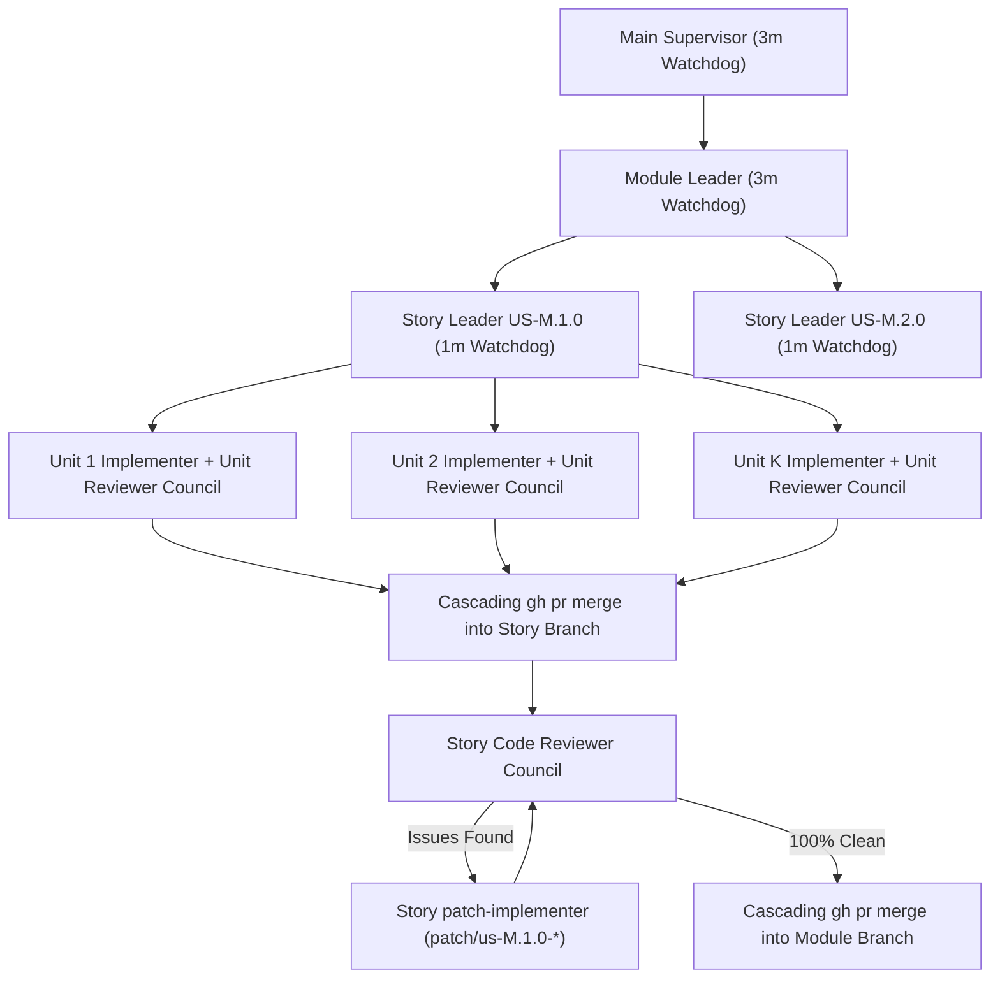

# Divide-and-Conquer Multi-Agent Orchestrator Skill

Use this skill to execute a decomposed software roadmap with maximum parallelism, strict hierarchical delegation, and zero merge conflicts.

---

## 1. Pre-Start Checklist (Mandatory)

1. **Run Gate 0 (`preflight-git-gh`)**:
   ```bash
   ${CLAUDE_PLUGIN_ROOT:-${ANTIGRAVITY_PLUGIN_ROOT:-.}}/scripts/preflight-check.sh
   ```
2. **Reconcile Existing State (Zero Duplication)**:
   - Inspect `.agents/checkpoints/<module-id>/checkpoint.json`, `git worktree list`, `git branch -a`, and `gh pr list --state all`.
   - Never re-spawn agents for units or stories that are already `merged` or have an active subagent running.
3. **Ensure `quota-sentinel` Is Active**:
   - Spawn the `quota-sentinel` subagent once per session to monitor single-profile token velocity and rate limits (`429` / `RESOURCE_EXHAUSTED` / 1% remaining quota).

---

## 2. Three-Tier Leadership & Parallel Spawning Protocol



### Strict Role Boundaries
- **Module Leader**:
  - Provisions `feat/module-M-<slug>` worktree via `Git Workflow Master`.
  - **Immediately spawns all User Story Leaders in Step 1** (zero idle monologue).
  - Schedules a 3-minute supervision cron (`*/3 * * * *`).
  - **NEVER spawns Unit Implementers directly.**
- **User Story Leader**:
  - Provisions `feat/us-M.S.0-<slug>` and all $K$ unit worktrees (`feat/us-M.S.0/unit-1..K-<scope>`) via `Git Workflow Master`.
  - **Immediately spawns all $K$ Unit Implementers in parallel in Step 1.**
  - Schedules a 1-minute supervision cron (`* * * * *`).
- **Unit Implementer (`unit-1..K`)**:
  - Works exclusively inside `.worktrees/feat-us-M.S.0-unit-N-<scope>`.
  - Implements its assigned vertical slice and unit tests.
  - Invokes its own independent **Code Reviewing Council** in parallel.
  - Self-corrects any flagged issues or cyclomatic complexity ($CC > 10$) until its Code Reviewer gives 100% clean sign-off.

---

## 3. Streaming PR Pipeline & Ordered Cascading Merge Queue

1. **Immediate PR Creation**:
   - As soon as any Unit $i \in \{1..K\}$ finishes implementation and passes local tests, `Git Workflow Master` commits, pushes (`git push -u origin feat/us-M.S.0/unit-i-<scope>`), opens its GitHub PR (`gh pr create` titled `feat(us-M.S.0/unit-i): <summary>`), and posts the **Implementation Report** directly to the PR conversation (`gh pr comment`).
   - Simultaneously, the GitHub Projects Kanban item moves to **`In Review / PR Open`**.
2. **Parallel Multi-Council Review**:
   - Each open Unit PR is audited by its own `Code Reviewer` council in parallel. The Council posts its **Security Audit & Cyclomatic Complexity Report** and **`### Gate G-Review Approval`** directly into the PR conversation.
3. **Ordered Cascading Merge ($1 \to 2 \to \dots \to K$)**:
   - Unit 1 merges into `feat/us-M.S.0-<slug>` via `gh pr merge <PR> --merge`.
   - Unit 2 pulls/rebases the updated `feat/us-M.S.0-<slug>`, re-runs verification tests to confirm clean integration, and merges via `gh pr merge <PR> --merge`.
   - Units $3..K$ follow the same cascading promotion sequence.
   - After each merge, `Git Workflow Master` updates `.agents/checkpoints/<module-id>/checkpoint.json` and moves the GitHub Projects Kanban card to **`Merged`**.

---

## 4. Story & Module Promotion with Mandatory `patch-implementer`

1. **Story Promotion (`feat/us-M.S.0-<slug>` $\to$ `feat/module-M-<slug>`)**:
   - Once all $K$ units are merged into the story branch, the Story Leader runs story-wide integration tests, opens the Story PR (`feat(us-M.S.0): <title> (Units 1..K Promotion)`), posts the Story Implementation Report to the PR conversation, and invokes an independent Story-level **Code Reviewing Council**.
   - **If ANY issue is flagged**: The Story Leader **MUST NOT edit code directly**. It spawns a **`patch-implementer`** subagent on `patch/us-M.S.0-<scope>`, merges the reviewed patch PR into the story branch via `gh pr merge`, and re-invokes the Story Code Reviewing Council until 0 issues remain.
2. **Module Promotion (`feat/module-M-<slug>` $\to$ `main`)**:
   - Once all User Stories merge into the module branch, the Module Leader opens the Module PR (`feat(module-M): <title>`), posts the Module Implementation Report to the PR conversation, and invokes a Module-level **Code Reviewing Council**.
   - Any findings trigger a dedicated **`patch-implementer`** on `patch/module-M-<scope>` until 100% clean sign-off is achieved.
3. **End-of-Module Whole-Codebase Validation**:
   - After the Module PR merges into `main`, the Main Supervisor runs the full repository test suite, linter, formatter, and doctests, and invokes a Whole-Codebase Gatekeeper Council across Modules $1..M$.
