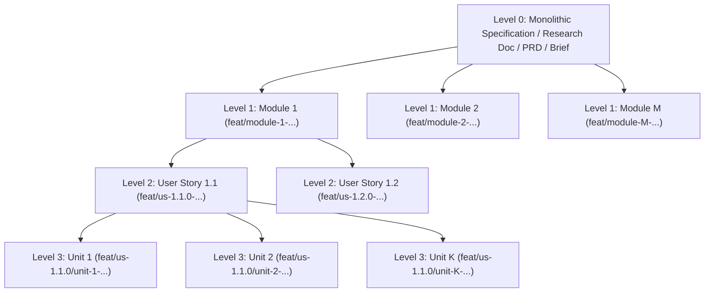

# Monolithic Specification Decomposition Skill

Use this skill whenever the user provides a monolithic specification, architecture RFC, product requirements document (PRD), financial model, marketing campaign brief, healthcare protocol, GIS pipeline, or research document and wants to build it using the **Divide-and-Conquer** workflow.

If `.agents/field-profile.json` exists in the workspace (or `--field <FIELD_PROFILE>` is passed), load the active field's sizing rubric from `profiles/fields.json` (default: `software`).

---

## 1. Four-Level Decomposition Hierarchy

### Level Definitions
1. **Level 1 — Modules (`module-1..M`)**:
   - **Scope**: Major architectural subsystems, domain bounded contexts, or workstreams (e.g., Core Runtime, Authentication, Billing Engine, Research Methodology, Campaign Funnel, Financial Statements).
   - **Rule**: Modules may have sequential phase dependencies or run in parallel if decoupled.
2. **Level 2 — User Stories / Deliverables (`us-M.1.0..us-M.S.0`)**:
   - **Scope**: Cohesive end-to-end feature or domain deliverables within a Module (typically 2 to 4 Stories per Module).
   - **Rule**: User Stories within a Module execute in parallel inside isolated `.worktrees/`.
3. **Level 3 — Implementation / Execution Units (`unit-1..K`)**:
   - **Scope**: Self-contained vertical deliverable slices within a User Story.
   - **Rule**: Every unit is a **pure deliverable production slice** (code + unit tests in software; drafted sections, models, or campaign assets + self-checks in non-software), and **all $K$ units run 100% in parallel without blocking one another**.

---

## 2. Dynamic Implementation Unit Sizing Matrix ($K \in [1, N]$)

> [!IMPORTANT]
> **Units Do NOT Have to Be 5**: Never force a User Story into an arbitrary 5-unit template if the story naturally decomposes into 2, 3, 4, 6, or 8 units. Always calculate the **Story Decomposition Score ($S_{\text{story}}$)** using the field-adapted matrix below to choose the exact number of units $K$.

### Step 2.1: Score the User Story Across 4 Dimensions ($D_1..D_4$)
Includes both **Code Metrics (`--field software|game-dev`)** and **Deliverable/Knowledge Metrics (`--field product|marketing|finance|research|healthcare|gis`)**:

| Dimension | Weight | Score = `1` | Score = `2` | Score = `3` | Score = `4` |
| :--- | :---: | :--- | :--- | :--- | :--- |
| **$D_1$: Functional / Deliverable Surface** *(endpoints/components or document sections/channels/models/hypotheses)* | **35%** | 1–2 distinct items | 3–4 distinct items | 5–6 distinct items | 7+ distinct items |
| **$D_2$: Artifact Volume** *(Production LOC or words/sheets/assets)* | **25%** | $< 300$ LOC *(or $< 1,000$ words / 1–2 sheets)* | $300 - 700$ LOC *(or $1,000 - 2,500$ words / 3–4 sheets)* | $700 - 1,400$ LOC *(or $2,500 - 5,000$ words / 5–6 sheets)* | $> 1,400$ LOC *(or $> 5,000$ words / 7+ sheets)* |
| **$D_3$: Logic / Analytical Complexity** *(Algorithmic or analytical/regulatory modeling)* | **20%** | Simple CRUD / static UI / narrative summary | Validation / state machine / structured synthesis | Crypto / streaming / dual-protocol / multi-scenario sensitivity | Concurrency / distributed consensus / multi-variable statistical or regulatory modeling |
| **$D_4$: Orthogonal File Boundaries** *(Independent files/modules/chapters)* | **20%** | 1–2 files/modules/chapters | 3–4 independent files/modules/chapters | 5–6 independent files/modules/chapters | 7+ independent files/modules/chapters |

Compute the weighted score:
$$S_{\text{story}} = (0.35 \times D_1) + (0.25 \times D_2) + (0.20 \times D_3) + (0.20 \times D_4)$$

### Step 2.2: Field-Specific $D_1$ & $D_2$ Reference Presets (`profiles/fields.json`)

| `--field` Flag | Auto-Enabled Divisions | $D_1$ (35% Surface) & $D_2$ (25% Volume) |
| :--- | :--- | :--- |
| **`software`** *(default)* | `engineering,security,testing` | **$D_1$**: Entities/endpoints; **$D_2$**: Production LOC (under 300 to over 1,400) |
| **`product`** | `product,design,project-management,research` | **$D_1$**: User flows/personas/screens; **$D_2$**: Spec depth (under 800 to over 4,000 words) |
| **`marketing`** | `marketing,paid-media,sales,design` | **$D_1$**: Channels/funnels/creatives; **$D_2$**: Asset count & copy volume |
| **`finance`** | `finance,specialized,support` | **$D_1$**: Models/statements/scenarios; **$D_2$**: Schedules, formulas & sensitivity tables |
| **`research`** | `academic,research,specialized` | **$D_1$**: Hypotheses/sections/datasets; **$D_2$**: Word count & citation density |
| **`healthcare`** | `healthcare,security,academic,support` | **$D_1$**: Clinical pathways/protocols; **$D_2$**: Evidence tables & regulatory modules |
| **`game-dev`** | `game-development,spatial-computing,design,testing` | **$D_1$**: Mechanics/systems/shaders/levels; **$D_2$**: Script LOC or scene asset count |
| **`gis`** | `gis,engineering,testing` | **$D_1$**: Layers/pipelines/projections; **$D_2$**: Spatial scripts & dataset schemas |

### Step 2.3: Map $S_{\text{story}}$ to Implementation Unit Count ($K$)

| Weighted Score ($S_{\text{story}}$) | Unit Count ($K$) | Sizing Rationale & Target Slice Size |
| :---: | :---: | :--- |
| **$1.00 - 1.25$** | **1–2 Units** | Micro-story: 1–2 small components ($150-250$ LOC or $400-800$ words per unit). Over-splitting would create trivial files. |
| **$1.26 - 2.00$** | **3 Units** | Compact story: 3 orthogonal slices (e.g., Entity Models, Service Operations, Event/Webhook Handler; or Literature, Methodology, Results). |
| **$2.01 - 2.55$** | **4 Units** | Medium story: 4 independent domain/deliverable slices ($200-350$ LOC or $800-1,200$ words per unit). |
| **$2.56 - 3.10$** | **5 Units** | Standard rich story: 5 vertical slices covering full domain, operations, streaming/pagination or multi-scenario analysis, and edge cases. |
| **$3.11 - 3.55$** | **6–7 Units** | Large story: 6–7 parallel slices across a wide API, UI, research, or modeling surface. |
| **$3.56 - 4.00$** | **8+ Units (or Split Story)** | Mega-story: Either partition into 8 orthogonal units or split into two separate User Stories (`us-M.S.0` and `us-M.(S+1).0`). |

---

## 3. Hard Invariants for Implementation Units

### Invariant A: Pure Deliverable Production Only (Zero Validation-Only Units)
- **Every unit $1..K$ MUST produce real primary artifacts** (production source code + unit tests in `--field software|game-dev`; drafted sections, financial models, protocols, spatial layers, or campaign assets + self-checks in non-software fields).
- **STRICTLY PROHIBITED**: Creating a blocking "review-only" or "validation-only" unit whose job is *"Unit $K$: Write integration tests / contract tests / peer review / benchmarks for Units $1..(K-1)$"*.
- **Why**: A validation-only unit cannot run until Units $1..(K-1)$ finish, turning a parallel pipeline into a sequential bottleneck. Story-wide integration and cross-unit verification belong to the **Story Leader** after all $K$ units merge into the story branch.

### Invariant B: Zero Inter-Unit Blocking (100% Parallel Execution)
- Units $1..K$ MUST NOT depend on unmerged artifacts from sibling units.
- **How to Achieve Zero Blocking**:
  1. **Disjoint File/Module Ownership**: Assign each unit its own dedicated files, submodules, or chapters (e.g., `unit-1` owns `customer.rs` or `01-revenue-schedule.md`, `unit-2` owns `subscription.rs` or `02-expense-model.md`).
  2. **Story Base Contract Seeding**: If units share a common trait, interface, schema, glossary, or base DTO, define that minimal stub/schema on the story branch (`feat/us-M.S.0-<slug>`) *before* branching `unit-1..K`.
  3. **Independent Verification**: Each unit's worktree MUST compile/validate and pass its unit checks independently without waiting for any sibling unit.

---

## 4. Decomposition Output Artifact & GitHub Projects Sync

After decomposing the monolithic spec:
1. Create the decomposition roadmap document (e.g., `docs/architecture/DECOMPOSITION_ROADMAP.md`) listing the active `--field` profile, every Module, User Story, its calculated $S_{\text{story}}$ score, chosen unit count $K$, and the exact file ownership boundary of each Unit $1..K$.
2. Run `${CLAUDE_PLUGIN_ROOT:-${ANTIGRAVITY_PLUGIN_ROOT:-.}}/scripts/gh-kanban-sync.sh init` to populate all Modules, User Stories, and Implementation Units on the **GitHub Projects Kanban board** and initialize `.agents/checkpoints/<module-id>/checkpoint.json`.
