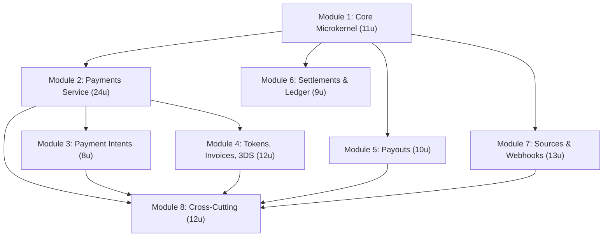

# some-moyasar — Decomposition Roadmap

**Generated by:** `spec-decomposition` skill (some-divide-and-conquer)  
**Active Field Profile:** `software` (`engineering,security,testing`)  
**Source Specification:** `docs/Moyasar Rust SDK Research.md` (678 lines, 37 Moyasar API endpoints, 9 service domains)  
**Schema Version:** 1.1.0

---

## Decomposition Summary

| Level | Count | Branch Naming Convention |
| :--- | :---: | :--- |
| **Modules** | **8** | `feat/module-M-<slug>` |
| **User Stories** | **23** | `feat/us-M.S.0-<slug>` |
| **Implementation Units (total)** | **99** | `feat/us-M.S.0/unit-N-<scope>` |
| **Units per story (range)** | 2 – 7 | Calculated via $S_{\text{story}}$ weighted matrix |

---

## Module 1: Core Microkernel & Transport Layer

**Feature flag:** `core` (always enabled)  
**Branch:** `feat/module-1-core-microkernel`  
**Domain:** `MoyasarClient`, HTTP Basic Auth, compile-time key-type isolation (`SecretKey` vs `PublishableKey`), body-injected `given_id` idempotency, validated `Metadata`, `MoyasarError` pipeline, paginated-list primitives, base `Amount`/`Currency` types.

### Story 1.1 — HTTP Client, Connection Pool & Authentication
**Branch:** `feat/us-1.1.0-http-client-auth`  
**Domain:** `MoyasarClient` builder, reqwest connection pool, timeout/retry config, `SecretKey`/`PublishableKey` newtypes with `secrecy::SecretString` + `ZeroizeOnDrop`, HTTP Basic Auth header encoder.

| Dimension | Score | Rationale |
| :--- | :---: | :--- |
| $D_1$ Surface | 2 | `client.rs` + `auth.rs` (2 distinct types) |
| $D_2$ Volume | 2 | ~400 LOC |
| $D_3$ Complexity | 2 | Validation / key-type parsing |
| $D_4$ Orthogonality | 2 | 2 independent files |

$$S_{\text{1.1}} = 0.35\cdot 2 + 0.25\cdot 2 + 0.20\cdot 2 + 0.20\cdot 2 = \textbf{2.00}$$

| Result | $K$ Units |
| :--- | :---: |
| **Score 2.00 → 3 units** | **3** |

| Unit | Branch | Owner Files | Deliverables |
| :--- | :--- | :--- | :--- |
| Unit 1 | `feat/us-1.1.0/unit-1-key-types` | `src/kernel/auth.rs` | `SecretKey` (`sk_test_`/`sk_live_`), `PublishableKey` (`pk_test_`/`pk_live_`), `ZeroizeOnDrop`, parsing validation, unit tests |
| Unit 2 | `feat/us-1.1.0/unit-2-http-client` | `src/kernel/client.rs` | `MoyasarClient::builder()`, reqwest `Client` pool, base URL, default/configured headers, `max_network_retries`, `build()?` |
| Unit 3 | `feat/us-1.1.0/unit-3-auth-encoding` | `src/kernel/transport.rs` | `TryFrom<&SecretKey>` / `TryFrom<&PublishableKey>` for `HeaderValue`, `Authorization: Basic base64("{key}:")` encoding, retry/timeout transport adapter, doc-tests |

---

### Story 1.2 — Idempotency, Metadata & Pagination Primitives
**Branch:** `feat/us-1.2.0-idempotency-metadata-pagination`  
**Domain:** `GivenIdPolicy` (UUIDv4 auto-generation, UUIDv5 deterministic hashing for subscription cycles), validated `Metadata` map (≤30 keys, key ≤40 chars, value ≤500 chars, empty-string unset), `PaginatedList<T>` + `Meta`.

| Dimension | Score | Rationale |
| :--- | :---: | :--- |
| $D_1$ Surface | 3 | idempotency, metadata, pagination (3 items) |
| $D_2$ Volume | 2 | ~550 LOC |
| $D_3$ Complexity | 3 | UUID hashing / validation / query-string |
| $D_4$ Orthogonality | 3 | `idempotency.rs`, `metadata.rs`, `pagination.rs` |

$$S_{\text{1.2}} = 0.35\cdot 3 + 0.25\cdot 2 + 0.20\cdot 3 + 0.20\cdot 3 = \textbf{2.75}$$

| Result | $K$ Units |
| :--- | :---: |
| **Score 2.75 → 5 units** | **5** |

| Unit | Branch | Owner Files | Deliverables |
| :--- | :--- | :--- | :--- |
| Unit 1 | `feat/us-1.2.0/unit-1-given-id-policy` | `src/kernel/idempotency.rs` | `GivenIdPolicy` enum (Random/Deterministic), UUIDv4 generation, `given_id` injection into JSON bodies |
| Unit 2 | `feat/us-1.2.0/unit-2-uuidv5-hashing` | `src/kernel/idempotency_v5.rs` | `Uuid::new_v5(&NAMESPACE, "{sub_id}:{cycle_index}")` deterministic derivation for subscription billing, roundtrip tests |
| Unit 3 | `feat/us-1.2.0/unit-3-metadata` | `src/kernel/metadata.rs` | `Metadata` map: `insert`/`remove`/`get`, validation on key count/length/value, empty-string key unset, unit tests for boundary conditions |
| Unit 4 | `feat/us-1.2.0/unit-4-pagination-types` | `src/kernel/pagination.rs` | `PaginatedList<T>`, `Meta` struct (current_page, next_page, prev_page, total_pages, total_count), `Deserialize` |
| Unit 5 | `feat/us-1.2.0/unit-5-pagination-stream` | `src/kernel/paginator_stream.rs` | `Paginator<T>::into_stream()` with `futures::Stream`, auto-page following next_page, unit tests covering 1-page and multi-page responses |

---

### Story 1.3 — Error Pipeline, Currency Types & Prelude
**Branch:** `feat/us-1.3.0-error-types-prelude`  
**Domain:** `MoyasarError` enum, `ApiErrorType` (invalid_request, authentication_error, api_error, record_not_found, intent_not_cancelable), field-level error arrays, ISO 8583 2-digit `ResponseCode`, `Amount` (smallest-unit integer), `Currency` enum, `prelude::*`.

| Dimension | Score | Rationale |
| :--- | :---: | :--- |
| $D_1$ Surface | 2 | error, amount/currency types |
| $D_2$ Volume | 2 | ~350 LOC |
| $D_3$ Complexity | 2 | Validation / enum mapping |
| $D_4$ Orthogonality | 2 | `error.rs`, `types.rs` |

$$S_{\text{1.3}} = 0.35\cdot 2 + 0.25\cdot 2 + 0.20\cdot 2 + 0.20\cdot 2 = \textbf{2.00}$$

| Result | $K$ Units |
| :--- | :---: |
| **Score 2.00 → 3 units** | **3** |

| Unit | Branch | Owner Files | Deliverables |
| :--- | :--- | :--- | :--- |
| Unit 1 | `feat/us-1.3.0/unit-1-error-enum` | `src/kernel/error.rs` | `MoyasarError` enum, `ApiErrorType`, `thiserror` derive, `From<reqwest::Error>`, `Deserialize` for error payloads |
| Unit 2 | `feat/us-1.3.0/unit-2-field-errors` | `src/kernel/response_code.rs` | `FieldError` dual map/array deserializer, `ResponseCode` ISO 8583 lookup table with custom `Unknown(String)` deserializer, `Display` impl |
| Unit 3 | `feat/us-1.3.0/unit-3-currency-prelude` | `src/kernel/types.rs` + `src/prelude.rs` | `Amount` newtype, `Currency` enum (SAR, USD, KWD, JPY, …), `RecipientType` enum, `prelude` module exporting all core types |

---

## Module 2: Payments Service — CRUD, Lifecycle & Sources

**Feature flag:** `payments` (default on)  
**Branch:** `feat/module-2-payments-service`  
**Depends on:** Module 1 (Core)  
**Domain:** Full `/v1/payments` API: create, retrieve, list, update, refund, capture, void; polymorphic payment sources (credit card, Apple Pay, Samsung Pay, STC Pay, SADAD Bill, saved token); marketplace payment splits; Account Funding Transactions sender.

### Story 2.1 — Payment Create, Retrieve & List
**Branch:** `feat/us-2.1.0-payment-create-retrieve-list`  
**Domain:** `CreatePaymentParams` builder, `POST /v1/payments`, `GET /v1/payments/:id`, `GET /v1/payments` with filters (page, id, status, created[gt/lt], metadata[key]).

| Dimension | Score | Rationale |
| :--- | :---: | :--- |
| $D_1$ Surface | 3 | create, retrieve, list (3 endpoints) |
| $D_2$ Volume | 3 | ~750 LOC |
| $D_3$ Complexity | 3 | Polymorphic sources + filtering |
| $D_4$ Orthogonality | 2 | `payments.rs` + `params.rs` |

$$S_{\text{2.1}} = 0.35\cdot 3 + 0.25\cdot 3 + 0.20\cdot 3 + 0.20\cdot 2 = \textbf{2.80}$$

| Result | $K$ Units |
| :--- | :---: |
| **Score 2.80 → 5 units** | **5** |

| Unit | Branch | Owner Files | Deliverables |
| :--- | :--- | :--- | :--- |
| Unit 1 | `feat/us-2.1.0/unit-1-payment-model` | `src/resources/payments/models.rs` | `Payment` struct (all fields: id, amount, amount_format, fee, fee_format, status, source, metadata, splits, timestamps, callback_url, invoice_id, ip) |
| Unit 2 | `feat/us-2.1.0/unit-2-create-params` | `src/resources/payments/params.rs` | `CreatePaymentParams::builder()` (amount, currency, description, callback_url, given_id, source, metadata, splits, sender), `Serialize` |
| Unit 3 | `feat/us-2.1.0/unit-3-create-endpoint` | `src/resources/payments/create.rs` | `client.payments().create(params)`, `given_id` injection, response deserialization, wire tests with mock |
| Unit 4 | `feat/us-2.1.0/unit-4-retrieve-endpoint` | `src/resources/payments/retrieve.rs` | `client.payments().retrieve(id)` / `.fetch(id)`, `PaymentId` newtype, 404 → record_not_found |
| Unit 5 | `feat/us-2.1.0/unit-5-list-endpoint` | `src/resources/payments/list.rs` | `client.payments().list(ListParams)`, query param serialization (page, id, status, created[gt/lt], metadata[key]), return `PaginatedList<Payment>` |

---

### Story 2.2 — Payment Update, Capture, Void & Refund
**Branch:** `feat/us-2.2.0-payment-lifecycle-operations`  
**Domain:** `PUT /v1/payments/:id` (update description/metadata), `POST /:id/capture`, `POST /:id/void` (~2-hour unsettled window), `POST /:id/refund` (full/partial), smart void-vs-refund routing.

| Dimension | Score | Rationale |
| :--- | :---: | :--- |
| $D_1$ Surface | 4 | update, capture, void, refund (4 operations) |
| $D_2$ Volume | 2 | ~500 LOC |
| $D_3$ Complexity | 3 | Settlement-window state machine, void-fallback-to-refund |
| $D_4$ Orthogonality | 2 | `lifecycle.rs`, `refund.rs` |

$$S_{\text{2.2}} = 0.35\cdot 4 + 0.25\cdot 2 + 0.20\cdot 3 + 0.20\cdot 2 = \textbf{2.90}$$

| Result | $K$ Units |
| :--- | :---: |
| **Score 2.90 → 5 units** | **5** |

| Unit | Branch | Owner Files | Deliverables |
| :--- | :--- | :--- | :--- |
| Unit 1 | `feat/us-2.2.0/unit-1-update` | `src/resources/payments/update.rs` | `client.payments().update(id, params)`, description + metadata mutation, empty-string metadata unset |
| Unit 2 | `feat/us-2.2.0/unit-2-capture` | `src/resources/payments/capture.rs` | `client.payments().capture(id, amount_opt)`, full/partial capture of authorized holds, status → captured |
| Unit 3 | `feat/us-2.2.0/unit-3-void` | `src/resources/payments/void.rs` | `client.payments().void(id)`, 2-hour unsettled-window guard, status transitions (authorized/paid/captured → voided) |
| Unit 4 | `feat/us-2.2.0/unit-4-refund` | `src/resources/payments/refund.rs` | `client.payments().refund(id, amount_opt)`, full refund (omit body) vs partial (amount in body), status → refunded |
| Unit 5 | `feat/us-2.2.0/unit-5-smart-void-refund` | `src/resources/payments/smart_void.rs` | `VoidOrRefund` strategy: try void first if within ~2h, else refund; 14-day Mada capture/void window; unit tests for each transition |

---

### Story 2.3 — Polymorphic Payment Sources — Request Types
**Branch:** `feat/us-2.3.0-source-request-types`  
**Domain:** `PaymentSourceRequest` tagged enum (`#[serde(tag = "type")]`) with credit card, Apple Pay, Samsung Pay, and saved token variants.

| Dimension | Score | Rationale |
| :--- | :---: | :--- |
| $D_1$ Surface | 4 | creditcard, applepay, samsungpay, token (4 source types) |
| $D_2$ Volume | 3 | ~700 LOC |
| $D_3$ Complexity | 3 | Card validation (Luhn, expiry, cvc lengths), conditional serialization |
| $D_4$ Orthogonality | 2 | `sources.rs`, inline in `payments/` |

$$S_{\text{2.3}} = 0.35\cdot 4 + 0.25\cdot 3 + 0.20\cdot 3 + 0.20\cdot 2 = \textbf{3.15}$$

| Result | $K$ Units |
| :--- | :---: |
| **Score 3.15 → 6 units** | **6** |

| Unit | Branch | Owner Files | Deliverables |
| :--- | :--- | :--- | :--- |
| Unit 1 | `feat/us-2.3.0/unit-1-source-trait` | `src/resources/payments/source.rs` | `PaymentSourceRequest` tagged enum + `PaymentSourceResponse` tagged enum stubs, `Serialize`/`Deserialize` with `tag = "type"` |
| Unit 2 | `feat/us-2.3.0/unit-2-creditcard` | `src/resources/payments/source_card.rs` | `CreditCardSource`: name, number, month, year, cvc (3-4 digits), statement_descriptor, manual, save_card, 3ds, card_auth_id, card_auth_data |
| Unit 3 | `feat/us-2.3.0/unit-3-applepay-samsungpay` | `src/resources/payments/source_digital_wallet.rs` | `ApplePaySource`: token/cryptogram, manual, save_card, statement_descriptor. `SamsungPaySource`: mirrors with sp subtype |
| Unit 4 | `feat/us-2.3.0/unit-4-token-source` | `src/resources/payments/source_token.rs` | `TokenSource`: token string, optional 3ds/manual/cvc flags, SecretKey-based charging |
| Unit 5 | `feat/us-2.3.0/unit-5-card-validation` | `src/resources/payments/card_validation.rs` | Luhn checksum, expiry date validation (month 1-12, year ≥ current), cvc length by brand (3 for most, 4 for AMEX) |
| Unit 6 | `feat/us-2.3.0/unit-6-source-response-models` | `src/resources/payments/source_response.rs` | `PaymentSourceResponse` tagged enum, `CardSourceResponse`, `WalletSourceResponse`, `CardBrand`, plus roundtrip JSON serde unit tests |

---

### Story 2.4 — Polymorphic Payment Sources — STC Pay & SADAD Bill
**Branch:** `feat/us-2.4.0-source-stcpay-sadad`  
**Domain:** STC Pay OTP initiation (mobile formatting), SADAD Bill source (expired_at, biller_code, sadad_number). Both involve async lifecycle completion.

| Dimension | Score | Rationale |
| :--- | :---: | :--- |
| $D_1$ Surface | 2 | stcpay, sadadbill |
| $D_2$ Volume | 2 | ~400 LOC |
| $D_3$ Complexity | 3 | OTP state machine, SADAD async reconciliation |
| $D_4$ Orthogonality | 2 | `source_stcpay.rs`, `source_sadad.rs` |

$$S_{\text{2.4}} = 0.35\cdot 2 + 0.25\cdot 2 + 0.20\cdot 3 + 0.20\cdot 2 = \textbf{2.20}$$

| Result | $K$ Units |
| :--- | :---: |
| **Score 2.20 → 4 units** | **4** |

| Unit | Branch | Owner Files | Deliverables |
| :--- | :--- | :--- | :--- |
| Unit 1 | `feat/us-2.4.0/unit-1-stcpay-source` | `src/resources/payments/source_stcpay.rs` | `StcPaySource`: mobile (+966/05/00966 formats), cashier, branch. Mobile validation via regex |
| Unit 2 | `feat/us-2.4.0/unit-2-stcpay-otp` | `src/resources/payments/stcpay_otp.rs` | `client.payments().verify_stc_otp(url, otp)`, POST to `transaction_url`, otp_value injection, status: initiated → paid/failed |
| Unit 3 | `feat/us-2.4.0/unit-3-sadad-source` | `src/resources/payments/source_sadad.rs` | `SadadBillSource` request (`expired_at`, optional sandbox `biller_code`) and `SadadBillSourceResponse` (`biller_code` 901/902/007, `sadad_number`, `provider_name`) |
| Unit 4 | `feat/us-2.4.0/unit-4-sadad-expiry-guard` | `src/resources/payments/sadad_expiry.rs` | SADAD 29-day maximum expiry validator, invoice-expiry cap helper, and sandbox unit tests (STC Pay 0515555555/58/59, SADAD biller 007) |

---

### Story 2.5 — Marketplace Splits & Account Funding Transactions
**Branch:** `feat/us-2.5.0-marketplace-splits-aft`  
**Domain:** `splits` array on payment creation (`PaymentSplit`: amount, recipient_type Entity/Platform/Beneficiary, recipient_id UUID, fee_source, refundable), AFT `sender` object (first_name, last_name, identification keys).

| Dimension | Score | Rationale |
| :--- | :---: | :--- |
| $D_1$ Surface | 2 | splits, AFT sender |
| $D_2$ Volume | 2 | ~350 LOC |
| $D_3$ Complexity | 3 | Split validation (sum into amount), fee_source semantics, refundable cascade |
| $D_4$ Orthogonality | 2 | `splits.rs`, `aft.rs` |

$$S_{\text{2.5}} = 0.35\cdot 2 + 0.25\cdot 2 + 0.20\cdot 3 + 0.20\cdot 2 = \textbf{2.20}$$

| Result | $K$ Units |
| :--- | :---: |
| **Score 2.20 → 4 units** | **4** |

| Unit | Branch | Owner Files | Deliverables |
| :--- | :--- | :--- | :--- |
| Unit 1 | `feat/us-2.5.0/unit-1-split-types` | `src/resources/payments/splits.rs` | `PaymentSplitRequest`, `SplitRecipientType` enum (`Entity`, `Platform`, `Beneficiary`), `fee_source`/`refundable` defaults |
| Unit 2 | `feat/us-2.5.0/unit-2-split-validation` | `src/resources/payments/split_validation.rs` | `validate_splits` with `checked_add` sum guard (`sum <= total`), zero-amount guard, single `fee_source` check, unit tests |
| Unit 3 | `feat/us-2.5.0/unit-3-aft-sender` | `src/resources/payments/aft.rs` | `AftSender` struct (`first_name`, `last_name`, optional identification fields) and `AfTSender` alias |
| Unit 4 | `feat/us-2.5.0/unit-4-split-response-helpers` | `src/resources/payments/splits_response.rs` | `PaymentSplitResponse` struct, proportional refund cascade calculator, and 2-way split + AFT unit tests |

---

## Module 3: Payment Intents Service

**Feature flag:** `payment-intents` (default on)  
**Branch:** `feat/module-3-payment-intents`  
**Depends on:** Modules 1-2 (Core, Payments)  
**Domain:** `/v1/payment_intents` — create (backend locks amount/currency/description/callback_url), fulfill (browser/mobile with PublishableKey + client_secret), retrieve, cancel. 1-hour expiry window with `is_usable()` guards.

### Story 3.1 — Intent Create, Retrieve & Cancel
**Branch:** `feat/us-3.1.0-intent-create-retrieve-cancel`  
**Domain:** `CreatePaymentIntentParams`, `POST /v1/payment_intents`, `GET /v1/payment_intents/:id`, `POST /v1/payment_intents/:id/cancel`.

| Dimension | Score | Rationale |
| :--- | :---: | :--- |
| $D_1$ Surface | 3 | create, retrieve, cancel |
| $D_2$ Volume | 2 | ~450 LOC |
| $D_3$ Complexity | 2 | Simple CRUD + `intent_not_cancelable` |
| $D_4$ Orthogonality | 2 | `payment_intents.rs` |

$$S_{\text{3.1}} = 0.35\cdot 3 + 0.25\cdot 2 + 0.20\cdot 2 + 0.20\cdot 2 = \textbf{2.35}$$

| Result | $K$ Units |
| :--- | :---: |
| **Score 2.35 → 4 units** | **4** |

| Unit | Branch | Owner Files | Deliverables |
| :--- | :--- | :--- | :--- |
| Unit 1 | `feat/us-3.1.0/unit-1-intent-model` | `src/resources/payment_intents/models.rs` | `PaymentIntent` struct (id, amount, currency, description, callback_url, status, client_secret, expires_at, created_at), `PaymentIntentStatus` enum |
| Unit 2 | `feat/us-3.1.0/unit-2-create-cancel` | `src/resources/payment_intents/create.rs` | `CreatePaymentIntentParams`, `client.payment_intents().create()`, `client.payment_intents().cancel(id)` returning 400 on already cancelled/fulfilled/expired |
| Unit 3 | `feat/us-3.1.0/unit-3-expiry-guard` | `src/resources/payment_intents/expiry.rs` | `PaymentIntent::is_usable(&self) -> bool` — status==Created AND Utc::now() < expires_at. Document pitfalls: status stays "created" past expiry |
| Unit 4 | `feat/us-3.1.0/unit-4-retrieve-endpoint` | `src/resources/payment_intents/retrieve.rs` | `client.payment_intents().retrieve(id)` (`SecretKey` bound), `IntentId` newtype, 403/404 handling, unit tests |

---

### Story 3.2 — Intent Fulfillment & Browser PublishableKey Flow
**Branch:** `feat/us-3.2.0-intent-fulfill`  
**Domain:** `POST /v1/payment_intents/:id/fulfill` with PublishableKey, `client_secret` matching, locked parameter enforcement (amount/currency/description/callback_url cannot be altered), outcome tracking on the resulting Payment.

| Dimension | Score | Rationale |
| :--- | :---: | :--- |
| $D_1$ Surface | 2 | fulfill endpoint + resulting Payment tracking |
| $D_2$ Volume | 2 | ~350 LOC |
| $D_3$ Complexity | 3 | client_secret validation, locked params enforcement, fulfilled≠paid |
| $D_4$ Orthogonality | 2 | `fulfill.rs` |

$$S_{\text{3.2}} = 0.35\cdot 2 + 0.25\cdot 2 + 0.20\cdot 3 + 0.20\cdot 2 = \textbf{2.20}$$

| Result | $K$ Units |
| :--- | :---: |
| **Score 2.20 → 4 units** | **4** |

| Unit | Branch | Owner Files | Deliverables |
| :--- | :--- | :--- | :--- |
| Unit 1 | `feat/us-3.2.0/unit-1-fulfill-params` | `src/resources/payment_intents/fulfill_params.rs` | `FulfillIntentParams` (`client_secret` redacted in `Debug`, `source`, `metadata`, `save_card`, `manual`, `3ds`) |
| Unit 2 | `feat/us-3.2.0/unit-2-fulfill-endpoint` | `src/resources/payment_intents/fulfill.rs` | `client.payment_intents().fulfill(id, params)` (`PublishableKey` compatible), returning `Payment` |
| Unit 3 | `feat/us-3.2.0/unit-3-fulfill-lifecycle` | `src/resources/payment_intents/lifecycle.rs` | `FulfillmentOutcome` enum (`Paid`, `Authorized`, `RequiresAction`, `Failed`) derived from returned `Payment` (`fulfilled ≠ paid`) |
| Unit 4 | `feat/us-3.2.0/unit-4-fulfill-guard` | `src/resources/payment_intents/fulfill_guard.rs` | Pre-fulfillment `is_usable()` and `client_secret` format guard, locked-param schema assertions, and fulfillment unit tests |

---

## Module 4: Tokenization, Invoices & 3D Secure

**Feature flags:** `tokens`, `invoices`, `card-auth` (all opt-in)  
**Branch:** `feat/module-4-tokens-invoices-3ds`  
**Depends on:** Modules 1-2 (Core, Payments)  
**Domain:** Card tokenization (create/retrieve/delete, token lifecycle: initiated→active→inactive), hosted e-invoices (create, bulk, list, update, cancel via PUT), standalone 3D Secure 2.x card authentication with MPI cryptographic result extraction.

### Story 4.1 — Card Tokenization Service
**Branch:** `feat/us-4.1.0-card-tokens`  
**Domain:** `POST /v1/tokens` (create token with save_only or save_card integration), `GET /v1/tokens/:id`, `DELETE /v1/tokens/:id` (204 No Content).

| Dimension | Score | Rationale |
| :--- | :---: | :--- |
| $D_1$ Surface | 3 | create, retrieve, delete (3 endpoints) |
| $D_2$ Volume | 2 | ~400 LOC |
| $D_3$ Complexity | 2 | Token state machine (initiated→active→inactive) |
| $D_4$ Orthogonality | 2 | `tokens.rs` |

$$S_{\text{4.1}} = 0.35\cdot 3 + 0.25\cdot 2 + 0.20\cdot 2 + 0.20\cdot 2 = \textbf{2.35}$$

| Result | $K$ Units |
| :--- | :---: |
| **Score 2.35 → 4 units** | **4** |

| Unit | Branch | Owner Files | Deliverables |
| :--- | :--- | :--- | :--- |
| Unit 1 | `feat/us-4.1.0/unit-1-token-model` | `src/resources/tokens/models.rs` | `Token` struct (id: "token_...", status: initiated/active/inactive, masked card details), `TokenStatus` enum, `TokenId` newtype |
| Unit 2 | `feat/us-4.1.0/unit-2-token-create` | `src/resources/tokens/create.rs` | `CreateTokenParams`: name, number, month, year, cvc, callback_url, save_only. `client.tokens().create()`, PublishableKey-accepted |
| Unit 3 | `feat/us-4.1.0/unit-3-token-retrieve` | `src/resources/tokens/retrieve.rs` | `client.tokens().retrieve(id)` (`SecretKey` bound, returns masked card details for customer display), 404 mapping, unit tests |
| Unit 4 | `feat/us-4.1.0/unit-4-token-delete` | `src/resources/tokens/delete.rs` | `client.tokens().delete(id)` (`DELETE /v1/tokens/:id` 204 No Content empty-body handler), token status gate helpers, unit tests |

---

### Story 4.2 — Hosted E-Invoice Service
**Branch:** `feat/us-4.2.0-invoices`  
**Domain:** `POST /v1/invoices`, `POST /v1/invoices/bulk`, `GET /v1/invoices`, `GET /v1/invoices/:id`, `PUT /v1/invoices/:id`, `PUT /v1/invoices/:id/cancel`.

| Dimension | Score | Rationale |
| :--- | :---: | :--- |
| $D_1$ Surface | 4 | create, bulk, list, retrieve, update, cancel (6 endpoints) |
| $D_2$ Volume | 3 | ~650 LOC |
| $D_3$ Complexity | 2 | Simple CRUD + bulk creation |
| $D_4$ Orthogonality | 2 | `invoices.rs` |

$$S_{\text{4.2}} = 0.35\cdot 4 + 0.25\cdot 3 + 0.20\cdot 2 + 0.20\cdot 2 = \textbf{2.95}$$

| Result | $K$ Units |
| :--- | :---: |
| **Score 2.95 → 5 units** | **5** |

| Unit | Branch | Owner Files | Deliverables |
| :--- | :--- | :--- | :--- |
| Unit 1 | `feat/us-4.2.0/unit-1-invoice-model` | `src/resources/invoices/models.rs` | `Invoice` struct (id, amount, currency, description, callback_url, status, hosted payment url, expired_at, created_at, associated payments) |
| Unit 2 | `feat/us-4.2.0/unit-2-invoice-create` | `src/resources/invoices/create.rs` | `CreateInvoiceParams`, `client.invoices().create()`, `client.invoices().create_bulk(Vec<CreateInvoiceParams>)` |
| Unit 3 | `feat/us-4.2.0/unit-3-invoice-retrieve-list` | `src/resources/invoices/retrieve_list.rs` | `client.invoices().retrieve(id)`, `client.invoices().list(params)` with metadata/status/date filters, pagination |
| Unit 4 | `feat/us-4.2.0/unit-4-invoice-update` | `src/resources/invoices/update.rs` | `UpdateInvoiceParams` (`description`, `metadata`), `client.invoices().update(id, params)` (`PUT /v1/invoices/:id`), unit tests |
| Unit 5 | `feat/us-4.2.0/unit-5-invoice-cancel` | `src/resources/invoices/cancel.rs` | `client.invoices().cancel(id)` via `PUT /v1/invoices/:id/cancel`, SADAD bill expiry synchronization (`sync_sadad_expiry`), unit tests |

---

### Story 4.3 — Standalone 3D Secure Card Authentication
**Branch:** `feat/us-4.3.0-card-auth-3ds`  
**Domain:** `POST /v1/card_auths` (enterprise-only standalone 3DS 2.x authentication), `GET /v1/card_auths/:id` (MPI cryptographic result: eci, authentication_value, ds_transaction_id, version, transaction_status, auth_scheme, is_frictionless).

| Dimension | Score | Rationale |
| :--- | :---: | :--- |
| $D_1$ Surface | 2 | create, retrieve (2 endpoints) |
| $D_2$ Volume | 2 | ~300 LOC |
| $D_3$ Complexity | 2 | MPI result deserialization |
| $D_4$ Orthogonality | 1 | `card_auths.rs` (single file) |

$$S_{\text{4.3}} = 0.35\cdot 2 + 0.25\cdot 2 + 0.20\cdot 2 + 0.20\cdot 1 = \textbf{1.80}$$

| Result | $K$ Units |
| :--- | :---: |
| **Score 1.80 → 3 units** | **3** |

| Unit | Branch | Owner Files | Deliverables |
| :--- | :--- | :--- | :--- |
| Unit 1 | `feat/us-4.3.0/unit-1-card-auth-model` | `src/resources/card_auths/models.rs` | `CardAuthentication` struct (id: "ca_...", status: authenticated/failed, transaction_url, result fields) |
| Unit 2 | `feat/us-4.3.0/unit-2-card-auth-create` | `src/resources/card_auths/create.rs` | `CreateCardAuthParams`: amount, currency, callback_url, card details. `client.card_auths().create()` |
| Unit 3 | `feat/us-4.3.0/unit-3-card-auth-retrieve` | `src/resources/card_auths/retrieve.rs` | `client.card_auths().retrieve(id)`, MPI result extraction (`eci`, `authentication_value`, `ds_transaction_id`), `card_auth_id`/`card_auth_data` bridging to Payment create, unit tests |

---

## Module 5: Payouts & Payout Accounts

**Feature flag:** `payouts` (opt-in)  
**Branch:** `feat/module-5-payouts`  
**Depends on:** Module 1 (Core)  
**Domain:** `/v1/payout_accounts` (create, list, retrieve bank/wallet accounts), `/v1/payouts` (single & bulk disbursement across internal, ips, sarie channels), 20 regulated `PayoutPurpose` enum variants, `BankDestination` (IBAN) and `WalletDestination` (mobile) types.

### Story 5.1 — Payout Accounts Service
**Branch:** `feat/us-5.1.0-payout-accounts`  
**Domain:** `POST /v1/payout_accounts` (create bank or wallet source account), `GET /v1/payout_accounts`, `GET /v1/payout_accounts/:id`.

| Dimension | Score | Rationale |
| :--- | :---: | :--- |
| $D_1$ Surface | 3 | create, list, retrieve |
| $D_2$ Volume | 2 | ~350 LOC |
| $D_3$ Complexity | 2 | Account-type validation + credentials |
| $D_4$ Orthogonality | 2 | `payout_accounts.rs`, `payouts.rs` |

$$S_{\text{5.1}} = 0.35\cdot 3 + 0.25\cdot 2 + 0.20\cdot 2 + 0.20\cdot 2 = \textbf{2.35}$$

| Result | $K$ Units |
| :--- | :---: |
| **Score 2.35 → 4 units** | **4** |

| Unit | Branch | Owner Files | Deliverables |
| :--- | :--- | :--- | :--- |
| Unit 1 | `feat/us-5.1.0/unit-1-payout-account-model` | `src/resources/payouts/models.rs` | `PayoutAccount` struct (id, account_type bank/wallet, currency, properties, created_at), `PayoutAccountId` newtype |
| Unit 2 | `feat/us-5.1.0/unit-2-payout-account-create` | `src/resources/payouts/accounts_create.rs` | `CreatePayoutAccountParams` (account_type, properties like iban, credentials), `client.payout_accounts().create()` |
| Unit 3 | `feat/us-5.1.0/unit-3-payout-account-list` | `src/resources/payouts/accounts_list.rs` | `ListPayoutAccountsParams`, `client.payout_accounts().list(params)`, pagination unit tests |
| Unit 4 | `feat/us-5.1.0/unit-4-payout-account-retrieve` | `src/resources/payouts/accounts_retrieve.rs` | `client.payout_accounts().retrieve(id)`, Saudi IBAN validator (`validate_sa_iban`), unit tests |

---

### Story 5.2 — Single & Bulk Payouts with 20 Regulated Purpose Codes
**Branch:** `feat/us-5.2.0-payout-disbursements`  
**Domain:** `POST /v1/payouts`, `POST /v1/payouts/bulk`, `GET /v1/payouts`, `GET /v1/payouts/:id`. Compile-time enforced `PayoutPurpose` enum (20 values like bills_or_rent, payroll_benefits, payment_to_merchant, etc.), `BankDestination` (IBAN + name + mobile + country + city) and `WalletDestination` (mobile).

| Dimension | Score | Rationale |
| :--- | :---: | :--- |
| $D_1$ Surface | 4 | single, bulk, list, retrieve + 20 purpose codes |
| $D_2$ Volume | 3 | ~700 LOC |
| $D_3$ Complexity | 3 | Channel routing (internal/ips/sarie), destination validation, sequence numbering |
| $D_4$ Orthogonality | 3 | `payouts_create.rs`, `payouts_bulk.rs`, `payouts_list.rs`, `destinations.rs` |

$$S_{\text{5.2}} = 0.35\cdot 4 + 0.25\cdot 3 + 0.20\cdot 3 + 0.20\cdot 3 = \textbf{3.35}$$

| Result | $K$ Units |
| :--- | :---: |
| **Score 3.35 → 6 units** | **6** |

| Unit | Branch | Owner Files | Deliverables |
| :--- | :--- | :--- | :--- |
| Unit 1 | `feat/us-5.2.0/unit-1-payout-model` | `src/resources/payouts/payout_model.rs` | `Payout` struct (id, channel, status: queued/initiated/paid/failed/canceled/returned, amount, message, failure_reason), `PayoutStatus` enum, `PayoutId` newtype |
| Unit 2 | `feat/us-5.2.0/unit-2-purpose-codes` | `src/resources/payouts/purpose.rs` | `PayoutPurpose` enum — all 20 regulated values (bills_or_rent, payroll_benefits, payment_to_merchant, own_account_transfer, etc.), `Serialize`/`Deserialize`, doc comments per variant |
| Unit 3 | `feat/us-5.2.0/unit-3-destinations` | `src/resources/payouts/destinations.rs` | `PayoutDestination` enum: `BankDestination` (iban, name, mobile, country, city), `WalletDestination` (mobile), IBAN validation, mobile format validation |
| Unit 4 | `feat/us-5.2.0/unit-4-single-payout` | `src/resources/payouts/payouts_create.rs` | `CreatePayoutParams`: source_id, sequence_number (optional 16-digit), amount, purpose, destination, comment, metadata. `client.payouts().create()` |
| Unit 5 | `feat/us-5.2.0/unit-5-bulk-payout` | `src/resources/payouts/payouts_bulk.rs` | `CreateBulkPayoutParams`: source_id, payouts Vec<BulkPayoutEntry>. `client.payouts().create_bulk()`, `BulkPayoutResponse` |
| Unit 6 | `feat/us-5.2.0/unit-6-payout-list-retrieve` | `src/resources/payouts/payouts_list.rs` | `ListPayoutsParams`, `client.payouts().list(params)`, `client.payouts().retrieve(id)`, unit tests |

---

## Module 6: Settlements, Transfers & Ledger

**Feature flag:** `settlements` (opt-in)  
**Branch:** `feat/module-6-settlements-ledger`  
**Depends on:** Module 1 (Core)  
**Domain:** All read-only financial reconciliation endpoints: `/v1/settlements` (list, retrieve, lines, balance), `/v1/transfers` (list, retrieve, lines), `/v1/internal_transactions` (list). Multi-currency settlement lines with invoicing FX rates, CSV/PDF report URLs.

### Story 6.1 — Settlements Service
**Branch:** `feat/us-6.1.0-settlements`  
**Domain:** `GET /v1/settlements` (list with id/date filters), `GET /v1/settlements/:id`, `GET /v1/settlements/:id/lines`, `GET /v1/settlements/balance`.

| Dimension | Score | Rationale |
| :--- | :---: | :--- |
| $D_1$ Surface | 4 | list, retrieve, lines, balance (4 endpoints) |
| $D_2$ Volume | 2 | ~400 LOC |
| $D_3$ Complexity | 2 | Multi-currency + FX rate deserialization |
| $D_4$ Orthogonality | 2 | `settlements.rs` |

$$S_{\text{6.1}} = 0.35\cdot 4 + 0.25\cdot 2 + 0.20\cdot 2 + 0.20\cdot 2 = \textbf{2.70}$$

| Result | $K$ Units |
| :--- | :---: |
| **Score 2.70 → 5 units** | **5** |

| Unit | Branch | Owner Files | Deliverables |
| :--- | :--- | :--- | :--- |
| Unit 1 | `feat/us-6.1.0/unit-1-settlement-model` | `src/resources/settlements/models.rs` | `Settlement` struct (recipient_type, currency, source_currency, invoicing_currency, amount, fee, tax, invoicing_fee, invoicing_tax, invoicing_ex_rate, reference, settlement_count, invoice_url PDF, csv_list_url, pdf_list_url) |
| Unit 2 | `feat/us-6.1.0/unit-2-settlement-list` | `src/resources/settlements/list.rs` | `client.settlements().list(params)` with id/created[gt/lt]/page filters, pagination |
| Unit 3 | `feat/us-6.1.0/unit-3-settlement-retrieve` | `src/resources/settlements/retrieve.rs` | `client.settlements().retrieve(id)`, `Settlement::net()` breakdown helper, 404 mapping, unit tests |
| Unit 4 | `feat/us-6.1.0/unit-4-settlement-balance` | `src/resources/settlements/balance.rs` | `client.settlements().fetch_balance()`, `MerchantBalance` struct (available, pending, reserved amounts), unit tests |
| Unit 5 | `feat/us-6.1.0/unit-5-settlement-lines` | `src/resources/settlements/lines.rs` | `SettlementLine` struct, `ListSettlementLinesParams`, `client.settlements().list_lines(id, params)`, unit tests |

---

### Story 6.2 — Transfers & Internal Transactions Service
**Branch:** `feat/us-6.2.0-transfers-internal-txns`  
**Domain:** `GET /v1/transfers` (list, retrieve, lines), `GET /v1/internal_transactions` (list with id/currency/date filters).

| Dimension | Score | Rationale |
| :--- | :---: | :--- |
| $D_1$ Surface | 3 | transfers (3), internal_transactions (1) |
| $D_2$ Volume | 2 | ~350 LOC |
| $D_3$ Complexity | 2 | Aggregation transfer reconciliation |
| $D_4$ Orthogonality | 2 | `transfers.rs`, `internal_transactions.rs` |

$$S_{\text{6.2}} = 0.35\cdot 3 + 0.25\cdot 2 + 0.20\cdot 2 + 0.20\cdot 2 = \textbf{2.35}$$

| Result | $K$ Units |
| :--- | :---: |
| **Score 2.35 → 4 units** | **4** |

| Unit | Branch | Owner Files | Deliverables |
| :--- | :--- | :--- | :--- |
| Unit 1 | `feat/us-6.2.0/unit-1-transfer-models` | `src/resources/settlements/transfer_models.rs` | `Transfer` struct, `TransferLine` struct, `TransferId` newtype |
| Unit 2 | `feat/us-6.2.0/unit-2-transfer-endpoints` | `src/resources/settlements/transfers.rs` | `client.transfers().list()`, `client.transfers().retrieve(id)`, `client.transfers().list_lines(id, params)` |
| Unit 3 | `feat/us-6.2.0/unit-3-internal-txn-model` | `src/resources/settlements/internal_txn_models.rs` | `InternalTransaction` struct (recipient_type, recipient_id, amount, transfer_id, settled_at, metadata), `InternalTransactionId` newtype |
| Unit 4 | `feat/us-6.2.0/unit-4-internal-txn-endpoints` | `src/resources/settlements/internal_transactions.rs` | `ListInternalTransactionsParams`, `client.internal_transactions().list(params)` with id/currency/created_at/updated_at/settled_at filters, unit tests |

---

## Module 7: Sources, Apple Pay & Webhooks

**Feature flags:** `webhook-engine` (default on), `sources` (opt-in), `webhooks-api` (opt-in)  
**Branch:** `feat/module-7-sources-webhooks`  
**Depends on:** Module 1 (Core)  
**Domain:** Pre-charge BIN/IIN issuer lookup, Apple Pay Web Merchant session initiation, CRUD webhook endpoint management, delivery attempt inspection, and the constant-time webhook verification engine.

### Story 7.1 — BIN/IIN Issuer Lookup & Apple Pay Session
**Branch:** `feat/us-7.1.0-sources-applepay`  
**Domain:** `POST /v1/source/issuer` (BIN or full PAN → issuer metadata), `GET/POST /v1/applepay/initiate` (Apple Pay merchant session with merchantSessionIdentifier, nonce, signature).

| Dimension | Score | Rationale |
| :--- | :---: | :--- |
| $D_1$ Surface | 2 | issuer lookup, applepay session |
| $D_2$ Volume | 2 | ~350 LOC |
| $D_3$ Complexity | 2 | BIN parsing, merchant session signing |
| $D_4$ Orthogonality | 2 | `sources.rs`, `apple_pay.rs` |

$$S_{\text{7.1}} = 0.35\cdot 2 + 0.25\cdot 2 + 0.20\cdot 2 + 0.20\cdot 2 = \textbf{2.00}$$

| Result | $K$ Units |
| :--- | :---: |
| **Score 2.00 → 3 units** | **3** |

| Unit | Branch | Owner Files | Deliverables |
| :--- | :--- | :--- | :--- |
| Unit 1 | `feat/us-7.1.0/unit-1-issuer-lookup` | `src/resources/sources/issuer.rs` | `IssuerMetadata`: issuer_name, issuer_country, issuer_card_type (debit/credit/charge_card/unspecified), issuer_card_category, first_digits, last_digits. `client.sources().get_issuer(params)` |
| Unit 2 | `feat/us-7.1.0/unit-2-applepay-session` | `src/resources/sources/apple_pay.rs` | `ApplePayMerchantSession`: epochTimestamp, expiresAt, merchantSessionIdentifier, nonce, merchantIdentifier, domainName, displayName, signature, operationalAnalyticsIdentifier. `client.apple_pay().initiate_session(params)` |
| Unit 3 | `feat/us-7.1.0/unit-3-sources-service` | `src/resources/sources/service.rs` | `SourcesService` (`client.sources()`) and `ApplePayService` (`client.apple_pay()`) facades, publishable-key enforcement guard, unit tests |

---

### Story 7.2 — Webhooks Management API
**Branch:** `feat/us-7.2.0-webhooks-api`  
**Domain:** `POST /v1/webhooks` (register endpoint with shared_secret, events filter), `GET /v1/webhooks`, `GET /v1/webhooks/:id`, `DELETE /v1/webhooks/:id`, `GET /v1/webhooks/available_events`, `GET /v1/webhooks/attempts`, `GET /v1/webhooks/attempts/:id`.

| Dimension | Score | Rationale |
| :--- | :---: | :--- |
| $D_1$ Surface | 4 | create, list, retrieve, delete, available_events, attempts list, attempt retrieve (7 endpoints) |
| $D_2$ Volume | 2 | ~450 LOC |
| $D_3$ Complexity | 2 | Simple CRUD + events filter |
| $D_4$ Orthogonality | 2 | `webhooks_api.rs` |

$$S_{\text{7.2}} = 0.35\cdot 4 + 0.25\cdot 2 + 0.20\cdot 2 + 0.20\cdot 2 = \textbf{2.70}$$

| Result | $K$ Units |
| :--- | :---: |
| **Score 2.70 → 5 units** | **5** |

| Unit | Branch | Owner Files | Deliverables |
| :--- | :--- | :--- | :--- |
| Unit 1 | `feat/us-7.2.0/unit-1-webhook-model` | `src/resources/webhooks_api/models.rs` | `WebhookEndpoint` struct (id, http_method, url, shared_secret, events), `WebhookAttempt` struct (id, event_id, status_code, response_body, created_at) |
| Unit 2 | `feat/us-7.2.0/unit-2-webhook-create-list` | `src/resources/webhooks_api/crud.rs` | `CreateWebhookParams` (with `validate_https_url`), `client.webhooks().create()` (`POST /v1/webhooks` with `http_method`, `url`, `shared_secret`, `events`), `.list()`, unit tests |
| Unit 3 | `feat/us-7.2.0/unit-3-available-events` | `src/resources/webhooks_api/events.rs` | `client.webhooks().available_events()` (`GET /v1/webhooks/available_events`), re-exporting `WebhookEventType` (all 11 variants) from `webhook_engine` |
| Unit 4 | `feat/us-7.2.0/unit-4-delivery-attempts` | `src/resources/webhooks_api/attempts.rs` | `ListWebhookAttemptsParams`, `client.webhooks().list_attempts(params)`, `client.webhooks().retrieve_attempt(id)`, delivery attempt diagnostics |
| Unit 5 | `feat/us-7.2.0/unit-5-webhook-retrieve-delete` | `src/resources/webhooks_api/retrieve_delete.rs` | `client.webhooks().retrieve(id)` (`GET /v1/webhooks/:id`) and `client.webhooks().delete(id)` (`DELETE /v1/webhooks/:id`), unit tests |

---

### Story 7.3 — Constant-Time Webhook Verification Engine
**Branch:** `feat/us-7.3.0-webhook-engine`  
**Domain:** `ConstantTimeSecretVerifier` — double-HMAC-SHA256 + `subtle::ConstantTimeEq` verification, 4-hour timestamp tolerance for Moyasar's 3h41m retry schedule, `WebhookDeduplicator` trait (idempotent by event.id UUID), `payment_faild` alias deserialization, `SecretToken` redacted in Debug.

| Dimension | Score | Rationale |
| :--- | :---: | :--- |
| $D_1$ Surface | 3 | verifier, deduplicator, typed events |
| $D_2$ Volume | 2 | ~400 LOC |
| $D_3$ Complexity | 4 | Double-HMAC constant-time crypto, timestamp tolerance, replay protection |
| $D_4$ Orthogonality | 2 | `webhook_engine.rs` |

$$S_{\text{7.3}} = 0.35\cdot 3 + 0.25\cdot 2 + 0.20\cdot 4 + 0.20\cdot 2 = \textbf{2.75}$$

| Result | $K$ Units |
| :--- | :---: |
| **Score 2.75 → 5 units** | **5** |

| Unit | Branch | Owner Files | Deliverables |
| :--- | :--- | :--- | :--- |
| Unit 1 | `feat/us-7.3.0/unit-1-webhook-event-types` | `src/webhook_engine/event_types.rs` | `WebhookEventType` enum with `#[serde(rename = "payment_failed", alias = "payment_faild")]`, all 11 event variants, `WebhookEvent` struct (id, event_type, created_at, secret_token [Debug-redacted], account_name, live, data as Value) |
| Unit 2 | `feat/us-7.3.0/unit-2-constant-time-verifier` | `src/webhook_engine/verifier.rs` | `ConstantTimeSecretVerifier::new(shared_secret, tolerance)` — HMAC-SHA256 with domain-separation key "some-moyasar-webhook-domain-v1", 32-byte digest comparison via `subtle::ConstantTimeEq` |
| Unit 3 | `feat/us-7.3.0/unit-3-timestamp-validation` | `src/webhook_engine/timestamp.rs` | `REPLAY_TOLERANCE` (4h default for 3h41m retry ladder), `validate_timestamp_at(now, tolerance)` guarding against stale and future-skewed events |
| Unit 4 | `feat/us-7.3.0/unit-4-deduplication` | `src/webhook_engine/deduplication.rs` | `WebhookDeduplicator` trait (async, keyed by `event.id` UUID), `NoopDeduplicator` and `InMemoryDeduplicator`, integration point for Redis/PostgreSQL |
| Unit 5 | `feat/us-7.3.0/unit-5-webhook-payload-extractors` | `src/webhook_engine/payload.rs` | Typed `WebhookEvent` payload extractors (`into_payment()`, `into_card_auth()`) and cryptographic/replay-ladder unit tests |

---

## Module 8: Cross-Cutting — Stripe Compat, some-payment Trait & Test Fixtures

**Feature flags:** `stripe-compat`, `some-payments-trait` (alias `some-payment-trait`), `test-utils`, `async-stream` (all opt-in)  
**Branch:** `feat/module-8-cross-cutting`  
**Depends on:** Modules 1-7 (all prior modules)  
**Domain:** Stripe-parity compatibility layer (refunds, customers, subscriptions with pro-rata refunds), `some-payment` unified gateway trait adapter, auto-pagination `Stream`, and test-utils feature with deterministic mock fixtures.

### Story 8.1 — Stripe-Compat: Refunds & Customer Vault
**Branch:** `feat/us-8.1.0-stripe-compat-refunds-customers`  
**Domain:** Virtual `client.refunds()` service (wraps `POST /v1/payments/:id/refund`), `RefundReceipt` struct, `client.customers()` with pluggable `CustomerVault` trait (PostgreSQL/Redis/Moka).

| Dimension | Score | Rationale |
| :--- | :---: | :--- |
| $D_1$ Surface | 2 | refunds service, customer vault |
| $D_2$ Volume | 2 | ~400 LOC |
| $D_3$ Complexity | 3 | Status validation, vault abstraction |
| $D_4$ Orthogonality | 2 | `refunds.rs`, `customers.rs` |

$$S_{\text{8.1}} = 0.35\cdot 2 + 0.25\cdot 2 + 0.20\cdot 3 + 0.20\cdot 2 = \textbf{2.20}$$

| Result | $K$ Units |
| :--- | :---: |
| **Score 2.20 → 4 units** | **4** |

| Unit | Branch | Owner Files | Deliverables |
| :--- | :--- | :--- | :--- |
| Unit 1 | `feat/us-8.1.0/unit-1-refunds-service` | `src/stripe_compat/refunds.rs` | `RefundsService`, `RefundCreateParams` (payment_id, amount optional, prefer_void_if_unsettled), `RefundReceipt` (payment_id, refunded_amount, refunded_format, refunded_at, split_reversal_flags) |
| Unit 2 | `feat/us-8.1.0/unit-2-refund-strategy` | `src/stripe_compat/refund_strategy.rs` | Smart routing: void within 2h → POST /void, else → POST /refund, partial amounts always → refund. Unit tests per strategy branch |
| Unit 3 | `feat/us-8.1.0/unit-3-customer-vault` | `src/stripe_compat/customers.rs` | `CustomerVault` trait: `associate(customer_id, token_id)`, `resolve_tokens(customer_id) -> Vec<TokenId>`, `deactivate(token_id)`. `customer_id` injected into payment metadata |
| Unit 4 | `feat/us-8.1.0/unit-4-in-memory-customer-vault` | `src/stripe_compat/in_memory_vault.rs` | Thread-safe `InMemoryCustomerVault` reference implementation of `CustomerVault`, customer metadata injector, and refund/customer unit tests |

---

### Story 8.2 — Stripe-Compat: Subscriptions & Pro-Rata Refunds
**Branch:** `feat/us-8.2.0-stripe-compat-subscriptions`  
**Domain:** `client.subscriptions()` with deterministic UUIDv5 cycle idempotency, off-session token charging, `refund_cycle()` with exact pro-rata halala calculation and 2-hour unsettled void fallback.

| Dimension | Score | Rationale |
| :--- | :---: | :--- |
| $D_1$ Surface | 3 | subscription cycles, pro-rata refunds |
| $D_2$ Volume | 2 | ~450 LOC |
| $D_3$ Complexity | 3 | Pro-rata math, idempotent UUIDv5, void window |
| $D_4$ Orthogonality | 3 | `subscriptions_model.rs`, `subscriptions_billing.rs`, `pro_rata.rs`, `subscriptions_refund.rs`, `subscription_plan.rs` |

$$S_{\text{8.2}} = 0.35\cdot 3 + 0.25\cdot 2 + 0.20\cdot 3 + 0.20\cdot 3 = \textbf{2.75}$$

| Result | $K$ Units |
| :--- | :---: |
| **Score 2.75 → 5 units** | **5** |

| Unit | Branch | Owner Files | Deliverables |
| :--- | :--- | :--- | :--- |
| Unit 1 | `feat/us-8.2.0/unit-1-subscription-model` | `src/stripe_compat/subscriptions_model.rs` | `SubscriptionCycle`, `SubscriptionCycleId`, `Subscription`, `RefundStrategy` enum (Full, Partial, ProRata { canceled_at }) |
| Unit 2 | `feat/us-8.2.0/unit-2-subscription-billing` | `src/stripe_compat/subscriptions_billing.rs` | `client.subscriptions().charge_cycle(sub_id, cycle_index, amount, token_id)`, deterministic UUIDv5: `Uuid::new_v5(&NAMESPACE, "{sub_id}:{cycle_index}")`, token status check before charge |
| Unit 3 | `feat/us-8.2.0/unit-3-pro-rata-calculator` | `src/stripe_compat/pro_rata.rs` | `pro_rata_refund(amount, period_start, period_end, canceled_at) -> u64` — exact halala calculation: `ceil(amount * remaining / total)`, unit tests for 30-day, 365-day, leap-year periods |
| Unit 4 | `feat/us-8.2.0/unit-4-cycle-refund` | `src/stripe_compat/subscriptions_refund.rs` | `client.subscriptions().refund_cycle(params)`: locate cycle Payment, compute pro-rata, execute refund/void with smart routing, `SubscriptionCycleRefundResult` (action, amount, payment_id) |
| Unit 5 | `feat/us-8.2.0/unit-5-subscription-plan` | `src/stripe_compat/subscription_plan.rs` | `SubscriptionPlan`, `PlanInterval` (`Day`, `Week`, `Month`, `Year`), billing period boundary calculator (`next_period_bounds`), and subscription cycle unit tests |

---

### Story 8.3 — some-payment Trait Adapter & Test Fixtures
**Branch:** `feat/us-8.3.0-some-payment-trait-tests`  
**Domain:** `some-payment-trait` feature: implements `UnifiedPaymentGateway`, `WebhookVerifier`, `PayoutEngine` traits. `test-utils` feature: deterministic JSON fixture responders covering all 11 webhook events, STC Pay sandbox numbers, SADAD sandbox biller 007, and ISO 8583 response codes.

| Dimension | Score | Rationale |
| :--- | :---: | :--- |
| $D_1$ Surface | 2 | trait adapter + test fixtures |
| $D_2$ Volume | 2 | ~400 LOC |
| $D_3$ Complexity | 2 | Trait impl + mock responders |
| $D_4$ Orthogonality | 2 | `unified.rs`, `test_utils.rs` |

$$S_{\text{8.3}} = 0.35\cdot 2 + 0.25\cdot 2 + 0.20\cdot 2 + 0.20\cdot 2 = \textbf{2.00}$$

| Result | $K$ Units |
| :--- | :---: |
| **Score 2.00 → 3 units** | **3** |

| Unit | Branch | Owner Files | Deliverables |
| :--- | :--- | :--- | :--- |
| Unit 1 | `feat/us-8.3.0/unit-1-unified-trait` | `src/unified.rs` | `impl UnifiedPaymentGateway for MoyasarClient`: create_intent, charge_saved_token, refund_or_void, verify_webhook. Normalization: idempotency_key → given_id, webhook verification via ConstantTimeSecretVerifier |
| Unit 2 | `feat/us-8.3.0/unit-2-test-fixtures` | `src/test_utils/fixtures.rs` | Deterministic JSON fixtures: all 11 webhook event types (including payment_faild), STC Pay mock responses (0515555555, 0515555558, 0515555559), SADAD sandbox biller 007, ISO 8583 response codes |
| Unit 3 | `feat/us-8.3.0/unit-3-mock-responder` | `src/test_utils/mock.rs` | `MoyasarMockServer` local HTTP mock responder and route handlers under `test-utils` feature flag, conformance unit tests |

---

## Unit Count Summary

| Module | Story | $S_{\text{story}}$ | Units |
| :--- | :--- | :---: | :---: |
| 1: Core | 1.1 HTTP Client & Auth | 2.00 | 3 |
| 1: Core | 1.2 Idempotency, Metadata & Pagination | 2.75 | 5 |
| 1: Core | 1.3 Error Pipeline & Types | 2.00 | 3 |
| **Module 1 subtotal** | | | **11** |
| 2: Payments | 2.1 Create, Retrieve & List | 2.80 | 5 |
| 2: Payments | 2.2 Update, Capture, Void & Refund | 2.90 | 5 |
| 2: Payments | 2.3 Source Request Types | 3.15 | 6 |
| 2: Payments | 2.4 STC Pay & SADAD Bill | 2.20 | 4 |
| 2: Payments | 2.5 Marketplace Splits & AFT | 2.20 | 4 |
| **Module 2 subtotal** | | | **24** |
| 3: Payment Intents | 3.1 Create, Retrieve & Cancel | 2.35 | 4 |
| 3: Payment Intents | 3.2 Fulfillment & Browser Flow | 2.20 | 4 |
| **Module 3 subtotal** | | | **8** |
| 4: Tokens, Invoices, 3DS | 4.1 Card Tokenization | 2.35 | 4 |
| 4: Tokens, Invoices, 3DS | 4.2 Hosted E-Invoices | 2.95 | 5 |
| 4: Tokens, Invoices, 3DS | 4.3 3D Secure Card Auth | 1.80 | 3 |
| **Module 4 subtotal** | | | **12** |
| 5: Payouts | 5.1 Payout Accounts | 2.35 | 4 |
| 5: Payouts | 5.2 Single & Bulk Payouts | 3.35 | 6 |
| **Module 5 subtotal** | | | **10** |
| 6: Settlements & Ledger | 6.1 Settlements | 2.70 | 5 |
| 6: Settlements & Ledger | 6.2 Transfers & Internal Txns | 2.35 | 4 |
| **Module 6 subtotal** | | | **9** |
| 7: Sources & Webhooks | 7.1 BIN Lookup & Apple Pay | 2.00 | 3 |
| 7: Sources & Webhooks | 7.2 Webhooks Management API | 2.70 | 5 |
| 7: Sources & Webhooks | 7.3 Webhook Verification Engine | 2.75 | 5 |
| **Module 7 subtotal** | | | **13** |
| 8: Cross-Cutting | 8.1 Stripe-Compat Refunds & Customers | 2.20 | 4 |
| 8: Cross-Cutting | 8.2 Stripe-Compat Subscriptions | 2.75 | 5 |
| 8: Cross-Cutting | 8.3 some-payment Trait & Test Fixtures | 2.00 | 3 |
| **Module 8 subtotal** | | | **12** |
| **TOTAL** | **8 Modules, 23 Stories** | | **99 units** |

> **Note on unit count:** 99 is driven by the decomposition matrix — stories scoring in the 2.55–3.35 band (e.g., 1.2, 2.1–2.3, 4.2, 5.2, 6.1, 7.2–7.3, 8.2) produce 5-6 units each. Every unit yields real production code + unit tests; zero validation-only units per Invariant A.

---

## Module Dependency Graph & Execution Order

- **Phase 1 (Core Foundation):** M1 runs first (`US-1.3.0` error/currency types first, then `US-1.1.0` and `US-1.2.0` in parallel).
- **Phase 2 (Parallel Domain Wave 1 — 4 modules):** M2 (`US-2.3.0`, `US-2.4.0`, `US-2.5.0` source/split types first, then `US-2.1.0`, then `US-2.2.0`), M5 (`US-5.1.0` then `US-5.2.0`), M6 (`US-6.1.0` and `US-6.2.0` in parallel), and M7 (`US-7.1.0` and `US-7.3.0` in parallel, then `US-7.2.0`) fire simultaneously after M1 merges.
- **Phase 3 (Parallel Domain Wave 2 — 2 modules):** M3 (`US-3.1.0` then `US-3.2.0`) and M4 (`US-4.1.0`, `US-4.2.0`, `US-4.3.0` in parallel) fire simultaneously after M2 merges.
- **Phase 4 (Cross-Cutting Integration):** M8 (`US-8.1.0` then `US-8.2.0`, in parallel with `US-8.3.0`) fires after M2, M3, M4, M5, and M7 merge.
- **Base Branch Scaffolding Rule:** Before spawning parallel unit worktrees for any module or story, the Leader commits `Cargo.toml`, `src/lib.rs`, `src/kernel/mod.rs`, `src/resources/mod.rs`, and the target module's `mod.rs` + `service.rs` facade declarations on the base branch so all $K$ units compile and pass `G0` independently in parallel.

---

## Two Non-Negotiable Invariants (Reaffirmed)

1. **Pure Deliverable Production Only**: Every unit 1..K produces real source code + unit tests. No unit exists solely to "write integration tests" or "validate other units." Story-level integration testing is the Story Leader's job after all K units merge.
2. **Zero Inter-Unit Blocking**: Every unit owns disjoint files. Where units share interfaces (e.g., `PaymentSourceRequest` tagged enum in M2.3), the base trait/enum stub is defined in Unit 1 of that story and established on the story branch before Units 2..K spawn.