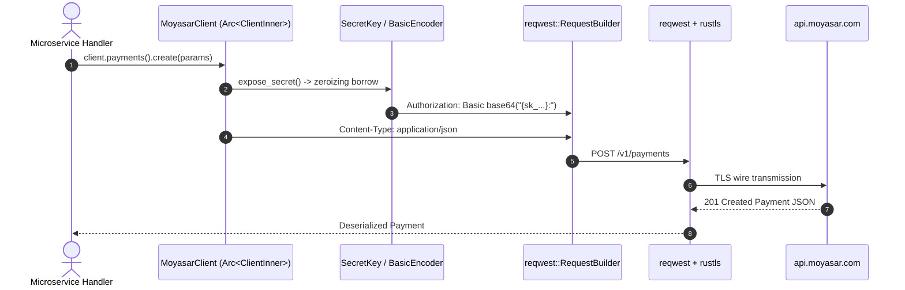

# US-1.1.0: Thread-Safe MoyasarClient Concurrency & Key-Type Isolation

> **Spec Kit Specification**: [Specification Lifecycle Active](../../../docs/architecture/DECOMPOSITION_ROADMAP.md)  
> **Behavior Blueprint**: `src/kernel/`  
> **Slicing Standard**: [10-PR Vertical Slicing Framework](../README.md#2-the-10-pr-vertical-slicing-framework-rust-sdk-adaptation)  
> **Security Gateway**: `security-audit` Level 2 Enforced  
> **Quality Gates**: `(G0–G4 + G-Review + G-Borrow + G-Law)`  

---

## 1. Spec Kit Specification

### 1.1 User Story Narrative
**As a** high-concurrency Rust backend engineer building Saudi/GCC fintech microservices against the Moyasar Payment Gateway,  
**I want to** initialize an immutable, thread-safe `MoyasarClient` backed by `Arc<ClientInner>` with compile-time isolation between `SecretKey` (`sk_...`) and `PublishableKey` (`pk_...`), transmitting HTTP Basic Auth as `Authorization: Basic base64("{api_key}:")`,  
**So that** my application can execute thousands of concurrent payment operations across Tokio tasks without mutex contention, credential exposure in logs, or accidentally leaking a publishable key into a backend-only route.

#### 1.1.1 Preconditions
- Application runtime on Rust 2024 edition with an async executor (Tokio / Actix-web / Axum).
- A valid Moyasar key: `sk_live_...`, `sk_test_...`, `pk_live_...`, or `pk_test_...`.
- The core microkernel compiles with `default-features = false, features = ["core"]`.

#### 1.1.2 Postconditions
- `MoyasarClient` clones via atomic refcount increment with zero deep heap duplication.
- Requests carry `Authorization: Basic base64("{key}:")` — key as username, empty-string password, per [Moyasar Authentication](https://docs.moyasar.com/api/authentication).
- Key material is `secrecy::SecretString` + `ZeroizeOnDrop`, and redacted from every `Debug` impl.
- A `PublishableKey` can never satisfy a `SecretKey` bound — enforced at compile time.

### 1.2 Acceptance Criteria (Gherkin Scenarios)

```gherkin
Feature: MoyasarClient Thread Safety and Key-Type Isolation

  Scenario: [AC-US-1.1.0-01] Cheap lock-free client cloning across concurrent Tokio tasks
    Given a MoyasarClient initialized with a valid SecretKey
    When 10,000 asynchronous Tokio tasks clone the MoyasarClient concurrently
    Then each task executes without lock contention or thread synchronization bottlenecks
    And the memory footprint of the client remains constant across all clones.

  Scenario: [AC-US-1.1.0-02] HTTP Basic Auth encoding with empty password
    Given a MoyasarClient configured with SecretKey "sk_test_YOUR_SECRET_KEY"
    When a request is dispatched to the Moyasar API
    Then the outgoing Authorization header equals "Basic " + base64("sk_test_YOUR_SECRET_KEY:")
    And the decoded credential is "sk_test_YOUR_SECRET_KEY:" with a trailing colon and empty password.

  Scenario: [AC-US-1.1.0-03] Compile-time rejection of publishable keys on secret-only routes
    Given a MoyasarClient initialized with a PublishableKey "pk_test_abc123"
    When code attempts to compile a call to client.payments().retrieve(id)
    Then the Rust compiler rejects the program with a type mismatch
    And no runtime 403 Forbidden response is ever generated for this mistake.

  Scenario: [AC-US-1.1.0-04] Key prefix validation and live/test mode detection
    Given a caller providing "sk_live_abc", "sk_test_abc", "pk_live_abc", or "pk_test_abc"
    When SecretKey::new() or PublishableKey::new() parses it
    Then valid prefixes are accepted and the live/test mode is recorded
    And an invalid prefix such as "abc123" returns Err(MoyasarError::InvalidKey).

  Scenario: [AC-US-1.1.0-05] Secret zeroization and debug log redaction
    Given a MoyasarClient configured with live API secret "sk_live_987654321secret"
    When the client is formatted using the "{:?}" Debug trait specifier
    Then the output prints "[REDACTED]" for the secret key
    And upon dropping the client, secret memory bytes are zeroized using volatile writes.

  Scenario: [AC-US-1.1.0-LAW] SAMA credential protection and PCI-DSS 4.0 compliance
    Given any client instantiation or network transmission
    When API credentials or authentication tokens are loaded or transmitted
    Then the system enforces TLS encryption in transit via rustls, strict memory zeroization on drop,
         and complete absence of plaintext credentials in logs, fulfilling PCI-DSS 4.0 Requirements 3.4 and 8.3.
```

### 1.3 Test Cases & Traceability Matrix

| Test Case ID | Target Criterion | Test Type | Execution Level | Verification Assertion & Pass Criteria |
| :--- | :--- | :--- | :--- | :--- |
| `TC-1.1.0-01` | `AC-US-1.1.0-01` | Concurrency | Integration / Stress | 10k Tokio spawns complete; `Arc::strong_count` integrity; zero data races under `loom`. |
| `TC-1.1.0-02` | `AC-US-1.1.0-02` | Functional | Unit / Contract | `base64("{key}:")` produces a trailing colon; header matches golden byte vector. |
| `TC-1.1.0-03` | `AC-US-1.1.0-03` | Type Safety | Compile-fail (`trybuild`) | `pk_` client calling `.retrieve()` fails to compile with expected error text. |
| `TC-1.1.0-04` | `AC-US-1.1.0-04` | Validation | Unit | Table-driven: 4 valid prefixes accepted, 5 invalid rejected with `InvalidKey`. |
| `TC-1.1.0-05` | `AC-US-1.1.0-05` | Security | Unit / SAST | `format!("{:?}", client)` contains neither `"sk_live"` nor `"sk_test"`. |
| `TC-1.1.0-LAW` | `AC-US-1.1.0-LAW` | Compliance | Static / Audit | TLS-only transport verified; zero secret keys in memory dumps and trace spans. |

---

## 2. Behavior-Centric Architecture & Folder Blueprint

### 2.1 Rust Crate Module & Unit File Ownership Tree

```
src/
├── src/kernel/auth.rs                         # Unit 1 (feat/us-1.1.0/unit-1-key-types)
├── src/kernel/client.rs                       # Unit 2 (feat/us-1.1.0/unit-2-http-client)
├── src/kernel/transport.rs                    # Unit 3 (feat/us-1.1.0/unit-3-auth-encoding)
```

### 2.2 Scoping & Promotion Blueprint
- **Tier 1 (Behaviour-Local)**: `ClientInner` atomic state and volatile zeroization helpers.
- **Tier 2 (Module-Shared)**: `MoyasarClientConfig` shared across all microkernel services.
- **Tier 3 (Feature-Shared)**: `MoyasarClient` re-exported for all domain plugins.
- **Tier 4 (Global-Shared)**: Re-exported from the `some-moyasar` facade via `prelude::*`.

---

## 3. Technical Implementation Plan

### 3.1 Domain Invariants & Storage Schema
- **Rust Memory Law**: Strict borrowing (`&self`); cloning `MoyasarClient` only bumps the `Arc` counter.
- **Key-Type Isolation Law**: `SecretKey` and `PublishableKey` are non-convertible newtypes with no `From`/`Into` between them.
- **Auth Encoding Law**: `base64("{api_key}:")` — the trailing colon is mandatory even with an empty password.
- **Redaction Law**: `#[derive(Debug)]` is forbidden on any struct holding key material.

```rust
pub trait AuthKey: Send + Sync + 'static {
    fn expose_secret(&self) -> &str;
}
pub trait SecretAuthKey: AuthKey {}
pub trait PublishableAuthKey: AuthKey {}

pub struct SecretKey(SecretString);
pub struct PublishableKey(SecretString);

impl AuthKey for SecretKey {
    fn expose_secret(&self) -> &str { self.0.expose_secret() }
}
impl SecretAuthKey for SecretKey {}

impl AuthKey for PublishableKey {
    fn expose_secret(&self) -> &str { self.0.expose_secret() }
}
impl PublishableAuthKey for PublishableKey {}

#[derive(Clone)]
pub struct MoyasarClient<K: AuthKey = SecretKey>(Arc<ClientInner<K>>);

impl SecretKey {
    pub fn new(raw: &str) -> Result<Self, MoyasarError> {
        if raw.starts_with("sk_live_") || raw.starts_with("sk_test_") {
            Ok(Self(SecretString::from(raw.to_owned())))
        } else {
            Err(MoyasarError::InvalidKey)
        }
    }
}

impl std::fmt::Debug for SecretKey {
    fn fmt(&self, f: &mut std::fmt::Formatter<'_>) -> std::fmt::Result {
        f.write_str("SecretKey([REDACTED])")
    }
}
```

### 3.2 Activity & Interaction Diagram



---

## 4. Granular Implementation Tasks

### 4.1 Dynamic 3-Unit Parallel Implementation Plan

| Unit # | Branch | Exclusive Owner Files | Deliverables & Colocated Unit Tests | Accountable Role / Agent | Assigned Skills |
| :--- | :--- | :--- | :--- | :--- | :--- |
| **Unit 1** | `feat/us-1.1.0/unit-1-key-types` | `src/kernel/auth.rs` | `SecretKey` (`sk_test_`/`sk_live_`), `PublishableKey` (`pk_test_`/`pk_live_`), `ZeroizeOnDrop`, parsing validation, unit tests | `engineering-software-architect` | `security-audit` |
| **Unit 2** | `feat/us-1.1.0/unit-2-http-client` | `src/kernel/client.rs` | `MoyasarClient::builder()`, reqwest `Client` pool, base URL, default/configured headers, `max_network_retries`, `build()?` | `engineering-backend-architect` | `security-audit` |
| **Unit 3** | `feat/us-1.1.0/unit-3-auth-encoding` | `src/kernel/transport.rs` | `TryFrom<&SecretKey>` / `TryFrom<&PublishableKey>` for `HeaderValue`, `Authorization: Basic base64("{key}:")` encoding, retry/timeout transport adapter, doc-tests | `engineering-backend-architect` | `security-audit` |

### 4.2 Parallel Unit Execution & Story Merge Breakdown

#### Wave 1: Base Branch Scaffolding (`feat/us-1.1.0-*`)
- [ ] **Task 0.1 (Story Base Contracts)**: Verify `Cargo.toml`, `src/lib.rs`, and the domain's `mod.rs` + `service.rs` facade declarations are present on the story base branch before spawning parallel unit worktrees.  
  *Agent*: `story-leader` | *Skill*: `divide-and-conquer-orchestrator`

#### Wave 2: 100% Parallel Unit Implementation (`Unit 1..3`)
- [ ] **Unit 1 (`feat/us-1.1.0/unit-1-key-types`)**: `SecretKey` (`sk_test_`/`sk_live_`), `PublishableKey` (`pk_test_`/`pk_live_`), `ZeroizeOnDrop`, parsing validation, unit tests (Files: `src/kernel/auth.rs`)  
  *Agent*: `engineering-software-architect` | *Skill*: `security-audit`
- [ ] **Unit 2 (`feat/us-1.1.0/unit-2-http-client`)**: `MoyasarClient::builder()`, reqwest `Client` pool, base URL, default/configured headers, `max_network_retries`, `build()?` (Files: `src/kernel/client.rs`)  
  *Agent*: `engineering-backend-architect` | *Skill*: `security-audit`
- [ ] **Unit 3 (`feat/us-1.1.0/unit-3-auth-encoding`)**: `TryFrom<&SecretKey>` / `TryFrom<&PublishableKey>` for `HeaderValue`, `Authorization: Basic base64("{key}:")` encoding, retry/timeout transport adapter, doc-tests (Files: `src/kernel/transport.rs`)  
  *Agent*: `engineering-backend-architect` | *Skill*: `security-audit`

#### Wave 3: Cascading Merge & Story Integration Verification
- [ ] **Task 3.1 (Cascading Merge & Wire Verification)**: Merge `Unit 1 -> ... -> Unit 3` into the story branch and run story-level wire integration tests and `G0–G4` quality gates.  
  *Agent*: `testing-api-tester` | *Skill*: `security-audit`
- [ ] **Task 3.2 (Council Review & Sign-Off)**: Execute independent Multi-Council Review (`G-Review`, `G-Borrow`, `G-Complexity`, `G-Docs`, `G-Law`).  
  *Agent*: `engineering-code-reviewer` | *Skill*: `code-review-council`

---

## 5. Security Gateway (Powered by security-audit)

### 5.1 Trust Boundaries & Security Actors
- **Trust Boundaries**:
  - `Client Execution Space`: caller application memory and task pool.
  - `Transport Boundary`: TLS socket to `api.moyasar.com`.
  - `Key-Type Boundary`: compile-time split between client-side (`pk_`) and server-side (`sk_`) authority.
- **Authorized Principals**:
  - Secret Key (`sk_`): backend authority across all 37 endpoints.
  - Publishable Key (`pk_`): exactly 4 client-originated routes — `POST /v1/payments`, `POST /v1/payment_intents/:id/fulfill`, `POST /v1/tokens`, `GET /v1/applepay/initiate`.

### 5.2 Threat Modeling & Abuse Matrix (STRIDE / ASVS)

| Threat Vector | Severity | Vulnerability Mechanism | Mitigating Control & Security Invariant |
| :--- | :--- | :--- | :--- |
| **Spoofing & Key Leakage** | Critical | Secret keys logged in plaintext during debug | Hand-written `Debug` emits `[REDACTED]`. |
| **Information Disclosure** | High | Memory dump exposes discarded keys | `SecretString` + `ZeroizeOnDrop` volatile overwrite. |
| **Privilege Escalation** | Critical | Publishable key reaching a secret-only route | Rust type system; non-convertible newtypes. |
| **Tampering** | High | Plaintext HTTP downgrade | `rustls-tls` default; `http://` base rejected at build. |
| **Elevation via Debug** | Medium | Panic backtraces dumping credential structs | `#[derive(Debug)]` forbidden on key-holding structs. |

### 5.3 Cryptographic & Data Protection Controls
- **TLS Transport**: `rustls-tls` is a default feature.
- **Memory Zeroization**: `zeroize::Zeroize` on drop for all key material.
- **Debug Filter**: compiler-enforced redaction via manual `Debug` impls.
- **Basic Auth Note**: base64 is **encoding, not encryption** — confidentiality rests entirely on TLS.

### 5.4 Automated Security Verification Checklist
- [ ] **Secret Scanning**: Gitleaks and `cargo-audit` report zero hardcoded secrets.
- [ ] **Log Redaction Test**: `format!("{client:?}")` contains no API key.
- [ ] **Memory Dump Audit**: Zeroized bytes confirmed after drop.
- [ ] **Compile-Fail Guard**: `trybuild` proves `pk_` cannot reach secret routes.

### 5.5 Security Gateway (G2) Sign-Off Checklist
- [ ] Threat boundaries verified against OWASP ASVS Level 2.
- [ ] Key-type isolation verified; zero runtime 403s from mismatched keys.
- [ ] Zero plaintext credentials in telemetry or log spans.
- [ ] Independent reviewer sign-off; zero open findings.

---

## 6. Validation Gates & Acceptance Sign-Off

**Status: Ready for Implementation.**

### G0 — Build, lint & format
- [ ] **US-1.1.0-G0:** `cargo build && cargo clippy --all-targets -- -D warnings && cargo fmt --check` passes clean.

### G1 — Test coverage
- [ ] **US-1.1.0-G1:** ≥90% line and ≥85% branch coverage on the microkernel core.

### G2 — Security audit
- [ ] **US-1.1.0-G2:** Zero-leak credential audit passes with zero critical/high findings.

### G3 — Architecture and maintainability
- [ ] **US-1.1.0-G3:** Microkernel compliance; zero monolithic codegen in core.

### G-Review — Code review
- [ ] **US-1.1.0-G-Review:** Peer review by `code-reviewer` across correctness, security, performance.

### G-Borrow — Rust zero-clone validation
- [ ] **US-1.1.0-G-Borrow:** Zero unauthorized deep `.clone()`; `Arc::clone` only.

### G-Complexity — Cyclomatic complexity
- [ ] **US-1.1.0-G-Complexity:** All functions $CC \le 6$; nesting $\le 2$.

### G-Docs — Public docs & examples
- [ ] **US-1.1.0-G-Docs:** 100% public symbols documented with runnable doc-tests.

### G-Law — Law validation
- [ ] **US-1.1.0-G-Law:** PCI-DSS 4.0 Requirements 3.4 & 8.3 and SAMA credential handling certified.

### G4 — Integrated acceptance
- [ ] **US-1.1.0-G4:** 10k-task concurrency verified against mock server; Basic Auth header byte-exact.
