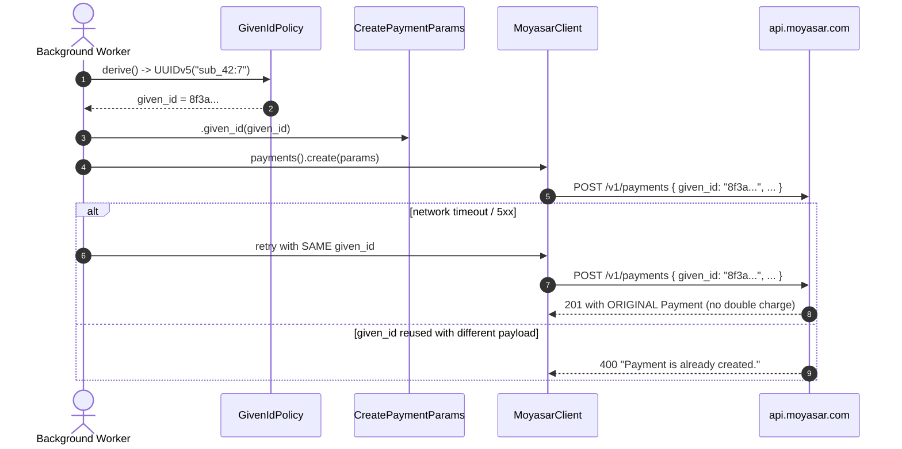

# US-1.2.0: Body-Injected `given_id` Idempotency, Validated Metadata & Pagination

> **Spec Kit Specification**: [Specification Lifecycle Active](../../../docs/architecture/DECOMPOSITION_ROADMAP.md)  
> **Behavior Blueprint**: `features/core/modules/microkernel/behaviours/idempotency-metadata-pagination/`  
> **Slicing Standard**: [10-PR Vertical Slicing Framework](../README.md#2-the-10-pr-vertical-slicing-framework-rust-sdk-adaptation)  
> **Security Gateway**: `security-audit` Level 2 Enforced  
> **Quality Gates**: `(G0–G4 + G-Review + G-Borrow + G-Law)`  

---

## 1. Spec Kit Specification

### 1.1 User Story Narrative
**As a** payment backend engineer operating under unreliable networks and at-least-once worker delivery,  
**I want to** have `given_id` UUIDs injected directly into mutating JSON request bodies (not HTTP headers), a compile-time-validated `Metadata` map, and a `PaginatedList<T>` with `Meta` cursors,  
**So that** retried requests never double-charge a customer, metadata never violates Moyasar's 30-key/40-char/500-char limits at runtime, and large result sets stream page-by-page without loading everything into memory.

#### 1.1.1 Preconditions
- The core microkernel is compiled (`features = ["core"]`).
- `uuid`, `serde_json`, `chrono` are available as core dependencies.

#### 1.1.2 Postconditions
- Every mutating payment request body contains a `given_id` UUID; the same UUID becomes the resulting `Payment.id`.
- Retrying an identical payload with the same `given_id` returns the original response without re-charging.
- Reusing a `given_id` with a *different* payload surfaces HTTP 400 "Payment is already created."
- `Metadata::insert` rejects: >30 keys, key >40 chars, value >500 chars.
- An empty-string metadata value unsets that key on update payloads.
- `PaginatedList<T>` deserializes `{ "<resource>": [...], "meta": {...} }` and follows `next_page`.

### 1.2 Acceptance Criteria (Gherkin Scenarios)

```gherkin
Feature: Idempotency, Metadata Validation and Pagination

  Scenario: [AC-US-1.2.0-01] Automatic UUIDv4 given_id injection into the request body
    Given a CreatePaymentParams builder with no explicitly supplied given_id
    When the request body is serialized
    Then the JSON body contains a "given_id" field holding a valid UUIDv4
    And no "Idempotency-Key" HTTP header is emitted (Moyasar does not use header idempotency).

  Scenario: [AC-US-1.2.0-02] Explicit given_id is preserved verbatim and becomes the Payment id
    Given a CreatePaymentParams with given_id "3fa85f64-5717-4562-b3fc-2c963f66afa6"
    When the payment is created successfully
    Then the response Payment.id equals "3fa85f64-5717-4562-b3fc-2c963f66afa6".

  Scenario: [AC-US-1.2.0-03] Deterministic UUIDv5 derivation for recurring subscription cycles
    Given a subscription id "sub_42" and cycle index 7
    When GivenIdPolicy::Deterministic derives the idempotency key
    Then the result equals Uuid::new_v5(&NAMESPACE, "sub_42:7")
    And deriving it again with identical inputs yields the exact same UUID.

  Scenario: [AC-US-1.2.0-04] Metadata limit enforcement at insert time
    Given a Metadata map containing 30 keys
    When a 31st key is inserted
    Then the call returns Err(MoyasarError::MetadataTooManyKeys)
    And inserting a key longer than 40 characters returns Err(MetadataKeyTooLong)
    And inserting a value longer than 500 characters returns Err(MetadataValueTooLong).

  Scenario: [AC-US-1.2.0-05] Empty-string metadata value unsets the key
    Given a Metadata map containing "order_id" -> "ORD-1"
    When "order_id" is set to an empty string and serialized into an update payload
    Then the JSON body contains "metadata": { "order_id": "" }
    And Moyasar is instructed to unset that key per its documented semantics.

  Scenario: [AC-US-1.2.0-06] PaginatedList deserialization and next-page traversal
    Given a list response with meta.total_pages = 3 and meta.current_page = 1
    When the response is deserialized into PaginatedList<Payment>
    Then items contains the payments for page 1 and meta.next_page equals 2.

  Scenario: [AC-US-1.2.0-LAW] Regulatory traceability of idempotent transaction records
    Given any mutating payment operation
    When the operation is executed or retried
    Then the given_id provides an immutable, auditable correlation key linking request to Payment.id,
         satisfying SAMA audit-trail requirements for financial transaction reconciliation.
```

### 1.3 Test Cases & Traceability Matrix

| Test Case ID | Target Criterion | Test Type | Execution Level | Verification Assertion & Pass Criteria |
| :--- | :--- | :--- | :--- | :--- |
| `TC-1.2.0-01` | `AC-US-1.2.0-01` | Functional | Unit | Serialized body JSON contains `given_id` parseable as UUID v4. |
| `TC-1.2.0-02` | `AC-US-1.2.0-02` | Functional | Integration | Mock returns the posted `given_id` as `id`; assertion on equality. |
| `TC-1.2.0-03` | `AC-US-1.2.0-03` | Functional | Unit | Repeated derivation is bit-identical; matches `Uuid::new_v5` golden vector. |
| `TC-1.2.0-04` | `AC-US-1.2.0-04` | Validation | Unit | Boundary tests at 30/31 keys, 40/41 chars, 500/501 chars. |
| `TC-1.2.0-05` | `AC-US-1.2.0-05` | Functional | Unit | Empty-string value serializes as `""` and is preserved. |
| `TC-1.2.0-06` | `AC-US-1.2.0-06` | Functional | Unit | Fixture JSON with 3 pages deserializes with correct `meta` fields. |
| `TC-1.2.0-LAW` | `AC-US-1.2.0-LAW` | Compliance | Static / Audit | Audit log correlation key present on every mutating operation. |

---

## 2. Behavior-Centric Architecture & Folder Blueprint

### 2.1 Colocated Behaviour Directory Tree

```
features/core/modules/microkernel/behaviours/idempotency-metadata-pagination/
├── services/        # PageFetcher (next-page traversal engine)
├── logic/           # GivenIdPolicy derivation, Metadata validation, query serialization
├── types/           # GivenIdPolicy, Metadata, PaginatedList<T>, Meta
└── constants/       # METADATA_MAX_KEYS, METADATA_KEY_MAX_LEN, METADATA_VALUE_MAX_LEN
```

### 2.2 Scoping & Promotion Blueprint
- **Tier 1 (Behaviour-Local)**: `GivenIdPolicy` private namespace constant and UUID derivation.
- **Tier 2 (Module-Shared)**: `Metadata` and `Meta` used by every resource service.
- **Tier 3 (Feature-Shared)**: `PaginatedList<T>` returned by all `list()` methods.
- **Tier 4 (Global-Shared)**: Exposed through `prelude::*`.

---

## 3. Technical Implementation Plan

### 3.1 Domain Invariants & Storage Schema
- **Body-Idempotency Law**: `given_id` lives in the JSON body. Any `Idempotency-Key` header emission is a bug.
- **Determinism Law**: `Uuid::new_v5(&NAMESPACE, "{sub_id}:{cycle_index}")` must be stable across processes and restarts.
- **Validation-at-Insert Law**: Metadata constraints are enforced on `insert()`, never deferred to serialization.
- **Retry Safety Law**: Automatic retries are enabled *only* for network errors, timeouts, and 5xx — never for 4xx.

```rust
pub enum GivenIdPolicy {
    Random,                                    // UUIDv4 per operation
    Deterministic { namespace: Uuid, scope: String },
}

impl GivenIdPolicy {
    pub fn derive(&self) -> Uuid {
        match self {
            Self::Random => Uuid::new_v4(),
            Self::Deterministic { namespace, scope } => Uuid::new_v5(namespace, scope.as_bytes()),
        }
    }
}

pub struct Metadata(BTreeMap<String, String>);

impl Metadata {
    pub fn insert(&mut self, key: &str, value: &str) -> Result<(), MoyasarError> {
        if self.0.len() >= METADATA_MAX_KEYS && !self.0.contains_key(key) {
            return Err(MoyasarError::MetadataTooManyKeys);
        }
        if key.chars().count() > METADATA_KEY_MAX_LEN {
            return Err(MoyasarError::MetadataKeyTooLong);
        }
        if value.chars().count() > METADATA_VALUE_MAX_LEN {
            return Err(MoyasarError::MetadataValueTooLong);
        }
        self.0.insert(key.to_owned(), value.to_owned());
        Ok(())
    }
}
```

### 3.2 Activity & Interaction Diagram



---

## 4. Granular Implementation Tasks

### 4.1 The 10-PR Vertical Slicing Implementation Plan

| PR # | Pillar | Architectural Layer | Primary Scope & Files | Deliverables & Acceptance | Accountable Role / Agent | Assigned Skills |
| :--- | :--- | :--- | :--- | :--- | :--- | :--- |
| **PR 1** | **Pillar 1** | **Domain Logic & Core Traits** | `src/kernel/idempotency.rs` | `GivenIdPolicy` enum, UUIDv4 generation. | `engineering-software-architect` | `security-audit` |
| **PR 2** | **Pillar 2** | **Request/Response Modeling** | `src/kernel/metadata.rs` | `Metadata` map, validation constants. | `engineering-backend-architect` | `security-audit` |
| **PR 3** | **Pillar 3** | **Transport Wire Adapter** | `src/kernel/idempotency.rs` | Body-level `given_id` injection; no header emission. | `engineering-backend-architect` | `security-audit` |
| **PR 4** | **Pillar 4** | **Service Accessor** | `src/kernel/pagination.rs` | `PaginatedList<T>` + `Meta` structs. | `engineering-software-architect` | `security-audit` |
| **PR 5** | **Pillar 5** | **Error Taxonomy** | `src/kernel/error.rs` | `MetadataTooManyKeys`, `MetadataKeyTooLong`, `MetadataValueTooLong` variants. | `security-application-security-engineer` | `security-audit` |
| **PR 6** | **Pillar 6** | **Resource Facade Mounting** | `src/lib.rs` | Export idempotency/metadata/pagination under `core` feature. | `engineering-software-architect` | `security-audit` |
| **PR 7** | **Pillar 7** | **Zero-Copy Hardening** | `src/kernel/metadata.rs` | Borrowed-key insertion; no needless `String` clones. | `agency-rust-refactoring-specialist` | `security-audit` |
| **PR 8** | **Pillar 8** | **Edge Cases & Guards** | `src/kernel/metadata.rs` | Empty-string unset semantics; boundary enforcement tests. | `agency-api-tester` | `security-audit` |
| **PR 9** | **Pillar 9** | **Integration Wire Verification** | `tests/idempotency_wire_test.rs` | Mock asserts same `given_id` on retry returns identical Payment. | `agency-api-tester` | `security-audit` |
| **PR 10** | **Pillar 10** | **Documentation & Packaging** | `README.md` | Doc-tests for UUIDv5 derivation and metadata limits. | `engineering-technical-writer` | `security-audit` |

### 4.2 Implementation Phase Breakdown

#### Phase 1: Domain Primitives (PR 1–2)
- [ ] **Task 1.1 (Types)**: `GivenIdPolicy` enum with `Random` and `Deterministic` variants.  
  *Agent*: `engineering-software-architect` | *Skill*: `security-audit`
- [ ] **Task 1.2 (Constants)**: `METADATA_MAX_KEYS=30`, `METADATA_KEY_MAX_LEN=40`, `METADATA_VALUE_MAX_LEN=500`.  
  *Agent*: `engineering-software-architect` | *Skill*: `security-audit`
- [ ] **Task 1.3 (Logic)**: `Metadata::insert` with validation-at-insert.  
  *Agent*: `engineering-backend-architect` | *Skill*: `security-audit`
- [ ] **Task 1.4 (Unit Tests)**: Boundary table tests at 30/31, 40/41, 500/501.  
  *Agent*: `agency-api-tester` | *Skill*: `security-audit`

#### Phase 2: Injection & Pagination (PR 3–6)
- [ ] **Task 2.1 (Injection)**: Serialize `given_id` into the body; assert no `Idempotency-Key` header.  
  *Agent*: `engineering-backend-architect` | *Skill*: `security-audit`
- [ ] **Task 2.2 (Deterministic UUIDv5)**: `Uuid::new_v5(&NAMESPACE, "{sub_id}:{cycle_index}")`.  
  *Agent*: `engineering-backend-architect` | *Skill*: `security-audit`
- [ ] **Task 2.3 (Pagination Types)**: `PaginatedList<T>`, `Meta` with `Deserialize`.  
  *Agent*: `engineering-software-architect` | *Skill*: `security-audit`
- [ ] **Task 2.4 (Stream)**: `Paginator<T>::into_stream()` following `next_page`.  
  *Agent*: `engineering-backend-architect` | *Skill*: `security-audit`

#### Phase 3: Edge Cases & Hardening (PR 7–8)
- [ ] **Task 3.1 (Borrow Audit)**: Eliminate needless `String` clones in metadata paths.  
  *Agent*: `agency-rust-refactoring-specialist` | *Skill*: `security-audit`
- [ ] **Task 3.2 (Unset Semantics)**: Empty-string value preserves unset behavior end-to-end.  
  *Agent*: `agency-api-tester` | *Skill*: `security-audit`

#### Phase 4: Verification & Sign-Off (PR 9–10)
- [ ] **Task 4.1 (Retry Wire Test)**: Same `given_id` twice → identical Payment, single charge.  
  *Agent*: `agency-api-tester` | *Skill*: `security-audit`
- [ ] **Task 4.2 (G-Review)**: Peer review on determinism and retry safety envelope.  
  *Agent*: `agency-code-reviewer` | *Skill*: `security-audit`
- [ ] **Task 4.3 (Documentation)**: Doc-tests including a worked subscription-cycle example.  
  *Agent*: `engineering-technical-writer` | *Skill*: `security-audit`

---

## 5. Security Gateway (Powered by security-audit)

### 5.1 Trust Boundaries & Security Actors
- **Trust Boundaries**:
  - `Idempotency Boundary`: the `given_id` namespace — must be unguessable to prevent cross-tenant collisions.
  - `Metadata Boundary`: merchant-controlled key/value space injected into financial records.
- **Authorized Principals**: any holder of a valid `SecretKey`.

### 5.2 Threat Modeling & Abuse Matrix (STRIDE / ASVS)

| Threat Vector | Severity | Vulnerability Mechanism | Mitigating Control & Security Invariant |
| :--- | :--- | :--- | :--- |
| **Replay / Double Charge** | Critical | Retry after timeout re-executes the charge | Body-injected `given_id`; Moyasar returns the original response. |
| **Idempotency Collision** | High | Reusing a `given_id` with a different payload | Server returns HTTP 400 `"Payment is already created."` — surfaced as typed error. |
| **Injection via Metadata** | High | Malicious metadata keys polluting audit records | Length caps + charset validation; no key interpolation into URLs. |
| **Predictable Subscription Keys** | Medium | Weak UUIDv5 namespace allows key guessing | Fixed private namespace constant; scope string includes the subscription id. |
| **Unbounded Memory** | Medium | `list()` loading all pages at once | `PaginatedList` is page-bounded; streaming is opt-in. |

### 5.3 Cryptographic & Data Protection Controls
- **UUIDv5 Namespace**: a fixed, non-secret, documented namespace constant — uniqueness, not secrecy, is the goal.
- **Retry Envelope**: retries only on network errors, timeouts, 5xx; never on 4xx.
- **Metadata Sanitization**: length and count enforced before serialization.

### 5.4 Automated Security Verification Checklist
- [ ] **Retry Safety**: integration test proves no double charge after a simulated timeout.
- [ ] **Collision Test**: same `given_id` + different payload yields a typed 400 error.
- [ ] **Boundary Tests**: metadata limits enforced at insert, not deferred.
- [ ] **No Header Idempotency**: assertion that no `Idempotency-Key` header is ever emitted.

### 5.5 Security Gateway (G2) Sign-Off Checklist
- [ ] Retry envelope verified against OWASP ASVS Level 2.
- [ ] Idempotency collision handling surfaces a typed, non-retryable error.
- [ ] Metadata constraints enforced pre-serialization.
- [ ] Independent reviewer sign-off; zero open findings.

---

## 6. Validation Gates & Acceptance Sign-Off

**Status: Ready for Implementation.**

### G0 — Build, lint & format
- [ ] **US-1.2.0-G0:** `cargo build && cargo clippy -- -D warnings && cargo fmt --check` clean.

### G1 — Test coverage
- [ ] **US-1.2.0-G1:** ≥90% line / ≥85% branch on idempotency, metadata, pagination modules.

### G2 — Security audit
- [ ] **US-1.2.0-G2:** Retry-replay audit passes with zero critical/high findings.

### G3 — Architecture and maintainability
- [ ] **US-1.2.0-G3:** Idempotency/metadata/pagination remain kernel-only; zero resource coupling.

### G-Review — Code review
- [ ] **US-1.2.0-G-Review:** Peer review on determinism and retry envelope.

### G-Borrow — Rust zero-clone validation
- [ ] **US-1.2.0-G-Borrow:** No needless `String` clones in metadata insertion paths.

### G-Complexity — Cyclomatic complexity
- [ ] **US-1.2.0-G-Complexity:** $CC \le 6$; nesting $\le 2$.

### G-Docs — Public docs & examples
- [ ] **US-1.2.0-G-Docs:** 100% public symbols documented; subscription UUIDv5 example is runnable.

### G-Law — Law validation
- [ ] **US-1.2.0-G-Law:** SAMA audit-trail correlation via `given_id → Payment.id` certified.

### G4 — Integrated acceptance
- [ ] **US-1.2.0-G4:** Retry-after-timeout returns the identical Payment with a single charge.
