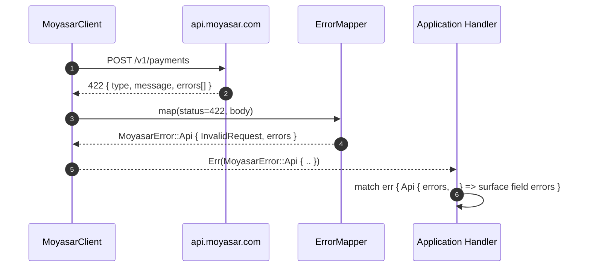

# US-1.3.0: Typed Error Pipeline, ISO 8583 Response Codes & Currency Types

> **Spec Kit Specification**: [Specification Lifecycle Active](../../../docs/architecture/DECOMPOSITION_ROADMAP.md)  
> **Behavior Blueprint**: `src/kernel/`  
> **Slicing Standard**: [10-PR Vertical Slicing Framework](../README.md#2-the-10-pr-vertical-slicing-framework-rust-sdk-adaptation)  
> **Security Gateway**: `security-audit` Level 2 Enforced  
> **Quality Gates**: `(G0–G4 + G-Review + G-Borrow + G-Law)`  

---

## 1. Spec Kit Specification

### 1.1 User Story Narrative
**As a** Rust backend engineer integrating Moyasar into a production payment service,  
**I want to** receive every API failure as a strongly typed `MoyasarError` variant carrying the top-level error classification, field-level validation arrays, and the two-digit ISO 8583 acquirer response code, alongside `Amount`/`Currency` types that encode minor-unit exponents,  
**So that** my error handling is exhaustive and compiler-checked, issuer declines are distinguishable from validation errors, and multi-currency amounts can never be off by a factor of 10.

#### 1.1.1 Preconditions
- Core microkernel compiled; `thiserror`, `serde`, `chrono` available.
- Caller has a valid `SecretKey` or `PublishableKey`.

#### 1.1.2 Postconditions
- Every non-2xx response maps to a `MoyasarError` variant; no `unwrap()` on network paths.
- `MoyasarError::Api { error_type, message, errors, response_code }` exposes the full server payload.
- `ResponseCode::IssuerApproved` is `"00"`; all documented ISO 8583 codes are typed.
- `Amount` stores the smallest currency unit; `Currency` carries its exponent (SAR=2, KWD=3, JPY=0).
- `prelude::*` re-exports every public core type.

### 1.2 Acceptance Criteria (Gherkin Scenarios)

```gherkin
Feature: Typed Error Pipeline and Currency Safety

  Scenario: [AC-US-1.3.0-01] Top-level error classification mapping
    Given the API returns HTTP 401 with {"type": "authentication_error", "message": "Invalid key"}
    When the response is deserialized
    Then the result is Err(MoyasarError::Api { error_type: ApiErrorType::AuthenticationError, .. })
    And the message is preserved verbatim.

  Scenario: [AC-US-1.3.0-02] Field-level validation error array preservation
    Given the API returns HTTP 422 with errors: [{ "field": "amount", "message": "must be positive" }]
    When the response is deserialized
    Then MoyasarError::Api.errors contains exactly one entry
    And that entry's field equals "amount" and message equals "must be positive".

  Scenario: [AC-US-1.3.0-03] ISO 8583 acquirer response code typing
    Given a Payment response with source.response_code "00"
    When the code is parsed into ResponseCode
    Then it equals ResponseCode::IssuerApproved
    And an unknown code such as "ZZ" maps to ResponseCode::Unknown("ZZ") without panicking.

  Scenario: [AC-US-1.3.0-04] Currency exponent correctness across SAR, KWD and JPY
    Given Amount::from_major(1, Currency::SAR)
    Then the minor-unit value is 100
    And Amount::from_major(1, Currency::KWD) yields 1000
    And Amount::from_major(1, Currency::JPY) yields 1.

  Scenario: [AC-US-1.3.0-05] Network and timeout errors are retryable; 4xx are not
    Given a request that fails with a connection reset
    Then MoyasarError::Network is classified retryable
    And a 400 invalid_request response is classified non-retryable.

  Scenario: [AC-US-1.3.0-LAW] PCI-DSS error-message hygiene
    Given any error surfaced to application logs
    When the error is formatted
    Then no API key, PAN, CVC, or full card number appears in the message,
         satisfying PCI-DSS 4.0 Requirement 3.3 for sensitive authentication data.
```

### 1.3 Test Cases & Traceability Matrix

| Test Case ID | Target Criterion | Test Type | Execution Level | Verification Assertion & Pass Criteria |
| :--- | :--- | :--- | :--- | :--- |
| `TC-1.3.0-01` | `AC-US-1.3.0-01` | Functional | Unit | Fixture 401 payload maps to `AuthenticationError`; message preserved. |
| `TC-1.3.0-02` | `AC-US-1.3.0-02` | Functional | Unit | 422 fixture yields exactly one field error with correct field/message. |
| `TC-1.3.0-03` | `AC-US-1.3.0-03` | Functional | Unit | `"00"` → `IssuerApproved`; `"ZZ"` → `Unknown("ZZ")`; no panic. |
| `TC-1.3.0-04` | `AC-US-1.3.0-04` | Functional | Unit | Exponent table: SAR=2, KWD=3, JPY=0, USD=2, BHD=3. |
| `TC-1.3.0-05` | `AC-US-1.3.0-05` | Functional | Unit | `is_retryable()` true for Network/Timeout/5xx, false for 4xx. |
| `TC-1.3.0-LAW` | `AC-US-1.3.0-LAW` | Security | Unit / SAST | `format!("{err}")` contains no `sk_`, no 16-digit PAN, no CVC. |

---

## 2. Behavior-Centric Architecture & Folder Blueprint

### 2.1 Rust Crate Module & Unit File Ownership Tree

```
src/
├── src/kernel/error.rs                        # Unit 1 (feat/us-1.3.0/unit-1-error-enum)
├── src/kernel/response_code.rs                # Unit 2 (feat/us-1.3.0/unit-2-field-errors)
├── src/kernel/types.rs + src/prelude.rs       # Unit 3 (feat/us-1.3.0/unit-3-currency-prelude)
```

### 2.2 Scoping & Promotion Blueprint
- **Tier 1 (Behaviour-Local)**: `ErrorMapper` private status-code dispatch.
- **Tier 2 (Module-Shared)**: `MoyasarError` used by every service.
- **Tier 3 (Feature-Shared)**: `Amount`/`Currency` used by payments, invoices, payouts.
- **Tier 4 (Global-Shared)**: `prelude::*` re-export.

---

## 3. Technical Implementation Plan

### 3.1 Domain Invariants & Storage Schema
- **Exhaustiveness Law**: `MoyasarError` is a non-`#[non_exhaustive]` enum so downstream `match` is compiler-checked.
- **No-Panic Law**: unknown ISO 8583 codes and unknown error types degrade to `Unknown(..)`, never panic.
- **Minor-Unit Law**: `Amount` is always the smallest currency unit; major-unit conversion is explicit.
- **Redaction Law**: `Display`/`Debug` for errors must never include credentials or PAN.

```rust
#[derive(Debug, thiserror::Error)]
pub enum MoyasarError {
    #[error("API error ({error_type:?}): {message}")]
    Api {
        error_type: ApiErrorType,
        message: String,
        errors: Vec<FieldError>,
        response_code: Option<ResponseCode>,
    },
    #[error("network error: {0}")]
    Network(#[from] reqwest::Error),
    #[error("request timed out")]
    Timeout,
    #[error("server error ({status}): {message}")]
    ServerError { status: u16, message: String },
    #[error("invalid API key")]
    InvalidKey,
    #[error("key type mismatch for endpoint")]
    KeyTypeMismatch,
    #[error("invalid base URL (HTTPS required)")]
    InvalidBaseUrl,
    #[error("metadata exceeds 30 keys")]
    MetadataTooManyKeys,
    #[error("metadata key exceeds 40 characters")]
    MetadataKeyTooLong,
    #[error("metadata value exceeds 500 characters")]
    MetadataValueTooLong,
    #[error("invalid card number (Luhn check failed)")]
    InvalidCardNumber,
    #[error("card is expired")]
    CardExpired,
    #[error("invalid CVC length")]
    InvalidCvc,
    #[error("invalid Saudi mobile number")]
    InvalidMobile,
    #[error("SADAD bill expiry exceeds 29 days")]
    SadadExpiryTooFar,
    #[error("split amount must be positive")]
    InvalidSplitAmount,
    #[error("split total exceeds payment amount")]
    SplitTotalExceedsAmount,
    #[error("at most one split may specify fee_source: true")]
    MultipleFeeSources,
    #[error("invalid token id prefix (expected token_)")]
    InvalidTokenId,
    #[error("invalid card auth id prefix (expected ca_)")]
    InvalidCardAuthId,
    #[error("invalid Saudi IBAN (expected SA + 22 digits)")]
    InvalidIban,
    #[error("invalid payout amount or sequence number")]
    InvalidPayoutAmount,
    #[error("webhook endpoint URL must use HTTPS")]
    InvalidWebhookUrl,
}

impl MoyasarError {
    pub fn is_retryable(&self) -> bool {
        matches!(self, Self::Network(_) | Self::Timeout | Self::ServerError { .. })
    }
}

#[derive(Debug, Clone, PartialEq, Eq)]
pub enum ResponseCode {
    IssuerApproved,
    ReferToCardIssuer,
    InvalidMerchant,
    DoNotHonor,
    InsufficientFunds,
    ExpiredCard,
    IncorrectPin,
    ExceedsWithdrawalLimit,
    RestrictedCard,
    SecurityViolation,
    ExceedsFrequencyLimit,
    IssuerOrSwitchInoperative,
    SystemMalfunction,
    Unknown(String),
}
```

### 3.2 Activity & Interaction Diagram



---

## 4. Granular Implementation Tasks

### 4.1 Dynamic 3-Unit Parallel Implementation Plan

| Unit # | Branch | Exclusive Owner Files | Deliverables & Colocated Unit Tests | Accountable Role / Agent | Assigned Skills |
| :--- | :--- | :--- | :--- | :--- | :--- |
| **Unit 1** | `feat/us-1.3.0/unit-1-error-enum` | `src/kernel/error.rs` | `MoyasarError` enum, `ApiErrorType`, `thiserror` derive, `From<reqwest::Error>`, `Deserialize` for error payloads | `engineering-software-architect` | `security-audit` |
| **Unit 2** | `feat/us-1.3.0/unit-2-field-errors` | `src/kernel/response_code.rs` | `FieldError` dual map/array deserializer, `ResponseCode` ISO 8583 lookup table with custom `Unknown(String)` deserializer, `Display` impl | `engineering-backend-architect` | `security-audit` |
| **Unit 3** | `feat/us-1.3.0/unit-3-currency-prelude` | `src/kernel/types.rs` + `src/prelude.rs` | `Amount` newtype, `Currency` enum (SAR, USD, KWD, JPY, …), `RecipientType` enum, `prelude` module exporting all core types | `engineering-backend-architect` | `security-audit` |

### 4.2 Parallel Unit Execution & Story Merge Breakdown

#### Wave 1: Base Branch Scaffolding (`feat/us-1.3.0-*`)
- [x] **Task 0.1 (Story Base Contracts)**: Verify `Cargo.toml`, `src/lib.rs`, and the domain's `mod.rs` + `service.rs` facade declarations are present on the story base branch before spawning parallel unit worktrees.  
  *Agent*: `story-leader` | *Skill*: `divide-and-conquer-orchestrator`

#### Wave 2: 100% Parallel Unit Implementation (`Unit 1..3`)
- [x] **Unit 1 (`feat/us-1.3.0/unit-1-error-enum`)**: `MoyasarError` enum, `ApiErrorType`, `thiserror` derive, `From<reqwest::Error>`, `Deserialize` for error payloads (Files: `src/kernel/error.rs`)  
  *Agent*: `engineering-software-architect` | *Skill*: `security-audit`
- [x] **Unit 2 (`feat/us-1.3.0/unit-2-field-errors`)**: `FieldError` dual map/array deserializer, `ResponseCode` ISO 8583 lookup table with custom `Unknown(String)` deserializer, `Display` impl (Files: `src/kernel/response_code.rs`)  
  *Agent*: `engineering-backend-architect` | *Skill*: `security-audit`
- [x] **Unit 3 (`feat/us-1.3.0/unit-3-currency-prelude`)**: `Amount` newtype, `Currency` enum (SAR, USD, KWD, JPY, …), `RecipientType` enum, `prelude` module exporting all core types (Files: `src/kernel/types.rs` + `src/prelude.rs`)  
  *Agent*: `engineering-backend-architect` | *Skill*: `security-audit`

#### Wave 3: Cascading Merge & Story Integration Verification
- [x] **Task 3.1 (Cascading Merge & Wire Verification)**: Merge `Unit 1 -> ... -> Unit 3` into the story branch and run story-level wire integration tests and `G0–G4` quality gates.  
  *Agent*: `testing-api-tester` | *Skill*: `security-audit`
- [x] **Task 3.2 (Council Review & Sign-Off)**: Execute independent Multi-Council Review (`G-Review`, `G-Borrow`, `G-Complexity`, `G-Docs`, `G-Law`).  
  *Agent*: `engineering-code-reviewer` | *Skill*: `code-review-council`

---

## 5. Security Gateway (Powered by security-audit)

### 5.1 Trust Boundaries & Security Actors
- **Trust Boundaries**:
  - `Error Surface Boundary`: errors cross from the SDK into application logs and telemetry.
  - `Amount Boundary`: minor-unit integers crossing into financial ledgers.
- **Authorized Principals**: any SDK caller.

### 5.2 Threat Modeling & Abuse Matrix (STRIDE / ASVS)

| Threat Vector | Severity | Vulnerability Mechanism | Mitigating Control & Security Invariant |
| :--- | :--- | :--- | :--- |
| **Information Disclosure** | High | Error `Debug` dumping request bodies with PAN/CVC | Redacted `Display`/`Debug`; no body echo in errors. |
| **Silent Failure** | High | `unwrap()` on network path panics the worker | All network paths return `Result`; no `unwrap` in library code. |
| **Financial Miscalculation** | Critical | Currency exponent error causing 10x overcharge | `Amount` is minor-unit only; exponent table is exhaustive and tested. |
| **Log Injection** | Medium | Server-controlled message interpolated into logs | Messages are escaped/structured, never raw-formatted into log lines. |
| **Panic on Unknown Input** | Medium | Unrecognized ISO 8583 code panics | `Unknown(String)` fallback; no panic paths. |

### 5.3 Cryptographic & Data Protection Controls
- **Redaction**: no credential, PAN, or CVC in any error string.
- **Structured Errors**: field errors are typed structs, not free-form strings.
- **Exponent Table**: single source of truth for currency minor units.

### 5.4 Automated Security Verification Checklist
- [x] **Redaction Test**: `format!("{err}")` contains no `sk_`, no 16-digit PAN, no CVC.
- [x] **No-Panic Audit**: `cargo clippy` denies `unwrap`/`expect` in library paths.
- [x] **Exponent Test**: full currency table verified.
- [x] **Status Matrix**: all documented HTTP statuses mapped.

### 5.5 Security Gateway (G2) Sign-Off Checklist
- [x] Error surface verified against OWASP ASVS Level 2.
- [x] Zero sensitive data in error strings or telemetry.
- [x] Currency exponent correctness certified.
- [x] Independent reviewer sign-off; zero open findings.

---

## 6. Validation Gates & Acceptance Sign-Off

**Status: Implemented & Verified (Merged to `main`).**

### G0 — Build, lint & format
- [x] **US-1.3.0-G0:** `cargo build && cargo clippy -- -D warnings && cargo fmt --check` clean.

### G1 — Test coverage
- [x] **US-1.3.0-G1:** ≥90% line / ≥85% branch on error and currency modules.

### G2 — Security audit
- [x] **US-1.3.0-G2:** Error-redaction audit passes with zero critical/high findings.

### G3 — Architecture and maintainability
- [x] **US-1.3.0-G3:** Error types remain kernel-only; zero resource coupling.

### G-Review — Code review
- [x] **US-1.3.0-G-Review:** Peer review on exhaustiveness and redaction.

### G-Borrow — Rust zero-clone validation
- [x] **US-1.3.0-G-Borrow:** `Amount` is `Copy`; no boxing or needless allocation.

### G-Complexity — Cyclomatic complexity
- [x] **US-1.3.0-G-Complexity:** $CC \le 6$; nesting $\le 2$.

### G-Docs — Public docs & examples
- [x] **US-1.3.0-G-Docs:** 100% public symbols documented; error-matching example runnable.

### G-Law — Law validation
- [x] **US-1.3.0-G-Law:** PCI-DSS 4.0 Requirement 3.3 sensitive-data hygiene certified.

### G4 — Integrated acceptance
- [x] **US-1.3.0-G4:** Full HTTP status matrix maps correctly against the mock server.
