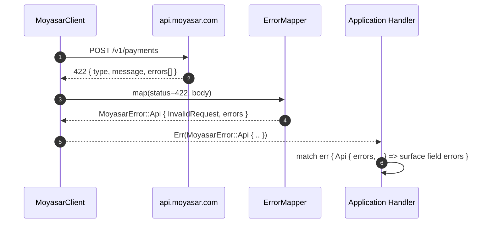

# US-1.3.0: Typed Error Pipeline, ISO 8583 Response Codes & Currency Types

> **Spec Kit Specification**: [Specification Lifecycle Active](../../../docs/architecture/DECOMPOSITION_ROADMAP.md)  
> **Behavior Blueprint**: `features/core/modules/microkernel/behaviours/error-types-prelude/`  
> **Slicing Standard**: [10-PR Vertical Slicing Framework](../README.md#2-the-10-pr-vertical-slicing-framework-rust-sdk-adaptation)  
> **Security Gateway**: `security-audit` Level 2 Enforced  
> **Quality Gates**: `(G0–G4 + G-Review + G-Borrow + G-Law)`  

---

## 1. Spec Kit Specification

### 1.1 User Story Narrative
**As a** Rust backend engineer integrating Moyasar into a production payment service,  
**I want to** receive every API failure as a strongly typed `MoyasarError` variant carrying the top-level error classification, field-level validation arrays, and the two-digit ISO 8583 acquirer response code, alongside `Amount`/`Currency` types that encode minor-unit exponents,  
**So that** my error handling is exhaustive and compiler-checked, issuer declines are distinguishable from validation errors, and multi-currency amounts can never be off by a factor of 10.

#### 1.1.1 Preconditions
- Core microkernel compiled; `thiserror`, `serde`, `chrono` available.
- Caller has a valid `SecretKey` or `PublishableKey`.

#### 1.1.2 Postconditions
- Every non-2xx response maps to a `MoyasarError` variant; no `unwrap()` on network paths.
- `MoyasarError::Api { error_type, message, errors, response_code }` exposes the full server payload.
- `ResponseCode::IssuerApproved` is `"00"`; all documented ISO 8583 codes are typed.
- `Amount` stores the smallest currency unit; `Currency` carries its exponent (SAR=2, KWD=3, JPY=0).
- `prelude::*` re-exports every public core type.

### 1.2 Acceptance Criteria (Gherkin Scenarios)

```gherkin
Feature: Typed Error Pipeline and Currency Safety

  Scenario: [AC-US-1.3.0-01] Top-level error classification mapping
    Given the API returns HTTP 401 with {"type": "authentication_error", "message": "Invalid key"}
    When the response is deserialized
    Then the result is Err(MoyasarError::Api { error_type: ApiErrorType::AuthenticationError, .. })
    And the message is preserved verbatim.

  Scenario: [AC-US-1.3.0-02] Field-level validation error array preservation
    Given the API returns HTTP 422 with errors: [{ "field": "amount", "message": "must be positive" }]
    When the response is deserialized
    Then MoyasarError::Api.errors contains exactly one entry
    And that entry's field equals "amount" and message equals "must be positive".

  Scenario: [AC-US-1.3.0-03] ISO 8583 acquirer response code typing
    Given a Payment response with source.response_code "00"
    When the code is parsed into ResponseCode
    Then it equals ResponseCode::IssuerApproved
    And an unknown code such as "ZZ" maps to ResponseCode::Unknown("ZZ") without panicking.

  Scenario: [AC-US-1.3.0-04] Currency exponent correctness across SAR, KWD and JPY
    Given Amount::from_major(1, Currency::SAR)
    Then the minor-unit value is 100
    And Amount::from_major(1, Currency::KWD) yields 1000
    And Amount::from_major(1, Currency::JPY) yields 1.

  Scenario: [AC-US-1.3.0-05] Network and timeout errors are retryable; 4xx are not
    Given a request that fails with a connection reset
    Then MoyasarError::Network is classified retryable
    And a 400 invalid_request response is classified non-retryable.

  Scenario: [AC-US-1.3.0-LAW] PCI-DSS error-message hygiene
    Given any error surfaced to application logs
    When the error is formatted
    Then no API key, PAN, CVC, or full card number appears in the message,
         satisfying PCI-DSS 4.0 Requirement 3.3 for sensitive authentication data.
```

### 1.3 Test Cases & Traceability Matrix

| Test Case ID | Target Criterion | Test Type | Execution Level | Verification Assertion & Pass Criteria |
| :--- | :--- | :--- | :--- | :--- |
| `TC-1.3.0-01` | `AC-US-1.3.0-01` | Functional | Unit | Fixture 401 payload maps to `AuthenticationError`; message preserved. |
| `TC-1.3.0-02` | `AC-US-1.3.0-02` | Functional | Unit | 422 fixture yields exactly one field error with correct field/message. |
| `TC-1.3.0-03` | `AC-US-1.3.0-03` | Functional | Unit | `"00"` → `IssuerApproved`; `"ZZ"` → `Unknown("ZZ")`; no panic. |
| `TC-1.3.0-04` | `AC-US-1.3.0-04` | Functional | Unit | Exponent table: SAR=2, KWD=3, JPY=0, USD=2, BHD=3. |
| `TC-1.3.0-05` | `AC-US-1.3.0-05` | Functional | Unit | `is_retryable()` true for Network/Timeout/5xx, false for 4xx. |
| `TC-1.3.0-LAW` | `AC-US-1.3.0-LAW` | Security | Unit / SAST | `format!("{err}")` contains no `sk_`, no 16-digit PAN, no CVC. |

---

## 2. Behavior-Centric Architecture & Folder Blueprint

### 2.1 Colocated Behaviour Directory Tree

```
features/core/modules/microkernel/behaviours/error-types-prelude/
├── services/        # ErrorMapper (HTTP status -> MoyasarError)
├── logic/           # ResponseCode lookup, retryability classification, exponent math
├── types/           # MoyasarError, ApiErrorType, FieldError, ResponseCode, Amount, Currency
└── constants/       # ISO_8583_CODES, CURRENCY_EXPONENTS
```

### 2.2 Scoping & Promotion Blueprint
- **Tier 1 (Behaviour-Local)**: `ErrorMapper` private status-code dispatch.
- **Tier 2 (Module-Shared)**: `MoyasarError` used by every service.
- **Tier 3 (Feature-Shared)**: `Amount`/`Currency` used by payments, invoices, payouts.
- **Tier 4 (Global-Shared)**: `prelude::*` re-export.

---

## 3. Technical Implementation Plan

### 3.1 Domain Invariants & Storage Schema
- **Exhaustiveness Law**: `MoyasarError` is a non-`#[non_exhaustive]` enum so downstream `match` is compiler-checked.
- **No-Panic Law**: unknown ISO 8583 codes and unknown error types degrade to `Unknown(..)`, never panic.
- **Minor-Unit Law**: `Amount` is always the smallest currency unit; major-unit conversion is explicit.
- **Redaction Law**: `Display`/`Debug` for errors must never include credentials or PAN.

```rust
#[derive(Debug, thiserror::Error)]
pub enum MoyasarError {
    #[error("API error ({error_type:?}): {message}")]
    Api {
        error_type: ApiErrorType,
        message: String,
        errors: Vec<FieldError>,
        response_code: Option<ResponseCode>,
    },
    #[error("network error: {0}")]
    Network(#[from] reqwest::Error),
    #[error("invalid API key")]
    InvalidKey,
    #[error("metadata exceeds 30 keys")]
    MetadataTooManyKeys,
    #[error("metadata key exceeds 40 characters")]
    MetadataKeyTooLong,
    #[error("metadata value exceeds 500 characters")]
    MetadataValueTooLong,
}

impl MoyasarError {
    pub fn is_retryable(&self) -> bool {
        matches!(self, Self::Network(_) | Self::Timeout | Self::ServerError { .. })
    }
}
```

### 3.2 Activity & Interaction Diagram



---

## 4. Granular Implementation Tasks

### 4.1 The 10-PR Vertical Slicing Implementation Plan

| PR # | Pillar | Architectural Layer | Primary Scope & Files | Deliverables & Acceptance | Accountable Role / Agent | Assigned Skills |
| :--- | :--- | :--- | :--- | :--- | :--- | :--- |
| **PR 1** | **Pillar 1** | **Domain Logic & Core Traits** | `src/kernel/error.rs` | `MoyasarError` enum, `ApiErrorType`, `thiserror` derives. | `engineering-software-architect` | `security-audit` |
| **PR 2** | **Pillar 2** | **Request/Response Modeling** | `src/kernel/error.rs` | `FieldError`, error payload `Deserialize`. | `engineering-backend-architect` | `security-audit` |
| **PR 3** | **Pillar 3** | **Transport Wire Adapter** | `src/kernel/error.rs` | HTTP status → variant mapping (`ErrorMapper`). | `engineering-backend-architect` | `security-audit` |
| **PR 4** | **Pillar 4** | **Service Accessor** | `src/kernel/types.rs` | `Amount`, `Currency` with exponent table. | `engineering-software-architect` | `security-audit` |
| **PR 5** | **Pillar 5** | **Error Taxonomy & Redaction** | `src/kernel/error.rs` | `Display`/`Debug` redaction; `is_retryable()`. | `security-application-security-engineer` | `security-audit` |
| **PR 6** | **Pillar 6** | **Resource Facade Mounting** | `src/lib.rs` | `prelude` module exporting all core types. | `engineering-software-architect` | `security-audit` |
| **PR 7** | **Pillar 7** | **Zero-Copy Hardening** | `src/kernel/types.rs` | `Amount` as `Copy` newtype; no boxing. | `agency-rust-refactoring-specialist` | `security-audit` |
| **PR 8** | **Pillar 8** | **Edge Cases & Guards** | `src/kernel/error.rs` | Unknown ISO 8583 codes; unknown error types; no panic. | `agency-api-tester` | `security-audit` |
| **PR 9** | **Pillar 9** | **Integration Wire Verification** | `tests/error_mapping_test.rs` | Fixture-driven 400/401/403/404/422/5xx mapping tests. | `agency-api-tester` | `security-audit` |
| **PR 10** | **Pillar 10** | **Documentation & Packaging** | `README.md` | Doc-tests for error matching and currency conversion. | `engineering-technical-writer` | `security-audit` |

### 4.2 Implementation Phase Breakdown

#### Phase 1: Error Enum & Payload Modeling (PR 1–2)
- [ ] **Task 1.1 (Types)**: `MoyasarError`, `ApiErrorType` with all documented classifications.  
  *Agent*: `engineering-software-architect` | *Skill*: `security-audit`
- [ ] **Task 1.2 (Payload)**: `FieldError` struct and error-body `Deserialize`.  
  *Agent*: `engineering-backend-architect` | *Skill*: `security-audit`
- [ ] **Task 1.3 (Unit Tests)**: Fixture-driven deserialization for each error type.  
  *Agent*: `agency-api-tester` | *Skill*: `security-audit`

#### Phase 2: Status Mapping & Currency Types (PR 3–6)
- [ ] **Task 2.1 (Mapper)**: 400/401/403/404/422/5xx → variant dispatch.  
  *Agent*: `engineering-backend-architect` | *Skill*: `security-audit`
- [ ] **Task 2.2 (ISO 8583)**: `ResponseCode` enum with `"00"` = `IssuerApproved` and `Unknown(String)` fallback.  
  *Agent*: `engineering-backend-architect` | *Skill*: `security-audit`
- [ ] **Task 2.3 (Currency)**: `Amount`/`Currency` with exponent table (SAR=2, KWD=3, JPY=0).  
  *Agent*: `engineering-software-architect` | *Skill*: `security-audit`
- [ ] **Task 2.4 (Prelude)**: `prelude::*` re-exports.  
  *Agent*: `engineering-software-architect` | *Skill*: `security-audit`

#### Phase 3: Redaction & Edge Cases (PR 7–8)
- [ ] **Task 3.1 (Redaction)**: `Display`/`Debug` never emit credentials or PAN.  
  *Agent*: `security-application-security-engineer` | *Skill*: `security-audit`
- [ ] **Task 3.2 (Retryability)**: `is_retryable()` classification tests.  
  *Agent*: `agency-api-tester` | *Skill*: `security-audit`
- [ ] **Task 3.3 (Unknown Codes)**: No-panic guarantees for unknown ISO 8583 and error types.  
  *Agent*: `agency-api-tester` | *Skill*: `security-audit`

#### Phase 4: Verification & Sign-Off (PR 9–10)
- [ ] **Task 4.1 (Wire Tests)**: Full status-code matrix against mock server.  
  *Agent*: `agency-api-tester` | *Skill*: `security-audit`
- [ ] **Task 4.2 (G-Review)**: Peer review on exhaustiveness and redaction.  
  *Agent*: `agency-code-reviewer` | *Skill*: `security-audit`
- [ ] **Task 4.3 (Documentation)**: Doc-tests for error matching and currency conversion.  
  *Agent*: `engineering-technical-writer` | *Skill*: `security-audit`

---

## 5. Security Gateway (Powered by security-audit)

### 5.1 Trust Boundaries & Security Actors
- **Trust Boundaries**:
  - `Error Surface Boundary`: errors cross from the SDK into application logs and telemetry.
  - `Amount Boundary`: minor-unit integers crossing into financial ledgers.
- **Authorized Principals**: any SDK caller.

### 5.2 Threat Modeling & Abuse Matrix (STRIDE / ASVS)

| Threat Vector | Severity | Vulnerability Mechanism | Mitigating Control & Security Invariant |
| :--- | :--- | :--- | :--- |
| **Information Disclosure** | High | Error `Debug` dumping request bodies with PAN/CVC | Redacted `Display`/`Debug`; no body echo in errors. |
| **Silent Failure** | High | `unwrap()` on network path panics the worker | All network paths return `Result`; no `unwrap` in library code. |
| **Financial Miscalculation** | Critical | Currency exponent error causing 10x overcharge | `Amount` is minor-unit only; exponent table is exhaustive and tested. |
| **Log Injection** | Medium | Server-controlled message interpolated into logs | Messages are escaped/structured, never raw-formatted into log lines. |
| **Panic on Unknown Input** | Medium | Unrecognized ISO 8583 code panics | `Unknown(String)` fallback; no panic paths. |

### 5.3 Cryptographic & Data Protection Controls
- **Redaction**: no credential, PAN, or CVC in any error string.
- **Structured Errors**: field errors are typed structs, not free-form strings.
- **Exponent Table**: single source of truth for currency minor units.

### 5.4 Automated Security Verification Checklist
- [ ] **Redaction Test**: `format!("{err}")` contains no `sk_`, no 16-digit PAN, no CVC.
- [ ] **No-Panic Audit**: `cargo clippy` denies `unwrap`/`expect` in library paths.
- [ ] **Exponent Test**: full currency table verified.
- [ ] **Status Matrix**: all documented HTTP statuses mapped.

### 5.5 Security Gateway (G2) Sign-Off Checklist
- [ ] Error surface verified against OWASP ASVS Level 2.
- [ ] Zero sensitive data in error strings or telemetry.
- [ ] Currency exponent correctness certified.
- [ ] Independent reviewer sign-off; zero open findings.

---

## 6. Validation Gates & Acceptance Sign-Off

**Status: Ready for Implementation.**

### G0 — Build, lint & format
- [ ] **US-1.3.0-G0:** `cargo build && cargo clippy -- -D warnings && cargo fmt --check` clean.

### G1 — Test coverage
- [ ] **US-1.3.0-G1:** ≥90% line / ≥85% branch on error and currency modules.

### G2 — Security audit
- [ ] **US-1.3.0-G2:** Error-redaction audit passes with zero critical/high findings.

### G3 — Architecture and maintainability
- [ ] **US-1.3.0-G3:** Error types remain kernel-only; zero resource coupling.

### G-Review — Code review
- [ ] **US-1.3.0-G-Review:** Peer review on exhaustiveness and redaction.

### G-Borrow — Rust zero-clone validation
- [ ] **US-1.3.0-G-Borrow:** `Amount` is `Copy`; no boxing or needless allocation.

### G-Complexity — Cyclomatic complexity
- [ ] **US-1.3.0-G-Complexity:** $CC \le 6$; nesting $\le 2$.

### G-Docs — Public docs & examples
- [ ] **US-1.3.0-G-Docs:** 100% public symbols documented; error-matching example runnable.

### G-Law — Law validation
- [ ] **US-1.3.0-G-Law:** PCI-DSS 4.0 Requirement 3.3 sensitive-data hygiene certified.

### G4 — Integrated acceptance
- [ ] **US-1.3.0-G4:** Full HTTP status matrix maps correctly against the mock server.
