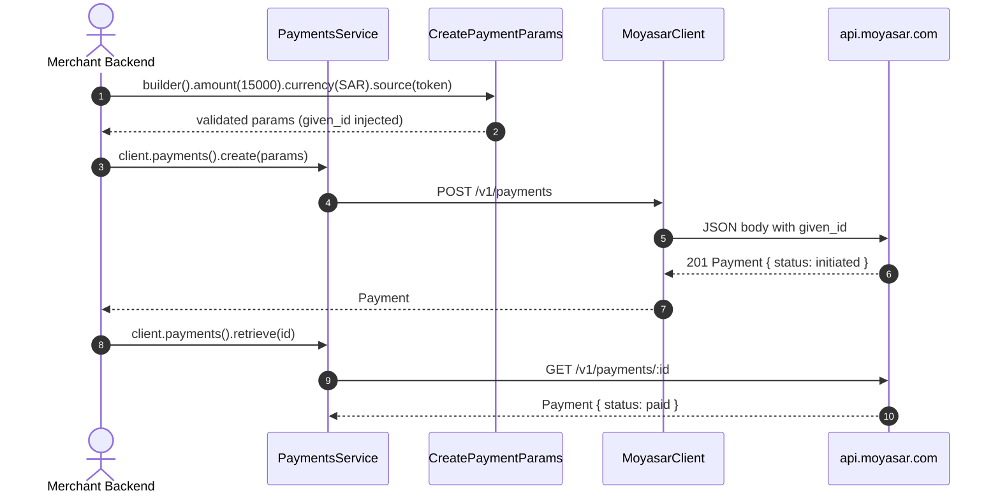

# US-2.1.0: Payment Creation, Retrieval & Filtered Listing

> **Spec Kit Specification**: [Specification Lifecycle Active](../../../docs/architecture/DECOMPOSITION_ROADMAP.md)  
> **Behavior Blueprint**: `features/core/modules/payments/behaviours/payment-crud/`  
> **Slicing Standard**: [10-PR Vertical Slicing Framework](../README.md#2-the-10-pr-vertical-slicing-framework-rust-sdk-adaptation)  
> **Security Gateway**: `security-audit` Level 2 Enforced  
> **Quality Gates**: `(G0–G4 + G-Review + G-Borrow + G-Law)`  

---

## 1. Spec Kit Specification

### 1.1 User Story Narrative
**As a** Saudi e-commerce backend engineer,  
**I want to** create, retrieve, and list payments through `client.payments()` with a builder that enforces Moyasar's required fields and body-injected `given_id`,  
**So that** I can accept Mada/STC Pay/credit card checkouts, poll payment state for reconciliation, and page through transaction history with server-side filters.

#### 1.1.1 Preconditions
- `some-moyasar` compiled with `features = ["payments"]` (implies `core`).
- A valid `SecretKey` for retrieve/list; `SecretKey` **or** `PublishableKey` for create.
- For source-based creation, a valid `PaymentSourceRequest` (see US-2.3.0 / US-2.4.0).

#### 1.1.2 Postconditions
- `POST /v1/payments` returns a `Payment` with `status` in `{initiated, paid, authorized, failed, verified, expired}`.
- `Payment` carries both integer minor-unit fields (`amount`, `fee`, `refunded`, `captured`) and pre-formatted strings (`amount_format`, `fee_format`, …).
- `GET /v1/payments/:id` returns the authoritative current state.
- `GET /v1/payments` returns `PaginatedList<Payment>` filtered by `page`, `id`, `status`, `created[gt|lt]`, `metadata[key]`.

### 1.2 Acceptance Criteria (Gherkin Scenarios)

```gherkin
Feature: Payment Creation, Retrieval and Listing

  Scenario: [AC-US-2.1.0-01] Create a payment with the minimal required fields
    Given a CreatePaymentParams with amount 15000, currency SAR, and a valid token source
    When client.payments().create(params) is called with a SecretKey
    Then the API receives POST /v1/payments with a body containing amount, currency and given_id
    And the response deserializes into a Payment whose amount equals 15000.

  Scenario: [AC-US-2.1.0-02] Payment response exposes both minor units and formatted strings
    Given a Payment fixture with amount 15000 and amount_format "150.00"
    When the Payment is deserialized
    Then payment.amount equals 15000 and payment.amount_format equals "150.00"
    And fee, refunded and captured follow the same dual representation.

  Scenario: [AC-US-2.1.0-03] Retrieve by id returns the authoritative state
    Given an existing payment id
    When client.payments().retrieve(id) is called
    Then the response Payment.id equals the requested id
    And a 404 response maps to MoyasarError::Api with ApiErrorType::RecordNotFound.

  Scenario: [AC-US-2.1.0-04] List with server-side filters and pagination
    Given a list request specifying status "paid", created[gt] and page 2
    When client.payments().list(params) is called
    Then the query string contains status=paid, created[gt]=<ts> and page=2
    And the response deserializes into PaginatedList<Payment> with meta.current_page == 2.

  Scenario: [AC-US-2.1.0-05] Metadata bracket-notation filter serialization
    Given a list request filtered by metadata["order_id"] with value "ORD-1"
    When the query string is serialized
    Then it contains the bracketed key metadata[order_id]=ORD-1.

  Scenario: [AC-US-2.1.0-LAW] Publishable-key isolation on create vs retrieve
    Given a MoyasarClient authenticated with a PublishableKey
    When code attempts client.payments().retrieve(id)
    Then the program fails to compile
    And create() remains available to satisfy the 4 documented pk_ origination routes.
```

### 1.3 Test Cases & Traceability Matrix

| Test Case ID | Target Criterion | Test Type | Execution Level | Verification Assertion & Pass Criteria |
| :--- | :--- | :--- | :--- | :--- |
| `TC-2.1.0-01` | `AC-US-2.1.0-01` | Functional | Integration | Mock asserts POST path, body contains `amount`, `currency`, `given_id`; Payment deserializes. |
| `TC-2.1.0-02` | `AC-US-2.1.0-02` | Functional | Unit | Dual-field deserialization test across amount/fee/refunded/captured. |
| `TC-2.1.0-03` | `AC-US-2.1.0-03` | Functional | Integration | 200 → matching id; 404 → `RecordNotFound`. |
| `TC-2.1.0-04` | `AC-US-2.1.0-04` | Functional | Unit | Query string byte-comparison against golden vector. |
| `TC-2.1.0-05` | `AC-US-2.1.0-05` | Functional | Unit | Bracketed metadata key present in serialized query. |
| `TC-2.1.0-LAW` | `AC-US-2.1.0-LAW` | Type Safety | Compile-fail (`trybuild`) | `pk_` + `retrieve()` fails to compile. |

---

## 2. Behavior-Centric Architecture & Folder Blueprint

### 2.1 Colocated Behaviour Directory Tree

```
features/core/modules/payments/behaviours/payment-crud/
├── services/        # PaymentsService accessor, create/retrieve/list dispatchers
├── logic/           # CreatePaymentParams builder, ListParams query serialization
├── types/           # Payment, PaymentStatus, PaymentId, CreatePaymentParams, ListParams
└── constants/       # PAYMENTS_PATH, DEFAULT_PAGE_SIZE
```

### 2.2 Scoping & Promotion Blueprint
- **Tier 1 (Behaviour-Local)**: query-string serializer for list filters.
- **Tier 2 (Module-Shared)**: `Payment` and `PaymentStatus` used by lifecycle, intents, webhooks.
- **Tier 3 (Feature-Shared)**: `PaymentsService` re-exported by the payments feature.
- **Tier 4 (Global-Shared)**: `client.payments()` on the root client facade.

---

## 3. Technical Implementation Plan

### 3.1 Domain Invariants & Storage Schema
- **Amount Law**: `amount` is always an integer in the currency's smallest unit (halalas for SAR).
- **State Law**: `PaymentStatus` is an exhaustive enum; unknown wire values deserialize to `Unknown(String)`.
- **Idempotency Law**: create() injects `given_id`; retrieve()/list() never do.
- **Bracket Notation Law**: metadata query filters use `metadata[key]=value`.

```rust
#[derive(Debug, Clone, Deserialize)]
pub struct Payment {
    pub id: Uuid,
    pub status: PaymentStatus,
    pub amount: u64,
    pub amount_format: String,
    pub fee: u64,
    pub fee_format: String,
    pub refunded: u64,
    pub refunded_format: String,
    pub captured: u64,
    pub captured_format: String,
    pub currency: Currency,
    pub description: Option<String>,
    pub source: PaymentSourceResponse,
    pub metadata: BTreeMap<String, String>,
    pub callback_url: Option<String>,
    pub created_at: DateTime<Utc>,
    pub updated_at: DateTime<Utc>,
}

#[derive(Debug, Clone, Copy, PartialEq, Eq, Deserialize)]
#[serde(rename_all = "lowercase")]
pub enum PaymentStatus {
    Initiated, Paid, Authorized, Failed, Verified, Expired,
    #[serde(other)]
    Unknown,
}
```

### 3.2 Activity & Interaction Diagram



---

## 4. Granular Implementation Tasks

### 4.1 The 10-PR Vertical Slicing Implementation Plan

| PR # | Pillar | Architectural Layer | Primary Scope & Files | Deliverables & Acceptance | Accountable Role / Agent | Assigned Skills |
| :--- | :--- | :--- | :--- | :--- | :--- | :--- |
| **PR 1** | **Pillar 1** | **Domain Logic & Core Traits** | `src/resources/payments/models.rs` | `Payment`, `PaymentStatus`, `PaymentId`. | `engineering-software-architect` | `security-audit` |
| **PR 2** | **Pillar 2** | **Request Modeling** | `src/resources/payments/params.rs` | `CreatePaymentParams` builder, `ListParams` with filters. | `engineering-backend-architect` | `security-audit` |
| **PR 3** | **Pillar 3** | **Transport Wire Adapter** | `src/resources/payments/create.rs` | `POST /v1/payments`, body serialization, `given_id` injection. | `engineering-backend-architect` | `security-audit` |
| **PR 4** | **Pillar 4** | **Service Accessor** | `src/resources/payments/service.rs` | `client.payments()` returning `PaymentsService<'a>`. | `engineering-software-architect` | `security-audit` |
| **PR 5** | **Pillar 5** | **Error Taxonomy** | `src/resources/payments/retrieve.rs` | 404 → `RecordNotFound`; 401/403 mapping. | `security-application-security-engineer` | `security-audit` |
| **PR 6** | **Pillar 6** | **Resource Facade Mounting** | `src/resources/payments/mod.rs` | Feature-gated `payments` module export. | `engineering-software-architect` | `security-audit` |
| **PR 7** | **Pillar 7** | **Zero-Copy Hardening** | `src/resources/payments/models.rs` | `PaymentId` newtype; borrowed description access. | `agency-rust-refactoring-specialist` | `security-audit` |
| **PR 8** | **Pillar 8** | **Edge Cases & Guards** | `src/resources/payments/list.rs` | Bracket-notation metadata filters; unknown status fallback. | `agency-api-tester` | `security-audit` |
| **PR 9** | **Pillar 9** | **Integration Wire Verification** | `tests/payments_crud_test.rs` | Create/retrieve/list against mock; filter assertions. | `agency-api-tester` | `security-audit` |
| **PR 10** | **Pillar 10** | **Documentation & Packaging** | `README.md`, `src/resources/payments/` | Doc-tests, feature flags, README quick-start. | `engineering-technical-writer` | `security-audit` |

### 4.2 Implementation Phase Breakdown

#### Phase 1: Models & Params (PR 1–2)
- [ ] **Task 1.1 (Types)**: `Payment` with dual minor-unit/formatted fields, `PaymentStatus`, `PaymentId`.  
  *Agent*: `engineering-software-architect` | *Skill*: `security-audit`
- [ ] **Task 1.2 (Params)**: `CreatePaymentParams::builder()` with required-field enforcement.  
  *Agent*: `engineering-backend-architect` | *Skill*: `security-audit`
- [ ] **Task 1.3 (List Params)**: `ListParams` with status/date/metadata filters.  
  *Agent*: `engineering-backend-architect` | *Skill*: `security-audit`
- [ ] **Task 1.4 (Unit Tests)**: Dual-field deserialization across all monetary fields.  
  *Agent*: `agency-api-tester` | *Skill*: `security-audit`

#### Phase 2: Endpoints & Service Accessor (PR 3–6)
- [ ] **Task 2.1 (Create)**: `POST /v1/payments` with `given_id` body injection.  
  *Agent*: `engineering-backend-architect` | *Skill*: `security-audit`
- [ ] **Task 2.2 (Retrieve)**: `GET /v1/payments/:id`, 404 → `RecordNotFound`.  
  *Agent*: `engineering-backend-architect` | *Skill*: `security-audit`
- [ ] **Task 2.3 (List)**: `GET /v1/payments` returning `PaginatedList<Payment>`.  
  *Agent*: `engineering-backend-architect` | *Skill*: `security-audit`
- [ ] **Task 2.4 (Accessor)**: zero-cost `PaymentsService<'a>(&'a MoyasarClient)`.  
  *Agent*: `engineering-software-architect` | *Skill*: `security-audit`

#### Phase 3: Edge Cases & Hardening (PR 7–8)
- [ ] **Task 3.1 (Borrow Audit)**: eliminate deep clones in model accessors.  
  *Agent*: `agency-rust-refactoring-specialist` | *Skill*: `security-audit`
- [ ] **Task 3.2 (Filters)**: bracket-notation `metadata[key]` serialization tests.  
  *Agent*: `agency-api-tester` | *Skill*: `security-audit`

#### Phase 4: Verification & Sign-Off (PR 9–10)
- [ ] **Task 4.1 (Wire Tests)**: create/retrieve/list end-to-end against mock server.  
  *Agent*: `agency-api-tester` | *Skill*: `security-audit`
- [ ] **Task 4.2 (G-Review)**: peer review on state handling and query serialization.  
  *Agent*: `agency-code-reviewer` | *Skill*: `security-audit`
- [ ] **Task 4.3 (Documentation)**: doc-tests and README quick-start.  
  *Agent*: `engineering-technical-writer` | *Skill*: `security-audit`

---

## 5. Security Gateway (Powered by security-audit)

### 5.1 Trust Boundaries & Security Actors
- **Trust Boundaries**:
  - `Key-Type Boundary`: create accepts `pk_`; retrieve/list require `sk_`.
  - `Data Boundary`: `Payment` objects contain metadata and payer IP — PII-adjacent.
- **Authorized Principals**: merchant backend (`sk_`), merchant storefront (`pk_`).

### 5.2 Threat Modeling & Abuse Matrix (STRIDE / ASVS)

| Threat Vector | Severity | Vulnerability Mechanism | Mitigating Control & Security Invariant |
| :--- | :--- | :--- | :--- |
| **Privilege Escalation** | Critical | Publishable key reading payment history | Compile-time `SecretKey` bound on retrieve/list. |
| **Enumeration** | Medium | Sequential id guessing exposes other merchants' payments | UUIDv4 ids; authorization enforced server-side by key ownership. |
| **Log Leakage** | High | Full `Payment` serialized into logs includes metadata PII | `Debug` on `Payment` excludes `metadata` values by default. |
| **Query Injection** | High | Unsanitized metadata key breaking query structure | Keys percent-encoded; bracket notation escaped. |
| **Double Charge** | Critical | Retried create without idempotency | `given_id` mandatory on create. |

### 5.3 Cryptographic & Data Protection Controls
- **Identifier Entropy**: UUIDv4 payment ids, not sequential.
- **Key-Type Enforcement**: `SecretKey` bound on all read operations.
- **Query Encoding**: all filter values percent-encoded before transmission.

### 5.4 Automated Security Verification Checklist
- [ ] **Key-Type Test**: `trybuild` proves `pk_` cannot call `retrieve()`/`list()`.
- [ ] **PII Log Test**: `format!("{:?}", payment)` does not print metadata values.
- [ ] **Query Encoding Test**: special characters in metadata keys are escaped.
- [ ] **Idempotency Test**: create always emits `given_id`.

### 5.5 Security Gateway (G2) Sign-Off Checklist
- [ ] Trust boundaries verified against OWASP ASVS Level 2.
- [ ] Key-type isolation verified for all three endpoints.
- [ ] Zero PII in default `Debug` output.
- [ ] Independent reviewer sign-off; zero open findings.

---

## 6. Validation Gates & Acceptance Sign-Off

**Status: Ready for Implementation.**

### G0 — Build, lint & format
- [ ] **US-2.1.0-G0:** `cargo build && cargo clippy -- -D warnings && cargo fmt --check` clean.

### G1 — Test coverage
- [ ] **US-2.1.0-G1:** ≥90% line / ≥85% branch on the payments CRUD module.

### G2 — Security audit
- [ ] **US-2.1.0-G2:** Zero critical/high findings on key-type and PII handling.

### G3 — Architecture and maintainability
- [ ] **US-2.1.0-G3:** Resource module depends only on the kernel; zero cross-resource coupling.

### G-Review — Code review
- [ ] **US-2.1.0-G-Review:** Peer review by `agency-code-reviewer`.

### G-Borrow — Rust zero-clone validation
- [ ] **US-2.1.0-G-Borrow:** `PaymentsService` borrows the client; zero deep clones.

### G-Complexity — Cyclomatic complexity
- [ ] **US-2.1.0-G-Complexity:** $CC \le 6$; nesting $\le 2$.

### G-Docs — Public docs & examples
- [ ] **US-2.1.0-G-Docs:** 100% public symbols documented; create→retrieve example runnable.

### G-Law — Law validation
- [ ] **US-2.1.0-G-Law:** PCI-DSS 4.0 data-minimization and SAMA transaction-record retention certified.

### G4 — Integrated acceptance
- [ ] **US-2.1.0-G4:** Create → retrieve → list round-trip succeeds against the mock server.
