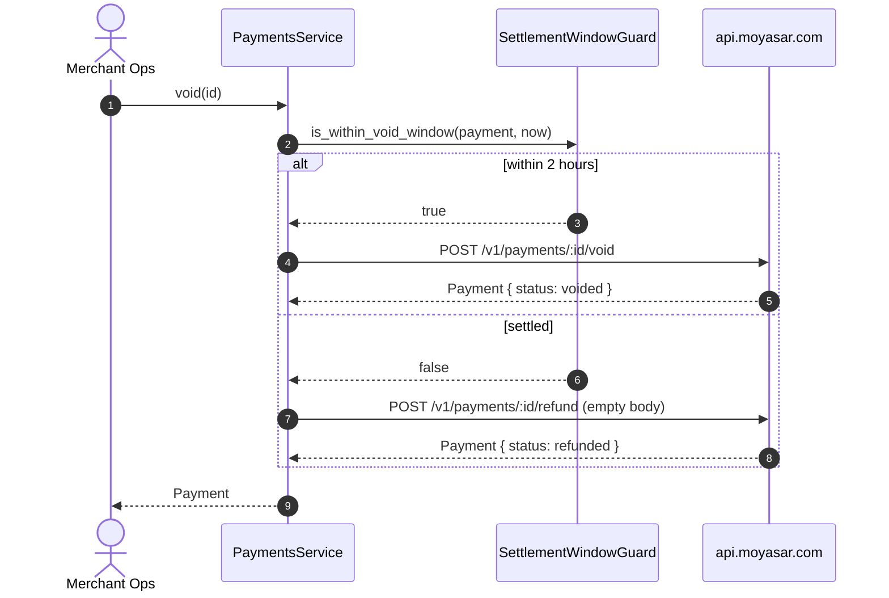

# US-2.2.0: Payment Update, Capture, Void & Refund with Settlement-Window Routing

> **Spec Kit Specification**: [Specification Lifecycle Active](../../../docs/architecture/DECOMPOSITION_ROADMAP.md)  
> **Behavior Blueprint**: `features/core/modules/payments/behaviours/payment-lifecycle/`  
> **Slicing Standard**: [10-PR Vertical Slicing Framework](../README.md#2-the-10-pr-vertical-slicing-framework-rust-sdk-adaptation)  
> **Security Gateway**: `security-audit` Level 2 Enforced  
> **Quality Gates**: `(G0–G4 + G-Review + G-Borrow + G-Law)`  

---

## 1. Spec Kit Specification

### 1.1 User Story Narrative
**As a** merchant operations engineer reconciling authorizations and handling cancellations,  
**I want to** update payment metadata, capture authorized holds (full or partial), void within the ~2-hour unsettled window, and refund settled transactions — with automatic void-or-refund routing,  
**So that** my team can release funds correctly, avoids failed voids after settlement, and never strands a customer's money in a hold that the issuer will silently release without updating Moyasar's status.

#### 1.1.1 Preconditions
- `features = ["payments"]`; a valid `SecretKey`.
- The target payment exists and its current `PaymentStatus` is known.

#### 1.1.2 Postconditions
- `update()` mutates `description` and `metadata`; an empty-string metadata value unsets that key.
- `capture(id, Some(amount))` captures a partial amount; `capture(id, None)` captures the full hold.
- `void()` succeeds only within ~2 hours of the original transaction, before settlement.
- `refund(id, None)` refunds the full captured/paid amount; `refund(id, Some(n))` issues a partial refund.
- Smart routing retries as a refund when a void fails on a `paid`/`captured` payment.

### 1.2 Acceptance Criteria (Gherkin Scenarios)

```gherkin
Feature: Payment Lifecycle Operations

  Scenario: [AC-US-2.2.0-01] Update description and metadata
    Given an existing payment
    When client.payments().update(id, params) is called with a new description
    Then the API receives PUT /v1/payments/:id with the new description
    And the returned Payment.description reflects the change.

  Scenario: [AC-US-2.2.0-02] Unset a metadata key via empty string
    Given a payment with metadata key "order_id"
    When update() is called with "order_id" set to an empty string
    Then the request body contains "metadata": { "order_id": "" }
    And the key is unset on the server.

  Scenario: [AC-US-2.2.0-03] Full and partial capture of an authorized payment
    Given a payment with status "authorized" and amount 10000
    When capture(id, Some(4000)) is called
    Then the request body contains { "amount": 4000 }
    And the resulting Payment.captured equals 4000
    And capture(id, None) sends an empty body to capture the full amount.

  Scenario: [AC-US-2.2.0-04] Void within the unsettled window
    Given a payment with status "authorized" created 30 minutes ago
    When void(id) is called
    Then the API receives POST /v1/payments/:id/void with no request body
    And the resulting Payment.status equals "voided".

  Scenario: [AC-US-2.2.0-05] Full refund omits the body; partial refund includes the amount
    Given a payment with status "paid" and amount 10000
    When refund(id, None) is called
    Then the request body is empty and the full amount is refunded
    And refund(id, Some(5000)) sends { "amount": 5000 }.

  Scenario: [AC-US-2.2.0-06] Smart void-or-refund routing after settlement
    Given a payment with status "paid" created 5 hours ago (settled)
    When the smart routing strategy is invoked
    Then void() is NOT attempted because the 2-hour window has elapsed
    And a refund() is issued instead.

  Scenario: [AC-US-2.2.0-07] Mada 14-day capture window awareness
    Given an authorized Mada payment created 15 days ago
    When capture(id, None) is called
    Then the SDK surfaces a documentation-level warning that the issuer hold has likely expired
    And does not report the payment as settled merely because status still reads "authorized".

  Scenario: [AC-US-2.2.0-LAW] SAMA refund traceability and balance sufficiency
    Given any refund operation
    When the refund is executed
    Then the resulting refunded_at timestamp and refunded amount are persisted for audit,
         satisfying SAMA reconciliation requirements for merchant-initiated reversals.
```

### 1.3 Test Cases & Traceability Matrix

| Test Case ID | Target Criterion | Test Type | Execution Level | Verification Assertion & Pass Criteria |
| :--- | :--- | :--- | :--- | :--- |
| `TC-2.2.0-01` | `AC-US-2.2.0-01` | Functional | Integration | PUT body contains new description; response reflects it. |
| `TC-2.2.0-02` | `AC-US-2.2.0-02` | Functional | Unit | Empty-string value serialized verbatim. |
| `TC-2.2.0-03` | `AC-US-2.2.0-03` | Functional | Integration | Partial capture body has amount; full capture body is empty. |
| `TC-2.2.0-04` | `AC-US-2.2.0-04` | Functional | Integration | Void sends empty body; status becomes `voided`. |
| `TC-2.2.0-05` | `AC-US-2.2.0-05` | Functional | Integration | Full refund body empty; partial refund body has amount. |
| `TC-2.2.0-06` | `AC-US-2.2.0-06` | State Machine | Unit | Settled payment routes to refund, never void. |
| `TC-2.2.0-07` | `AC-US-2.2.0-07` | State Machine | Unit | Age > 14 days on Mada triggers warning path. |
| `TC-2.2.0-LAW` | `AC-US-2.2.0-LAW` | Compliance | Static / Audit | `refunded_at` and amount recorded on every reversal. |

---

## 2. Behavior-Centric Architecture & Folder Blueprint

### 2.1 Colocated Behaviour Directory Tree

```
features/core/modules/payments/behaviours/payment-lifecycle/
├── services/        # capture(), void(), refund(), update() dispatchers
├── logic/           # Settlement-window guards, void-or-refund routing strategy
├── types/           # UpdatePaymentParams, CaptureParams, RefundParams, ReversalStrategy
└── constants/       # VOID_WINDOW_SECS (7200), MADA_CAPTURE_WINDOW_DAYS (14)
```

### 2.2 Scoping & Promotion Blueprint
- **Tier 1 (Behaviour-Local)**: settlement-window clock arithmetic.
- **Tier 2 (Module-Shared)**: `ReversalStrategy` used by stripe-compat refunds.
- **Tier 3 (Feature-Shared)**: lifecycle methods on `PaymentsService`.
- **Tier 4 (Global-Shared)**: accessible via `client.payments()`.

---

## 3. Technical Implementation Plan

### 3.1 Domain Invariants & Storage Schema
- **Window Law**: `VOID_WINDOW_SECS = 7200`. After that, only `refund()` is permitted.
- **Silent-State Law**: Mada holds expire after 14 days while `status` remains `authorized`. The SDK must never treat `authorized` as proof of an active hold.
- **Body-Omission Law**: `refund(id, None)` sends **no** body — adding `{"amount": null}` is a bug.
- **Idempotency Law**: lifecycle mutations are retried only on network errors/timeouts/5xx.

```rust
pub enum ReversalStrategy {
    Void,
    Refund { amount: Option<u64> },
    Auto,
}

impl PaymentsService<'_> {
    pub fn plan_reversal(&self, payment: &Payment, now: DateTime<Utc>) -> ReversalStrategy {
        let age = now - payment.created_at;
        let unsettled = age.num_seconds() < VOID_WINDOW_SECS;
        match (payment.status, unsettled) {
            (PaymentStatus::Authorized, _) => ReversalStrategy::Void,
            (PaymentStatus::Paid | PaymentStatus::Captured, true) => ReversalStrategy::Void,
            _ => ReversalStrategy::Refund { amount: None },
        }
    }
}
```

### 3.2 Activity & Interaction Diagram



---

## 4. Granular Implementation Tasks

### 4.1 The 10-PR Vertical Slicing Implementation Plan

| PR # | Pillar | Architectural Layer | Primary Scope & Files | Deliverables & Acceptance | Accountable Role / Agent | Assigned Skills |
| :--- | :--- | :--- | :--- | :--- | :--- | :--- |
| **PR 1** | **Pillar 1** | **Domain Logic & Core Traits** | `src/resources/payments/lifecycle.rs` | `ReversalStrategy` enum, window constants. | `engineering-software-architect` | `security-audit` |
| **PR 2** | **Pillar 2** | **Request Modeling** | `src/resources/payments/params.rs` | `UpdatePaymentParams`, `CaptureParams`, `RefundParams`. | `engineering-backend-architect` | `security-audit` |
| **PR 3** | **Pillar 3** | **Transport Wire Adapter** | `src/resources/payments/update.rs` | `PUT /v1/payments/:id`. | `engineering-backend-architect` | `security-audit` |
| **PR 4** | **Pillar 4** | **Service Accessor** | `src/resources/payments/capture.rs` | `capture(id, Option<u64>)` full/partial. | `engineering-software-architect` | `security-audit` |
| **PR 5** | **Pillar 5** | **Error Taxonomy** | `src/resources/payments/void.rs` | Void failure mapping; refund fallback trigger. | `security-application-security-engineer` | `security-audit` |
| **PR 6** | **Pillar 6** | **Resource Facade Mounting** | `src/resources/payments/refund.rs` | `refund(id, Option<u64>)` with body omission. | `engineering-software-architect` | `security-audit` |
| **PR 7** | **Pillar 7** | **Zero-Copy Hardening** | `src/resources/payments/lifecycle.rs` | Clock arithmetic without allocation. | `agency-rust-refactoring-specialist` | `security-audit` |
| **PR 8** | **Pillar 8** | **Edge Cases & Guards** | `src/resources/payments/smart_void.rs` | 2-hour routing, Mada 14-day warning path. | `agency-api-tester` | `security-audit` |
| **PR 9** | **Pillar 9** | **Integration Wire Verification** | `tests/payment_lifecycle_test.rs` | All four operations + routing branches. | `agency-api-tester` | `security-audit` |
| **PR 10** | **Pillar 10** | **Documentation & Packaging** | `README.md` | Doc-tests documenting window semantics. | `engineering-technical-writer` | `security-audit` |

### 4.2 Implementation Phase Breakdown

#### Phase 1: Strategy & Params (PR 1–2)
- [ ] **Task 1.1 (Types)**: `ReversalStrategy`, `VOID_WINDOW_SECS`, `MADA_CAPTURE_WINDOW_DAYS`.  
  *Agent*: `engineering-software-architect` | *Skill*: `security-audit`
- [ ] **Task 1.2 (Params)**: update/capture/refund param structs.  
  *Agent*: `engineering-backend-architect` | *Skill*: `security-audit`
- [ ] **Task 1.3 (Unit Tests)**: window boundary at exactly 7200s.  
  *Agent*: `agency-api-tester` | *Skill*: `security-audit`

#### Phase 2: Endpoints (PR 3–6)
- [ ] **Task 2.1 (Update)**: `PUT` with description/metadata mutation.  
  *Agent*: `engineering-backend-architect` | *Skill*: `security-audit`
- [ ] **Task 2.2 (Capture)**: full vs partial capture bodies.  
  *Agent*: `engineering-software-architect` | *Skill*: `security-audit`
- [ ] **Task 2.3 (Void)**: empty-body POST; status transitions.  
  *Agent*: `engineering-backend-architect` | *Skill*: `security-audit`
- [ ] **Task 2.4 (Refund)**: body omission for full refund.  
  *Agent*: `engineering-software-architect` | *Skill*: `security-audit`

#### Phase 3: Routing & Edge Cases (PR 7–8)
- [ ] **Task 3.1 (Smart Routing)**: void→refund fallback on settled payments.  
  *Agent*: `agency-api-tester` | *Skill*: `security-audit`
- [ ] **Task 3.2 (Mada Window)**: 14-day hold-expiry awareness and warning.  
  *Agent*: `agency-api-tester` | *Skill*: `security-audit`

#### Phase 4: Verification & Sign-Off (PR 9–10)
- [ ] **Task 4.1 (Wire Tests)**: all operations and every routing branch.  
  *Agent*: `agency-api-tester` | *Skill*: `security-audit`
- [ ] **Task 4.2 (G-Review)**: peer review on state machine correctness.  
  *Agent*: `agency-code-reviewer` | *Skill*: `security-audit`
- [ ] **Task 4.3 (Documentation)**: doc-tests covering window semantics.  
  *Agent*: `engineering-technical-writer` | *Skill*: `security-audit`

---

## 5. Security Gateway (Powered by security-audit)

### 5.1 Trust Boundaries & Security Actors
- **Trust Boundaries**:
  - `Reversal Boundary`: money-moving operations requiring strong authorization.
  - `Settlement Boundary`: the 2-hour void window is a real financial boundary.
- **Authorized Principals**: merchant backend holding a `SecretKey`.

### 5.2 Threat Modeling & Abuse Matrix (STRIDE / ASVS)

| Threat Vector | Severity | Vulnerability Mechanism | Mitigating Control & Security Invariant |
| :--- | :--- | :--- | :--- |
| **Financial Loss** | Critical | Void attempted after settlement always fails; funds stuck | Automatic refund fallback in the smart routing strategy. |
| **Double Refund** | Critical | Retried refund after timeout refunds twice | Retry uses the same request identity; 4xx never retried. |
| **Silent Hold Expiry** | High | Mada hold released but status stays `authorized` | 14-day window documented; SDK avoids asserting settlement. |
| **Unauthorized Reversal** | Critical | Reversal called without adequate authority | `SecretKey`-only methods; no `pk_` access path. |
| **Amount Tampering** | High | Partial refund exceeds captured amount | Client-side guard rejects `amount > captured`. |

### 5.3 Cryptographic & Data Protection Controls
- **Key-Type Enforcement**: all lifecycle operations require `SecretKey`.
- **Amount Bounds**: partial refund/capture amounts validated against `captured`/`amount`.
- **Audit Fields**: `voided_at`, `refunded_at`, `captured_at` preserved verbatim.

### 5.4 Automated Security Verification Checklist
- [ ] **Bounds Test**: refund amount > captured is rejected client-side.
- [ ] **Key-Type Test**: no `pk_` path reaches capture/void/refund.
- [ ] **Retry Test**: refund retry does not double-refund.
- [ ] **Routing Test**: settled payment never issues a void.

### 5.5 Security Gateway (G2) Sign-Off Checklist
- [ ] Reversal authorization verified against OWASP ASVS Level 2.
- [ ] Amount bounds enforced before transmission.
- [ ] Audit timestamps preserved on every reversal.
- [ ] Independent reviewer sign-off; zero open findings.

---

## 6. Validation Gates & Acceptance Sign-Off

**Status: Ready for Implementation.**

### G0 — Build, lint & format
- [ ] **US-2.2.0-G0:** `cargo build && cargo clippy -- -D warnings && cargo fmt --check` clean.

### G1 — Test coverage
- [ ] **US-2.2.0-G1:** ≥90% line / ≥85% branch on lifecycle operations.

### G2 — Security audit
- [ ] **US-2.2.0-G2:** Financial-safety audit passes with zero critical/high findings.

### G3 — Architecture and maintainability
- [ ] **US-2.2.0-G3:** Routing strategy isolated from transport; testable without network.

### G-Review — Code review
- [ ] **US-2.2.0-G-Review:** Peer review on the reversal state machine.

### G-Borrow — Rust zero-clone validation
- [ ] **US-2.2.0-G-Borrow:** Zero deep clones in routing and guard paths.

### G-Complexity — Cyclomatic complexity
- [ ] **US-2.2.0-G-Complexity:** $CC \le 6$; nesting $\le 2$ (routing expressed as a `match` table).

### G-Docs — Public docs & examples
- [ ] **US-2.2.0-G-Docs:** Window semantics documented with runnable doc-tests.

### G-Law — Law validation
- [ ] **US-2.2.0-G-Law:** SAMA reversal-reconciliation traceability certified.

### G4 — Integrated acceptance
- [ ] **US-2.2.0-G4:** All four operations plus both routing branches verified against mock server.
