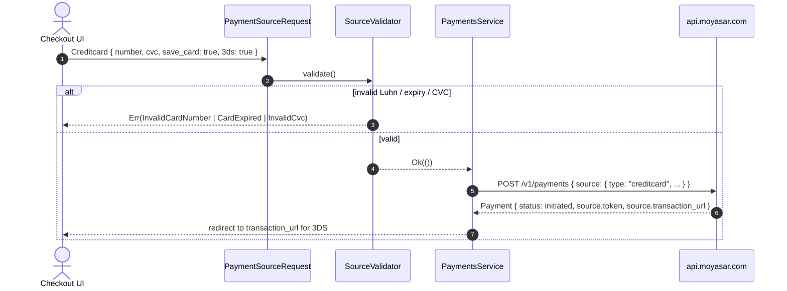

# US-2.3.0: Polymorphic Payment Sources — Card, Digital Wallets & Saved Tokens

> **Spec Kit Specification**: [Specification Lifecycle Active](../../../docs/architecture/DECOMPOSITION_ROADMAP.md)  
> **Behavior Blueprint**: `features/core/modules/payments/behaviours/source-request-types/`  
> **Slicing Standard**: [10-PR Vertical Slicing Framework](../README.md#2-the-10-pr-vertical-slicing-framework-rust-sdk-adaptation)  
> **Security Gateway**: `security-audit` Level 2 Enforced  
> **Quality Gates**: `(G0–G4 + G-Review + G-Borrow + G-Law)`  

---

## 1. Spec Kit Specification

### 1.1 User Story Narrative
**As a** checkout engineer supporting Saudi payment instruments,  
**I want to** model every Moyasar payment instrument as a strongly typed `PaymentSourceRequest` variant — credit/debit card (Mada, Visa, Mastercard, Amex, UnionPay), Apple Pay, Samsung Pay, and saved card token — with brand-aware validation,  
**So that** invalid card data is rejected before a network round-trip, the `type` discriminator is always correct on the wire, and 3DS/save-card/manual-capture flags are impossible to set on instruments that don't support them.

#### 1.1.1 Preconditions
- `features = ["payments"]`.
- Caller has collected instrument data (card fields, wallet token, or saved token id).

#### 1.1.2 Postconditions
- `PaymentSourceRequest` serializes with `#[serde(tag = "type", rename_all = "lowercase")]` producing `"creditcard"`, `"applepay"`, `"samsungpay"`, `"token"`.
- Card validation enforces Luhn checksum, expiry in the future, and CVC length by brand (3 digits, 4 for AMEX).
- `save_card: true` on a card/wallet source yields `source.token` in the **initiated** response, before the 3DS redirect.
- `PaymentSourceResponse` deserializes the full issuer metadata: `company`, masked `number`, `gateway_id`, `reference_number`, `authorization_code`, `response_code`, `issuer_name`, `issuer_country`, `issuer_card_type`, `issuer_card_category`.

### 1.2 Acceptance Criteria (Gherkin Scenarios)

```gherkin
Feature: Polymorphic Payment Source Request Types

  Scenario: [AC-US-2.3.0-01] Tagged-union serialization with lowercase type discriminator
    Given a PaymentSourceRequest::CreditCard variant
    When the source is serialized into a payment body
    Then the JSON contains "type": "creditcard"
    And ApplePay serializes as "type": "applepay", SamsungPay as "samsungpay", Token as "token".

  Scenario: [AC-US-2.3.0-02] Luhn checksum rejection of malformed card numbers
    Given a card number "4111111111111112" (invalid Luhn)
    When CreditCardSource::new() validates it
    Then the call returns Err(MoyasarError::InvalidCardNumber)
    And "4111111111111111" (valid Luhn) is accepted.

  Scenario: [AC-US-2.3.0-03] Brand-aware CVC length validation
    Given an AMEX card number beginning with 34 or 37
    When a 3-digit CVC is supplied
    Then validation returns Err(MoyasarError::InvalidCvc)
    And a 4-digit CVC is accepted for AMEX while 3 digits remain valid for Visa/Mada.

  Scenario: [AC-US-2.3.0-04] Expiry date must be in the future
    Given a card with month 12 and year 2020
    When the expiry is validated against the current date
    Then the call returns Err(MoyasarError::CardExpired)
    And a month/year combination in the future is accepted.

  Scenario: [AC-US-2.3.0-05] save_card returns a token before the 3DS redirect
    Given a credit card source with save_card true and 3ds true
    When the payment is created
    Then the response status is "initiated"
    And source.token is populated with a "token_..." value
    And source.transaction_url is present for the 3DS challenge.

  Scenario: [AC-US-2.3.0-06] Token source charges a saved card without 3DS by default
    Given a PaymentSourceRequest::Token with token "token_abc" and no explicit 3ds flag
    When the payment is created with a SecretKey
    Then the request body contains "type": "token" and "token": "token_abc"
    And no 3ds field is emitted, so the charge proceeds without a challenge.

  Scenario: [AC-US-2.3.0-07] Response deserializes full issuer metadata
    Given a credit card response fixture with company "mada" and response_code "00"
    When deserialized into PaymentSourceResponse
    Then company equals Mada, response_code equals IssuerApproved
    And issuer_card_type equals Debit.

  Scenario: [AC-US-2.3.0-LAW] PCI-DSS prohibition on persisting PAN and CVC
    Given any card source
    When the source is constructed and transmitted
    Then the full PAN and CVC are never written to logs, Debug output, or error messages,
         and only the masked number is retained in the response model, satisfying PCI-DSS 4.0 Requirement 3.2.
```

### 1.3 Test Cases & Traceability Matrix

| Test Case ID | Target Criterion | Test Type | Execution Level | Verification Assertion & Pass Criteria |
| :--- | :--- | :--- | :--- | :--- |
| `TC-2.3.0-01` | `AC-US-2.3.0-01` | Functional | Unit | Roundtrip serde for all four variants; `type` string exact. |
| `TC-2.3.0-02` | `AC-US-2.3.0-02` | Validation | Unit | Luhn table: 10 valid, 10 invalid numbers. |
| `TC-2.3.0-03` | `AC-US-2.3.0-03` | Validation | Unit | AMEX 3-digit rejected, 4-digit accepted; Visa 3-digit accepted. |
| `TC-2.3.0-04` | `AC-US-2.3.0-04` | Validation | Unit | Past expiry rejected; current-month boundary accepted. |
| `TC-2.3.0-05` | `AC-US-2.3.0-05` | Functional | Integration | Initiated response contains `token` and `transaction_url`. |
| `TC-2.3.0-06` | `AC-US-2.3.0-06` | Functional | Unit | Token body has no `3ds` key when unset. |
| `TC-2.3.0-07` | `AC-US-2.3.0-07` | Functional | Unit | Fixture deserializes to typed `company`/`response_code`/`issuer_card_type`. |
| `TC-2.3.0-LAW` | `AC-US-2.3.0-LAW` | Security | Unit / SAST | `format!("{:?}", source)` contains no full PAN and no CVC. |

---

## 2. Behavior-Centric Architecture & Folder Blueprint

### 2.1 Colocated Behaviour Directory Tree

```
features/core/modules/payments/behaviours/source-request-types/
├── services/        # SourceValidator dispatch by variant
├── logic/           # Luhn, expiry, CVC-by-brand, mobile/IBAN helpers
├── types/           # PaymentSourceRequest, PaymentSourceResponse, CardBrand, IssuerCardType
└── constants/       # AMEX_PREFIXES, CVC_LEN_DEFAULT, CVC_LEN_AMEX
```

### 2.2 Scoping & Promotion Blueprint
- **Tier 1 (Behaviour-Local)**: Luhn and expiry validators.
- **Tier 2 (Module-Shared)**: `PaymentSourceRequest` used by payments and intents.
- **Tier 3 (Feature-Shared)**: `PaymentSourceResponse` used by webhook payload parsing.
- **Tier 4 (Global-Shared)**: exported via `prelude::*`.

---

## 3. Technical Implementation Plan

### 3.1 Domain Invariants & Storage Schema
- **Discriminator Law**: `#[serde(tag = "type", rename_all = "lowercase")]` — the wire value is always lowercase.
- **Validation-Before-Transport Law**: card validation runs client-side; no invalid PAN reaches the network.
- **PAN Non-Retention Law**: request structs holding a PAN must not derive `Debug`; `Display` is forbidden.
- **Flag Applicability Law**: `3ds`/`save_card`/`manual` exist only on variants that support them.

```rust
#[derive(Serialize)]
#[serde(tag = "type", rename_all = "lowercase")]
pub enum PaymentSourceRequest {
    Creditcard(CreditCardSource),
    Applepay(ApplePaySource),
    Samsungpay(SamsungPaySource),
    Token(TokenSource),
}

pub struct CreditCardSource {
    pub name: String,
    pub number: String,          // never Debug-printed
    pub month: u8,
    pub year: u16,
    pub cvc: String,             // never Debug-printed
    pub statement_descriptor: Option<String>,
    pub manual: Option<bool>,
    pub save_card: Option<bool>,
    #[serde(rename = "3ds")]
    pub three_ds: Option<bool>,
    pub card_auth_id: Option<String>,
    pub card_auth_data: Option<serde_json::Value>,
}

pub fn luhn_valid(number: &str) -> bool {
    let digits: Vec<u32> = number.chars().filter_map(|c| c.to_digit(10)).collect();
    if digits.len() < 12 { return false; }
    let sum: u32 = digits.iter().rev().enumerate().map(|(i, &d)| {
        if i % 2 == 1 { let d2 = d * 2; if d2 > 9 { d2 - 9 } else { d2 } } else { d }
    }).sum();
    sum % 10 == 0
}
```

### 3.2 Activity & Interaction Diagram



---

## 4. Granular Implementation Tasks

### 4.1 The 10-PR Vertical Slicing Implementation Plan

| PR # | Pillar | Architectural Layer | Primary Scope & Files | Deliverables & Acceptance | Accountable Role / Agent | Assigned Skills |
| :--- | :--- | :--- | :--- | :--- | :--- | :--- |
| **PR 1** | **Pillar 1** | **Domain Logic & Core Traits** | `src/resources/payments/source.rs` | `PaymentSourceRequest`/`Response` tagged enums. | `engineering-software-architect` | `security-audit` |
| **PR 2** | **Pillar 2** | **Request Modeling** | `src/resources/payments/source_card.rs` | `CreditCardSource` with all documented fields. | `engineering-backend-architect` | `security-audit` |
| **PR 3** | **Pillar 3** | **Transport Wire Adapter** | `src/resources/payments/source_wallet.rs` | Apple Pay / Samsung Pay variants and serialization. | `engineering-backend-architect` | `security-audit` |
| **PR 4** | **Pillar 4** | **Service Accessor** | `src/resources/payments/source_token.rs` | `TokenSource` with optional 3ds/manual/cvc. | `engineering-software-architect` | `security-audit` |
| **PR 5** | **Pillar 5** | **Error Taxonomy** | `src/kernel/error.rs` | `InvalidCardNumber`, `CardExpired`, `InvalidCvc` variants. | `security-application-security-engineer` | `security-audit` |
| **PR 6** | **Pillar 6** | **Resource Facade Mounting** | `src/resources/payments/mod.rs` | Export source types under `payments`. | `engineering-software-architect` | `security-audit` |
| **PR 7** | **Pillar 7** | **Zero-Copy Hardening** | `src/resources/payments/source_card.rs` | No `Debug` derive on PAN/CVC holders; borrowed validation. | `agency-rust-refactoring-specialist` | `security-audit` |
| **PR 8** | **Pillar 8** | **Edge Cases & Guards** | `src/resources/payments/card_validation.rs` | Luhn, expiry boundary, CVC-by-brand. | `agency-api-tester` | `security-audit` |
| **PR 9** | **Pillar 9** | **Integration Wire Verification** | `tests/source_serde_test.rs` | Roundtrip serde for every variant + issuer metadata. | `agency-api-tester` | `security-audit` |
| **PR 10** | **Pillar 10** | **Documentation & Packaging** | `README.md` | Doc-tests per source variant. | `engineering-technical-writer` | `security-audit` |

### 4.2 Implementation Phase Breakdown

#### Phase 1: Tagged Union & Card Model (PR 1–2)
- [ ] **Task 1.1 (Enum)**: `PaymentSourceRequest`/`PaymentSourceResponse` with `tag = "type"`.  
  *Agent*: `engineering-software-architect` | *Skill*: `security-audit`
- [ ] **Task 1.2 (Card)**: `CreditCardSource` with all documented request fields.  
  *Agent*: `engineering-backend-architect` | *Skill*: `security-audit`
- [ ] **Task 1.3 (Unit Tests)**: serde roundtrip for the card variant.  
  *Agent*: `agency-api-tester` | *Skill*: `security-audit`

#### Phase 2: Wallets & Token (PR 3–6)
- [ ] **Task 2.1 (Apple Pay)**: token/cryptogram, manual, save_card, statement_descriptor.  
  *Agent*: `engineering-backend-architect` | *Skill*: `security-audit`
- [ ] **Task 2.2 (Samsung Pay)**: mirror structure with `sp` gateway subtype.  
  *Agent*: `engineering-backend-architect` | *Skill*: `security-audit`
- [ ] **Task 2.3 (Token)**: `TokenSource` with optional 3ds/manual/cvc.  
  *Agent*: `engineering-software-architect` | *Skill*: `security-audit`
- [ ] **Task 2.4 (Errors)**: card validation error variants.  
  *Agent*: `security-application-security-engineer` | *Skill*: `security-audit`

#### Phase 3: Validation & Hardening (PR 7–8)
- [ ] **Task 3.1 (Luhn)**: checksum implementation with table tests.  
  *Agent*: `agency-api-tester` | *Skill*: `security-audit`
- [ ] **Task 3.2 (Expiry)**: month/year validation against current date.  
  *Agent*: `agency-api-tester` | *Skill*: `security-audit`
- [ ] **Task 3.3 (CVC)**: brand-aware length (4 for AMEX, 3 otherwise).  
  *Agent*: `agency-api-tester` | *Skill*: `security-audit`
- [ ] **Task 3.4 (Redaction)**: no `Debug` on PAN/CVC holders.  
  *Agent*: `agency-rust-refactoring-specialist` | *Skill*: `security-audit`

#### Phase 4: Verification & Sign-Off (PR 9–10)
- [ ] **Task 4.1 (Serde Tests)**: every variant roundtrip + issuer metadata fixture.  
  *Agent*: `agency-api-tester` | *Skill*: `security-audit`
- [ ] **Task 4.2 (G-Review)**: peer review on validation completeness.  
  *Agent*: `agency-code-reviewer` | *Skill*: `security-audit`
- [ ] **Task 4.3 (Documentation)**: doc-tests per variant.  
  *Agent*: `engineering-technical-writer` | *Skill*: `security-audit`

---

## 5. Security Gateway (Powered by security-audit)

### 5.1 Trust Boundaries & Security Actors
- **Trust Boundaries**:
  - `Cardholder Data Boundary`: PAN and CVC cross from the client into the SDK.
  - `Tokenization Boundary`: `save_card` converts a PAN into a reusable `token_...`.
- **Authorized Principals**: storefront (`pk_`) for card origination; backend (`sk_`) for token charges.

### 5.2 Threat Modeling & Abuse Matrix (STRIDE / ASVS)

| Threat Vector | Severity | Vulnerability Mechanism | Mitigating Control & Security Invariant |
| :--- | :--- | :--- | :--- |
| **PAN Leakage** | Critical | Full card number in `Debug`/logs/errors | No `Debug` derive on PAN holders; masked number only in responses. |
| **CVC Retention** | Critical | CVC persisted beyond authorization | CVC never stored in response models; request-only field. |
| **Malformed Card Acceptance** | High | Invalid PAN reaching the gateway | Luhn + expiry + CVC validation before transport. |
| **Downgrade of 3DS** | High | `3ds: false` silently bypassing a required challenge | Flag is explicit and documented; no implicit default that weakens security. |
| **Token Reuse Across Merchants** | High | Token charged by a different merchant | Tokens are merchant-scoped server-side; SDK surfaces 4xx as typed errors. |

### 5.3 Cryptographic & Data Protection Controls
- **No PAN Persistence**: request structs are transient; only masked numbers survive in responses.
- **Validation Before Transport**: Luhn/expiry/CVC checked client-side.
- **Redaction**: `Display`/`Debug` forbidden on sensitive source structs.

### 5.4 Automated Security Verification Checklist
- [ ] **PAN Log Test**: `format!("{:?}", source)` contains no 12+ digit sequence.
- [ ] **CVC Log Test**: CVC value absent from all formatted output.
- [ ] **Luhn Table**: 10 valid / 10 invalid numbers verified.
- [ ] **Brand CVC Test**: AMEX 4-digit enforced.

### 5.5 Security Gateway (G2) Sign-Off Checklist
- [ ] Cardholder-data handling verified against OWASP ASVS Level 2.
- [ ] Zero PAN/CVC in logs, errors, or telemetry.
- [ ] Validation coverage complete for all four variants.
- [ ] Independent reviewer sign-off; zero open findings.

---

## 6. Validation Gates & Acceptance Sign-Off

**Status: Ready for Implementation.**

### G0 — Build, lint & format
- [ ] **US-2.3.0-G0:** `cargo build && cargo clippy -- -D warnings && cargo fmt --check` clean.

### G1 — Test coverage
- [ ] **US-2.3.0-G1:** ≥90% line / ≥85% branch on source types and validators.

### G2 — Security audit
- [ ] **US-2.3.0-G2:** Cardholder-data audit passes with zero critical/high findings.

### G3 — Architecture and maintainability
- [ ] **US-2.3.0-G3:** Source types are pure data + validation; zero transport coupling.

### G-Review — Code review
- [ ] **US-2.3.0-G-Review:** Peer review on validation and redaction.

### G-Borrow — Rust zero-clone validation
- [ ] **US-2.3.0-G-Borrow:** Validation borrows `&str`; no needless `String` allocation.

### G-Complexity — Cyclomatic complexity
- [ ] **US-2.3.0-G-Complexity:** $CC \le 6$; nesting $\le 2$.

### G-Docs — Public docs & examples
- [ ] **US-2.3.0-G-Docs:** 100% public symbols documented; one runnable example per variant.

### G-Law — Law validation
- [ ] **US-2.3.0-G-Law:** PCI-DSS 4.0 Requirement 3.2 (no PAN/CVC retention) certified.

### G4 — Integrated acceptance
- [ ] **US-2.3.0-G4:** All four variants serialize correctly and validate against the mock server.
