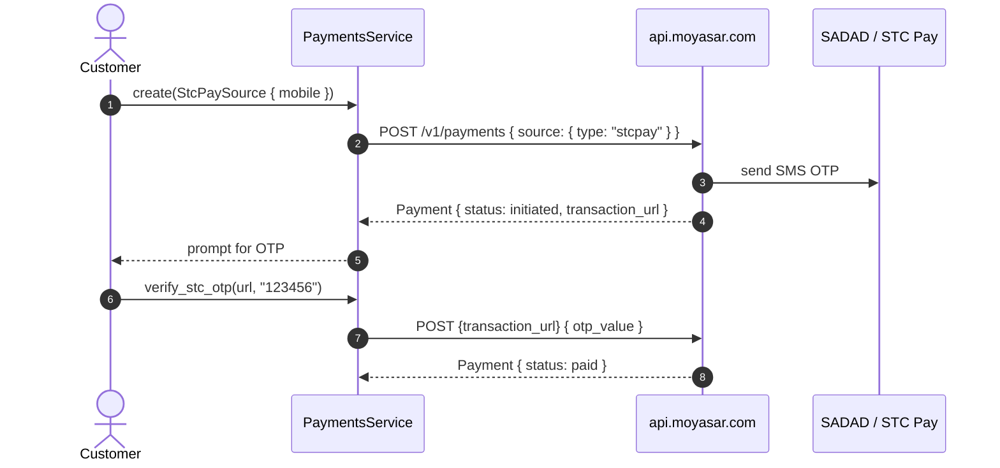

# US-2.4.0: STC Pay OTP Flow & SADAD Bill Sources

> **Spec Kit Specification**: [Specification Lifecycle Active](../../../docs/architecture/DECOMPOSITION_ROADMAP.md)  
> **Behavior Blueprint**: `features/core/modules/payments/behaviours/source-stcpay-sadad/`  
> **Slicing Standard**: [10-PR Vertical Slicing Framework](../README.md#2-the-10-pr-vertical-slicing-framework-rust-sdk-adaptation)  
> **Security Gateway**: `security-audit` Level 2 Enforced  
> **Quality Gates**: `(G0–G4 + G-Review + G-Borrow + G-Law)`  

---

## 1. Spec Kit Specification

### 1.1 User Story Narrative
**As a** Saudi merchant accepting mobile-wallet and bank-bill payments,  
**I want to** initiate STC Pay charges that return a `transaction_url` for OTP completion, and create SADAD Bill payments that produce a `sadad_number` payable through the customer's banking app or ATM,  
**So that** I can serve customers who don't use cards, complete STC Pay charges with a second OTP call, and reconcile SADAD bills asynchronously via `payment_paid` / `payment_expired` webhooks.

#### 1.1.1 Preconditions
- `features = ["payments"]`; valid `SecretKey` (or `pk_` for STC Pay origination).
- STC Pay: customer's mobile number in `05xxxxxxxx`, `+9665xxxxxxxx`, or `009665xxxxxxxx` form.
- SADAD: optional `expired_at` no more than 29 days in the future.

#### 1.1.2 Postconditions
- STC Pay initiation returns `status: "initiated"` with `source.transaction_url` (`/v1/stc_pays/:id/proceed?otp_token=...`).
- `verify_stc_otp(url, otp)` posts `{"otp_value": "..."}` and transitions the payment to `paid` or `failed`.
- SADAD creation returns `sadad_number`, `biller_code`, `provider_name`, and `expired_at`.
- SADAD `expired_at` defaults to 29 days and is capped at the 29-day provider limit.

### 1.2 Acceptance Criteria (Gherkin Scenarios)

```gherkin
Feature: STC Pay and SADAD Bill Payment Sources

  Scenario: [AC-US-2.4.0-01] STC Pay mobile number normalization
    Given mobile inputs "0512345678", "+966512345678" and "00966512345678"
    When StcPaySource::new() validates each
    Then all three are accepted as the same underlying number
    And an input such as "12345" returns Err(MoyasarError::InvalidMobile).

  Scenario: [AC-US-2.4.0-02] STC Pay initiation returns a transaction_url
    Given a valid StcPaySource
    When the payment is created
    Then the response status is "initiated"
    And source.transaction_url contains "/v1/stc_pays/" and an "otp_token" query parameter.

  Scenario: [AC-US-2.4.0-03] OTP completion transitions the payment
    Given an initiated STC Pay payment with a transaction_url
    When client.payments().verify_stc_otp(url, "123456") is called
    Then the request body contains { "otp_value": "123456" }
    And the resulting Payment.status is "paid" or "failed".

  Scenario: [AC-US-2.4.0-04] SADAD bill creation returns a payable sadad_number
    Given a SadadBillSource with no expired_at
    When the payment is created
    Then the response source contains a numeric sadad_number
    And biller_code is one of 901, 902, or 007
    And expired_at is approximately 29 days after creation.

  Scenario: [AC-US-2.4.0-05] SADAD expiry capped at 29 days
    Given a SadadBillSource with expired_at set 45 days in the future
    When the source is validated
    Then the call returns Err(MoyasarError::SadadExpiryTooFar)
    And an expired_at 20 days out is accepted unchanged.

  Scenario: [AC-US-2.4.0-06] SADAD sandbox biller code 007 is accepted
    Given a SadadBillSource with biller_code "007" in test mode
    When the payment is created against the sandbox
    Then provider_name deserializes to the sandbox provider label
    And the payment is created successfully.

  Scenario: [AC-US-2.4.0-LAW] SAMA e-invoicing and bill-expiry consistency
    Given a SADAD bill linked to an invoice
    When the bill is created
    Then the bill's expired_at never exceeds the invoice expiry nor the 29-day provider cap,
         satisfying SAMA e-invoicing consistency requirements.
```

### 1.3 Test Cases & Traceability Matrix

| Test Case ID | Target Criterion | Test Type | Execution Level | Verification Assertion & Pass Criteria |
| :--- | :--- | :--- | :--- | :--- |
| `TC-2.4.0-01` | `AC-US-2.4.0-01` | Validation | Unit | Three accepted formats normalize identically; 5 invalid rejected. |
| `TC-2.4.0-02` | `AC-US-2.4.0-02` | Functional | Integration | Initiated response has `transaction_url` with `otp_token`. |
| `TC-2.4.0-03` | `AC-US-2.4.0-03` | Functional | Integration | OTP body exact; status transitions to paid/failed. |
| `TC-2.4.0-04` | `AC-US-2.4.0-04` | Functional | Integration | `sadad_number` numeric; `biller_code` in allowed set. |
| `TC-2.4.0-05` | `AC-US-2.4.0-05` | Validation | Unit | 45-day expiry rejected; 20-day accepted. |
| `TC-2.4.0-06` | `AC-US-2.4.0-06` | Functional | Integration | Sandbox biller 007 creates successfully. |
| `TC-2.4.0-LAW` | `AC-US-2.4.0-LAW` | Compliance | Static / Audit | Bill expiry ≤ invoice expiry and ≤ 29 days. |

---

## 2. Behavior-Centric Architecture & Folder Blueprint

### 2.1 Colocated Behaviour Directory Tree

```
features/core/modules/payments/behaviours/source-stcpay-sadad/
├── services/        # StcPayOtpCompleter, SadadBillCreator
├── logic/           # Mobile normalization, SADAD expiry capping
├── types/           # StcPaySource, SadadBillSource, StcPayResponse, SadadBillResponse
└── constants/       # SADAD_MAX_EXPIRY_DAYS (29), STC_PAY_PATH
```

### 2.2 Scoping & Promotion Blueprint
- **Tier 1 (Behaviour-Local)**: mobile normalization and expiry capping helpers.
- **Tier 2 (Module-Shared)**: both source variants inside `PaymentSourceRequest`.
- **Tier 3 (Feature-Shared)**: `verify_stc_otp` on `PaymentsService`.
- **Tier 4 (Global-Shared)**: exported via `prelude::*`.

---

## 3. Technical Implementation Plan

### 3.1 Domain Invariants & Storage Schema
- **Mobile Law**: accept `05…`, `+9665…`, `009665…`; normalize to a canonical form before validation.
- **OTP Law**: `verify_stc_otp` posts to the **server-provided** `transaction_url`, never a constructed path.
- **SADAD Cap Law**: `expired_at` ≤ 29 days from creation; never exceeds the linked invoice expiry.
- **Async Law**: SADAD settlement is out-of-band; the SDK never polls — reconciliation is webhook-driven.

```rust
pub struct StcPaySource {
    pub mobile: String,
    pub cashier: Option<String>,
    pub branch: Option<String>,
}

impl StcPaySource {
    pub fn new(mobile: &str) -> Result<Self, MoyasarError> {
        let normalized = normalize_saudi_mobile(mobile)?;
        Ok(Self { mobile: normalized, cashier: None, branch: None })
    }
}

pub struct SadadBillSource {
    pub expired_at: Option<DateTime<Utc>>,
}

impl SadadBillSource {
    pub fn validate(&self, now: DateTime<Utc>) -> Result<(), MoyasarError> {
        if let Some(exp) = self.expired_at {
            if (exp - now).num_days() > SADAD_MAX_EXPIRY_DAYS {
                return Err(MoyasarError::SadadExpiryTooFar);
            }
        }
        Ok(())
    }
}
```

### 3.2 Activity & Interaction Diagram



---

## 4. Granular Implementation Tasks

### 4.1 The 10-PR Vertical Slicing Implementation Plan

| PR # | Pillar | Architectural Layer | Primary Scope & Files | Deliverables & Acceptance | Accountable Role / Agent | Assigned Skills |
| :--- | :--- | :--- | :--- | :--- | :--- | :--- |
| **PR 1** | **Pillar 1** | **Domain Logic & Core Traits** | `src/resources/payments/source_stcpay.rs` | `StcPaySource`, mobile normalization. | `engineering-software-architect` | `security-audit` |
| **PR 2** | **Pillar 2** | **Request Modeling** | `src/resources/payments/source_sadad.rs` | `SadadBillSource`, expiry validation. | `engineering-backend-architect` | `security-audit` |
| **PR 3** | **Pillar 3** | **Transport Wire Adapter** | `src/resources/payments/stcpay_otp.rs` | `verify_stc_otp` posting to `transaction_url`. | `engineering-backend-architect` | `security-audit` |
| **PR 4** | **Pillar 4** | **Service Accessor** | `src/resources/payments/service.rs` | `verify_stc_otp` on `PaymentsService`. | `engineering-software-architect` | `security-audit` |
| **PR 5** | **Pillar 5** | **Error Taxonomy** | `src/kernel/error.rs` | `InvalidMobile`, `SadadExpiryTooFar` variants. | `security-application-security-engineer` | `security-audit` |
| **PR 6** | **Pillar 6** | **Resource Facade Mounting** | `src/resources/payments/mod.rs` | Export both source variants. | `engineering-software-architect` | `security-audit` |
| **PR 7** | **Pillar 7** | **Zero-Copy Hardening** | `src/resources/payments/source_stcpay.rs` | Normalization without intermediate allocations. | `agency-rust-refactoring-specialist` | `security-audit` |
| **PR 8** | **Pillar 8** | **Edge Cases & Guards** | `src/resources/payments/source_sadad.rs` | 29-day cap, invoice-expiry interaction. | `agency-api-tester` | `security-audit` |
| **PR 9** | **Pillar 9** | **Integration Wire Verification** | `tests/stcpay_sadad_test.rs` | Sandbox numbers 0515555555/58/59, biller 007. | `agency-api-tester` | `security-audit` |
| **PR 10** | **Pillar 10** | **Documentation & Packaging** | `README.md` | Doc-tests for OTP flow and SADAD creation. | `engineering-technical-writer` | `security-audit` |

### 4.2 Implementation Phase Breakdown

#### Phase 1: Source Models (PR 1–2)
- [ ] **Task 1.1 (STC Pay)**: `StcPaySource` with three accepted mobile formats.  
  *Agent*: `engineering-software-architect` | *Skill*: `security-audit`
- [ ] **Task 1.2 (SADAD)**: `SadadBillSource` with optional `expired_at`.  
  *Agent*: `engineering-backend-architect` | *Skill*: `security-audit`
- [ ] **Task 1.3 (Unit Tests)**: mobile normalization table; expiry boundary tests.  
  *Agent*: `agency-api-tester` | *Skill*: `security-audit`

#### Phase 2: OTP & Endpoints (PR 3–6)
- [ ] **Task 2.1 (OTP)**: `verify_stc_otp(url, otp)` posting `otp_value`.  
  *Agent*: `engineering-backend-architect` | *Skill*: `security-audit`
- [ ] **Task 2.2 (Errors)**: `InvalidMobile`, `SadadExpiryTooFar`.  
  *Agent*: `security-application-security-engineer` | *Skill*: `security-audit`
- [ ] **Task 2.3 (Exports)**: feature-gated module wiring.  
  *Agent*: `engineering-software-architect` | *Skill*: `security-audit`

#### Phase 3: Edge Cases (PR 7–8)
- [ ] **Task 3.1 (Expiry Cap)**: reject > 29 days; respect invoice expiry.  
  *Agent*: `agency-api-tester` | *Skill*: `security-audit`
- [ ] **Task 3.2 (Biller Codes)**: accept 901/902/007; reject others.  
  *Agent*: `agency-api-tester` | *Skill*: `security-audit`

#### Phase 4: Verification & Sign-Off (PR 9–10)
- [ ] **Task 4.1 (Sandbox Tests)**: STC Pay sandbox numbers and SADAD biller 007.  
  *Agent*: `agency-api-tester` | *Skill*: `security-audit`
- [ ] **Task 4.2 (G-Review)**: peer review on OTP flow and expiry logic.  
  *Agent*: `agency-code-reviewer` | *Skill*: `security-audit`
- [ ] **Task 4.3 (Documentation)**: doc-tests for both flows.  
  *Agent*: `engineering-technical-writer` | *Skill*: `security-audit`

---

## 5. Security Gateway (Powered by security-audit)

### 5.1 Trust Boundaries & Security Actors
- **Trust Boundaries**:
  - `OTP Boundary`: the OTP is a bearer credential for completing a charge.
  - `Bill Boundary`: `sadad_number` is a payable reference exposed to the customer.
- **Authorized Principals**: storefront (`pk_`) for STC Pay origination; backend (`sk_`) for OTP completion.

### 5.2 Threat Modeling & Abuse Matrix (STRIDE / ASVS)

| Threat Vector | Severity | Vulnerability Mechanism | Mitigating Control & Security Invariant |
| :--- | :--- | :--- | :--- |
| **OTP Brute Force** | High | Repeated OTP attempts against a transaction | Server enforces attempt limits; SDK surfaces the 60-second cooldown error distinctly. |
| **OTP Leakage** | Critical | OTP logged in plaintext | OTP is a request-only field; never `Debug`-printed or persisted. |
| **URL Tampering** | High | Client constructs the OTP URL instead of using the server's | `verify_stc_otp` uses the server-provided `transaction_url` verbatim. |
| **Bill Expiry Abuse** | Medium | Bill outliving the invoice | 29-day cap plus invoice-expiry interaction enforced. |
| **Mobile Enumeration** | Low | Probing which numbers are registered | Sandbox numbers documented; production errors are generic. |

### 5.3 Cryptographic & Data Protection Controls
- **OTP Non-Retention**: OTP never stored or logged.
- **Server-Provided URL**: no client-side URL construction.
- **Expiry Capping**: single source of truth for the 29-day limit.

### 5.4 Automated Security Verification Checklist
- [ ] **OTP Log Test**: OTP absent from all formatted output.
- [ ] **URL Test**: `verify_stc_otp` uses the provided URL byte-for-byte.
- [ ] **Expiry Test**: 29-day cap enforced.
- [ ] **Cooldown Test**: 60-second cooldown error mapped distinctly.

### 5.5 Security Gateway (G2) Sign-Off Checklist
- [ ] OTP handling verified against OWASP ASVS Level 2.
- [ ] Zero OTP in logs or telemetry.
- [ ] Expiry capping certified.
- [ ] Independent reviewer sign-off; zero open findings.

---

## 6. Validation Gates & Acceptance Sign-Off

**Status: Ready for Implementation.**

### G0 — Build, lint & format
- [ ] **US-2.4.0-G0:** `cargo build && cargo clippy -- -D warnings && cargo fmt --check` clean.

### G1 — Test coverage
- [ ] **US-2.4.0-G1:** ≥90% line / ≥85% branch on STC Pay and SADAD modules.

### G2 — Security audit
- [ ] **US-2.4.0-G2:** OTP-handling audit passes with zero critical/high findings.

### G3 — Architecture and maintainability
- [ ] **US-2.4.0-G3:** Both sources are pure data + validation; zero transport coupling.

### G-Review — Code review
- [ ] **US-2.4.0-G-Review:** Peer review on OTP flow and expiry logic.

### G-Borrow — Rust zero-clone validation
- [ ] **US-2.4.0-G-Borrow:** Mobile normalization avoids intermediate allocations.

### G-Complexity — Cyclomatic complexity
- [ ] **US-2.4.0-G-Complexity:** $CC \le 6$; nesting $\le 2$.

### G-Docs — Public docs & examples
- [ ] **US-2.4.0-G-Docs:** 100% public symbols documented; OTP flow example runnable.

### G-Law — Law validation
- [ ] **US-2.4.0-G-Law:** SAMA e-invoicing bill-expiry consistency certified.

### G4 — Integrated acceptance
- [ ] **US-2.4.0-G4:** STC Pay OTP round-trip and SADAD creation verified against sandbox.
