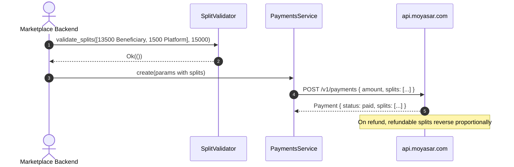

# US-2.5.0: Marketplace Payment Splits & Account Funding Transactions

> **Spec Kit Specification**: [Specification Lifecycle Active](../../../docs/architecture/DECOMPOSITION_ROADMAP.md)  
> **Behavior Blueprint**: `features/core/modules/payments/behaviours/marketplace-splits-aft/`  
> **Slicing Standard**: [10-PR Vertical Slicing Framework](../README.md#2-the-10-pr-vertical-slicing-framework-rust-sdk-adaptation)  
> **Security Gateway**: `security-audit` Level 2 Enforced  
> **Quality Gates**: `(G0–G4 + G-Review + G-Borrow + G-Law)`  

---

## 1. Spec Kit Specification

### 1.1 User Story Narrative
**As a** marketplace platform operator routing funds between vendors and my own commission account,  
**I want to** attach a `splits` array to payment creation with typed recipient roles (`Entity`, `Platform`, `Beneficiary`), fee-source designation, and refundability flags, plus an AFT `sender` object for account funding transactions,  
**So that** a single customer charge can be divided across multiple beneficiaries at capture time, processing fees land on the correct party, and split reversals follow the parent payment's refund.

#### 1.1.1 Preconditions
- `features = ["payments"]`; valid `SecretKey`.
- Recipient UUIDs exist as Moyasar entities/platforms/beneficiaries.
- For AFT, sender identification fields are available.

#### 1.1.2 Postconditions
- `splits` serializes as an array of `PaymentSplitRequest` with `amount`, `recipient_type`, `recipient_id`, optional `reference`/`description`, `fee_source`, `refundable`.
- Split amounts are validated: each non-zero, and the sum does not exceed the payment `amount`.
- `fee_source: true` designates which split absorbs Moyasar's processing fee.
- `refundable: true` (default) means the split is reversed when the parent payment is refunded.
- AFT `sender` carries `first_name`, `last_name`, and identification keys.

### 1.2 Acceptance Criteria (Gherkin Scenarios)

```gherkin
Feature: Marketplace Splits and Account Funding Transactions

  Scenario: [AC-US-2.5.0-01] Two-way split serialization with typed recipient roles
    Given a payment of 15000 with splits of 13500 to a Beneficiary and 1500 to the Platform
    When the payment is created
    Then the body contains a splits array of length 2
    And the first entry has recipient_type "beneficiary" and the second "platform".

  Scenario: [AC-US-2.5.0-02] Split sum exceeding the payment amount is rejected
    Given a payment of 10000 with splits totalling 12000
    When the params are validated
    Then the call returns Err(MoyasarError::SplitTotalExceedsAmount)
    And splits totalling exactly 10000 are accepted.

  Scenario: [AC-US-2.5.0-03] Zero or negative split amounts are rejected
    Given a split with amount 0
    When the params are validated
    Then the call returns Err(MoyasarError::InvalidSplitAmount).

  Scenario: [AC-US-2.5.0-04] fee_source designates the fee-absorbing party
    Given a Platform split with fee_source true and a Beneficiary split with fee_source false
    When the payment is created
    Then the serialized Platform split contains "fee_source": true
    And the Beneficiary split contains "fee_source": false.

  Scenario: [AC-US-2.5.0-05] refundable defaults to true when omitted
    Given a split with no explicit refundable flag
    When serialized
    Then the field is either omitted or serialized as true
    And the server treats the split as refundable.

  Scenario: [AC-US-2.5.0-06] AFT sender object is attached to the payment
    Given a payment with an AFT sender containing first_name and last_name
    When the payment is created
    Then the body contains a sender object with those fields
    And the payment is created successfully.

  Scenario: [AC-US-2.5.0-LAW] SAMA marketplace split transparency and auditability
    Given any payment carrying splits
    When the payment is created
    Then each split's recipient_id, amount and reference are persisted for reconciliation,
         satisfying SAMA marketplace-funds-flow transparency requirements.
```

### 1.3 Test Cases & Traceability Matrix

| Test Case ID | Target Criterion | Test Type | Execution Level | Verification Assertion & Pass Criteria |
| :--- | :--- | :--- | :--- | :--- |
| `TC-2.5.0-01` | `AC-US-2.5.0-01` | Functional | Unit | Serialized array length 2; recipient_type strings exact. |
| `TC-2.5.0-02` | `AC-US-2.5.0-02` | Validation | Unit | 12000 > 10000 rejected; 10000 == 10000 accepted. |
| `TC-2.5.0-03` | `AC-US-2.5.0-03` | Validation | Unit | Zero and negative amounts rejected. |
| `TC-2.5.0-04` | `AC-US-2.5.0-04` | Functional | Unit | `fee_source` serialized per split. |
| `TC-2.5.0-05` | `AC-US-2.5.0-05` | Functional | Unit | Omitted `refundable` defaults to true. |
| `TC-2.5.0-06` | `AC-US-2.5.0-06` | Functional | Integration | Sender object present in body; payment created. |
| `TC-2.5.0-LAW` | `AC-US-2.5.0-LAW` | Compliance | Static / Audit | Split recipient/amount/reference persisted. |

---

## 2. Behavior-Centric Architecture & Folder Blueprint

### 2.1 Colocated Behaviour Directory Tree

```
features/core/modules/payments/behaviours/marketplace-splits-aft/
├── services/        # SplitValidator, AftSenderBuilder
├── logic/           # Sum validation, fee-source resolution, refundable defaults
├── types/           # PaymentSplitRequest, PaymentSplitResponse, SplitRecipientType, AftSender
└── constants/       # MAX_SPLITS_PER_PAYMENT
```

### 2.2 Scoping & Promotion Blueprint
- **Tier 1 (Behaviour-Local)**: split-sum validator.
- **Tier 2 (Module-Shared)**: `PaymentSplitRequest` used by payments and stripe-compat refunds.
- **Tier 3 (Feature-Shared)**: `SplitRecipientType` used by settlements reconciliation.
- **Tier 4 (Global-Shared)**: exported via `prelude::*`.

---

## 3. Technical Implementation Plan

### 3.1 Domain Invariants & Storage Schema
- **Sum Law**: `sum(split.amount) <= payment.amount`; each split `amount > 0`.
- **Fee Law**: exactly one split may carry `fee_source: true`; if none, the platform absorbs the fee.
- **Refund Cascade Law**: `refundable: true` splits reverse proportionally on parent refund.
- **Reference Law**: `reference` is persisted into settlement files — it must be stable and unique per split.

```rust
#[derive(Serialize, Clone)]
pub struct PaymentSplitRequest {
    pub amount: u64,
    pub recipient_type: SplitRecipientType,
    pub recipient_id: Uuid,
    pub reference: Option<String>,
    pub description: Option<String>,
    pub fee_source: Option<bool>,
    pub refundable: Option<bool>,
}

#[derive(Serialize, Clone, Copy)]
#[serde(rename_all = "lowercase")]
pub enum SplitRecipientType { Entity, Platform, Beneficiary }

pub fn validate_splits(splits: &[PaymentSplitRequest], total: u64) -> Result<(), MoyasarError> {
    if splits.iter().any(|s| s.amount == 0) {
        return Err(MoyasarError::InvalidSplitAmount);
    }
    let sum: u64 = splits.iter().map(|s| s.amount).sum();
    if sum > total {
        return Err(MoyasarError::SplitTotalExceedsAmount);
    }
    Ok(())
}
```

### 3.2 Activity & Interaction Diagram



---

## 4. Granular Implementation Tasks

### 4.1 The 10-PR Vertical Slicing Implementation Plan

| PR # | Pillar | Architectural Layer | Primary Scope & Files | Deliverables & Acceptance | Accountable Role / Agent | Assigned Skills |
| :--- | :--- | :--- | :--- | :--- | :--- | :--- |
| **PR 1** | **Pillar 1** | **Domain Logic & Core Traits** | `src/resources/payments/splits.rs` | `PaymentSplitRequest`/`Response`, `SplitRecipientType`. | `engineering-software-architect` | `security-audit` |
| **PR 2** | **Pillar 2** | **Request Modeling** | `src/resources/payments/aft.rs` | `AftSender` struct and integration. | `engineering-backend-architect` | `security-audit` |
| **PR 3** | **Pillar 3** | **Transport Wire Adapter** | `src/resources/payments/params.rs` | `splits` and `sender` fields on create params. | `engineering-backend-architect` | `security-audit` |
| **PR 4** | **Pillar 4** | **Service Accessor** | `src/resources/payments/service.rs` | Split-aware create path. | `engineering-software-architect` | `security-audit` |
| **PR 5** | **Pillar 5** | **Error Taxonomy** | `src/kernel/error.rs` | `SplitTotalExceedsAmount`, `InvalidSplitAmount`. | `security-application-security-engineer` | `security-audit` |
| **PR 6** | **Pillar 6** | **Resource Facade Mounting** | `src/resources/payments/mod.rs` | Export split and AFT types. | `engineering-software-architect` | `security-audit` |
| **PR 7** | **Pillar 7** | **Zero-Copy Hardening** | `src/resources/payments/splits.rs` | Borrowed validation; no split cloning. | `agency-rust-refactoring-specialist` | `security-audit` |
| **PR 8** | **Pillar 8** | **Edge Cases & Guards** | `src/resources/payments/split_validation.rs` | Sum/zero/negative guards; refundable default. | `agency-api-tester` | `security-audit` |
| **PR 9** | **Pillar 9** | **Integration Wire Verification** | `tests/splits_aft_test.rs` | Two-way split and AFT sender wire tests. | `agency-api-tester` | `security-audit` |
| **PR 10** | **Pillar 10** | **Documentation & Packaging** | `README.md` | Doc-tests for splits and AFT. | `engineering-technical-writer` | `security-audit` |

### 4.2 Implementation Phase Breakdown

#### Phase 1: Split & AFT Models (PR 1–2)
- [ ] **Task 1.1 (Splits)**: `PaymentSplitRequest`/`Response`, `SplitRecipientType`.  
  *Agent*: `engineering-software-architect` | *Skill*: `security-audit`
- [ ] **Task 1.2 (AFT)**: `AftSender` with identification fields.  
  *Agent*: `engineering-backend-architect` | *Skill*: `security-audit`
- [ ] **Task 1.3 (Unit Tests)**: serde roundtrip for splits and sender.  
  *Agent*: `agency-api-tester` | *Skill*: `security-audit`

#### Phase 2: Wiring & Errors (PR 3–6)
- [ ] **Task 2.1 (Params)**: attach `splits`/`sender` to create params.  
  *Agent*: `engineering-backend-architect` | *Skill*: `security-audit`
- [ ] **Task 2.2 (Errors)**: split validation error variants.  
  *Agent*: `security-application-security-engineer` | *Skill*: `security-audit`
- [ ] **Task 2.3 (Exports)**: feature-gated module wiring.  
  *Agent*: `engineering-software-architect` | *Skill*: `security-audit`

#### Phase 3: Validation (PR 7–8)
- [ ] **Task 3.1 (Sum Guard)**: reject sum > amount; reject zero/negative.  
  *Agent*: `agency-api-tester` | *Skill*: `security-audit`
- [ ] **Task 3.2 (Defaults)**: `refundable` defaults to true; `fee_source` resolution.  
  *Agent*: `agency-api-tester` | *Skill*: `security-audit`

#### Phase 4: Verification & Sign-Off (PR 9–10)
- [ ] **Task 4.1 (Wire Tests)**: two-way split and AFT sender end-to-end.  
  *Agent*: `agency-api-tester` | *Skill*: `security-audit`
- [ ] **Task 4.2 (G-Review)**: peer review on split arithmetic and refund cascade.  
  *Agent*: `agency-code-reviewer` | *Skill*: `security-audit`
- [ ] **Task 4.3 (Documentation)**: doc-tests for splits and AFT.  
  *Agent*: `engineering-technical-writer` | *Skill*: `security-audit`

---

## 5. Security Gateway (Powered by security-audit)

### 5.1 Trust Boundaries & Security Actors
- **Trust Boundaries**:
  - `Fund-Routing Boundary`: splits move money to third-party recipients.
  - `Recipient Boundary`: `recipient_id` must belong to the merchant's authorized network.
- **Authorized Principals**: marketplace backend holding a `SecretKey`.

### 5.2 Threat Modeling & Abuse Matrix (STRIDE / ASVS)

| Threat Vector | Severity | Vulnerability Mechanism | Mitigating Control & Security Invariant |
| :--- | :--- | :--- | :--- |
| **Fund Diversion** | Critical | Split recipient_id pointing to an unauthorized account | Server-side recipient authorization; SDK surfaces 4xx as typed errors. |
| **Over-Allocation** | Critical | Splits summing above the payment amount | Client-side sum guard before transport. |
| **Fee Misattribution** | High | Multiple `fee_source: true` splits | Exactly-one rule enforced; default to platform. |
| **Refund Leakage** | High | Non-refundable split reversed anyway | `refundable` flag respected by the refund cascade. |
| **Reference Collision** | Medium | Duplicate split references breaking reconciliation | Reference uniqueness documented and validated per payment. |

### 5.3 Cryptographic & Data Protection Controls
- **Sum Guard**: client-side validation before transmission.
- **Recipient Authorization**: server-enforced; SDK never assumes authority.
- **Audit Fields**: `reference` persisted into settlement files.

### 5.4 Automated Security Verification Checklist
- [ ] **Sum Test**: over-allocation rejected.
- [ ] **Zero Test**: zero/negative amounts rejected.
- [ ] **Fee Test**: multiple `fee_source` flagged.
- [ ] **Refund Cascade Test**: non-refundable splits preserved.

### 5.5 Security Gateway (G2) Sign-Off Checklist
- [ ] Fund-routing verified against OWASP ASVS Level 2.
- [ ] Over-allocation impossible client-side.
- [ ] Audit references persisted.
- [ ] Independent reviewer sign-off; zero open findings.

---

## 6. Validation Gates & Acceptance Sign-Off

**Status: Ready for Implementation.**

### G0 — Build, lint & format
- [ ] **US-2.5.0-G0:** `cargo build && cargo clippy -- -D warnings && cargo fmt --check` clean.

### G1 — Test coverage
- [ ] **US-2.5.0-G1:** ≥90% line / ≥85% branch on splits and AFT modules.

### G2 — Security audit
- [ ] **US-2.5.0-G2:** Fund-routing audit passes with zero critical/high findings.

### G3 — Architecture and maintainability
- [ ] **US-2.5.0-G3:** Split logic is pure validation; zero transport coupling.

### G-Review — Code review
- [ ] **US-2.5.0-G-Review:** Peer review on split arithmetic and refund cascade.

### G-Borrow — Rust zero-clone validation
- [ ] **US-2.5.0-G-Borrow:** Validation borrows the slice; no split cloning.

### G-Complexity — Cyclomatic complexity
- [ ] **US-2.5.0-G-Complexity:** $CC \le 6$; nesting $\le 2$.

### G-Docs — Public docs & examples
- [ ] **US-2.5.0-G-Docs:** 100% public symbols documented; two-way split example runnable.

### G-Law — Law validation
- [ ] **US-2.5.0-G-Law:** SAMA marketplace funds-flow transparency certified.

### G4 — Integrated acceptance
- [ ] **US-2.5.0-G4:** Two-way split and AFT sender verified against the mock server.
