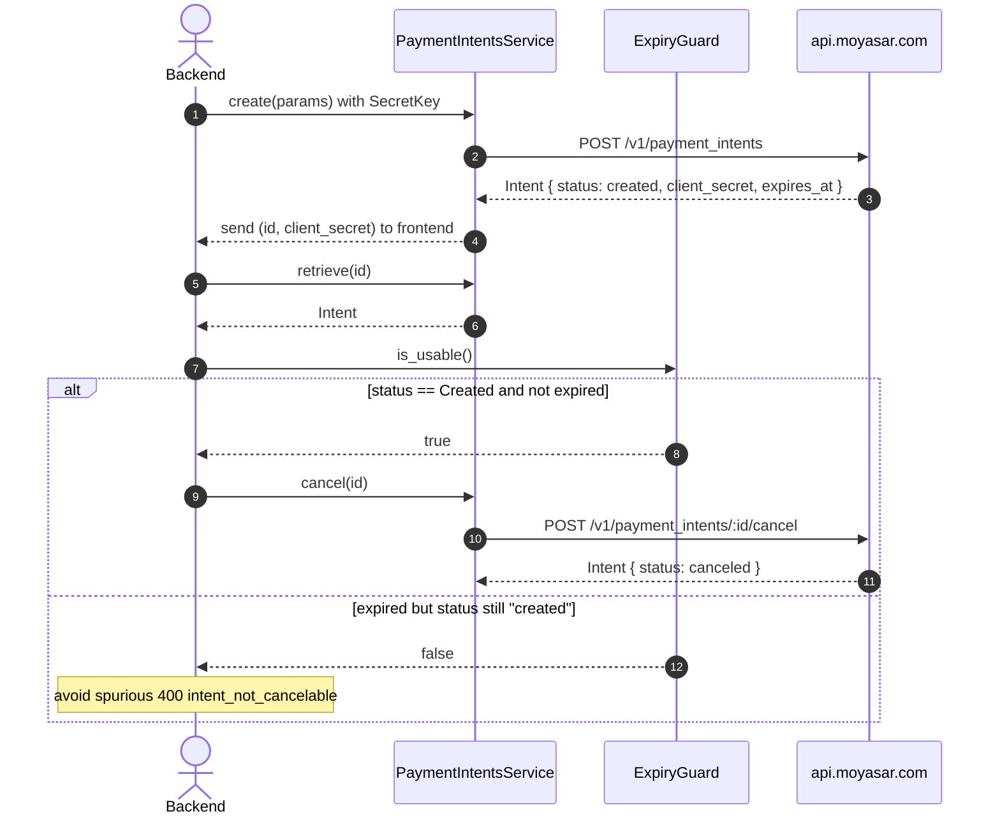

# US-3.1.0: Payment Intent Creation, Retrieval, Cancellation & Expiry Guards

> **Spec Kit Specification**: [Specification Lifecycle Active](../../../docs/architecture/DECOMPOSITION_ROADMAP.md)  
> **Behavior Blueprint**: `features/core/modules/payment-intents/behaviours/intent-lifecycle/`  
> **Slicing Standard**: [10-PR Vertical Slicing Framework](../README.md#2-the-10-pr-vertical-slicing-framework-rust-sdk-adaptation)  
> **Security Gateway**: `security-audit` Level 2 Enforced  
> **Quality Gates**: `(G0–G4 + G-Review + G-Borrow + G-Law)`  

---

## 1. Spec Kit Specification

### 1.1 User Story Narrative
**As a** backend engineer building a tamper-proof browser/mobile checkout,  
**I want to** create a `PaymentIntent` on the server that locks `amount`, `currency`, `description`, and `callback_url`, then retrieve or cancel it — with an `is_usable()` guard that accounts for Moyasar's fixed, non-configurable 1-hour expiry window where status still reads `"created"`,  
**So that** my frontend can collect card details with only a `pk_` key and a `client_secret`, my backend never issues a cancel that returns `intent_not_cancelable`, and I never treat a `fulfilled` intent as a successful payment.

#### 1.1.1 Preconditions
- `features = ["payment-intents"]` (implies `core`, `payments`).
- A valid `SecretKey` for create/retrieve/cancel.

#### 1.1.2 Postconditions
- `POST /v1/payment_intents` returns a `PaymentIntent` with `status: "created"`, a `client_secret`, and `expires_at = created_at + 1 hour`.
- `GET /v1/payment_intents/:id` returns the intent including `client_secret`; calling it with a `pk_` returns `403 Forbidden`.
- `POST /v1/payment_intents/:id/cancel` returns `status: "canceled"`, or `400 intent_not_cancelable` if already fulfilled/canceled/expired.
- `PaymentIntent::is_usable()` returns true only when `status == Created && Utc::now() < expires_at`.

### 1.2 Acceptance Criteria (Gherkin Scenarios)

```gherkin
Feature: Payment Intent Lifecycle Management

  Scenario: [AC-US-3.1.0-01] Create an intent that locks the four immutable parameters
    Given a CreatePaymentIntentParams with amount 25000, currency SAR and a callback_url
    When client.payment_intents().create(params) is called with a SecretKey
    Then the response status equals "created"
    And client_secret is present and non-empty
    And expires_at equals created_at plus one hour.

  Scenario: [AC-US-3.1.0-02] Retrieve an intent by id
    Given an existing payment intent id
    When client.payment_intents().retrieve(id) is called with a SecretKey
    Then the returned intent includes client_secret
    And a 404 maps to MoyasarError::Api { error_type: RecordNotFound }.

  Scenario: [AC-US-3.1.0-03] Publishable key cannot retrieve an intent
    Given a MoyasarClient authenticated with a PublishableKey
    When code attempts client.payment_intents().retrieve(id)
    Then the program fails to compile
    And the equivalent runtime call returns 403 Forbidden per Moyasar's key-type rules.

  Scenario: [AC-US-3.1.0-04] Cancel a usable intent
    Given an intent with status "created" whose expires_at is in the future
    When client.payment_intents().cancel(id) is called
    Then the response status equals "canceled".

  Scenario: [AC-US-3.1.0-05] is_usable guards against the silent expiry window
    Given an intent with status "created" but expires_at one minute in the past
    When PaymentIntent::is_usable() is evaluated
    Then it returns false
    And a subsequent cancel() would return 400 intent_not_cancelable.

  Scenario: [AC-US-3.1.0-06] Cancel on a non-cancelable intent surfaces a typed error
    Given an intent already in status "fulfilled"
    When cancel(id) is called
    Then the result is Err(MoyasarError::Api { error_type: IntentNotCancelable })
    And no retry is attempted because 400 is non-retryable.

  Scenario: [AC-US-3.1.0-LAW] SAMA checkout integrity via locked server-side parameters
    Given any intent created by the backend
    When the frontend fulfills it
    Then amount, currency, description and callback_url cannot be altered by the client,
         satisfying SAMA requirements for tamper-proof transaction origination.
```

### 1.3 Test Cases & Traceability Matrix

| Test Case ID | Target Criterion | Test Type | Execution Level | Verification Assertion & Pass Criteria |
| :--- | :--- | :--- | :--- | :--- |
| `TC-3.1.0-01` | `AC-US-3.1.0-01` | Functional | Integration | Status `created`; `client_secret` present; `expires_at - created_at == 3600s`. |
| `TC-3.1.0-02` | `AC-US-3.1.0-02` | Functional | Integration | Retrieve includes `client_secret`; 404 → `RecordNotFound`. |
| `TC-3.1.0-03` | `AC-US-3.1.0-03` | Type Safety | Compile-fail (`trybuild`) | `pk_` + `retrieve()` fails to compile. |
| `TC-3.1.0-04` | `AC-US-3.1.0-04` | Functional | Integration | Cancel returns `canceled`. |
| `TC-3.1.0-05` | `AC-US-3.1.0-05` | State Machine | Unit | `is_usable()` false when expired despite status `created`. |
| `TC-3.1.0-06` | `AC-US-3.1.0-06` | Error Handling | Unit | 400 maps to `IntentNotCancelable`; `is_retryable()` false. |
| `TC-3.1.0-LAW` | `AC-US-3.1.0-LAW` | Compliance | Static / Audit | Locked parameters enforced server-side. |

---

## 2. Behavior-Centric Architecture & Folder Blueprint

### 2.1 Colocated Behaviour Directory Tree

```
features/core/modules/payment-intents/behaviours/intent-lifecycle/
├── services/        # PaymentIntentsService dispatchers
├── logic/           # is_usable() expiry guard, status transition checks
├── types/           # PaymentIntent, PaymentIntentStatus, CreatePaymentIntentParams
└── constants/       # INTENT_EXPIRY_SECS (3600)
```

### 2.2 Scoping & Promotion Blueprint
- **Tier 1 (Behaviour-Local)**: expiry comparison logic.
- **Tier 2 (Module-Shared)**: `PaymentIntent` used by fulfillment (US-3.2.0).
- **Tier 3 (Feature-Shared)**: `PaymentIntentsService` under `payment-intents`.
- **Tier 4 (Global-Shared)**: `client.payment_intents()` facade accessor.

---

## 3. Technical Implementation Plan

### 3.1 Domain Invariants & Storage Schema
- **Expiry Law**: 1 hour, non-configurable. `INTENT_EXPIRY_SECS = 3600`.
- **Silent-Status Law**: an expired intent still reports `status: "created"`. Never trust status alone.
- **Fulfilled≠Paid Law**: `Fulfilled` means an attempt occurred, not that money moved.
- **Secret Law**: `client_secret` appears only in create/retrieve responses; `Debug` must redact it.

```rust
#[derive(Debug, Clone, Deserialize)]
pub struct PaymentIntent {
    pub id: Uuid,
    pub status: PaymentIntentStatus,
    pub amount: u64,
    pub currency: Currency,
    pub description: Option<String>,
    pub callback_url: String,
    #[serde(skip_serializing)]           // never re-emitted into logs
    pub client_secret: String,
    pub expires_at: DateTime<Utc>,
    pub created_at: DateTime<Utc>,
}

impl PaymentIntent {
    /// True only when the intent is still cancelable/fulfillable.
    pub fn is_usable(&self) -> bool {
        self.status == PaymentIntentStatus::Created && Utc::now() < self.expires_at
    }
}

#[derive(Debug, Clone, Copy, PartialEq, Eq, Deserialize)]
#[serde(rename_all = "lowercase")]
pub enum PaymentIntentStatus {
    Created, Fulfilled, Canceled,
    #[serde(other)]
    Unknown,
}
```

### 3.2 Activity & Interaction Diagram



---

## 4. Granular Implementation Tasks

### 4.1 The 10-PR Vertical Slicing Implementation Plan

| PR # | Pillar | Architectural Layer | Primary Scope & Files | Deliverables & Acceptance | Accountable Role / Agent | Assigned Skills |
| :--- | :--- | :--- | :--- | :--- | :--- | :--- |
| **PR 1** | **Pillar 1** | **Domain Logic & Core Traits** | `src/resources/payment_intents/models.rs` | `PaymentIntent`, `PaymentIntentStatus`. | `engineering-software-architect` | `security-audit` |
| **PR 2** | **Pillar 2** | **Request Modeling** | `src/resources/payment_intents/params.rs` | `CreatePaymentIntentParams` (four locked fields). | `engineering-backend-architect` | `security-audit` |
| **PR 3** | **Pillar 3** | **Transport Wire Adapter** | `src/resources/payment_intents/create.rs` | `POST /v1/payment_intents`; `POST /:id/cancel`. | `engineering-backend-architect` | `security-audit` |
| **PR 4** | **Pillar 4** | **Service Accessor** | `src/resources/payment_intents/service.rs` | `client.payment_intents()` accessor. | `engineering-software-architect` | `security-audit` |
| **PR 5** | **Pillar 5** | **Error Taxonomy** | `src/kernel/error.rs` | `IntentNotCancelable` mapping, non-retryable. | `security-application-security-engineer` | `security-audit` |
| **PR 6** | **Pillar 6** | **Resource Facade Mounting** | `src/resources/payment_intents/mod.rs` | Feature-gated export under `payment-intents`. | `engineering-software-architect` | `security-audit` |
| **PR 7** | **Pillar 7** | **Zero-Copy Hardening** | `src/resources/payment_intents/models.rs` | `is_usable()` on `&self`; no allocation. | `agency-rust-refactoring-specialist` | `security-audit` |
| **PR 8** | **Pillar 8** | **Edge Cases & Guards** | `src/resources/payment_intents/expiry.rs` | Silent-expiry guard; boundary at exactly +3600s. | `agency-api-tester` | `security-audit` |
| **PR 9** | **Pillar 9** | **Integration Wire Verification** | `tests/intent_lifecycle_test.rs` | Create→retrieve→cancel; 400 on already-canceled. | `agency-api-tester` | `security-audit` |
| **PR 10** | **Pillar 10** | **Documentation & Packaging** | `README.md` | Doc-tests incl. the expiry pitfall. | `engineering-technical-writer` | `security-audit` |

### 4.2 Implementation Phase Breakdown

#### Phase 1: Models & Params (PR 1–2)
- [ ] **Task 1.1 (Types)**: `PaymentIntent`, `PaymentIntentStatus`, `INTENT_EXPIRY_SECS`.  
  *Agent*: `engineering-software-architect` | *Skill*: `security-audit`
- [ ] **Task 1.2 (Params)**: `CreatePaymentIntentParams` with the four locked fields.  
  *Agent*: `engineering-backend-architect` | *Skill*: `security-audit`
- [ ] **Task 1.3 (Unit Tests)**: deserialization incl. `client_secret`.  
  *Agent*: `agency-api-tester` | *Skill*: `security-audit`

#### Phase 2: Endpoints & Accessor (PR 3–6)
- [ ] **Task 2.1 (Create)**: `POST /v1/payment_intents`.  
  *Agent*: `engineering-backend-architect` | *Skill*: `security-audit`
- [ ] **Task 2.2 (Retrieve)**: `GET /v1/payment_intents/:id`, 404 mapping.  
  *Agent*: `engineering-backend-architect` | *Skill*: `security-audit`
- [ ] **Task 2.3 (Cancel)**: `POST /:id/cancel`, `intent_not_cancelable` mapping.  
  *Agent*: `engineering-backend-architect` | *Skill*: `security-audit`
- [ ] **Task 2.4 (Accessor)**: zero-cost `PaymentIntentsService<'a>`.  
  *Agent*: `engineering-software-architect` | *Skill*: `security-audit`

#### Phase 3: Expiry Guard (PR 7–8)
- [ ] **Task 3.1 (is_usable)**: `status == Created && now < expires_at`.  
  *Agent*: `agency-rust-refactoring-specialist` | *Skill*: `security-audit`
- [ ] **Task 3.2 (Boundary Tests)**: exactly at expiry, just before, just after.  
  *Agent*: `agency-api-tester` | *Skill*: `security-audit`

#### Phase 4: Verification & Sign-Off (PR 9–10)
- [ ] **Task 4.1 (Wire Tests)**: full create→retrieve→cancel cycle.  
  *Agent*: `agency-api-tester` | *Skill*: `security-audit`
- [ ] **Task 4.2 (G-Review)**: peer review on expiry semantics.  
  *Agent*: `agency-code-reviewer` | *Skill*: `security-audit`
- [ ] **Task 4.3 (Documentation)**: document the silent-expiry pitfall.  
  *Agent*: `engineering-technical-writer` | *Skill*: `security-audit`

---

## 5. Security Gateway (Powered by security-audit)

### 5.1 Trust Boundaries & Security Actors
- **Trust Boundaries**:
  - `Client-Secret Boundary`: `client_secret` authorizes frontend fulfillment.
  - `Key-Type Boundary`: `pk_` may fulfill; only `sk_` may create/retrieve/cancel.
- **Authorized Principals**: backend (`sk_`), storefront (`pk_` + `client_secret`).

### 5.2 Threat Modeling & Abuse Matrix (STRIDE / ASVS)

| Threat Vector | Severity | Vulnerability Mechanism | Mitigating Control & Security Invariant |
| :--- | :--- | :--- | :--- |
| **Amount Tampering** | Critical | Client altering amount/currency at fulfillment | Server locks the four parameters; overrides ignored. |
| **client_secret Leakage** | Critical | Secret logged or echoed in errors | `skip_serializing` + redacted `Debug`. |
| **Privilege Escalation** | Critical | `pk_` retrieving intents or client_secrets | Compile-time `SecretKey` bound on retrieve. |
| **Spurious 400s** | Medium | Canceling an expired intent | `is_usable()` guard before any cancel. |
| **False Settlement** | High | Treating `fulfilled` as `paid` | Documented explicitly; Payment status must be checked separately. |

### 5.3 Cryptographic & Data Protection Controls
- **Secret Redaction**: `client_secret` never serialized into logs.
- **Key-Type Enforcement**: `SecretKey` bound on create/retrieve/cancel.
- **Expiry Guard**: prevents wasted API calls and misleading state.

### 5.4 Automated Security Verification Checklist
- [ ] **client_secret Test**: absent from `Debug` output.
- [ ] **Key-Type Test**: `pk_` cannot create/retrieve/cancel.
- [ ] **Expiry Test**: boundary at exactly 3600 seconds.
- [ ] **Non-Retry Test**: `intent_not_cancelable` is never retried.

### 5.5 Security Gateway (G2) Sign-Off Checklist
- [ ] Checkout integrity verified against OWASP ASVS Level 2.
- [ ] Zero `client_secret` in logs or telemetry.
- [ ] Parameter locking verified server-side.
- [ ] Independent reviewer sign-off; zero open findings.

---

## 6. Validation Gates & Acceptance Sign-Off

**Status: Ready for Implementation.**

### G0 — Build, lint & format
- [ ] **US-3.1.0-G0:** `cargo build && cargo clippy -- -D warnings && cargo fmt --check` clean.

### G1 — Test coverage
- [ ] **US-3.1.0-G1:** ≥90% line / ≥85% branch on the intent lifecycle module.

### G2 — Security audit
- [ ] **US-3.1.0-G2:** Client-secret and key-type audit passes with zero critical/high findings.

### G3 — Architecture and maintainability
- [ ] **US-3.1.0-G3:** Intent module depends only on kernel + payments; zero cyclical coupling.

### G-Review — Code review
- [ ] **US-3.1.0-G-Review:** Peer review on expiry semantics and status handling.

### G-Borrow — Rust zero-clone validation
- [ ] **US-3.1.0-G-Borrow:** `is_usable()` takes `&self`; zero allocation.

### G-Complexity — Cyclomatic complexity
- [ ] **US-3.1.0-G-Complexity:** $CC \le 6$; nesting $\le 2$.

### G-Docs — Public docs & examples
- [ ] **US-3.1.0-G-Docs:** 100% public symbols documented; expiry pitfall documented.

### G-Law — Law validation
- [ ] **US-3.1.0-G-Law:** SAMA tamper-proof origination certified.

### G4 — Integrated acceptance
- [ ] **US-3.1.0-G4:** Create→retrieve→cancel cycle verified against the mock server.
