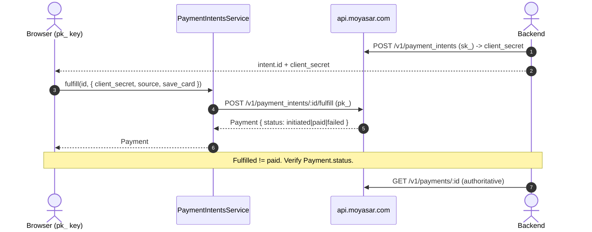

# US-3.2.0: Payment Intent Fulfillment via Publishable Key & Browser Flow

> **Spec Kit Specification**: [Specification Lifecycle Active](../../../docs/architecture/DECOMPOSITION_ROADMAP.md)  
> **Behavior Blueprint**: `features/core/modules/payment-intents/behaviours/intent-fulfillment/`  
> **Slicing Standard**: [10-PR Vertical Slicing Framework](../README.md#2-the-10-pr-vertical-slicing-framework-rust-sdk-adaptation)  
> **Security Gateway**: `security-audit` Level 2 Enforced  
> **Quality Gates**: `(G0–G4 + G-Review + G-Borrow + G-Law)`  

---

## 1. Spec Kit Specification

### 1.1 User Story Narrative
**As a** frontend/mobile integrator collecting card data in the browser,  
**I want to** fulfill a previously created `PaymentIntent` using only the `PublishableKey` and the intent's `client_secret`, supplying instrument-specific properties,  
**So that** no secret key ever reaches the client, the amount cannot be tampered with, and the resulting `Payment` object — not the intent — carries the authoritative charge outcome.

#### 1.2 Preconditions
- `features = ["payment-intents"]`.
- Backend has created the intent and delivered `(intent.id, intent.client_secret)` to the client.
- Client holds a `PublishableKey`.

#### 1.3 Postconditions
- `POST /v1/payment_intents/:id/fulfill` accepts `client_secret`, `source`, `metadata`, `save_card`, `manual`, `3ds` and returns a standard `Payment`.
- Attempts to override `amount`, `currency`, `description`, or `callback_url` are **ignored** by Moyasar; the intent's locked values win.
- The intent transitions to `fulfilled`; that is **not** proof of payment.
- Charge outcome must be read from the returned `Payment.status` or a subsequent `GET /v1/payments/:id`.

### 1.2 Acceptance Criteria (Gherkin Scenarios)

```gherkin
Feature: Payment Intent Fulfillment from the Browser

  Scenario: [AC-US-3.2.0-01] Fulfill with a valid client_secret and card source
    Given an intent in status "created" with a known client_secret
    When fulfill(id, params) is called with the PublishableKey and that client_secret
    Then the API receives POST /v1/payment_intents/:id/fulfill
    And the response deserializes into a Payment object.

  Scenario: [AC-US-3.2.0-02] Altered amount is ignored in favour of the locked value
    Given an intent locking amount 25000
    When a fulfillment payload attempts to supply amount 1
    Then the resulting Payment.amount equals 25000
    And the override is discarded by the server.

  Scenario: [AC-US-3.2.0-03] Mismatched client_secret is rejected
    Given an intent whose client_secret is "cs_valid"
    When fulfill() is called with client_secret "cs_wrong"
    Then the result is Err(MoyasarError::Api { .. }) with a 4xx classification
    And no charge is created.

  Scenario: [AC-US-3.2.0-04] Fulfilling an expired intent fails
    Given an intent whose expires_at has passed but status still reads "created"
    When fulfill() is called
    Then the API returns HTTP 400
    And the SDK surfaces a typed non-retryable error.

  Scenario: [AC-US-3.2.0-05] Fulfilled does not mean paid
    Given a fulfillment response where the intent is now "fulfilled"
    When the caller inspects the returned Payment
    Then the authoritative outcome is Payment.status, which may be "initiated" or "failed"
    And the SDK documentation states that a separate payment retrieval is required for final state.

  Scenario: [AC-US-3.2.0-06] save_card and 3ds flags are forwarded
    Given a fulfillment payload with save_card true and 3ds true
    When the request is serialized
    Then the body contains "save_card": true and "3ds": true.

  Scenario: [AC-US-3.2.0-LAW] PCI-DSS scoping via publishable-key-only client flows
    Given any browser-initiated fulfillment
    When the request is transmitted
    Then only a publishable key and client_secret cross the client boundary, never a secret key,
         keeping the client out of PCI-DSS CDE scope for key handling.
```

### 1.3 Test Cases & Traceability Matrix

| Test Case ID | Target Criterion | Test Type | Execution Level | Verification Assertion & Pass Criteria |
| :--- | :--- | :--- | :--- | :--- |
| `TC-3.2.0-01` | `AC-US-3.2.0-01` | Functional | Integration | Fulfill returns a `Payment` deserializable with `id` and `status`. |
| `TC-3.2.0-02` | `AC-US-3.2.0-02` | Security | Integration | Attempted `amount` override does not change `Payment.amount`. |
| `TC-3.2.0-03` | `AC-US-3.2.0-03` | Security | Integration | Wrong `client_secret` yields 4xx typed error. |
| `TC-3.2.0-04` | `AC-US-3.2.0-04` | State Machine | Integration | Expired intent → 400, non-retryable. |
| `TC-3.2.0-05` | `AC-US-3.2.0-05` | Documentation | Unit / Doc-test | Doc-test asserts caller reads `Payment.status`. |
| `TC-3.2.0-06` | `AC-US-3.2.0-06` | Functional | Unit | `save_card`/`3ds` present in serialized body. |
| `TC-3.2.0-LAW` | `AC-US-3.2.0-LAW` | Compliance | Static / Audit | No `sk_` in client-side code paths. |

---

## 2. Behavior-Centric Architecture & Folder Blueprint

### 2.1 Colocated Behaviour Directory Tree

```
features/core/modules/payment-intents/behaviours/intent-fulfillment/
├── services/        # FulfillDispatcher
├── logic/           # client_secret matching, flag forwarding
├── types/           # FulfillIntentParams, FulfillmentOutcome
└── constants/       # FULFILL_PATH
```

### 2.2 Scoping & Promotion Blueprint
- **Tier 1 (Behaviour-Local)**: fulfillment payload assembly.
- **Tier 2 (Module-Shared)**: `FulfillIntentParams` reusing `PaymentSourceRequest`.
- **Tier 3 (Feature-Shared)**: `fulfill()` on `PaymentIntentsService`.
- **Tier 4 (Global-Shared)**: `client.payment_intents().fulfill()`.

---

## 3. Technical Implementation Plan

### 3.1 Domain Invariants & Storage Schema
- **Locked-Params Law**: fulfillment payload must not contain `amount`, `currency`, `description`, or `callback_url`.
- **Outcome Law**: `PaymentIntentStatus::Fulfilled` never implies `PaymentStatus::Paid`.
- **Secret Matching Law**: `client_secret` must be the one issued for that intent id.
- **Key Law**: fulfill is callable with a `PublishableKey`.

```rust
#[derive(Serialize)]
pub struct FulfillIntentParams {
    pub client_secret: String,
    pub source: PaymentSourceRequest,
    #[serde(skip_serializing_if = "Option::is_none")]
    pub metadata: Option<BTreeMap<String, String>>,
    #[serde(skip_serializing_if = "Option::is_none")]
    pub save_card: Option<bool>,
    #[serde(skip_serializing_if = "Option::is_none")]
    pub manual: Option<bool>,
    #[serde(rename = "3ds", skip_serializing_if = "Option::is_none")]
    pub three_ds: Option<bool>,
}

impl PaymentIntentsService<'_> {
    pub async fn fulfill(&self, id: Uuid, params: FulfillIntentParams)
        -> Result<Payment, MoyasarError>
    {
        // POST /v1/payment_intents/{id}/fulfill -> Payment (NOT PaymentIntent)
        self.client.post(&format!("{FULFILL_PATH}/{id}/fulfill"), &params).await
    }
}
```

### 3.2 Activity & Interaction Diagram



---

## 4. Granular Implementation Tasks

### 4.1 The 10-PR Vertical Slicing Implementation Plan

| PR # | Pillar | Architectural Layer | Primary Scope & Files | Deliverables & Acceptance | Accountable Role / Agent | Assigned Skills |
| :--- | :--- | :--- | :--- | :--- | :--- | :--- |
| **PR 1** | **Pillar 1** | **Domain Logic & Core Traits** | `src/resources/payment_intents/fulfill.rs` | `FulfillIntentParams` struct. | `engineering-software-architect` | `security-audit` |
| **PR 2** | **Pillar 2** | **Request Modeling** | `src/resources/payment_intents/fulfill.rs` | Flag forwarding (`save_card`, `manual`, `3ds`). | `engineering-backend-architect` | `security-audit` |
| **PR 3** | **Pillar 3** | **Transport Wire Adapter** | `src/resources/payment_intents/fulfill.rs` | `POST /:id/fulfill` returning `Payment`. | `engineering-backend-architect` | `security-audit` |
| **PR 4** | **Pillar 4** | **Service Accessor** | `src/resources/payment_intents/service.rs` | `fulfill()` on the service, `pk_`-callable. | `engineering-software-architect` | `security-audit` |
| **PR 5** | **Pillar 5** | **Error Taxonomy** | `src/kernel/error.rs` | Mismatched `client_secret` and expired-intent errors. | `security-application-security-engineer` | `security-audit` |
| **PR 6** | **Pillar 6** | **Resource Facade Mounting** | `src/resources/payment_intents/mod.rs` | Export fulfillment types. | `engineering-software-architect` | `security-audit` |
| **PR 7** | **Pillar 7** | **Zero-Copy Hardening** | `src/resources/payment_intents/fulfill.rs` | Borrowed source; no payload duplication. | `agency-rust-refactoring-specialist` | `security-audit` |
| **PR 8** | **Pillar 8** | **Edge Cases & Guards** | `src/resources/payment_intents/lifecycle.rs` | Locked-param rejection; fulfilled≠paid guard. | `agency-api-tester` | `security-audit` |
| **PR 9** | **Pillar 9** | **Integration Wire Verification** | `tests/intent_fulfill_test.rs` | Override-ignored, wrong-secret, expired-intent cases. | `agency-api-tester` | `security-audit` |
| **PR 10** | **Pillar 10** | **Documentation & Packaging** | `README.md` | Doc-test asserting `Payment.status` is authoritative. | `engineering-technical-writer` | `security-audit` |

### 4.2 Implementation Phase Breakdown

#### Phase 1: Fulfillment Model (PR 1–2)
- [ ] **Task 1.1 (Params)**: `FulfillIntentParams` with `client_secret` and `source`.  
  *Agent*: `engineering-software-architect` | *Skill*: `security-audit`
- [ ] **Task 1.2 (Flags)**: forward `save_card`, `manual`, `3ds` when present.  
  *Agent*: `engineering-backend-architect` | *Skill*: `security-audit`
- [ ] **Task 1.3 (Unit Tests)**: serialized body shape.  
  *Agent*: `agency-api-tester` | *Skill*: `security-audit`

#### Phase 2: Endpoint & Errors (PR 3–6)
- [ ] **Task 2.1 (Fulfill)**: `POST /:id/fulfill` returning `Payment`.  
  *Agent*: `engineering-backend-architect` | *Skill*: `security-audit`
- [ ] **Task 2.2 (Errors)**: mismatched secret, expired intent.  
  *Agent*: `security-application-security-engineer` | *Skill*: `security-audit`
- [ ] **Task 2.3 (Exports)**: feature-gated wiring.  
  *Agent*: `engineering-software-architect` | *Skill*: `security-audit`

#### Phase 3: Guards (PR 7–8)
- [ ] **Task 3.1 (Locked Params)**: assert no override fields serialized.  
  *Agent*: `agency-api-tester` | *Skill*: `security-audit`
- [ ] **Task 3.2 (Outcome Guard)**: document and test fulfilled≠paid.  
  *Agent*: `agency-api-tester` | *Skill*: `security-audit`

#### Phase 4: Verification & Sign-Off (PR 9–10)
- [ ] **Task 4.1 (Wire Tests)**: override-ignored and wrong-secret scenarios.  
  *Agent*: `agency-api-tester` | *Skill*: `security-audit`
- [ ] **Task 4.2 (G-Review)**: peer review on secret handling.  
  *Agent*: `agency-code-reviewer` | *Skill*: `security-audit`
- [ ] **Task 4.3 (Documentation)**: browser-flow example.  
  *Agent*: `engineering-technical-writer` | *Skill*: `security-audit`

---

## 5. Security Gateway (Powered by security-audit)

### 5.1 Trust Boundaries & Security Actors
- **Trust Boundaries**:
  - `Browser Boundary`: untrusted; holds only `pk_` + `client_secret`.
  - `Parameter Boundary`: locked server-side values vs client-supplied payload.
- **Authorized Principals**: storefront (`pk_` + `client_secret`).

### 5.2 Threat Modeling & Abuse Matrix (STRIDE / ASVS)

| Threat Vector | Severity | Vulnerability Mechanism | Mitigating Control & Security Invariant |
| :--- | :--- | :--- | :--- |
| **Amount Tampering** | Critical | Client overriding amount at fulfillment | Server ignores overrides; locked values win. |
| **Secret Key Exposure** | Critical | `sk_` shipped to the browser | Fulfill requires only `pk_`; no `sk_` path exists. |
| **client_secret Brute Force** | High | Guessing another intent's secret | High-entropy server-issued secret; 4xx on mismatch. |
| **Replay of Fulfillment** | High | Re-submitting a fulfilled intent | Server rejects; SDK surfaces non-retryable 4xx. |
| **Mistaken Settlement** | High | Treating fulfilled as paid | Explicit documentation + doc-test. |

### 5.3 Cryptographic & Data Protection Controls
- **Key Separation**: only `pk_` crosses the client boundary.
- **Secret Matching**: server-side verification of `client_secret`.
- **No Override Path**: locked parameters cannot be transmitted by the SDK.

### 5.4 Automated Security Verification Checklist
- [ ] **Override Test**: amount override has no effect.
- [ ] **Sk-Absence Test**: no secret key referenced in fulfill path.
- [ ] **Wrong-Secret Test**: typed 4xx, no charge.
- [ ] **Replay Test**: re-fulfill rejected.

### 5.5 Security Gateway (G2) Sign-Off Checklist
- [ ] Browser flow verified against OWASP ASVS Level 2.
- [ ] Zero secret keys in client paths.
- [ ] Parameter locking confirmed.
- [ ] Independent reviewer sign-off; zero open findings.

---

## 6. Validation Gates & Acceptance Sign-Off

**Status: Ready for Implementation.**

### G0 — Build, lint & format
- [ ] **US-3.2.0-G0:** `cargo build && cargo clippy -- -D warnings && cargo fmt --check` clean.

### G1 — Test coverage
- [ ] **US-3.2.0-G1:** ≥90% line / ≥85% branch on the fulfillment module.

### G2 — Security audit
- [ ] **US-3.2.0-G2:** Browser-boundary audit passes with zero critical/high findings.

### G3 — Architecture and maintainability
- [ ] **US-3.2.0-G3:** Fulfillment reuses `PaymentSourceRequest`; zero duplication.

### G-Review — Code review
- [ ] **US-3.2.0-G-Review:** Peer review on secret handling and locked params.

### G-Borrow — Rust zero-clone validation
- [ ] **US-3.2.0-G-Borrow:** Source moved into params; no payload duplication.

### G-Complexity — Cyclomatic complexity
- [ ] **US-3.2.0-G-Complexity:** $CC \le 6$; nesting $\le 2$.

### G-Docs — Public docs & examples
- [ ] **US-3.2.0-G-Docs:** Browser-flow example runnable; fulfilled≠paid documented.

### G-Law — Law validation
- [ ] **US-3.2.0-G-Law:** PCI-DSS client-boundary scoping certified.

### G4 — Integrated acceptance
- [ ] **US-3.2.0-G4:** Fulfillment succeeds and override attempts are provably ignored.
