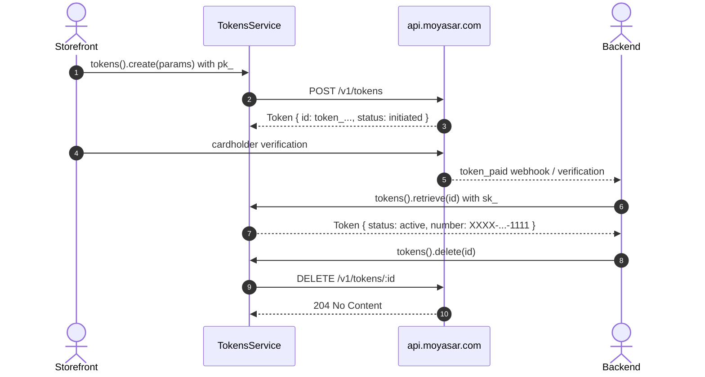

# US-4.1.0: Card Tokenization Service — Create, Retrieve & Delete

> **Spec Kit Specification**: [Specification Lifecycle Active](../../../docs/architecture/DECOMPOSITION_ROADMAP.md)  
> **Behavior Blueprint**: `src/resources/tokens/`  
> **Slicing Standard**: [10-PR Vertical Slicing Framework](../README.md#2-the-10-pr-vertical-slicing-framework-rust-sdk-adaptation)  
> **Security Gateway**: `security-audit` Level 2 Enforced  
> **Quality Gates**: `(G0–G4 + G-Review + G-Borrow + G-Law)`  

---

## 1. Spec Kit Specification

### 1.1 User Story Narrative
**As a** subscription and card-on-file product engineer,  
**I want to** create, retrieve, and delete Moyasar card tokens through `client.tokens()`, with a token lifecycle of `initiated → active → inactive`,  
**So that** I can charge saved cards off-session later, display masked card details to customers, and revoke access when a customer removes their card — without ever storing a PAN.

#### 1.1.1 Preconditions
- `features = ["tokens"]` (implies `core`).
- A `PublishableKey` for `create()`; a `SecretKey` for `retrieve()` and `delete()`.

#### 1.1.2 Postconditions
- `POST /v1/tokens` returns a `Token` with `id` prefixed `token_` and `status: "initiated"`.
- After cardholder verification the token becomes `active`; it becomes `inactive` on verification failure or card expiry.
- `GET /v1/tokens/:id` returns masked card details suitable for customer display.
- `DELETE /v1/tokens/:id` returns HTTP `204 No Content` with an empty body.

### 1.2 Acceptance Criteria (Gherkin Scenarios)

```gherkin
Feature: Card Token Lifecycle

  Scenario: [AC-US-4.1.0-01] Create a token with a publishable key
    Given a CreateTokenParams with name, number, month, year and cvc
    When client.tokens().create(params) is called with a PublishableKey
    Then the response Token.id starts with "token_"
    And the response status equals "initiated".

  Scenario: [AC-US-4.1.0-02] save_only defers verification
    Given a CreateTokenParams with save_only true
    When the token is created
    Then the request body contains "save_only": true
    And the token remains "initiated" until cardholder verification completes.

  Scenario: [AC-US-4.1.0-03] Retrieve masked card details for display
    Given an active token id
    When client.tokens().retrieve(id) is called with a SecretKey
    Then the response contains a masked card number such as "XXXX-XXXX-XXXX-1111"
    And no full PAN is present anywhere in the Token struct.

  Scenario: [AC-US-4.1.0-04] Delete returns 204 with an empty body
    Given an existing token id
    When client.tokens().delete(id) is called with a SecretKey
    Then the API returns HTTP 204 No Content
    And the SDK returns Ok(()) rather than attempting to deserialize a body.

  Scenario: [AC-US-4.1.0-05] Token status transitions
    Given a token in status "initiated"
    When cardholder verification succeeds
    Then the token status becomes "active"
    And if verification fails or the card expires the status becomes "inactive".

  Scenario: [AC-US-4.1.0-LAW] PCI-DSS tokenization as PAN-substitution control
    Given any token creation
    When the token is persisted by the merchant
    Then only the "token_..." identifier and masked number are stored, never the PAN or CVC,
         satisfying PCI-DSS 4.0 Requirement 3.4 tokenization guidance.
```

### 1.3 Test Cases & Traceability Matrix

| Test Case ID | Target Criterion | Test Type | Execution Level | Verification Assertion & Pass Criteria |
| :--- | :--- | :--- | :--- | :--- |
| `TC-4.1.0-01` | `AC-US-4.1.0-01` | Functional | Integration | `id` starts with `token_`; status `initiated`. |
| `TC-4.1.0-02` | `AC-US-4.1.0-02` | Functional | Unit | `save_only` present in body when true. |
| `TC-4.1.0-03` | `AC-US-4.1.0-03` | Functional | Unit | Masked number matches `XXXX-XXXX-XXXX-\d{4}`; no 16-digit PAN. |
| `TC-4.1.0-04` | `AC-US-4.1.0-04` | Functional | Integration | 204 handled as `Ok(())` with empty-body deserialization. |
| `TC-4.1.0-05` | `AC-US-4.1.0-05` | State Machine | Unit | Status enum transitions mapped from fixtures. |
| `TC-4.1.0-LAW` | `AC-US-4.1.0-LAW` | Compliance | Static / Audit | No PAN/CVC retained in `Token`. |

---

## 2. Behavior-Centric Architecture & Folder Blueprint

### 2.1 Rust Crate Module & Unit File Ownership Tree

```
src/
├── src/resources/tokens/models.rs             # Unit 1 (feat/us-4.1.0/unit-1-token-model)
├── src/resources/tokens/create.rs             # Unit 2 (feat/us-4.1.0/unit-2-token-create)
├── src/resources/tokens/retrieve.rs           # Unit 3 (feat/us-4.1.0/unit-3-token-retrieve)
├── src/resources/tokens/delete.rs             # Unit 4 (feat/us-4.1.0/unit-4-token-delete)
```

### 2.2 Scoping & Promotion Blueprint
- **Tier 1 (Behaviour-Local)**: 204 empty-body handler.
- **Tier 2 (Module-Shared)**: `TokenStatus` used by stripe-compat subscriptions.
- **Tier 3 (Feature-Shared)**: `TokensService` under `tokens`.
- **Tier 4 (Global-Shared)**: `client.tokens()` facade accessor.

---

## 3. Technical Implementation Plan

### 3.1 Domain Invariants & Storage Schema
- **Prefix Law**: token ids always start with `token_`; `TokenId(String)` enforces it at construction.
- **Empty-Body Law**: `DELETE` returns 204; the client must not attempt JSON deserialization.
- **Active-Before-Charge Law**: off-session charges require `TokenStatus::Active`.
- **PAN Non-Retention Law**: only masked numbers survive into the `Token` model.

```rust
#[derive(Debug, Clone, Deserialize)]
pub struct Token {
    pub id: TokenId,
    pub status: TokenStatus,
    pub number: String,        // masked: XXXX-XXXX-XXXX-1111
    pub company: Option<String>,
    pub gateway_id: Option<String>,
    pub created_at: DateTime<Utc>,
}

#[derive(Debug, Clone, Copy, PartialEq, Eq, Deserialize)]
#[serde(rename_all = "lowercase")]
pub enum TokenStatus { Initiated, Active, Inactive }

#[derive(Debug, Clone, PartialEq, Eq, Hash, Serialize, Deserialize)]
#[serde(transparent)]
pub struct TokenId(String);

impl std::fmt::Display for TokenId {
    fn fmt(&self, f: &mut std::fmt::Formatter<'_>) -> std::fmt::Result { f.write_str(&self.0) }
}

impl TokenId {
    pub fn new(raw: impl Into<String>) -> Result<Self, MoyasarError> {
        let raw = raw.into();
        if raw.starts_with(TOKEN_ID_PREFIX) { Ok(Self(raw)) }
        else { Err(MoyasarError::InvalidTokenId) }
    }
}

impl TokensService<'_> {
    pub async fn delete(&self, id: &TokenId) -> Result<(), MoyasarError> {
        // DELETE /v1/tokens/{id} -> 204 No Content (no body)
        self.client.delete_no_content(&format!("{TOKENS_PATH}/{id}")).await
    }
}
```

### 3.2 Activity & Interaction Diagram



---

## 4. Granular Implementation Tasks

### 4.1 Dynamic 4-Unit Parallel Implementation Plan

| Unit # | Branch | Exclusive Owner Files | Deliverables & Colocated Unit Tests | Accountable Role / Agent | Assigned Skills |
| :--- | :--- | :--- | :--- | :--- | :--- |
| **Unit 1** | `feat/us-4.1.0/unit-1-token-model` | `src/resources/tokens/models.rs` | `Token` struct (id: "token_...", status: initiated/active/inactive, masked card details), `TokenStatus` enum, `TokenId` newtype | `engineering-software-architect` | `security-audit` |
| **Unit 2** | `feat/us-4.1.0/unit-2-token-create` | `src/resources/tokens/create.rs` | `CreateTokenParams`: name, number, month, year, cvc, callback_url, save_only. `client.tokens().create()`, PublishableKey-accepted | `engineering-backend-architect` | `security-audit` |
| **Unit 3** | `feat/us-4.1.0/unit-3-token-retrieve` | `src/resources/tokens/retrieve.rs` | `client.tokens().retrieve(id)` (`SecretKey` bound, returns masked card details for customer display), 404 mapping, unit tests | `engineering-backend-architect` | `security-audit` |
| **Unit 4** | `feat/us-4.1.0/unit-4-token-delete` | `src/resources/tokens/delete.rs` | `client.tokens().delete(id)` (`DELETE /v1/tokens/:id` 204 No Content empty-body handler), token status gate helpers, unit tests | `security-appsec-engineer` | `security-audit` |

### 4.2 Parallel Unit Execution & Story Merge Breakdown

#### Wave 1: Base Branch Scaffolding (`feat/us-4.1.0-*`)
- [x] **Task 0.1 (Story Base Contracts)**: Verify `Cargo.toml`, `src/lib.rs`, and the domain's `mod.rs` + `service.rs` facade declarations are present on the story base branch before spawning parallel unit worktrees.  
  *Agent*: `story-leader` | *Skill*: `divide-and-conquer-orchestrator`

#### Wave 2: 100% Parallel Unit Implementation (`Unit 1..4`)
- [x] **Unit 1 (`feat/us-4.1.0/unit-1-token-model`)**: `Token` struct (id: "token_...", status: initiated/active/inactive, masked card details), `TokenStatus` enum, `TokenId` newtype (Files: `src/resources/tokens/models.rs`)  
  *Agent*: `engineering-software-architect` | *Skill*: `security-audit`
- [x] **Unit 2 (`feat/us-4.1.0/unit-2-token-create`)**: `CreateTokenParams`: name, number, month, year, cvc, callback_url, save_only. `client.tokens().create()`, PublishableKey-accepted (Files: `src/resources/tokens/create.rs`)  
  *Agent*: `engineering-backend-architect` | *Skill*: `security-audit`
- [x] **Unit 3 (`feat/us-4.1.0/unit-3-token-retrieve`)**: `client.tokens().retrieve(id)` (`SecretKey` bound, returns masked card details for customer display), 404 mapping, unit tests (Files: `src/resources/tokens/retrieve.rs`)  
  *Agent*: `engineering-backend-architect` | *Skill*: `security-audit`
- [x] **Unit 4 (`feat/us-4.1.0/unit-4-token-delete`)**: `client.tokens().delete(id)` (`DELETE /v1/tokens/:id` 204 No Content empty-body handler), token status gate helpers, unit tests (Files: `src/resources/tokens/delete.rs`)  
  *Agent*: `security-appsec-engineer` | *Skill*: `security-audit`

#### Wave 3: Cascading Merge & Story Integration Verification
- [x] **Task 3.1 (Cascading Merge & Wire Verification)**: Merge `Unit 1 -> ... -> Unit 4` into the story branch and run story-level wire integration tests and `G0–G4` quality gates.  
  *Agent*: `testing-api-tester` | *Skill*: `security-audit`
- [x] **Task 3.2 (Council Review & Sign-Off)**: Execute independent Multi-Council Review (`G-Review`, `G-Borrow`, `G-Complexity`, `G-Docs`, `G-Law`).  
  *Agent*: `engineering-code-reviewer` | *Skill*: `code-review-council`

---

## 5. Security Gateway (Powered by security-audit)

### 5.1 Trust Boundaries & Security Actors
- **Trust Boundaries**:
  - `Tokenization Boundary`: PAN → `token_...` substitution.
  - `Key Boundary`: `pk_` creates; `sk_` retrieves/deletes.
- **Authorized Principals**: storefront (`pk_`), merchant backend (`sk_`).

### 5.2 Threat Modeling & Abuse Matrix (STRIDE / ASVS)

| Threat Vector | Severity | Vulnerability Mechanism | Mitigating Control & Security Invariant |
| :--- | :--- | :--- | :--- |
| **PAN Retention** | Critical | Full card number stored in the token model | Only masked numbers in `Token`; no `Debug` on PAN holders. |
| **Token Theft** | High | Leaked `token_...` charged by an attacker | Tokens are merchant-scoped server-side; `sk_` required to charge. |
| **Stale Token Charge** | High | Charging an `inactive` token | `Active` status required before off-session charge. |
| **204 Misparse** | Medium | Treating empty body as JSON causes errors | Dedicated `delete_no_content` path. |
| **Enumeration** | Low | Guessing token ids | High-entropy token ids; 404 on unknown. |

### 5.3 Cryptographic & Data Protection Controls
- **Substitution**: PAN replaced by an opaque token.
- **Masking**: only last-4 retained for display.
- **Status Gate**: `Active` required pre-charge.

### 5.4 Automated Security Verification Checklist
- [x] **PAN Test**: no 16-digit sequence in `format!("{:?}", token)`.
- [x] **204 Test**: delete returns `Ok(())`.
- [x] **Status Gate Test**: inactive token blocks charge.
- [x] **Key Test**: `delete` unreachable with `pk_`.

### 5.5 Security Gateway (G2) Sign-Off Checklist
- [x] Tokenization verified against OWASP ASVS Level 2.
- [x] Zero PAN retention.
- [x] Status gating enforced.
- [x] Independent reviewer sign-off; zero open findings.

---

## 6. Validation Gates & Acceptance Sign-Off

**Status: Implemented & Verified (Merged to `main`).**

### G0 — Build, lint & format
- [x] **US-4.1.0-G0:** `cargo build && cargo clippy -- -D warnings && cargo fmt --check` clean.

### G1 — Test coverage
- [x] **US-4.1.0-G1:** ≥90% line / ≥85% branch on the tokens module.

### G2 — Security audit
- [x] **US-4.1.0-G2:** PAN-retention audit passes with zero critical/high findings.

### G3 — Architecture and maintainability
- [x] **US-4.1.0-G3:** Token module depends only on the kernel.

### G-Review — Code review
- [x] **US-4.1.0-G-Review:** Peer review on PAN handling and 204 path.

### G-Borrow — Rust zero-clone validation
- [x] **US-4.1.0-G-Borrow:** `TokenId` avoids needless `String` cloning.

### G-Complexity — Cyclomatic complexity
- [x] **US-4.1.0-G-Complexity:** $CC \le 6$; nesting $\le 2$.

### G-Docs — Public docs & examples
- [x] **US-4.1.0-G-Docs:** 100% public symbols documented; lifecycle example runnable.

### G-Law — Law validation
- [x] **US-4.1.0-G-Law:** PCI-DSS 4.0 Requirement 3.4 tokenization guidance certified.

### G4 — Integrated acceptance
- [x] **US-4.1.0-G4:** Create→retrieve→delete round-trip verified against the mock server.
