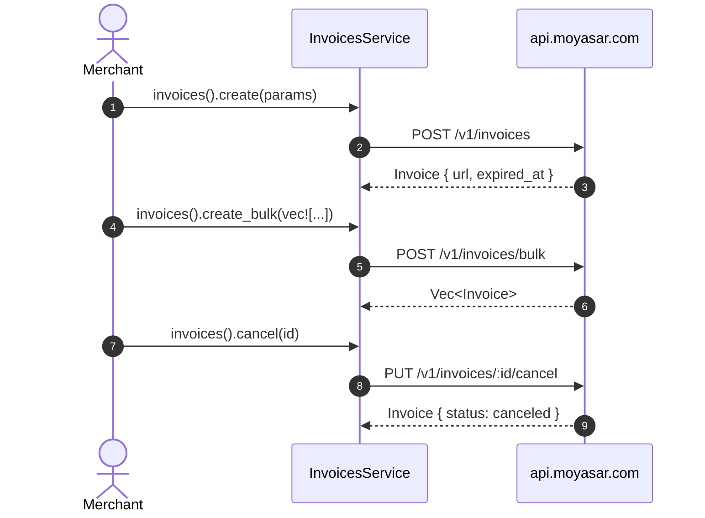

# US-4.2.0: Hosted E-Invoice Service — Create, Bulk, List, Update & Cancel

> **Spec Kit Specification**: [Specification Lifecycle Active](../../../docs/architecture/DECOMPOSITION_ROADMAP.md)  
> **Behavior Blueprint**: `features/core/modules/invoices/behaviours/hosted-e-invoices/`  
> **Slicing Standard**: [10-PR Vertical Slicing Framework](../README.md#2-the-10-pr-vertical-slicing-framework-rust-sdk-adaptation)  
> **Security Gateway**: `security-audit` Level 2 Enforced  
> **Quality Gates**: `(G0–G4 + G-Review + G-Borrow + G-Law)`  

---

## 1. Spec Kit Specification

### 1.1 User Story Narrative
**As a** merchant billing business customers in Saudi Arabia,  
**I want to** create hosted payment invoices (single and bulk), list and update them, and cancel them using the documented `PUT /v1/invoices/:id/cancel` verb,  
**So that** my customers receive a Moyasar-hosted payment page, SADAD bill expiries stay synchronized with invoice expiry, and I can batch-issue invoices for many customers without N round-trips.

#### 1.1.1 Preconditions
- `features = ["invoices"]` (implies `core`, `payments`).
- A valid `SecretKey`.

#### 1.1.2 Postconditions
- `create()` returns an `Invoice` including a hosted payment `url`, `expired_at`, and associated payments.
- `create_bulk()` accepts `Vec<CreateInvoiceParams>` and returns `Vec<Invoice>`.
- `list()` supports `page`, `id`, `status`, `created[gt|lt]`, `metadata[key]` filters and returns `PaginatedList<Invoice>`.
- `update()` mutates `description` and `metadata`.
- `cancel()` uses **HTTP PUT** on `/v1/invoices/:id/cancel` and transitions status to `canceled`.
- A SADAD bill attached to an invoice never outlives the invoice expiry (capped at 29 days).

### 1.2 Acceptance Criteria (Gherkin Scenarios)

```gherkin
Feature: Hosted E-Invoice Lifecycle

  Scenario: [AC-US-4.2.0-01] Create a hosted invoice
    Given a CreateInvoiceParams with amount 50000, currency SAR and a description
    When client.invoices().create(params) is called
    Then the response Invoice contains a hosted payment url
    And the Invoice.status reflects an unpaid/created state.

  Scenario: [AC-US-4.2.0-02] Bulk invoice creation
    Given a vector of three CreateInvoiceParams
    When client.invoices().create_bulk(params) is called
    Then the request body contains an "invoices" array of length 3
    And the response is a Vec<Invoice> of length 3.

  Scenario: [AC-US-4.2.0-03] List with filters and pagination
    Given a list request filtered by status and a created[gt] timestamp
    When client.invoices().list(params) is called
    Then the query string contains the status and created[gt] filters
    And the response deserializes into PaginatedList<Invoice>.

  Scenario: [AC-US-4.2.0-04] Update description and metadata
    Given an existing invoice
    When client.invoices().update(id, params) is called
    Then the API receives PUT /v1/invoices/:id
    And the returned Invoice.description reflects the change.

  Scenario: [AC-US-4.2.0-05] Cancel uses the PUT verb on the /cancel path
    Given a payable invoice
    When client.invoices().cancel(id) is called
    Then the request method is PUT (not POST and not DELETE)
    And the path is /v1/invoices/:id/cancel
    And the returned Invoice.status equals "canceled".

  Scenario: [AC-US-4.2.0-06] SADAD expiry never outlives the invoice
    Given an invoice with expired_at 40 days out
    When a SADAD bill is created against it
    Then the bill's expired_at is capped at the invoice expiry and at 29 days
    And the bill never remains payable after the invoice expires.

  Scenario: [AC-US-4.2.0-LAW] SAMA e-invoicing expiry and immutability rules
    Given any invoice
    When it is created and later cancelled
    Then amount and currency are immutable across the lifecycle and cancellation is terminal,
         satisfying SAMA e-invoicing requirements for issued documents.
```

### 1.3 Test Cases & Traceability Matrix

| Test Case ID | Target Criterion | Test Type | Execution Level | Verification Assertion & Pass Criteria |
| :--- | :--- | :--- | :--- | :--- |
| `TC-4.2.0-01` | `AC-US-4.2.0-01` | Functional | Integration | Hosted `url` present and non-empty. |
| `TC-4.2.0-02` | `AC-US-4.2.0-02` | Functional | Unit | Bulk body has `invoices` array of length 3. |
| `TC-4.2.0-03` | `AC-US-4.2.0-03` | Functional | Unit | Query string byte-comparison; pagination meta correct. |
| `TC-4.2.0-04` | `AC-US-4.2.0-04` | Functional | Integration | PUT verb; description updated. |
| `TC-4.2.0-05` | `AC-US-4.2.0-05` | Functional | Integration | Method is PUT; path suffix `/cancel`. |
| `TC-4.2.0-06` | `AC-US-4.2.0-06` | Validation | Unit | 40-day invoice yields ≤29-day bill expiry. |
| `TC-4.2.0-LAW` | `AC-US-4.2.0-LAW` | Compliance | Static / Audit | amount/currency immutable; cancel terminal. |

---

## 2. Behavior-Centric Architecture & Folder Blueprint

### 2.1 Colocated Behaviour Directory Tree

```
features/core/modules/invoices/behaviours/hosted-e-invoices/
├── services/        # InvoicesService dispatchers
├── logic/           # Query filters, SADAD expiry synchronization
├── types/           # Invoice, InvoiceStatus, InvoiceId, CreateInvoiceParams, ListInvoicesParams
└── constants/       # INVOICES_PATH, CANCEL_SUFFIX
```

### 2.2 Scoping & Promotion Blueprint
- **Tier 1 (Behaviour-Local)**: query-filter serialization.
- **Tier 2 (Module-Shared)**: `Invoice` referenced by SADAD bill and settlements.
- **Tier 3 (Feature-Shared)**: `InvoicesService` under `invoices`.
- **Tier 4 (Global-Shared)**: `client.invoices()` facade.

---

## 3. Technical Implementation Plan

### 3.1 Domain Invariants & Storage Schema
- **Verb Law**: cancel is `PUT /v1/invoices/:id/cancel` — never POST, never DELETE.
- **Immutability Law**: `amount` and `currency` cannot change after creation.
- **Terminal Law**: `canceled` is a terminal state; no transition out of it.
- **Expiry Sync Law**: SADAD bill expiry = `min(invoice.expired_at, now + 29 days)`.

```rust
#[derive(Debug, Clone, Deserialize)]
pub struct Invoice {
    pub id: Uuid,
    pub status: InvoiceStatus,
    pub amount: u64,
    pub currency: Currency,
    pub description: Option<String>,
    pub url: String,                                  // hosted payment page
    pub expired_at: Option<DateTime<Utc>>,
    pub metadata: BTreeMap<String, String>,
    pub payments: Option<Vec<serde_json::Value>>,
    pub created_at: DateTime<Utc>,
}

#[derive(Debug, Clone, Copy, PartialEq, Eq, Deserialize)]
#[serde(rename_all = "lowercase")]
pub enum InvoiceStatus { Created, Paid, Canceled, Expired, #[serde(other)] Unknown }

impl InvoicesService<'_> {
    /// Cancels via PUT /v1/invoices/:id/cancel (documented non-standard verb).
    pub async fn cancel(&self, id: Uuid) -> Result<Invoice, MoyasarError> {
        self.client.put(&format!("{INVOICES_PATH}/{id}{CANCEL_SUFFIX}"), &()).await
    }
}
```

### 3.2 Activity & Interaction Diagram



---

## 4. Granular Implementation Tasks

### 4.1 The 10-PR Vertical Slicing Implementation Plan

| PR # | Pillar | Architectural Layer | Primary Scope & Files | Deliverables & Acceptance | Accountable Role / Agent | Assigned Skills |
| :--- | :--- | :--- | :--- | :--- | :--- | :--- |
| **PR 1** | **Pillar 1** | **Domain Logic & Core Traits** | `src/resources/invoices/models.rs` | `Invoice`, `InvoiceStatus`, `InvoiceId`. | `engineering-software-architect` | `security-audit` |
| **PR 2** | **Pillar 2** | **Request Modeling** | `src/resources/invoices/params.rs` | `CreateInvoiceParams`, `ListInvoicesParams`. | `engineering-backend-architect` | `security-audit` |
| **PR 3** | **Pillar 3** | **Transport Wire Adapter** | `src/resources/invoices/create.rs` | `POST /v1/invoices` and `/bulk`. | `engineering-backend-architect` | `security-audit` |
| **PR 4** | **Pillar 4** | **Service Accessor** | `src/resources/invoices/service.rs` | `client.invoices()` accessor. | `engineering-software-architect` | `security-audit` |
| **PR 5** | **Pillar 5** | **Error Taxonomy** | `src/kernel/error.rs` | 404 and invalid-status error mapping. | `security-application-security-engineer` | `security-audit` |
| **PR 6** | **Pillar 6** | **Resource Facade Mounting** | `src/resources/invoices/mod.rs` | Feature-gated export under `invoices`. | `engineering-software-architect` | `security-audit` |
| **PR 7** | **Pillar 7** | **Zero-Copy Hardening** | `src/resources/invoices/models.rs` | Borrowed metadata; no bulk cloning. | `agency-rust-refactoring-specialist` | `security-audit` |
| **PR 8** | **Pillar 8** | **Edge Cases & Guards** | `src/resources/invoices/cancel.rs` | PUT-verb cancel + terminal-state guard. | `agency-api-tester` | `security-audit` |
| **PR 9** | **Pillar 9** | **Integration Wire Verification** | `tests/invoices_test.rs` | create/bulk/list/update/cancel wire tests. | `agency-api-tester` | `security-audit` |
| **PR 10** | **Pillar 10** | **Documentation & Packaging** | `README.md` | Doc-tests incl. the PUT cancel quirk. | `engineering-technical-writer` | `security-audit` |

### 4.2 Implementation Phase Breakdown

#### Phase 1: Models & Params (PR 1–2)
- [ ] **Task 1.1 (Types)**: `Invoice`, `InvoiceStatus`, `InvoiceId`.  
  *Agent*: `engineering-software-architect` | *Skill*: `security-audit`
- [ ] **Task 1.2 (Params)**: create/list params with all filters.  
  *Agent*: `engineering-backend-architect` | *Skill*: `security-audit`
- [ ] **Task 1.3 (Unit Tests)**: deserialization with hosted `url`.  
  *Agent*: `agency-api-tester` | *Skill*: `security-audit`

#### Phase 2: Endpoints (PR 3–6)
- [ ] **Task 2.1 (Create/Bulk)**: POST single and bulk creation.  
  *Agent*: `engineering-backend-architect` | *Skill*: `security-audit`
- [ ] **Task 2.2 (Retrieve/List)**: GET by id and filtered list.  
  *Agent*: `engineering-backend-architect` | *Skill*: `security-audit`
- [ ] **Task 2.3 (Update)**: PUT description/metadata.  
  *Agent*: `engineering-backend-architect` | *Skill*: `security-audit`

#### Phase 3: Cancel & Edge Cases (PR 7–8)
- [ ] **Task 3.1 (PUT Cancel)**: documented non-standard verb.  
  *Agent*: `agency-api-tester` | *Skill*: `security-audit`
- [ ] **Task 3.2 (SADAD Sync)**: bill expiry ≤ invoice expiry and ≤ 29 days.  
  *Agent*: `agency-api-tester` | *Skill*: `security-audit`

#### Phase 4: Verification & Sign-Off (PR 9–10)
- [ ] **Task 4.1 (Wire Tests)**: full endpoint matrix.  
  *Agent*: `agency-api-tester` | *Skill*: `security-audit`
- [ ] **Task 4.2 (G-Review)**: peer review on verb correctness and immutability.  
  *Agent*: `agency-code-reviewer` | *Skill*: `security-audit`
- [ ] **Task 4.3 (Documentation)**: doc-tests including the PUT quirk.  
  *Agent*: `engineering-technical-writer` | *Skill*: `security-audit`

---

## 5. Security Gateway (Powered by security-audit)

### 5.1 Trust Boundaries & Security Actors
- **Trust Boundaries**:
  - `Hosted Page Boundary`: the invoice `url` is a customer-facing attack surface.
  - `Document Boundary`: invoices are financial documents subject to immutability.
- **Authorized Principals**: merchant backend (`sk_` only).

### 5.2 Threat Modeling & Abuse Matrix (STRIDE / ASVS)

| Threat Vector | Severity | Vulnerability Mechanism | Mitigating Control & Security Invariant |
| :--- | :--- | :--- | :--- |
| **Amount Tampering** | Critical | Modifying amount after issuance | amount/currency immutable; update touches only description/metadata. |
| **Premature Deletion** | High | DELETE used instead of PUT cancel | Only `PUT /cancel` exposed; no DELETE method exists. |
| **Stale Bill Payment** | High | SADAD bill payable after invoice expiry | Expiry synchronization caps bill at invoice expiry. |
| **Metadata Injection** | Medium | Malicious metadata breaking audit records | Length caps; percent-encoded query filters. |
| **Bulk Abuse** | Medium | Huge bulk payload causing resource exhaustion | Documented batch-size guidance; server enforces limits. |

### 5.3 Cryptographic & Data Protection Controls
- **Immutability**: only description/metadata are mutable.
- **Terminal State**: canceled invoices cannot be revived.
- **Expiry Synchronization**: single formula for bill expiry.

### 5.4 Automated Security Verification Checklist
- [ ] **Verb Test**: cancel issues PUT only.
- [ ] **Immutability Test**: amount/currency unchanged by update.
- [ ] **Expiry Test**: bill expiry ≤ invoice expiry.
- [ ] **Terminal Test**: no transition out of `canceled`.

### 5.5 Security Gateway (G2) Sign-Off Checklist
- [ ] Document integrity verified against OWASP ASVS Level 2.
- [ ] No DELETE path for invoices.
- [ ] Expiry synchronization certified.
- [ ] Independent reviewer sign-off; zero open findings.

---

## 6. Validation Gates & Acceptance Sign-Off

**Status: Ready for Implementation.**

### G0 — Build, lint & format
- [ ] **US-4.2.0-G0:** `cargo build && cargo clippy -- -D warnings && cargo fmt --check` clean.

### G1 — Test coverage
- [ ] **US-4.2.0-G1:** ≥90% line / ≥85% branch on the invoices module.

### G2 — Security audit
- [ ] **US-4.2.0-G2:** Document-integrity audit passes with zero critical/high findings.

### G3 — Architecture and maintainability
- [ ] **US-4.2.0-G3:** Invoices depend on kernel + payments only.

### G-Review — Code review
- [ ] **US-4.2.0-G-Review:** Peer review on verb correctness and immutability.

### G-Borrow — Rust zero-clone validation
- [ ] **US-4.2.0-G-Borrow:** Bulk creation moves the vec; no element cloning.

### G-Complexity — Cyclomatic complexity
- [ ] **US-4.2.0-G-Complexity:** $CC \le 6$; nesting $\le 2$.

### G-Docs — Public docs & examples
- [ ] **US-4.2.0-G-Docs:** 100% public symbols documented; PUT-cancel quirk documented.

### G-Law — Law validation
- [ ] **US-4.2.0-G-Law:** SAMA e-invoicing expiry and immutability certified.

### G4 — Integrated acceptance
- [ ] **US-4.2.0-G4:** All six endpoints verified against the mock server.
