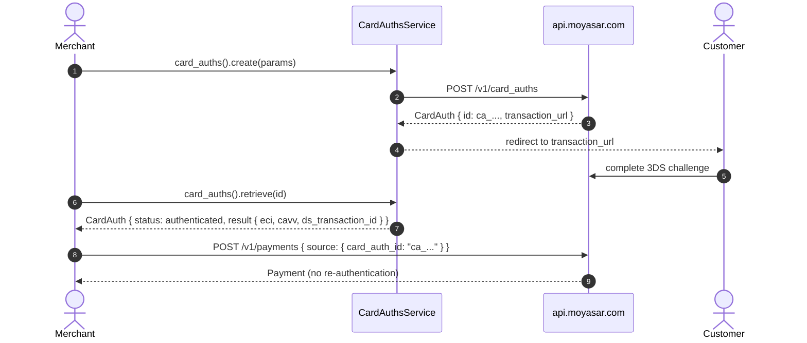

# US-4.3.0: Standalone 3D Secure Card Authentication & MPI Result Extraction

> **Spec Kit Specification**: [Specification Lifecycle Active](../../../docs/architecture/DECOMPOSITION_ROADMAP.md)  
> **Behavior Blueprint**: `features/core/modules/card-auths/behaviours/standalone-3ds/`  
> **Slicing Standard**: [10-PR Vertical Slicing Framework](../README.md#2-the-10-pr-vertical-slicing-framework-rust-sdk-adaptation)  
> **Security Gateway**: `security-audit` Level 2 Enforced  
> **Quality Gates**: `(G0–G4 + G-Review + G-Borrow + G-Law)`  

---

## 1. Spec Kit Specification

### 1.1 User Story Narrative
**As an** enterprise merchant running 3D Secure independently of charging,  
**I want to** authenticate a card via `POST /v1/card_auths`, retrieve the resulting MPI cryptographic parameters (`eci`, `authentication_value`, `ds_transaction_id`, `version`, `transaction_status`, `auth_scheme`, `is_frictionless`), then charge later via `card_auth_id` — or inject external MPI data via `card_auth_data`,  
**So that** I can pre-authenticate cards, reuse one authentication across gateways, and satisfy scheme mandates without coupling authentication to capture.

#### 1.1.1 Preconditions
- `features = ["card-auth"]` (enterprise entitlement).
- A `SecretKey` (or `PublishableKey` where the route permits).
- Card details for authentication.

#### 1.1.2 Postconditions
- `create()` returns a `CardAuthentication` with `id` prefixed `ca_` and a `transaction_url` (`/v1/card_auth/:id/prepare`).
- `retrieve()` returns `status` (`authenticated` | `failed`) plus the full `result` block.
- The `ca_...` id can be passed as `source.card_auth_id` on a later payment.
- External MPI parameters can be supplied as `source.card_auth_data`.

### 1.2 Acceptance Criteria (Gherkin Scenarios)

```gherkin
Feature: Standalone 3D Secure Card Authentication

  Scenario: [AC-US-4.3.0-01] Create a card authentication
    Given a CreateCardAuthParams with amount, currency, callback_url and card details
    When client.card_auths().create(params) is called
    Then the response id starts with "ca_"
    And transaction_url contains "/v1/card_auth/" and "/prepare".

  Scenario: [AC-US-4.3.0-02] Retrieve authentication status and MPI result
    Given an existing card authentication id
    When client.card_auths().retrieve(id) is called
    Then status is either "authenticated" or "failed"
    And when authenticated, result contains eci, authentication_value and ds_transaction_id.

  Scenario: [AC-US-4.3.0-03] Frictionless flow is distinguishable
    Given a successful authentication
    When the result is inspected
    Then is_frictionless equals true when no challenge was presented
    And transaction_status reflects the scheme outcome.

  Scenario: [AC-US-4.3.0-04] Charge later using the card_auth_id
    Given a successful card authentication with id "ca_abc"
    When a payment is created with source.card_auth_id "ca_abc"
    Then the payment body contains "card_auth_id": "ca_abc"
    And the card is not re-authenticated.

  Scenario: [AC-US-4.3.0-05] External MPI parameters via card_auth_data
    Given externally obtained 3DS parameters (eci, cavv, ds_transaction_id)
    When a payment is created with source.card_auth_data holding those values
    Then the body contains a card_auth_data object with those fields
    And Moyasar accepts the externally authenticated transaction.

  Scenario: [AC-US-4.3.0-LAW] PCI-DSS and scheme mandate compliance for 3DS2
    Given any standalone authentication
    When the authentication is executed
    Then CAVV/authentication_value and ECI are transmitted only over TLS and never logged in plaintext,
         satisfying PCI-DSS 4.0 multi-factor authentication requirements for cardholder verification.
```

### 1.3 Test Cases & Traceability Matrix

| Test Case ID | Target Criterion | Test Type | Execution Level | Verification Assertion & Pass Criteria |
| :--- | :--- | :--- | :--- | :--- |
| `TC-4.3.0-01` | `AC-US-4.3.0-01` | Functional | Integration | `id` starts with `ca_`; `transaction_url` shape correct. |
| `TC-4.3.0-02` | `AC-US-4.3.0-02` | Functional | Unit | Fixture deserializes `result` with all MPI fields. |
| `TC-4.3.0-03` | `AC-US-4.3.0-03` | Functional | Unit | `is_frictionless` true/false fixtures. |
| `TC-4.3.0-04` | `AC-US-4.3.0-04` | Functional | Unit | `card_auth_id` serialized into payment source. |
| `TC-4.3.0-05` | `AC-US-4.3.0-05` | Functional | Unit | `card_auth_data` object serialized verbatim. |
| `TC-4.3.0-LAW` | `AC-US-4.3.0-LAW` | Security | Unit / SAST | No CAVV/authentication_value in `Debug` or logs. |

---

## 2. Behavior-Centric Architecture & Folder Blueprint

### 2.1 Colocated Behaviour Directory Tree

```
features/core/modules/card-auths/behaviours/standalone-3ds/
├── services/        # CardAuthsService create/retrieve
├── logic/           # MPI result normalization, frictionless detection
├── types/           # CardAuthentication, CardAuthStatus, CardAuthResult, CardAuthId
└── constants/       # CARD_AUTHS_PATH, CARD_AUTH_ID_PREFIX ("ca_")
```

### 2.2 Scoping & Promotion Blueprint
- **Tier 1 (Behaviour-Local)**: MPI result parsing.
- **Tier 2 (Module-Shared)**: `CardAuthResult` consumed by payments (`card_auth_id`).
- **Tier 3 (Feature-Shared)**: `CardAuthsService` under `card-auth`.
- **Tier 4 (Global-Shared)**: `client.card_auths()` facade.

---

## 3. Technical Implementation Plan

### 3.1 Domain Invariants & Storage Schema
- **Prefix Law**: card auth ids start with `ca_`.
- **Redaction Law**: `authentication_value` (CAVV) is a sensitive cryptographic value — never `Debug`-printed.
- **Reuse Law**: a `ca_...` id is single-use per charge; reusing it is a server-side error surfaced as a typed 4xx.
- **Data Law**: `card_auth_data` is opaque external MPI JSON, forwarded verbatim.

```rust
#[derive(Debug, Clone, Deserialize)]
pub struct CardAuthentication {
    pub id: CardAuthId,
    pub status: CardAuthStatus,
    pub transaction_url: Option<String>,
    pub result: Option<CardAuthResult>,
}

#[derive(Debug, Clone, Deserialize)]
pub struct CardAuthResult {
    pub eci: Option<String>,
    #[serde(skip)]                              // never logged
    pub authentication_value: Option<String>,
    pub ds_transaction_id: Option<String>,
    pub version: Option<String>,
    pub transaction_status: Option<String>,
    pub auth_scheme: Option<String>,
    pub is_frictionless: Option<bool>,
}

#[derive(Debug, Clone, Copy, PartialEq, Eq, Deserialize)]
#[serde(rename_all = "lowercase")]
pub enum CardAuthStatus { Authenticated, Failed, #[serde(other)] Unknown }

pub struct CardAuthId(String);

impl CardAuthId {
    pub fn new(raw: impl Into<String>) -> Result<Self, MoyasarError> {
        let raw = raw.into();
        if raw.starts_with("ca_") { Ok(Self(raw)) } else { Err(MoyasarError::InvalidCardAuthId) }
    }
}
```

### 3.2 Activity & Interaction Diagram



---

## 4. Granular Implementation Tasks

### 4.1 The 10-PR Vertical Slicing Implementation Plan

| PR # | Pillar | Architectural Layer | Primary Scope & Files | Deliverables & Acceptance | Accountable Role / Agent | Assigned Skills |
| :--- | :--- | :--- | :--- | :--- | :--- | :--- |
| **PR 1** | **Pillar 1** | **Domain Logic & Core Traits** | `src/resources/card_auths/models.rs` | `CardAuthentication`, `CardAuthStatus`, `CardAuthResult`. | `engineering-software-architect` | `security-audit` |
| **PR 2** | **Pillar 2** | **Request Modeling** | `src/resources/card_auths/params.rs` | `CreateCardAuthParams` with card details. | `engineering-backend-architect` | `security-audit` |
| **PR 3** | **Pillar 3** | **Transport Wire Adapter** | `src/resources/card_auths/create.rs` | `POST /v1/card_auths`. | `engineering-backend-architect` | `security-audit` |
| **PR 4** | **Pillar 4** | **Service Accessor** | `src/resources/card_auths/service.rs` | `client.card_auths()` accessor. | `engineering-software-architect` | `security-audit` |
| **PR 5** | **Pillar 5** | **Error Taxonomy** | `src/kernel/error.rs` | `InvalidCardAuthId`, authentication-failed mapping. | `security-application-security-engineer` | `security-audit` |
| **PR 6** | **Pillar 6** | **Resource Facade Mounting** | `src/resources/card_auths/mod.rs` | Feature-gated export under `card-auth`. | `engineering-software-architect` | `security-audit` |
| **PR 7** | **Pillar 7** | **Zero-Copy Hardening** | `src/resources/card_auths/models.rs` | `CardAuthId` newtype; no result cloning. | `agency-rust-refactoring-specialist` | `security-audit` |
| **PR 8** | **Pillar 8** | **Edge Cases & Guards** | `src/resources/card_auths/retrieve.rs` | Failed-auth path; single-use id guard. | `agency-api-tester` | `security-audit` |
| **PR 9** | **Pillar 9** | **Integration Wire Verification** | `tests/card_auths_test.rs` | create→retrieve→charge-with-auth-id round-trip. | `agency-api-tester` | `security-audit` |
| **PR 10** | **Pillar 10** | **Documentation & Packaging** | `README.md` | Doc-tests for both `card_auth_id` and `card_auth_data`. | `engineering-technical-writer` | `security-audit` |

### 4.2 Implementation Phase Breakdown

#### Phase 1: Models & Params (PR 1–2)
- [ ] **Task 1.1 (Types)**: `CardAuthentication`, `CardAuthResult`, `CardAuthStatus`.  
  *Agent*: `engineering-software-architect` | *Skill*: `security-audit`
- [ ] **Task 1.2 (Params)**: `CreateCardAuthParams` with card fields.  
  *Agent*: `engineering-backend-architect` | *Skill*: `security-audit`
- [ ] **Task 1.3 (Unit Tests)**: MPI result fixture deserialization.  
  *Agent*: `agency-api-tester` | *Skill*: `security-audit`

#### Phase 2: Endpoints (PR 3–6)
- [ ] **Task 2.1 (Create)**: `POST /v1/card_auths`.  
  *Agent*: `engineering-backend-architect` | *Skill*: `security-audit`
- [ ] **Task 2.2 (Retrieve)**: `GET /v1/card_auths/:id`.  
  *Agent*: `engineering-backend-architect` | *Skill*: `security-audit`
- [ ] **Task 2.3 (Errors)**: invalid id and failed-auth mapping.  
  *Agent*: `security-application-security-engineer` | *Skill*: `security-audit`

#### Phase 3: Bridging & Guards (PR 7–8)
- [ ] **Task 3.1 (card_auth_id)**: wire `ca_...` into payment source.  
  *Agent*: `agency-rust-refactoring-specialist` | *Skill*: `security-audit`
- [ ] **Task 3.2 (card_auth_data)**: forward external MPI JSON verbatim.  
  *Agent*: `agency-api-tester` | *Skill*: `security-audit`

#### Phase 4: Verification & Sign-Off (PR 9–10)
- [ ] **Task 4.1 (Wire Tests)**: full authenticate→charge cycle.  
  *Agent*: `agency-api-tester` | *Skill*: `security-audit`
- [ ] **Task 4.2 (G-Review)**: peer review on CAVV handling.  
  *Agent*: `agency-code-reviewer` | *Skill*: `security-audit`
- [ ] **Task 4.3 (Documentation)**: both bridge paths documented.  
  *Agent*: `engineering-technical-writer` | *Skill*: `security-audit`

---

## 5. Security Gateway (Powered by security-audit)

### 5.1 Trust Boundaries & Security Actors
- **Trust Boundaries**:
  - `Authentication Boundary`: the 3DS challenge moves liability shift.
  - `MPI Data Boundary`: CAVV/E CI values are cryptographic evidence of authentication.
- **Authorized Principals**: enterprise merchant backend (`sk_`).

### 5.2 Threat Modeling & Abuse Matrix (STRIDE / ASVS)

| Threat Vector | Severity | Vulnerability Mechanism | Mitigating Control & Security Invariant |
| :--- | :--- | :--- | :--- |
| **CAVV Leakage** | Critical | Authentication value logged in plaintext | `#[serde(skip)]` + no `Debug` emission of `authentication_value`. |
| **Auth Replay** | High | Reusing one `ca_...` for multiple charges | Single-use enforced server-side; typed 4xx surfaced. |
| **Liability Shift Loss** | High | Charging without valid authentication | `card_auth_id` presence documented as prerequisite. |
| **External MPI Forgery** | High | Injecting fabricated `card_auth_data` | Server validates the cryptographic parameters. |
| **PAN Retention** | Critical | Card number stored in auth params | Request-only fields; no `Debug` on PAN holders. |

### 5.3 Cryptographic & Data Protection Controls
- **MPI Redaction**: CAVV never formatted into logs.
- **Single-Use**: one authentication per charge.
- **TLS-Only**: authentication values transmitted over TLS exclusively.

### 5.4 Automated Security Verification Checklist
- [ ] **CAVV Log Test**: absent from `Debug` output.
- [ ] **Replay Test**: reusing `ca_` for a second charge fails.
- [ ] **PAN Test**: no full PAN in formatted output.
- [ ] **TLS Test**: `http://` base rejected.

### 5.5 Security Gateway (G2) Sign-Off Checklist
- [ ] 3DS handling verified against OWASP ASVS Level 2.
- [ ] Zero CAVV/PAN in logs.
- [ ] Single-use enforcement verified.
- [ ] Independent reviewer sign-off; zero open findings.

---

## 6. Validation Gates & Acceptance Sign-Off

**Status: Ready for Implementation.**

### G0 — Build, lint & format
- [ ] **US-4.3.0-G0:** `cargo build && cargo clippy -- -D warnings && cargo fmt --check` clean.

### G1 — Test coverage
- [ ] **US-4.3.0-G1:** ≥90% line / ≥85% branch on the card-auth module.

### G2 — Security audit
- [ ] **US-4.3.0-G2:** MPI-data audit passes with zero critical/high findings.

### G3 — Architecture and maintainability
- [ ] **US-4.3.0-G3:** card-auth module depends only on the kernel and payments.

### G-Review — Code review
- [ ] **US-4.3.0-G-Review:** Peer review on CAVV handling and single-use semantics.

### G-Borrow — Rust zero-clone validation
- [ ] **US-4.3.0-G-Borrow:** `CardAuthId` avoids needless allocation in hot paths.

### G-Complexity — Cyclomatic complexity
- [ ] **US-4.3.0-G-Complexity:** $CC \le 6$; nesting $\le 2$.

### G-Docs — Public docs & examples
- [ ] **US-4.3.0-G-Docs:** 100% public symbols documented; both bridge examples runnable.

### G-Law — Law validation
- [ ] **US-4.3.0-G-Law:** PCI-DSS 4.0 MFA/3DS2 compliance certified.

### G4 — Integrated acceptance
- [ ] **US-4.3.0-G4:** authenticate→retrieve→charge cycle verified against the mock server.
