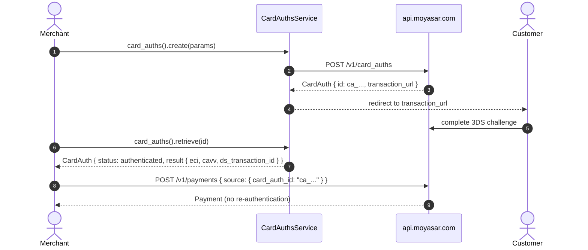

# US-4.3.0: Standalone 3D Secure Card Authentication & MPI Result Extraction

> **Spec Kit Specification**: [Specification Lifecycle Active](../../../docs/architecture/DECOMPOSITION_ROADMAP.md)  
> **Behavior Blueprint**: `src/resources/card_auths/`  
> **Slicing Standard**: [10-PR Vertical Slicing Framework](../README.md#2-the-10-pr-vertical-slicing-framework-rust-sdk-adaptation)  
> **Security Gateway**: `security-audit` Level 2 Enforced  
> **Quality Gates**: `(G0–G4 + G-Review + G-Borrow + G-Law)`  

---

## 1. Spec Kit Specification

### 1.1 User Story Narrative
**As an** enterprise merchant running 3D Secure independently of charging,  
**I want to** authenticate a card via `POST /v1/card_auths`, retrieve the resulting MPI cryptographic parameters (`eci`, `authentication_value`, `ds_transaction_id`, `version`, `transaction_status`, `auth_scheme`, `is_frictionless`), then charge later via `card_auth_id` — or inject external MPI data via `card_auth_data`,  
**So that** I can pre-authenticate cards, reuse one authentication across gateways, and satisfy scheme mandates without coupling authentication to capture.

#### 1.1.1 Preconditions
- `features = ["card-auth"]` (enterprise entitlement).
- A `SecretKey` (or `PublishableKey` where the route permits).
- Card details for authentication.

#### 1.1.2 Postconditions
- `create()` returns a `CardAuthentication` with `id` prefixed `ca_` and a `transaction_url` (`/v1/card_auth/:id/prepare`).
- `retrieve()` returns `status` (`authenticated` | `failed`) plus the full `result` block.
- The `ca_...` id can be passed as `source.card_auth_id` on a later payment.
- External MPI parameters can be supplied as `source.card_auth_data`.

### 1.2 Acceptance Criteria (Gherkin Scenarios)

```gherkin
Feature: Standalone 3D Secure Card Authentication

  Scenario: [AC-US-4.3.0-01] Create a card authentication
    Given a CreateCardAuthParams with amount, currency, callback_url and card details
    When client.card_auths().create(params) is called
    Then the response id starts with "ca_"
    And transaction_url contains "/v1/card_auth/" and "/prepare".

  Scenario: [AC-US-4.3.0-02] Retrieve authentication status and MPI result
    Given an existing card authentication id
    When client.card_auths().retrieve(id) is called
    Then status is either "authenticated" or "failed"
    And when authenticated, result contains eci, authentication_value and ds_transaction_id.

  Scenario: [AC-US-4.3.0-03] Frictionless flow is distinguishable
    Given a successful authentication
    When the result is inspected
    Then is_frictionless equals true when no challenge was presented
    And transaction_status reflects the scheme outcome.

  Scenario: [AC-US-4.3.0-04] Charge later using the card_auth_id
    Given a successful card authentication with id "ca_abc"
    When a payment is created with source.card_auth_id "ca_abc"
    Then the payment body contains "card_auth_id": "ca_abc"
    And the card is not re-authenticated.

  Scenario: [AC-US-4.3.0-05] External MPI parameters via card_auth_data
    Given externally obtained 3DS parameters (eci, cavv, ds_transaction_id)
    When a payment is created with source.card_auth_data holding those values
    Then the body contains a card_auth_data object with those fields
    And Moyasar accepts the externally authenticated transaction.

  Scenario: [AC-US-4.3.0-LAW] PCI-DSS and scheme mandate compliance for 3DS2
    Given any standalone authentication
    When the authentication is executed
    Then CAVV/authentication_value and ECI are transmitted only over TLS and never logged in plaintext,
         satisfying PCI-DSS 4.0 multi-factor authentication requirements for cardholder verification.
```

### 1.3 Test Cases & Traceability Matrix

| Test Case ID | Target Criterion | Test Type | Execution Level | Verification Assertion & Pass Criteria |
| :--- | :--- | :--- | :--- | :--- |
| `TC-4.3.0-01` | `AC-US-4.3.0-01` | Functional | Integration | `id` starts with `ca_`; `transaction_url` shape correct. |
| `TC-4.3.0-02` | `AC-US-4.3.0-02` | Functional | Unit | Fixture deserializes `result` with all MPI fields. |
| `TC-4.3.0-03` | `AC-US-4.3.0-03` | Functional | Unit | `is_frictionless` true/false fixtures. |
| `TC-4.3.0-04` | `AC-US-4.3.0-04` | Functional | Unit | `card_auth_id` serialized into payment source. |
| `TC-4.3.0-05` | `AC-US-4.3.0-05` | Functional | Unit | `card_auth_data` object serialized verbatim. |
| `TC-4.3.0-LAW` | `AC-US-4.3.0-LAW` | Security | Unit / SAST | No CAVV/authentication_value in `Debug` or logs. |

---

## 2. Behavior-Centric Architecture & Folder Blueprint

### 2.1 Rust Crate Module & Unit File Ownership Tree

```
src/
├── src/resources/card_auths/models.rs         # Unit 1 (feat/us-4.3.0/unit-1-card-auth-model)
├── src/resources/card_auths/create.rs         # Unit 2 (feat/us-4.3.0/unit-2-card-auth-create)
├── src/resources/card_auths/retrieve.rs       # Unit 3 (feat/us-4.3.0/unit-3-card-auth-retrieve)
```

### 2.2 Scoping & Promotion Blueprint
- **Tier 1 (Behaviour-Local)**: MPI result parsing.
- **Tier 2 (Module-Shared)**: `CardAuthResult` consumed by payments (`card_auth_id`).
- **Tier 3 (Feature-Shared)**: `CardAuthsService` under `card-auth`.
- **Tier 4 (Global-Shared)**: `client.card_auths()` facade.

---

## 3. Technical Implementation Plan

### 3.1 Domain Invariants & Storage Schema
- **Prefix Law**: card auth ids start with `ca_`.
- **Redaction Law**: `authentication_value` (CAVV) is a sensitive cryptographic value — never `Debug`-printed.
- **Reuse Law**: a `ca_...` id is single-use per charge; reusing it is a server-side error surfaced as a typed 4xx.
- **Data Law**: `card_auth_data` is opaque external MPI JSON, forwarded verbatim.

```rust
#[derive(Debug, Clone, Deserialize)]
pub struct CardAuthentication {
    pub id: CardAuthId,
    pub status: CardAuthStatus,
    pub transaction_url: Option<String>,
    pub result: Option<CardAuthResult>,
}

#[derive(Clone, Deserialize)]
pub struct CardAuthResult {
    pub eci: Option<String>,
    pub authentication_value: Option<String>,
    pub ds_transaction_id: Option<String>,
    pub version: Option<String>,
    pub transaction_status: Option<String>,
    pub auth_scheme: Option<String>,
    pub is_frictionless: Option<bool>,
}

impl std::fmt::Debug for CardAuthResult {
    fn fmt(&self, f: &mut std::fmt::Formatter<'_>) -> std::fmt::Result {
        f.debug_struct("CardAuthResult")
            .field("eci", &self.eci)
            .field("authentication_value", &self.authentication_value.as_ref().map(|_| "[REDACTED]"))
            .field("ds_transaction_id", &self.ds_transaction_id)
            .field("version", &self.version)
            .field("transaction_status", &self.transaction_status)
            .field("auth_scheme", &self.auth_scheme)
            .field("is_frictionless", &self.is_frictionless)
            .finish()
    }
}

#[derive(Debug, Clone, Copy, PartialEq, Eq, Deserialize)]
#[serde(rename_all = "lowercase")]
pub enum CardAuthStatus { Initiated, Authenticated, Failed, #[serde(other)] Unknown }

#[derive(Debug, Clone, PartialEq, Eq, Hash, Serialize, Deserialize)]
#[serde(transparent)]
pub struct CardAuthId(String);

impl std::fmt::Display for CardAuthId {
    fn fmt(&self, f: &mut std::fmt::Formatter<'_>) -> std::fmt::Result { f.write_str(&self.0) }
}

impl CardAuthId {
    pub fn new(raw: impl Into<String>) -> Result<Self, MoyasarError> {
        let raw = raw.into();
        if raw.starts_with("ca_") { Ok(Self(raw)) } else { Err(MoyasarError::InvalidCardAuthId) }
    }
}
```

### 3.2 Activity & Interaction Diagram



---

## 4. Granular Implementation Tasks

### 4.1 Dynamic 3-Unit Parallel Implementation Plan

| Unit # | Branch | Exclusive Owner Files | Deliverables & Colocated Unit Tests | Accountable Role / Agent | Assigned Skills |
| :--- | :--- | :--- | :--- | :--- | :--- |
| **Unit 1** | `feat/us-4.3.0/unit-1-card-auth-model` | `src/resources/card_auths/models.rs` | `CardAuthentication` struct (id: "ca_...", status: authenticated/failed, transaction_url, result fields) | `engineering-software-architect` | `security-audit` |
| **Unit 2** | `feat/us-4.3.0/unit-2-card-auth-create` | `src/resources/card_auths/create.rs` | `CreateCardAuthParams`: amount, currency, callback_url, card details. `client.card_auths().create()` | `engineering-backend-architect` | `security-audit` |
| **Unit 3** | `feat/us-4.3.0/unit-3-card-auth-retrieve` | `src/resources/card_auths/retrieve.rs` | `client.card_auths().retrieve(id)`, MPI result extraction (`eci`, `authentication_value`, `ds_transaction_id`), `card_auth_id`/`card_auth_data` bridging to Payment create, unit tests | `engineering-backend-architect` | `security-audit` |

### 4.2 Parallel Unit Execution & Story Merge Breakdown

#### Wave 1: Base Branch Scaffolding (`feat/us-4.3.0-*`)
- [ ] **Task 0.1 (Story Base Contracts)**: Verify `Cargo.toml`, `src/lib.rs`, and the domain's `mod.rs` + `service.rs` facade declarations are present on the story base branch before spawning parallel unit worktrees.  
  *Agent*: `story-leader` | *Skill*: `divide-and-conquer-orchestrator`

#### Wave 2: 100% Parallel Unit Implementation (`Unit 1..3`)
- [ ] **Unit 1 (`feat/us-4.3.0/unit-1-card-auth-model`)**: `CardAuthentication` struct (id: "ca_...", status: authenticated/failed, transaction_url, result fields) (Files: `src/resources/card_auths/models.rs`)  
  *Agent*: `engineering-software-architect` | *Skill*: `security-audit`
- [ ] **Unit 2 (`feat/us-4.3.0/unit-2-card-auth-create`)**: `CreateCardAuthParams`: amount, currency, callback_url, card details. `client.card_auths().create()` (Files: `src/resources/card_auths/create.rs`)  
  *Agent*: `engineering-backend-architect` | *Skill*: `security-audit`
- [ ] **Unit 3 (`feat/us-4.3.0/unit-3-card-auth-retrieve`)**: `client.card_auths().retrieve(id)`, MPI result extraction (`eci`, `authentication_value`, `ds_transaction_id`), `card_auth_id`/`card_auth_data` bridging to Payment create, unit tests (Files: `src/resources/card_auths/retrieve.rs`)  
  *Agent*: `engineering-backend-architect` | *Skill*: `security-audit`

#### Wave 3: Cascading Merge & Story Integration Verification
- [ ] **Task 3.1 (Cascading Merge & Wire Verification)**: Merge `Unit 1 -> ... -> Unit 3` into the story branch and run story-level wire integration tests and `G0–G4` quality gates.  
  *Agent*: `testing-api-tester` | *Skill*: `security-audit`
- [ ] **Task 3.2 (Council Review & Sign-Off)**: Execute independent Multi-Council Review (`G-Review`, `G-Borrow`, `G-Complexity`, `G-Docs`, `G-Law`).  
  *Agent*: `engineering-code-reviewer` | *Skill*: `code-review-council`

---

## 5. Security Gateway (Powered by security-audit)

### 5.1 Trust Boundaries & Security Actors
- **Trust Boundaries**:
  - `Authentication Boundary`: the 3DS challenge moves liability shift.
  - `MPI Data Boundary`: CAVV/E CI values are cryptographic evidence of authentication.
- **Authorized Principals**: enterprise merchant backend (`sk_`).

### 5.2 Threat Modeling & Abuse Matrix (STRIDE / ASVS)

| Threat Vector | Severity | Vulnerability Mechanism | Mitigating Control & Security Invariant |
| :--- | :--- | :--- | :--- |
| **CAVV Leakage** | Critical | Authentication value logged in plaintext | `#[serde(skip)]` + no `Debug` emission of `authentication_value`. |
| **Auth Replay** | High | Reusing one `ca_...` for multiple charges | Single-use enforced server-side; typed 4xx surfaced. |
| **Liability Shift Loss** | High | Charging without valid authentication | `card_auth_id` presence documented as prerequisite. |
| **External MPI Forgery** | High | Injecting fabricated `card_auth_data` | Server validates the cryptographic parameters. |
| **PAN Retention** | Critical | Card number stored in auth params | Request-only fields; no `Debug` on PAN holders. |

### 5.3 Cryptographic & Data Protection Controls
- **MPI Redaction**: CAVV never formatted into logs.
- **Single-Use**: one authentication per charge.
- **TLS-Only**: authentication values transmitted over TLS exclusively.

### 5.4 Automated Security Verification Checklist
- [ ] **CAVV Log Test**: absent from `Debug` output.
- [ ] **Replay Test**: reusing `ca_` for a second charge fails.
- [ ] **PAN Test**: no full PAN in formatted output.
- [ ] **TLS Test**: `http://` base rejected.

### 5.5 Security Gateway (G2) Sign-Off Checklist
- [ ] 3DS handling verified against OWASP ASVS Level 2.
- [ ] Zero CAVV/PAN in logs.
- [ ] Single-use enforcement verified.
- [ ] Independent reviewer sign-off; zero open findings.

---

## 6. Validation Gates & Acceptance Sign-Off

**Status: Ready for Implementation.**

### G0 — Build, lint & format
- [ ] **US-4.3.0-G0:** `cargo build && cargo clippy -- -D warnings && cargo fmt --check` clean.

### G1 — Test coverage
- [ ] **US-4.3.0-G1:** ≥90% line / ≥85% branch on the card-auth module.

### G2 — Security audit
- [ ] **US-4.3.0-G2:** MPI-data audit passes with zero critical/high findings.

### G3 — Architecture and maintainability
- [ ] **US-4.3.0-G3:** card-auth module depends only on the kernel and payments.

### G-Review — Code review
- [ ] **US-4.3.0-G-Review:** Peer review on CAVV handling and single-use semantics.

### G-Borrow — Rust zero-clone validation
- [ ] **US-4.3.0-G-Borrow:** `CardAuthId` avoids needless allocation in hot paths.

### G-Complexity — Cyclomatic complexity
- [ ] **US-4.3.0-G-Complexity:** $CC \le 6$; nesting $\le 2$.

### G-Docs — Public docs & examples
- [ ] **US-4.3.0-G-Docs:** 100% public symbols documented; both bridge examples runnable.

### G-Law — Law validation
- [ ] **US-4.3.0-G-Law:** PCI-DSS 4.0 MFA/3DS2 compliance certified.

### G4 — Integrated acceptance
- [ ] **US-4.3.0-G4:** authenticate→retrieve→charge cycle verified against the mock server.
