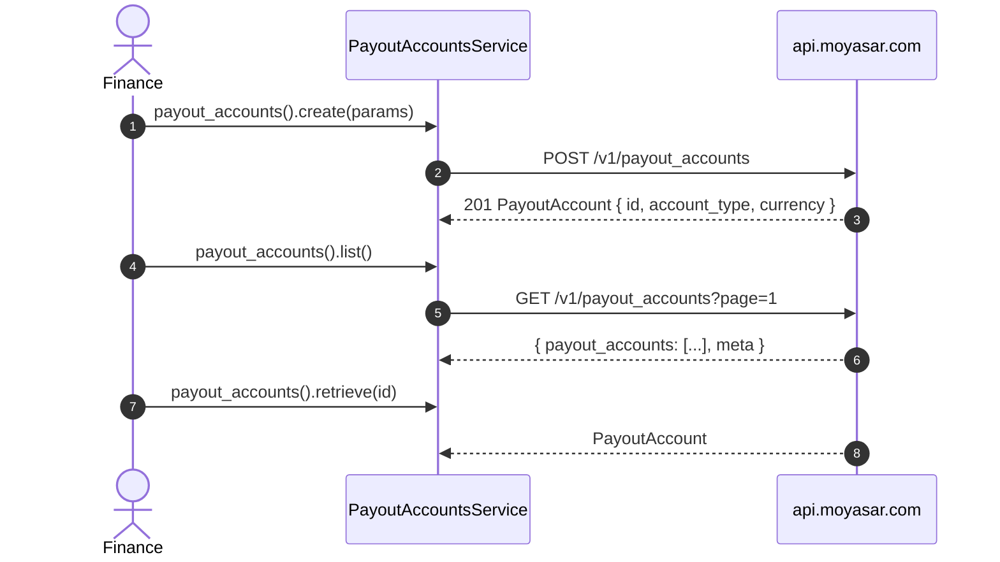

# US-5.1.0: Payout Accounts Service — Bank & Wallet Source Accounts

> **Spec Kit Specification**: [Specification Lifecycle Active](../../../docs/architecture/DECOMPOSITION_ROADMAP.md)  
> **Behavior Blueprint**: `src/resources/payouts/`  
> **Slicing Standard**: [10-PR Vertical Slicing Framework](../README.md#2-the-10-pr-vertical-slicing-framework-rust-sdk-adaptation)  
> **Security Gateway**: `security-audit` Level 2 Enforced  
> **Quality Gates**: `(G0–G4 + G-Review + G-Borrow + G-Law)`  

---

## 1. Spec Kit Specification

### 1.1 User Story Narrative
**As a** marketplace finance engineer preparing to disburse vendor funds,  
**I want to** register bank and wallet payout source accounts via `client.payout_accounts()`, supplying account type, properties (IBAN) and provider credentials, and then list or retrieve them,  
**So that** every subsequent single or bulk payout references a validated, credentialed source account with a stable UUID.

#### 1.1.1 Preconditions
- `features = ["payouts"]` (implies `core`).
- A valid `SecretKey` with payout entitlement.
- Provider credentials for the destination bank/wallet channel.

#### 1.1.2 Postconditions
- `create()` returns HTTP 201 with a `PayoutAccount` containing `id` (UUID), `account_type` (`bank` | `wallet`), `currency`, `properties`, `created_at`.
- `list()` returns a paginated collection of accounts with `meta`.
- `retrieve(id)` returns a single account.
- Credentials are never echoed back in the response model.

### 1.2 Acceptance Criteria (Gherkin Scenarios)

```gherkin
Feature: Payout Account Registration and Retrieval

  Scenario: [AC-US-5.1.0-01] Create a bank payout account with an IBAN
    Given a CreatePayoutAccountParams with account_type bank and an iban property
    When client.payout_accounts().create(params) is called
    Then the API returns HTTP 201
    And the response PayoutAccount.account_type equals "bank"
    And properties contains the supplied iban.

  Scenario: [AC-US-5.1.0-02] Create a wallet payout account
    Given a CreatePayoutAccountParams with account_type wallet
    When the account is created
    Then PayoutAccount.account_type equals "wallet"
    And the wallet properties are returned.

  Scenario: [AC-US-5.1.0-03] List payout accounts with pagination
    Given two registered payout accounts
    When client.payout_accounts().list(params) is called
    Then the response contains a payout_accounts array
    And a meta object with current_page and total_pages.

  Scenario: [AC-US-5.1.0-04] Retrieve a single account by id
    Given a registered payout account id
    When client.payout_accounts().retrieve(id) is called
    Then the returned PayoutAccount.id equals the requested id
    And a 404 maps to RecordNotFound.

  Scenario: [AC-US-5.1.0-05] Provider credentials never appear in the response model
    Given a create request that supplied provider credentials
    When the response is deserialized into PayoutAccount
    Then the struct contains no credentials field
    And Debug output reveals no secret material.

  Scenario: [AC-US-5.1.0-LAW] SAMA IBAN validation and payee identity requirements
    Given a bank payout account
    When it is registered
    Then the IBAN must be a syntactically valid Saudi IBAN (SA + 22 digits) and the account holder name recorded,
         satisfying SAMA outbound-transfer payee identification requirements.
```

### 1.3 Test Cases & Traceability Matrix

| Test Case ID | Target Criterion | Test Type | Execution Level | Verification Assertion & Pass Criteria |
| :--- | :--- | :--- | :--- | :--- |
| `TC-5.1.0-01` | `AC-US-5.1.0-01` | Functional | Integration | 201; `account_type` bank; iban round-trips. |
| `TC-5.1.0-02` | `AC-US-5.1.0-02` | Functional | Integration | `account_type` wallet returned. |
| `TC-5.1.0-03` | `AC-US-5.1.0-03` | Functional | Unit | Paginated shape with `meta`. |
| `TC-5.1.0-04` | `AC-US-5.1.0-04` | Functional | Integration | Matching id; 404 → `RecordNotFound`. |
| `TC-5.1.0-05` | `AC-US-5.1.0-05` | Security | Unit / SAST | No credentials field; no secrets in `Debug`. |
| `TC-5.1.0-LAW` | `AC-US-5.1.0-LAW` | Compliance | Static / Audit | IBAN format validated; payee name required. |

---

## 2. Behavior-Centric Architecture & Folder Blueprint

### 2.1 Rust Crate Module & Unit File Ownership Tree

```
src/
├── src/resources/payouts/models.rs            # Unit 1 (feat/us-5.1.0/unit-1-payout-account-model)
├── src/resources/payouts/accounts_create.rs   # Unit 2 (feat/us-5.1.0/unit-2-payout-account-create)
├── src/resources/payouts/accounts_list.rs     # Unit 3 (feat/us-5.1.0/unit-3-payout-account-list)
├── src/resources/payouts/accounts_retrieve.rs # Unit 4 (feat/us-5.1.0/unit-4-payout-account-retrieve)
```

### 2.2 Scoping & Promotion Blueprint
- **Tier 1 (Behaviour-Local)**: IBAN validator.
- **Tier 2 (Module-Shared)**: `PayoutAccountId` referenced by payouts.
- **Tier 3 (Feature-Shared)**: `PayoutAccountsService` under `payouts`.
- **Tier 4 (Global-Shared)**: `client.payout_accounts()` facade.

---

## 3. Technical Implementation Plan

### 3.1 Domain Invariants & Storage Schema
- **Credential Non-Retention Law**: credentials are write-only; the response model has no field for them.
- **IBAN Law**: Saudi IBAN is `SA` + 22 digits (24 chars total).
- **Account Type Law**: `bank` | `wallet`, parsed into an exhaustive enum.
- **Identity Law**: bank accounts require an account holder name for SAMA payee identification.

```rust
#[derive(Debug, Clone, Deserialize)]
pub struct PayoutAccount {
    pub id: PayoutAccountId,
    pub account_type: AccountType,
    pub currency: Currency,
    pub properties: PayoutAccountProperties,
    pub created_at: DateTime<Utc>,
}

#[derive(Debug, Clone, Copy, PartialEq, Eq, Deserialize)]
#[serde(rename_all = "lowercase")]
pub enum AccountType { Bank, Wallet }

#[derive(Debug, Clone, PartialEq, Eq, Hash, Serialize, Deserialize)]
#[serde(transparent)]
pub struct PayoutAccountId(pub Uuid);

#[derive(Debug, Clone, Serialize, Deserialize)]
pub struct PayoutAccountProperties {
    pub iban: Option<String>,
    pub name: Option<String>,
    pub bank_name: Option<String>,
    #[serde(flatten)]
    pub extra: BTreeMap<String, serde_json::Value>,
}

#[derive(Clone, Serialize)]
pub struct CreatePayoutAccountParams {
    pub account_type: AccountType,
    pub properties: PayoutAccountProperties,
    pub credentials: serde_json::Value,   // write-only; redacted in Debug
}

impl std::fmt::Debug for CreatePayoutAccountParams {
    fn fmt(&self, f: &mut std::fmt::Formatter<'_>) -> std::fmt::Result {
        f.debug_struct("CreatePayoutAccountParams")
            .field("account_type", &self.account_type)
            .field("properties", &self.properties)
            .field("credentials", &"[REDACTED]")
            .finish()
    }
}

pub fn validate_sa_iban(iban: &str) -> Result<(), MoyasarError> {
    let ok = iban.starts_with("SA") && iban.len() == 24
        && iban[2..].chars().all(|c| c.is_ascii_digit());
    if ok { Ok(()) } else { Err(MoyasarError::InvalidIban) }
}
```

### 3.2 Activity & Interaction Diagram



---

## 4. Granular Implementation Tasks

### 4.1 Dynamic 4-Unit Parallel Implementation Plan

| Unit # | Branch | Exclusive Owner Files | Deliverables & Colocated Unit Tests | Accountable Role / Agent | Assigned Skills |
| :--- | :--- | :--- | :--- | :--- | :--- |
| **Unit 1** | `feat/us-5.1.0/unit-1-payout-account-model` | `src/resources/payouts/models.rs` | `PayoutAccount` struct (id, account_type bank/wallet, currency, properties, created_at), `PayoutAccountId` newtype | `engineering-software-architect` | `security-audit` |
| **Unit 2** | `feat/us-5.1.0/unit-2-payout-account-create` | `src/resources/payouts/accounts_create.rs` | `CreatePayoutAccountParams` (account_type, properties like iban, credentials), `client.payout_accounts().create()` | `engineering-backend-architect` | `security-audit` |
| **Unit 3** | `feat/us-5.1.0/unit-3-payout-account-list` | `src/resources/payouts/accounts_list.rs` | `ListPayoutAccountsParams`, `client.payout_accounts().list(params)`, pagination unit tests | `engineering-backend-architect` | `security-audit` |
| **Unit 4** | `feat/us-5.1.0/unit-4-payout-account-retrieve` | `src/resources/payouts/accounts_retrieve.rs` | `client.payout_accounts().retrieve(id)`, Saudi IBAN validator (`validate_sa_iban`), unit tests | `security-appsec-engineer` | `security-audit` |

### 4.2 Parallel Unit Execution & Story Merge Breakdown

#### Wave 1: Base Branch Scaffolding (`feat/us-5.1.0-*`)
- [ ] **Task 0.1 (Story Base Contracts)**: Verify `Cargo.toml`, `src/lib.rs`, and the domain's `mod.rs` + `service.rs` facade declarations are present on the story base branch before spawning parallel unit worktrees.  
  *Agent*: `story-leader` | *Skill*: `divide-and-conquer-orchestrator`

#### Wave 2: 100% Parallel Unit Implementation (`Unit 1..4`)
- [ ] **Unit 1 (`feat/us-5.1.0/unit-1-payout-account-model`)**: `PayoutAccount` struct (id, account_type bank/wallet, currency, properties, created_at), `PayoutAccountId` newtype (Files: `src/resources/payouts/models.rs`)  
  *Agent*: `engineering-software-architect` | *Skill*: `security-audit`
- [ ] **Unit 2 (`feat/us-5.1.0/unit-2-payout-account-create`)**: `CreatePayoutAccountParams` (account_type, properties like iban, credentials), `client.payout_accounts().create()` (Files: `src/resources/payouts/accounts_create.rs`)  
  *Agent*: `engineering-backend-architect` | *Skill*: `security-audit`
- [ ] **Unit 3 (`feat/us-5.1.0/unit-3-payout-account-list`)**: `ListPayoutAccountsParams`, `client.payout_accounts().list(params)`, pagination unit tests (Files: `src/resources/payouts/accounts_list.rs`)  
  *Agent*: `engineering-backend-architect` | *Skill*: `security-audit`
- [ ] **Unit 4 (`feat/us-5.1.0/unit-4-payout-account-retrieve`)**: `client.payout_accounts().retrieve(id)`, Saudi IBAN validator (`validate_sa_iban`), unit tests (Files: `src/resources/payouts/accounts_retrieve.rs`)  
  *Agent*: `security-appsec-engineer` | *Skill*: `security-audit`

#### Wave 3: Cascading Merge & Story Integration Verification
- [ ] **Task 3.1 (Cascading Merge & Wire Verification)**: Merge `Unit 1 -> ... -> Unit 4` into the story branch and run story-level wire integration tests and `G0–G4` quality gates.  
  *Agent*: `testing-api-tester` | *Skill*: `security-audit`
- [ ] **Task 3.2 (Council Review & Sign-Off)**: Execute independent Multi-Council Review (`G-Review`, `G-Borrow`, `G-Complexity`, `G-Docs`, `G-Law`).  
  *Agent*: `engineering-code-reviewer` | *Skill*: `code-review-council`

---

## 5. Security Gateway (Powered by security-audit)

### 5.1 Trust Boundaries & Security Actors
- **Trust Boundaries**:
  - `Credential Boundary`: provider private keys enter the SDK and must not return.
  - `Payee Boundary`: IBAN + name identify where funds will land.
- **Authorized Principals**: marketplace finance backend (`sk_`).

### 5.2 Threat Modeling & Abuse Matrix (STRIDE / ASVS)

| Threat Vector | Severity | Vulnerability Mechanism | Mitigating Control & Security Invariant |
| :--- | :--- | :--- | :--- |
| **Credential Leakage** | Critical | Provider credentials echoed or logged | Write-only params; no credentials field in the response model. |
| **IBAN Substitution** | Critical | Wrong IBAN registering an attacker's account | IBAN syntax validation + payee name required; server verifies ownership. |
| **Account Enumeration** | Medium | Guessing another merchant's account ids | UUID ids; server-side ownership enforcement. |
| **Malformed IBAN** | Medium | Invalid IBAN causing failed payouts later | Client-side `SA`+22-digit validation. |
| **Cross-Tenant Use** | Critical | Using another merchant's payout account as source | Server-side source authorization; typed 4xx. |

### 5.3 Cryptographic & Data Protection Controls
- **Write-Only Secrets**: credentials never return in responses.
- **IBAN Validation**: syntactic check before transport.
- **UUID Identifiers**: non-sequential account ids.

### 5.4 Automated Security Verification Checklist
- [ ] **Credential Test**: no credentials in `Debug` or response model.
- [ ] **IBAN Test**: invalid IBANs rejected.
- [ ] **Ownership Test**: foreign account id yields typed 4xx.
- [ ] **Identity Test**: missing payee name rejected.

### 5.5 Security Gateway (G2) Sign-Off Checklist
- [ ] Payee/credential handling verified against OWASP ASVS Level 2.
- [ ] Zero credential exposure.
- [ ] IBAN validation certified.
- [ ] Independent reviewer sign-off; zero open findings.

---

## 6. Validation Gates & Acceptance Sign-Off

**Status: Ready for Implementation.**

### G0 — Build, lint & format
- [ ] **US-5.1.0-G0:** `cargo build && cargo clippy -- -D warnings && cargo fmt --check` clean.

### G1 — Test coverage
- [ ] **US-5.1.0-G1:** ≥90% line / ≥85% branch on the payout-accounts module.

### G2 — Security audit
- [ ] **US-5.1.0-G2:** Credential/payee audit passes with zero critical/high findings.

### G3 — Architecture and maintainability
- [ ] **US-5.1.0-G3:** Accounts module independent of the payouts disbursement module.

### G-Review — Code review
- [ ] **US-5.1.0-G-Review:** Peer review on credential handling and IBAN validation.

### G-Borrow — Rust zero-clone validation
- [ ] **US-5.1.0-G-Borrow:** Credentials moved into the request; never cloned.

### G-Complexity — Cyclomatic complexity
- [ ] **US-5.1.0-G-Complexity:** $CC \le 6$; nesting $\le 2$.

### G-Docs — Public docs & examples
- [ ] **US-5.1.0-G-Docs:** 100% public symbols documented; both account types demonstrated.

### G-Law — Law validation
- [ ] **US-5.1.0-G-Law:** SAMA payee-identification and IBAN requirements certified.

### G4 — Integrated acceptance
- [ ] **US-5.1.0-G4:** Bank and wallet account registration verified against the mock server.
