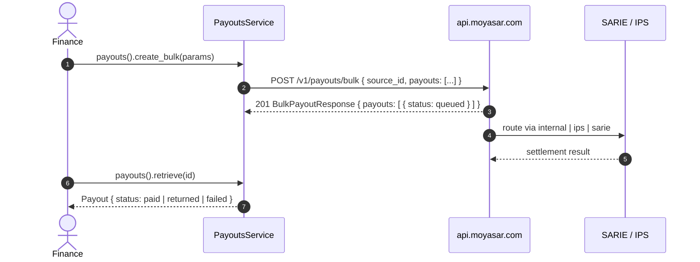

# US-5.2.0: Single & Bulk Payouts with 20 Regulated Purpose Codes

> **Spec Kit Specification**: [Specification Lifecycle Active](../../../docs/architecture/DECOMPOSITION_ROADMAP.md)  
> **Behavior Blueprint**: `features/core/modules/payouts/behaviours/payout-disbursements/`  
> **Slicing Standard**: [10-PR Vertical Slicing Framework](../README.md#2-the-10-pr-vertical-slicing-framework-rust-sdk-adaptation)  
> **Security Gateway**: `security-audit` Level 2 Enforced  
> **Quality Gates**: `(G0–G4 + G-Review + G-Borrow + G-Law)`  

---

## 1. Spec Kit Specification

### 1.1 User Story Narrative
**As a** marketplace disbursing funds to vendors and couriers,  
**I want to** issue single and bulk payouts through `internal`, `ips`, and `sarie` channels with a compile-time-enforced `PayoutPurpose` enum covering all 20 SAMA-regulated classifications, and typed `BankDestination` (IBAN) / `WalletDestination` (mobile) targets,  
**So that** every outbound transfer is regulation-compliant by construction, a bulk batch is one round-trip instead of N, and status transitions (`queued`, `initiated`, `paid`, `failed`, `canceled`, `returned`) are strongly typed.

#### 1.1.1 Preconditions
- `features = ["payouts"]`; valid `SecretKey` with payout entitlement.
- A registered `source_id` from `client.payout_accounts()` (US-5.1.0).
- Beneficiary IBAN or wallet mobile number.

#### 1.1.2 Postconditions
- `create()` returns HTTP 201 with a `Payout` carrying `channel`, `status`, `amount`, `message`, `failure_reason`.
- `create_bulk()` accepts `Vec<BulkPayoutEntry>` and returns `BulkPayoutResponse { payouts: Vec<Payout> }`.
- `PayoutPurpose` has exactly 20 variants, each serializing to its documented wire string.
- `sequence_number` is an optional 16-digit string; when omitted Moyasar auto-generates it.
- `list()` and `retrieve()` return paginated and single payouts respectively.

### 1.2 Acceptance Criteria (Gherkin Scenarios)

```gherkin
Feature: Regulated Single and Bulk Payouts

  Scenario: [AC-US-5.2.0-01] Create a single bank payout with a purpose code
    Given a CreatePayoutParams with source_id, amount, purpose PaymentToMerchant and a BankDestination
    When client.payouts().create(params) is called
    Then the API returns HTTP 201
    And the Payout.status is one of queued, initiated, paid, failed, canceled or returned
    And the Payout.channel is one of internal, ips or sarie.

  Scenario: [AC-US-5.2.0-02] All 20 purpose codes serialize to their wire strings
    Given each of the 20 PayoutPurpose variants
    When serialized
    Then each produces its exact snake_case wire value
    And an invalid purpose string fails deserialization rather than silently mapping to a default.

  Scenario: [AC-US-5.2.0-03] Bulk payout sends one request for many entries
    Given a CreateBulkPayoutParams with three BulkPayoutEntry items
    When client.payouts().create_bulk(params) is called
    Then exactly one HTTP request is issued to POST /v1/payouts/bulk
    And the body contains a payouts array of length 3
    And the response is a BulkPayoutResponse with 3 payouts.

  Scenario: [AC-US-5.2.0-04] Wallet destination for mobile disbursements
    Given a PayoutDestination::Wallet with a valid Saudi mobile number
    When the payout is created
    Then the body contains a wallet destination object with that mobile.

  Scenario: [AC-US-5.2.0-05] Optional 16-digit sequence number
    Given a BulkPayoutEntry with sequence_number "2026110500000001"
    When serialized
    Then the body contains that exact 16-digit string
    And omitting it leaves the field absent so Moyasar auto-generates one.

  Scenario: [AC-US-5.2.0-06] List and retrieve payouts
    Given existing payouts
    When client.payouts().list(params) is called
    Then the response contains a payouts array and a meta object
    And client.payouts().retrieve(id) returns the matching Payout.

  Scenario: [AC-US-5.2.0-LAW] SAMA mandatory purpose classification for outbound transfers
    Given any payout
    When it is created
    Then a purpose from the 20 regulated values is always present and the destination includes payee name,
         satisfying SAMA mandatory purpose-of-transfer classification requirements.
```

### 1.3 Test Cases & Traceability Matrix

| Test Case ID | Target Criterion | Test Type | Execution Level | Verification Assertion & Pass Criteria |
| :--- | :--- | :--- | :--- | :--- |
| `TC-5.2.0-01` | `AC-US-5.2.0-01` | Functional | Integration | 201; status and channel within documented sets. |
| `TC-5.2.0-02` | `AC-US-5.2.0-02` | Functional | Unit | 20-variant serde table; invalid string rejected. |
| `TC-5.2.0-03` | `AC-US-5.2.0-03` | Functional | Integration | Exactly one request; array length 3. |
| `TC-5.2.0-04` | `AC-US-5.2.0-04` | Functional | Unit | Wallet destination serialized with mobile. |
| `TC-5.2.0-05` | `AC-US-5.2.0-05` | Functional | Unit | 16-digit preserved; omission leaves key absent. |
| `TC-5.2.0-06` | `AC-US-5.2.0-06` | Functional | Unit | Paginated shape and single retrieve. |
| `TC-5.2.0-LAW` | `AC-US-5.2.0-LAW` | Compliance | Static / Audit | Purpose always present; payee name required. |

---

## 2. Behavior-Centric Architecture & Folder Blueprint

### 2.1 Colocated Behaviour Directory Tree

```
features/core/modules/payouts/behaviours/payout-disbursements/
├── services/        # PayoutsService create/create_bulk/list/retrieve
├── logic/           # Purpose serialization, destination validation, sequence formatting
├── types/           # Payout, PayoutStatus, PayoutPurpose, PayoutDestination, BulkPayoutEntry
└── constants/       # PAYOUTS_PATH, BULK_PATH, SEQUENCE_NUMBER_LEN (16)
```

### 2.2 Scoping & Promotion Blueprint
- **Tier 1 (Behaviour-Local)**: sequence-number formatting.
- **Tier 2 (Module-Shared)**: `Payout` referenced by settlements reconciliation.
- **Tier 3 (Feature-Shared)**: `PayoutsService` under `payouts`.
- **Tier 4 (Global-Shared)**: `client.payouts()` facade.

---

## 3. Technical Implementation Plan

### 3.1 Domain Invariants & Storage Schema
- **Twenty Law**: `PayoutPurpose` has exactly 20 variants; no `#[serde(other)]` fallback — an unknown purpose must fail loudly.
- **Positive Amount Law**: payout `amount` must be > 0.
- **Sequence Law**: `sequence_number` is exactly 16 digits when supplied.
- **Payee Law**: `BankDestination` requires iban + name + mobile + country + city.

```rust
#[derive(Debug, Clone, Copy, Serialize, Deserialize)]
#[serde(rename_all = "snake_case")]
pub enum PayoutPurpose {
    BillsOrRent, ExpensesServices, PurchaseAssets, SavingInvestment,
    GovernmentDues, MoneyExchange, CreditCardLoan, GiftOrReward,
    Personal, InvestmentTransaction, FamilyAssistance, Donation,
    PayrollBenefits, OnlinePurchase, HajjAndUmra, DividendPayment,
    GovernmentPayment, InvestmentHouse, PaymentToMerchant, OwnAccountTransfer,
}

#[derive(Debug, Clone, Serialize)]
#[serde(tag = "type", rename_all = "lowercase")]
pub enum PayoutDestination {
    Bank { iban: String, name: String, mobile: String, country: String, city: String },
    Wallet { mobile: String },
}

#[derive(Debug, Clone, Deserialize)]
pub struct Payout {
    pub id: Uuid,
    pub channel: PayoutChannel,
    pub status: PayoutStatus,
    pub amount: u64,
    pub message: Option<String>,
    pub failure_reason: Option<String>,
}

#[derive(Debug, Clone, Copy, PartialEq, Eq, Deserialize)]
#[serde(rename_all = "lowercase")]
pub enum PayoutStatus {
    Queued, Initiated, Paid, Failed, Canceled, Returned,
}
```

### 3.2 Activity & Interaction Diagram



---

## 4. Granular Implementation Tasks

### 4.1 The 10-PR Vertical Slicing Implementation Plan

| PR # | Pillar | Architectural Layer | Primary Scope & Files | Deliverables & Acceptance | Accountable Role / Agent | Assigned Skills |
| :--- | :--- | :--- | :--- | :--- | :--- | :--- |
| **PR 1** | **Pillar 1** | **Domain Logic & Core Traits** | `src/resources/payouts/payout_model.rs` | `Payout`, `PayoutStatus`, `PayoutChannel`, `PayoutId`. | `engineering-software-architect` | `security-audit` |
| **PR 2** | **Pillar 2** | **Request Modeling** | `src/resources/payouts/purpose.rs` | `PayoutPurpose` — all 20 regulated variants. | `engineering-backend-architect` | `security-audit` |
| **PR 3** | **Pillar 3** | **Transport Wire Adapter** | `src/resources/payouts/destinations.rs` | `PayoutDestination` bank/wallet + validation. | `engineering-backend-architect` | `security-audit` |
| **PR 4** | **Pillar 4** | **Service Accessor** | `src/resources/payouts/service.rs` | `client.payouts()` accessor. | `engineering-software-architect` | `security-audit` |
| **PR 5** | **Pillar 5** | **Error Taxonomy** | `src/kernel/error.rs` | `InvalidIban`, `InvalidMobile`, `InvalidPayoutAmount`. | `security-application-security-engineer` | `security-audit` |
| **PR 6** | **Pillar 6** | **Resource Facade Mounting** | `src/resources/payouts/mod.rs` | Feature-gated export under `payouts`. | `engineering-software-architect` | `security-audit` |
| **PR 7** | **Pillar 7** | **Zero-Copy Hardening** | `src/resources/payouts/payouts_bulk.rs` | Borrow entries for validation; move into request. | `agency-rust-refactoring-specialist` | `security-audit` |
| **PR 8** | **Pillar 8** | **Edge Cases & Guards** | `src/resources/payouts/payouts_create.rs` | Positive-amount guard; 16-digit sequence guard. | `agency-api-tester` | `security-audit` |
| **PR 9** | **Pillar 9** | **Integration Wire Verification** | `tests/payouts_test.rs` | Single + bulk across all 3 channels. | `agency-api-tester` | `security-audit` |
| **PR 10** | **Pillar 10** | **Documentation & Packaging** | `README.md` | Doc-tests with a 20-code reference table. | `engineering-technical-writer` | `security-audit` |

### 4.2 Implementation Phase Breakdown

#### Phase 1: Models & Purpose Codes (PR 1–2)
- [ ] **Task 1.1 (Types)**: `Payout`, `PayoutStatus`, `PayoutChannel`.  
  *Agent*: `engineering-software-architect` | *Skill*: `security-audit`
- [ ] **Task 1.2 (Purpose)**: all 20 `PayoutPurpose` variants with doc comments.  
  *Agent*: `engineering-backend-architect` | *Skill*: `security-audit`
- [ ] **Task 1.3 (Unit Tests)**: 20-variant serde table.  
  *Agent*: `agency-api-tester` | *Skill*: `security-audit`

#### Phase 2: Destinations & Endpoints (PR 3–6)
- [ ] **Task 2.1 (Destinations)**: bank/wallet variants with validation.  
  *Agent*: `engineering-backend-architect` | *Skill*: `security-audit`
- [ ] **Task 2.2 (Single)**: `POST /v1/payouts`.  
  *Agent*: `engineering-backend-architect` | *Skill*: `security-audit`
- [ ] **Task 2.3 (Bulk)**: `POST /v1/payouts/bulk` + `BulkPayoutResponse`.  
  *Agent*: `engineering-backend-architect` | *Skill*: `security-audit`
- [ ] **Task 2.4 (List/Retrieve)**: paginated list and single retrieve.  
  *Agent*: `engineering-software-architect` | *Skill*: `security-audit`

#### Phase 3: Guards (PR 7–8)
- [ ] **Task 3.1 (Amount)**: reject zero/negative.  
  *Agent*: `agency-api-tester` | *Skill*: `security-audit`
- [ ] **Task 3.2 (Sequence)**: exactly 16 digits when present.  
  *Agent*: `agency-api-tester` | *Skill*: `security-audit`

#### Phase 4: Verification & Sign-Off (PR 9–10)
- [ ] **Task 4.1 (Wire Tests)**: single and bulk across internal/ips/sarie.  
  *Agent*: `agency-api-tester` | *Skill*: `security-audit`
- [ ] **Task 4.2 (G-Review)**: peer review on purpose completeness and destination validation.  
  *Agent*: `agency-code-reviewer` | *Skill*: `security-audit`
- [ ] **Task 4.3 (Documentation)**: 20-code reference table + doc-tests.  
  *Agent*: `engineering-technical-writer` | *Skill*: `security-audit`

---

## 5. Security Gateway (Powered by security-audit)

### 5.1 Trust Boundaries & Security Actors
- **Trust Boundaries**:
  - `Disbursement Boundary`: money leaves the merchant's account.
  - `Regulatory Boundary`: purpose classification is a legal requirement.
- **Authorized Principals**: marketplace finance backend (`sk_`).

### 5.2 Threat Modeling & Abuse Matrix (STRIDE / ASVS)

| Threat Vector | Severity | Vulnerability Mechanism | Mitigating Control & Security Invariant |
| :--- | :--- | :--- | :--- |
| **Fund Misrouting** | Critical | Attacker-controlled IBAN or wallet in the destination | IBAN/mobile validation + required payee name; server-side ownership of `source_id`. |
| **Regulatory Non-Compliance** | Critical | Missing or fabricated purpose classification | `PayoutPurpose` is a required, non-defaultable 20-variant enum. |
| **Bulk Batch Injection** | High | Unreviewed entries added to a batch | One request per batch; entries validated individually before send. |
| **Duplicate Disbursement** | High | Retrying a bulk payout after timeout | Retry only on network/timeout/5xx; server dedupes by `sequence_number`. |
| **Amount Manipulation** | High | Zero or negative amounts | Client-side positive-amount guard. |

### 5.3 Cryptographic & Data Protection Controls
- **Purpose Enforcement**: unrepresentable-invalid by type.
- **Destination Validation**: IBAN syntax and Saudi mobile format.
- **Sequence Numbers**: stable 16-digit references for reconciliation.

### 5.4 Automated Security Verification Checklist
- [ ] **Purpose Test**: all 20 variants serialize; unknown rejected.
- [ ] **Amount Test**: zero/negative rejected.
- [ ] **Destination Test**: malformed IBAN/mobile rejected.
- [ ] **Bulk Test**: exactly one HTTP request per batch.

### 5.5 Security Gateway (G2) Sign-Off Checklist
- [ ] Disbursement controls verified against OWASP ASVS Level 2.
- [ ] Purpose classification always present.
- [ ] Destination validation certified.
- [ ] Independent reviewer sign-off; zero open findings.

---

## 6. Validation Gates & Acceptance Sign-Off

**Status: Ready for Implementation.**

### G0 — Build, lint & format
- [ ] **US-5.2.0-G0:** `cargo build && cargo clippy -- -D warnings && cargo fmt --check` clean.

### G1 — Test coverage
- [ ] **US-5.2.0-G1:** ≥90% line / ≥85% branch on the payouts module.

### G2 — Security audit
- [ ] **US-5.2.0-G2:** Disbursement audit passes with zero critical/high findings.

### G3 — Architecture and maintainability
- [ ] **US-5.2.0-G3:** Payout purpose and destination types are pure data; zero transport coupling.

### G-Review — Code review
- [ ] **US-5.2.0-G-Review:** Peer review on purpose completeness and validation.

### G-Borrow — Rust zero-clone validation
- [ ] **US-5.2.0-G-Borrow:** Bulk entries moved, not cloned.

### G-Complexity — Cyclomatic complexity
- [ ] **US-5.2.0-G-Complexity:** $CC \le 6$; nesting $\le 2$.

### G-Docs — Public docs & examples
- [ ] **US-5.2.0-G-Docs:** 100% public symbols documented; 20-code table published.

### G-Law — Law validation
- [ ] **US-5.2.0-G-Law:** SAMA mandatory purpose-of-transfer classification certified.

### G4 — Integrated acceptance
- [ ] **US-5.2.0-G4:** Single and bulk payouts verified across all three channels.
