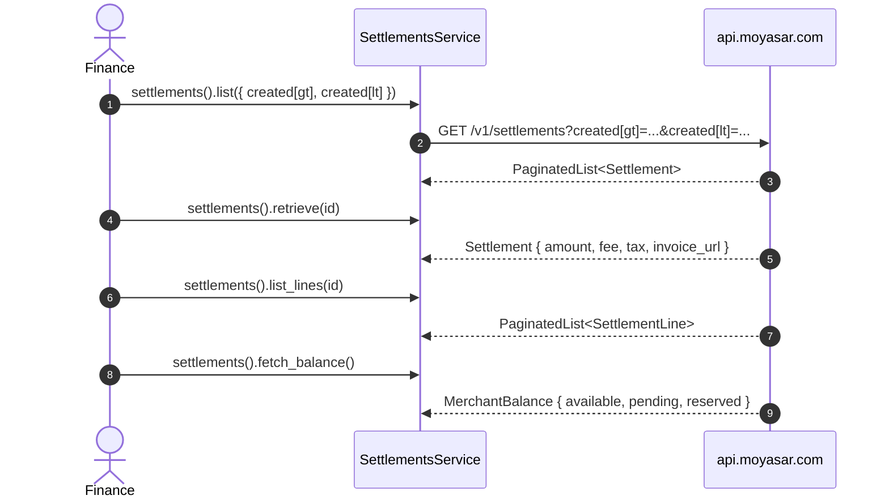

# US-6.1.0: Settlements Service — List, Retrieve, Lines & Balance

> **Spec Kit Specification**: [Specification Lifecycle Active](../../../docs/architecture/DECOMPOSITION_ROADMAP.md)  
> **Behavior Blueprint**: `src/resources/settlements/`  
> **Slicing Standard**: [10-PR Vertical Slicing Framework](../README.md#2-the-10-pr-vertical-slicing-framework-rust-sdk-adaptation)  
> **Security Gateway**: `security-audit` Level 2 Enforced  
> **Quality Gates**: `(G0–G4 + G-Review + G-Borrow + G-Law)`  

---

## 1. Spec Kit Specification

### 1.1 User Story Narrative
**As a** finance engineer closing the books each day,  
**I want to** list and retrieve settlements, drill into their individual lines, and fetch the merchant balance through `client.settlements()`,  
**So that** I can reconcile gross volume against fees, tax and net settlement per currency, download the CSV/PDF reports Moyasar generates, and know exactly how much is available, pending and reserved.

#### 1.1.1 Preconditions
- `features = ["settlements"]` (implies `core`).
- A valid `SecretKey`.

#### 1.1.2 Postconditions
- `list()` returns `PaginatedList<Settlement>` filtered by `id`, `created[gt|lt]`, `page`.
- `retrieve(id)` returns a single `Settlement`.
- `list_lines(id)` returns `PaginatedList<SettlementLine>`.
- `fetch_balance()` returns `MerchantBalance` (available / pending / reserved).
- `Settlement` exposes `recipient_type`, `currency`, `source_currency`, `invoicing_currency`, `amount`, `fee`, `tax`, `invoicing_fee`, `invoicing_tax`, `invoicing_ex_rate`, `reference`, `settlement_count`, and the report URLs.

### 1.2 Acceptance Criteria (Gherkin Scenarios)

```gherkin
Feature: Settlement Reconciliation

  Scenario: [AC-US-6.1.0-01] List settlements within a date range
    Given a list request with created[gt] and created[lt] filters
    When client.settlements().list(params) is called
    Then the query string contains the encoded date filters
    And the response deserializes into PaginatedList<Settlement>.

  Scenario: [AC-US-6.1.0-02] Retrieve a settlement with monetary breakdown
    Given a settlement id
    When client.settlements().retrieve(id) is called
    Then amount, fee, tax and the invoicing_* fields are all populated
    And the relationship amount - fee - tax equals the net settled value.

  Scenario: [AC-US-6.1.0-03] Multi-currency settlement exposes invoicing FX rate
    Given a settlement with source_currency SAR and invoicing_currency USD
    When deserialized
    Then invoicing_ex_rate is a positive float
    And invoicing_fee and invoicing_tax are expressed in the invoicing currency.

  Scenario: [AC-US-6.1.0-04] Report URLs are present for download
    Given a settlement
    When deserialized
    Then invoice_url, csv_list_url and pdf_list_url are optional but, when present, are absolute URLs.

  Scenario: [AC-US-6.1.0-05] List settlement lines with pagination
    Given a settlement with multiple lines
    When client.settlements().list_lines(id, params) is called
    Then the response is a PaginatedList<SettlementLine>
    And each line references its originating payment.

  Scenario: [AC-US-6.1.0-06] Fetch merchant balance
    Given the merchant has settlement activity
    When client.settlements().fetch_balance() is called
    Then the response MerchantBalance reports available, pending and reserved amounts
    And each amount is expressed in the merchant's settlement currency.

  Scenario: [AC-US-6.1.0-LAW] SAMA reconciliation completeness and retention
    Given any settlement record
    When it is retrieved for audit
    Then gross amount, fee, tax, net amount and timestamps are all available for reconstruction,
         satisfying SAMA record-retention and reconciliation requirements.
```

### 1.3 Test Cases & Traceability Matrix

| Test Case ID | Target Criterion | Test Type | Execution Level | Verification Assertion & Pass Criteria |
| :--- | :--- | :--- | :--- | :--- |
| `TC-6.1.0-01` | `AC-US-6.1.0-01` | Functional | Unit | Encoded filters present; paginated shape correct. |
| `TC-6.1.0-02` | `AC-US-6.1.0-02` | Functional | Unit | `amount - fee - tax` arithmetic holds on fixtures. |
| `TC-6.1.0-03` | `AC-US-6.1.0-03` | Functional | Unit | `invoicing_ex_rate > 0`; invoicing fields populated. |
| `TC-6.1.0-04` | `AC-US-6.1.0-04` | Functional | Unit | URLs parse as absolute when present. |
| `TC-6.1.0-05` | `AC-US-6.1.0-05` | Functional | Integration | Lines paginate; line → payment linkage present. |
| `TC-6.1.0-06` | `AC-US-6.1.0-06` | Functional | Integration | Balance struct with three amounts. |
| `TC-6.1.0-LAW` | `AC-US-6.1.0-LAW` | Compliance | Static / Audit | Full breakdown reconstructable per settlement. |

---

## 2. Behavior-Centric Architecture & Folder Blueprint

### 2.1 Rust Crate Module & Unit File Ownership Tree

```
src/
├── src/resources/settlements/models.rs        # Unit 1 (feat/us-6.1.0/unit-1-settlement-model)
├── src/resources/settlements/list.rs          # Unit 2 (feat/us-6.1.0/unit-2-settlement-list)
├── src/resources/settlements/retrieve.rs      # Unit 3 (feat/us-6.1.0/unit-3-settlement-retrieve)
├── src/resources/settlements/balance.rs       # Unit 4 (feat/us-6.1.0/unit-4-settlement-balance)
├── src/resources/settlements/lines.rs         # Unit 5 (feat/us-6.1.0/unit-5-settlement-lines)
```

### 2.2 Scoping & Promotion Blueprint
- **Tier 1 (Behaviour-Local)**: net-amount helper.
- **Tier 2 (Module-Shared)**: `SettlementId` referenced by transfers.
- **Tier 3 (Feature-Shared)**: `SettlementsService` under `settlements`.
- **Tier 4 (Global-Shared)**: `client.settlements()` facade.

---

## 3. Technical Implementation Plan

### 3.1 Domain Invariants & Storage Schema
- **Read-Only Law**: every settlements endpoint is `GET`; no mutation methods exist.
- **Arithmetic Law**: `net = amount - fee - tax` in the settlement currency.
- **FX Law**: `invoicing_ex_rate` is a float, positive; invoicing amounts are in `invoicing_currency`.
- **Pagination Law**: all list endpoints return `PaginatedList<T>`.

```rust
#[derive(Debug, Clone, Deserialize)]
pub struct Settlement {
    pub id: SettlementId,
    pub recipient_type: RecipientType,
    pub currency: Currency,
    pub source_currency: Currency,
    pub invoicing_currency: Option<Currency>,
    pub amount: u64,
    pub fee: u64,
    pub tax: u64,
    pub invoicing_fee: Option<u64>,
    pub invoicing_tax: Option<u64>,
    pub invoicing_ex_rate: Option<f64>,
    pub reference: Option<String>,
    pub settlement_count: Option<u32>,
    pub invoice_url: Option<String>,
    pub csv_list_url: Option<String>,
    pub pdf_list_url: Option<String>,
    pub created_at: DateTime<Utc>,
}

impl Settlement {
    /// Net settled amount in the settlement currency.
    pub fn net(&self) -> u64 { self.amount.saturating_sub(self.fee).saturating_sub(self.tax) }
}

#[derive(Debug, Clone, Copy, PartialEq, Eq, Deserialize)]
#[serde(rename_all = "lowercase")]
pub enum RecipientType { Entity, Platform, Beneficiary }

#[derive(Debug, Clone, Deserialize)]
pub struct SettlementLine {
    pub payment_id: Option<Uuid>,
    #[serde(rename = "type")]
    pub line_type: Option<String>,
    pub currency: Currency,
    pub amount: u64,
    pub fee: u64,
    pub tax: u64,
    pub reference: Option<String>,
    pub settled_at: Option<DateTime<Utc>>,
}

#[derive(Debug, Clone, Deserialize)]
pub struct MerchantBalance {
    pub currency: Currency,
    pub available: u64,
    pub pending: u64,
    pub reserved: u64,
    pub available_format: Option<String>,
    pub pending_format: Option<String>,
    pub reserved_format: Option<String>,
}
```

### 3.2 Activity & Interaction Diagram



---

## 4. Granular Implementation Tasks

### 4.1 Dynamic 5-Unit Parallel Implementation Plan

| Unit # | Branch | Exclusive Owner Files | Deliverables & Colocated Unit Tests | Accountable Role / Agent | Assigned Skills |
| :--- | :--- | :--- | :--- | :--- | :--- |
| **Unit 1** | `feat/us-6.1.0/unit-1-settlement-model` | `src/resources/settlements/models.rs` | `Settlement` struct (recipient_type, currency, source_currency, invoicing_currency, amount, fee, tax, invoicing_fee, invoicing_tax, invoicing_ex_rate, reference, settlement_count, invoice_url PDF, csv_list_url, pdf_list_url) | `engineering-software-architect` | `security-audit` |
| **Unit 2** | `feat/us-6.1.0/unit-2-settlement-list` | `src/resources/settlements/list.rs` | `client.settlements().list(params)` with id/created[gt/lt]/page filters, pagination | `engineering-backend-architect` | `security-audit` |
| **Unit 3** | `feat/us-6.1.0/unit-3-settlement-retrieve` | `src/resources/settlements/retrieve.rs` | `client.settlements().retrieve(id)`, `Settlement::net()` breakdown helper, 404 mapping, unit tests | `engineering-backend-architect` | `security-audit` |
| **Unit 4** | `feat/us-6.1.0/unit-4-settlement-balance` | `src/resources/settlements/balance.rs` | `client.settlements().fetch_balance()`, `MerchantBalance` struct (available, pending, reserved amounts), unit tests | `security-appsec-engineer` | `security-audit` |
| **Unit 5** | `feat/us-6.1.0/unit-5-settlement-lines` | `src/resources/settlements/lines.rs` | `SettlementLine` struct, `ListSettlementLinesParams`, `client.settlements().list_lines(id, params)`, unit tests | `engineering-rust-refactoring-specialist` | `security-audit` |

### 4.2 Parallel Unit Execution & Story Merge Breakdown

#### Wave 1: Base Branch Scaffolding (`feat/us-6.1.0-*`)
- [ ] **Task 0.1 (Story Base Contracts)**: Verify `Cargo.toml`, `src/lib.rs`, and the domain's `mod.rs` + `service.rs` facade declarations are present on the story base branch before spawning parallel unit worktrees.  
  *Agent*: `story-leader` | *Skill*: `divide-and-conquer-orchestrator`

#### Wave 2: 100% Parallel Unit Implementation (`Unit 1..5`)
- [ ] **Unit 1 (`feat/us-6.1.0/unit-1-settlement-model`)**: `Settlement` struct (recipient_type, currency, source_currency, invoicing_currency, amount, fee, tax, invoicing_fee, invoicing_tax, invoicing_ex_rate, reference, settlement_count, invoice_url PDF, csv_list_url, pdf_list_url) (Files: `src/resources/settlements/models.rs`)  
  *Agent*: `engineering-software-architect` | *Skill*: `security-audit`
- [ ] **Unit 2 (`feat/us-6.1.0/unit-2-settlement-list`)**: `client.settlements().list(params)` with id/created[gt/lt]/page filters, pagination (Files: `src/resources/settlements/list.rs`)  
  *Agent*: `engineering-backend-architect` | *Skill*: `security-audit`
- [ ] **Unit 3 (`feat/us-6.1.0/unit-3-settlement-retrieve`)**: `client.settlements().retrieve(id)`, `Settlement::net()` breakdown helper, 404 mapping, unit tests (Files: `src/resources/settlements/retrieve.rs`)  
  *Agent*: `engineering-backend-architect` | *Skill*: `security-audit`
- [ ] **Unit 4 (`feat/us-6.1.0/unit-4-settlement-balance`)**: `client.settlements().fetch_balance()`, `MerchantBalance` struct (available, pending, reserved amounts), unit tests (Files: `src/resources/settlements/balance.rs`)  
  *Agent*: `security-appsec-engineer` | *Skill*: `security-audit`
- [ ] **Unit 5 (`feat/us-6.1.0/unit-5-settlement-lines`)**: `SettlementLine` struct, `ListSettlementLinesParams`, `client.settlements().list_lines(id, params)`, unit tests (Files: `src/resources/settlements/lines.rs`)  
  *Agent*: `engineering-rust-refactoring-specialist` | *Skill*: `security-audit`

#### Wave 3: Cascading Merge & Story Integration Verification
- [ ] **Task 3.1 (Cascading Merge & Wire Verification)**: Merge `Unit 1 -> ... -> Unit 5` into the story branch and run story-level wire integration tests and `G0–G4` quality gates.  
  *Agent*: `testing-api-tester` | *Skill*: `security-audit`
- [ ] **Task 3.2 (Council Review & Sign-Off)**: Execute independent Multi-Council Review (`G-Review`, `G-Borrow`, `G-Complexity`, `G-Docs`, `G-Law`).  
  *Agent*: `engineering-code-reviewer` | *Skill*: `code-review-council`

---

## 5. Security Gateway (Powered by security-audit)

### 5.1 Trust Boundaries & Security Actors
- **Trust Boundaries**:
  - `Report Boundary`: report URLs grant access to financial documents.
  - `Data Boundary`: settlement data is merchant-confidential.
- **Authorized Principals**: merchant finance backend (`sk_`).

### 5.2 Threat Modeling & Abuse Matrix (STRIDE / ASVS)

| Threat Vector | Severity | Vulnerability Mechanism | Mitigating Control & Security Invariant |
| :--- | :--- | :--- | :--- |
| **Report URL Leakage** | High | Signed URLs logged or shared | URLs treated as confidential; redacted in `Debug`. |
| **Cross-Tenant Read** | Critical | Accessing another merchant's settlements | Server-side ownership; typed 404/403. |
| **Arithmetic Drift** | High | Float rounding causing reconciliation mismatch | Integer minor units with saturating arithmetic; floats only for FX rate. |
| **Date Filter Injection** | Medium | Malformed date strings breaking queries | Typed `DateTime<Utc>` params, encoded on the wire. |
| **Unbounded Listing** | Medium | Fetching all settlements at once | Mandatory pagination. |

### 5.3 Cryptographic & Data Protection Controls
- **Signed URLs**: treated as bearer credentials for documents.
- **Integer Money**: no floating-point arithmetic on amounts.
- **Typed Filters**: dates validated before serialization.

### 5.4 Automated Security Verification Checklist
- [ ] **Arithmetic Test**: `amount - fee - tax` verified on fixtures.
- [ ] **Tenant Test**: foreign id yields typed error.
- [ ] **URL Redaction Test**: `Debug` hides report URLs.
- [ ] **Filter Test**: malformed dates rejected before transport.

### 5.5 Security Gateway (G2) Sign-Off Checklist
- [ ] Report access verified against OWASP ASVS Level 2.
- [ ] Zero confidential data in logs.
- [ ] Monetary arithmetic certified.
- [ ] Independent reviewer sign-off; zero open findings.

---

## 6. Validation Gates & Acceptance Sign-Off

**Status: Ready for Implementation.**

### G0 — Build, lint & format
- [ ] **US-6.1.0-G0:** `cargo build && cargo clippy -- -D warnings && cargo fmt --check` clean.

### G1 — Test coverage
- [ ] **US-6.1.0-G1:** ≥90% line / ≥85% branch on the settlements module.

### G2 — Security audit
- [ ] **US-6.1.0-G2:** Financial-data audit passes with zero critical/high findings.

### G3 — Architecture and maintainability
- [ ] **US-6.1.0-G3:** Read-only module; zero mutation surface.

### G-Review — Code review
- [ ] **US-6.1.0-G-Review:** Peer review on arithmetic and filter handling.

### G-Borrow — Rust zero-clone validation
- [ ] **US-6.1.0-G-Borrow:** `SettlementId` and URL accessors avoid cloning.

### G-Complexity — Cyclomatic complexity
- [ ] **US-6.1.0-G-Complexity:** $CC \le 6$; nesting $\le 2$.

### G-Docs — Public docs & examples
- [ ] **US-6.1.0-G-Docs:** 100% public symbols documented; reconciliation example runnable.

### G-Law — Law validation
- [ ] **US-6.1.0-G-Law:** SAMA reconciliation completeness and retention certified.

### G4 — Integrated acceptance
- [ ] **US-6.1.0-G4:** List/retrieve/lines/balance verified against the mock server.
