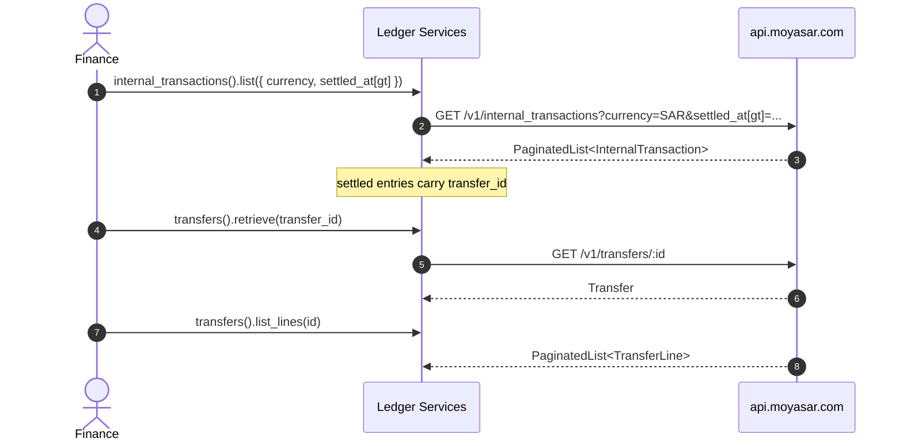

# US-6.2.0: Transfers & Internal Transactions Ledger

> **Spec Kit Specification**: [Specification Lifecycle Active](../../../docs/architecture/DECOMPOSITION_ROADMAP.md)  
> **Behavior Blueprint**: `features/core/modules/settlements/behaviours/transfers-ledger/`  
> **Slicing Standard**: [10-PR Vertical Slicing Framework](../README.md#2-the-10-pr-vertical-slicing-framework-rust-sdk-adaptation)  
> **Security Gateway**: `security-audit` Level 2 Enforced  
> **Quality Gates**: `(G0–G4 + G-Review + G-Borrow + G-Law)`  

---

## 1. Spec Kit Specification

### 1.1 User Story Narrative
**As a** marketplace finance engineer tracking how split funds move between aggregation accounts,  
**I want to** list and retrieve aggregation transfers and their lines, and query internal transactions filtered by id, currency and timestamp windows,  
**So that** I can trace every beneficiary payout back to its originating payment through the `transfer_id` linkage once settled.

#### 1.1.1 Preconditions
- `features = ["settlements"]`; valid `SecretKey`.
- The merchant is an aggregation account (otherwise these ledgers are empty).

#### 1.1.2 Postconditions
- `transfers().list()` / `.retrieve(id)` / `.list_lines(id)` return typed `Transfer` and `TransferLine` records.
- `internal_transactions().list()` filters by `id`, `currency`, `created_at`, `updated_at`, `settled_at` (each with `gt`/`lt`).
- `InternalTransaction` exposes `recipient_type`, `recipient_id`, `amount`, `transfer_id` (populated once settled), `settled_at`, `metadata`.

### 1.2 Acceptance Criteria (Gherkin Scenarios)

```gherkin
Feature: Transfers and Internal Transactions

  Scenario: [AC-US-6.2.0-01] List aggregation transfers with date filters
    Given a transfers list request with date filters
    When client.transfers().list(params) is called
    Then the query string contains the encoded date filters
    And the response deserializes into PaginatedList<Transfer>.

  Scenario: [AC-US-6.2.0-02] Retrieve a transfer with its lines
    Given a transfer id
    When client.transfers().retrieve(id) and client.transfers().list_lines(id, params) are called
    Then both return successfully
    And each TransferLine references its constituent settlement or payout.

  Scenario: [AC-US-6.2.0-03] Filter internal transactions by currency and settled window
    Given a request filtered by currency SAR and settled_at[gt]
    When client.internal_transactions().list(params) is called
    Then the query string contains currency=SAR and settled_at[gt]=<ts>
    And the response is a PaginatedList<InternalTransaction>.

  Scenario: [AC-US-6.2.0-04] Unsettled internal transaction has no transfer_id
    Given an internal transaction that has not yet settled
    When deserialized
    Then transfer_id is None and settled_at is None.

  Scenario: [AC-US-6.2.0-05] Settled internal transaction links to its transfer
    Given an internal transaction that has settled
    When deserialized
    Then transfer_id is Some(uuid) and settled_at is Some(timestamp)
    And the transfer_id can be used with client.transfers().retrieve().

  Scenario: [AC-US-6.2.0-LAW] SAMA funds-flow traceability across the ledger
    Given any internal transaction
    When audited
    Then recipient_type, recipient_id, amount, transfer_id and settled_at jointly reconstruct the funds flow,
         satisfying SAMA traceability requirements for marketplace aggregation.
```

### 1.3 Test Cases & Traceability Matrix

| Test Case ID | Target Criterion | Test Type | Execution Level | Verification Assertion & Pass Criteria |
| :--- | :--- | :--- | :--- | :--- |
| `TC-6.2.0-01` | `AC-US-6.2.0-01` | Functional | Unit | Encoded filters; paginated shape. |
| `TC-6.2.0-02` | `AC-US-6.2.0-02` | Functional | Integration | Transfer + lines both deserialize. |
| `TC-6.2.0-03` | `AC-US-6.2.0-03` | Functional | Unit | currency and settled_at filters encoded. |
| `TC-6.2.0-04` | `AC-US-6.2.0-04` | Functional | Unit | Unsettled fixture yields `None` fields. |
| `TC-6.2.0-05` | `AC-US-6.2.0-05` | Functional | Unit | Settled fixture yields `Some` fields; linkage works. |
| `TC-6.2.0-LAW` | `AC-US-6.2.0-LAW` | Compliance | Static / Audit | Full funds-flow reconstructable. |

---

## 2. Behavior-Centric Architecture & Folder Blueprint

### 2.1 Colocated Behaviour Directory Tree

```
features/core/modules/settlements/behaviours/transfers-ledger/
├── services/        # TransfersService, InternalTransactionsService
├── logic/           # Timestamp-window filter serialization
├── types/           # Transfer, TransferLine, InternalTransaction, TransferId, InternalTransactionId
└── constants/       # TRANSFERS_PATH, INTERNAL_TXNS_PATH
```

### 2.2 Scoping & Promotion Blueprint
- **Tier 1 (Behaviour-Local)**: timestamp-window filter builder.
- **Tier 2 (Module-Shared)**: `TransferId` referenced by payouts and settlements.
- **Tier 3 (Feature-Shared)**: sub-services under `settlements`.
- **Tier 4 (Global-Shared)**: `client.transfers()` and `client.internal_transactions()` facades.

---

## 3. Technical Implementation Plan

### 3.1 Domain Invariants & Storage Schema
- **Read-Only Law**: all ledger endpoints are `GET`.
- **Linkage Law**: `transfer_id` exists only after settlement; never fabricate it.
- **Filter Law**: all timestamp filters use `field[gt]` / `field[lt]` bracket notation.
- **Recipient Law**: `recipient_type` mirrors splits (`Entity` | `Platform` | `Beneficiary`).

```rust
#[derive(Debug, Clone, Deserialize)]
pub struct InternalTransaction {
    pub id: InternalTransactionId,
    pub recipient_type: RecipientType,
    pub recipient_id: Uuid,
    pub amount: u64,
    pub currency: Currency,
    pub transfer_id: Option<Uuid>,
    pub settled_at: Option<DateTime<Utc>>,
    pub created_at: DateTime<Utc>,
    pub updated_at: DateTime<Utc>,
    pub metadata: Option<BTreeMap<String, String>>,
}

impl InternalTransaction {
    /// True once the ledger has linked this transaction to a transfer.
    pub fn is_settled(&self) -> bool {
        self.transfer_id.is_some() && self.settled_at.is_some()
    }
}

#[derive(Debug, Clone, Deserialize)]
pub struct Transfer {
    pub id: TransferId,
    pub amount: u64,
    pub currency: Currency,
    pub created_at: DateTime<Utc>,
}
```

### 3.2 Activity & Interaction Diagram



---

## 4. Granular Implementation Tasks

### 4.1 The 10-PR Vertical Slicing Implementation Plan

| PR # | Pillar | Architectural Layer | Primary Scope & Files | Deliverables & Acceptance | Accountable Role / Agent | Assigned Skills |
| :--- | :--- | :--- | :--- | :--- | :--- | :--- |
| **PR 1** | **Pillar 1** | **Domain Logic & Core Traits** | `src/resources/settlements/transfer_models.rs` | `Transfer`, `TransferLine`, `TransferId`. | `engineering-software-architect` | `security-audit` |
| **PR 2** | **Pillar 2** | **Request Modeling** | `src/resources/settlements/ledger_params.rs` | Filter params for both services. | `engineering-backend-architect` | `security-audit` |
| **PR 3** | **Pillar 3** | **Transport Wire Adapter** | `src/resources/settlements/transfers.rs` | `GET /v1/transfers` + lines. | `engineering-backend-architect` | `security-audit` |
| **PR 4** | **Pillar 4** | **Service Accessor** | `src/resources/settlements/service.rs` | `client.transfers()`, `client.internal_transactions()`. | `engineering-software-architect` | `security-audit` |
| **PR 5** | **Pillar 5** | **Error Taxonomy** | `src/kernel/error.rs` | 404 and bad-filter mapping. | `security-application-security-engineer` | `security-audit` |
| **PR 6** | **Pillar 6** | **Resource Facade Mounting** | `src/resources/settlements/mod.rs` | Export both sub-services. | `engineering-software-architect` | `security-audit` |
| **PR 7** | **Pillar 7** | **Zero-Copy Hardening** | `src/resources/settlements/internal_txn_models.rs` | `InternalTransactionId` newtype. | `agency-rust-refactoring-specialist` | `security-audit` |
| **PR 8** | **Pillar 8** | **Edge Cases & Guards** | `src/resources/settlements/internal_transactions.rs` | Unsettled vs settled fixtures; `is_settled()`. | `agency-api-tester` | `security-audit` |
| **PR 9** | **Pillar 9** | **Integration Wire Verification** | `tests/transfers_ledger_test.rs` | Transfer/line/internal-txn wire tests. | `agency-api-tester` | `security-audit` |
| **PR 10** | **Pillar 10** | **Documentation & Packaging** | `README.md` | Doc-tests tracing payment → transfer. | `engineering-technical-writer` | `security-audit` |

### 4.2 Implementation Phase Breakdown

#### Phase 1: Models & Params (PR 1–2)
- [ ] **Task 1.1 (Transfer Types)**: `Transfer`, `TransferLine`.  
  *Agent*: `engineering-software-architect` | *Skill*: `security-audit`
- [ ] **Task 1.2 (Internal Txn Types)**: `InternalTransaction`, `is_settled()`.  
  *Agent*: `engineering-software-architect` | *Skill*: `security-audit`
- [ ] **Task 1.3 (Params)**: filter structs for both services.  
  *Agent*: `engineering-backend-architect` | *Skill*: `security-audit`

#### Phase 2: Endpoints (PR 3–6)
- [ ] **Task 2.1 (Transfers)**: list, retrieve, list_lines.  
  *Agent*: `engineering-backend-architect` | *Skill*: `security-audit`
- [ ] **Task 2.2 (Internal Txns)**: list with timestamp windows.  
  *Agent*: `engineering-backend-architect` | *Skill*: `security-audit`

#### Phase 3: Edge Cases (PR 7–8)
- [ ] **Task 3.1 (Settled/Unsettled)**: fixtures for both linkage states.  
  *Agent*: `agency-api-tester` | *Skill*: `security-audit`

#### Phase 4: Verification & Sign-Off (PR 9–10)
- [ ] **Task 4.1 (Wire Tests)**: all ledger endpoints.  
  *Agent*: `agency-api-tester` | *Skill*: `security-audit`
- [ ] **Task 4.2 (G-Review)**: peer review on linkage semantics.  
  *Agent*: `agency-code-reviewer` | *Skill*: `security-audit`
- [ ] **Task 4.3 (Documentation)**: funds-flow trace example.  
  *Agent*: `engineering-technical-writer` | *Skill*: `security-audit`

---

## 5. Security Gateway (Powered by security-audit)

### 5.1 Trust Boundaries & Security Actors
- **Trust Boundaries**:
  - `Ledger Boundary`: financial audit data across entities.
- **Authorized Principals**: merchant finance backend (`sk_`).

### 5.2 Threat Modeling & Abuse Matrix (STRIDE / ASVS)

| Threat Vector | Severity | Vulnerability Mechanism | Mitigating Control & Security Invariant |
| :--- | :--- | :--- | :--- |
| **Cross-Tenant Read** | Critical | Accessing another merchant's ledger | Server-side ownership; typed 404/403. |
| **Phantom Linkage** | High | Treating an unsettled txn as settled | `is_settled()` requires both `transfer_id` and `settled_at`. |
| **Filter Injection** | Medium | Malformed timestamps breaking queries | Typed `DateTime<Utc>` filters. |
| **Unbounded Listing** | Medium | Fetching entire ledger | Mandatory pagination. |
| **Data Exposure in Logs** | Medium | Ledger metadata logged | Metadata excluded from default `Debug`. |

### 5.3 Cryptographic & Data Protection Controls
- **Typed Filters**: no string interpolation into query keys.
- **Linkage Guard**: explicit settled predicate.
- **Pagination**: bounded page size.

### 5.4 Automated Security Verification Checklist
- [ ] **Linkage Test**: unsettled txn has `None` linkage.
- [ ] **Tenant Test**: foreign id yields typed error.
- [ ] **Filter Test**: malformed timestamps rejected.
- [ ] **Pagination Test**: list requires a page parameter.

### 5.5 Security Gateway (G2) Sign-Off Checklist
- [ ] Ledger access verified against OWASP ASVS Level 2.
- [ ] Linkage semantics certified.
- [ ] Zero metadata leakage in logs.
- [ ] Independent reviewer sign-off; zero open findings.

---

## 6. Validation Gates & Acceptance Sign-Off

**Status: Ready for Implementation.**

### G0 — Build, lint & format
- [ ] **US-6.2.0-G0:** `cargo build && cargo clippy -- -D warnings && cargo fmt --check` clean.

### G1 — Test coverage
- [ ] **US-6.2.0-G1:** ≥90% line / ≥85% branch on the ledger module.

### G2 — Security audit
- [ ] **US-6.2.0-G2:** Ledger-access audit passes with zero critical/high findings.

### G3 — Architecture and maintainability
- [ ] **US-6.2.0-G3:** Read-only services; zero mutation surface.

### G-Review — Code review
- [ ] **US-6.2.0-G-Review:** Peer review on linkage semantics and filters.

### G-Borrow — Rust zero-clone validation
- [ ] **US-6.2.0-G-Borrow:** Newtype ids avoid needless cloning.

### G-Complexity — Cyclomatic complexity
- [ ] **US-6.2.0-G-Complexity:** $CC \le 6$; nesting $\le 2$.

### G-Docs — Public docs & examples
- [ ] **US-6.2.0-G-Docs:** 100% public symbols documented; trace example runnable.

### G-Law — Law validation
- [ ] **US-6.2.0-G-Law:** SAMA funds-flow traceability certified.

### G4 — Integrated acceptance
- [ ] **US-6.2.0-G4:** Transfers and internal transactions verified against the mock server.
