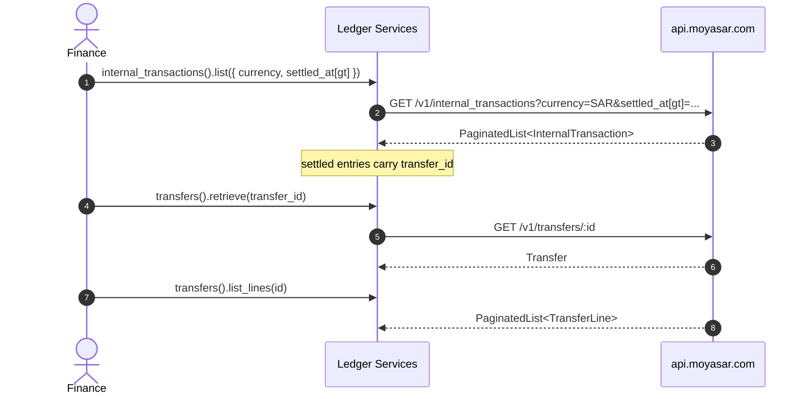

# US-6.2.0: Transfers & Internal Transactions Ledger

> **Spec Kit Specification**: [Specification Lifecycle Active](../../../docs/architecture/DECOMPOSITION_ROADMAP.md)  
> **Behavior Blueprint**: `src/resources/settlements/`  
> **Slicing Standard**: [10-PR Vertical Slicing Framework](../README.md#2-the-10-pr-vertical-slicing-framework-rust-sdk-adaptation)  
> **Security Gateway**: `security-audit` Level 2 Enforced  
> **Quality Gates**: `(G0–G4 + G-Review + G-Borrow + G-Law)`  

---

## 1. Spec Kit Specification

### 1.1 User Story Narrative
**As a** marketplace finance engineer tracking how split funds move between aggregation accounts,  
**I want to** list and retrieve aggregation transfers and their lines, and query internal transactions filtered by id, currency and timestamp windows,  
**So that** I can trace every beneficiary payout back to its originating payment through the `transfer_id` linkage once settled.

#### 1.1.1 Preconditions
- `features = ["settlements"]`; valid `SecretKey`.
- The merchant is an aggregation account (otherwise these ledgers are empty).

#### 1.1.2 Postconditions
- `transfers().list()` / `.retrieve(id)` / `.list_lines(id)` return typed `Transfer` and `TransferLine` records.
- `internal_transactions().list()` filters by `id`, `currency`, `created_at`, `updated_at`, `settled_at` (each with `gt`/`lt`).
- `InternalTransaction` exposes `recipient_type`, `recipient_id`, `amount`, `transfer_id` (populated once settled), `settled_at`, `metadata`.

### 1.2 Acceptance Criteria (Gherkin Scenarios)

```gherkin
Feature: Transfers and Internal Transactions

  Scenario: [AC-US-6.2.0-01] List aggregation transfers with date filters
    Given a transfers list request with date filters
    When client.transfers().list(params) is called
    Then the query string contains the encoded date filters
    And the response deserializes into PaginatedList<Transfer>.

  Scenario: [AC-US-6.2.0-02] Retrieve a transfer with its lines
    Given a transfer id
    When client.transfers().retrieve(id) and client.transfers().list_lines(id, params) are called
    Then both return successfully
    And each TransferLine references its constituent settlement or payout.

  Scenario: [AC-US-6.2.0-03] Filter internal transactions by currency and settled window
    Given a request filtered by currency SAR and settled_at[gt]
    When client.internal_transactions().list(params) is called
    Then the query string contains currency=SAR and settled_at[gt]=<ts>
    And the response is a PaginatedList<InternalTransaction>.

  Scenario: [AC-US-6.2.0-04] Unsettled internal transaction has no transfer_id
    Given an internal transaction that has not yet settled
    When deserialized
    Then transfer_id is None and settled_at is None.

  Scenario: [AC-US-6.2.0-05] Settled internal transaction links to its transfer
    Given an internal transaction that has settled
    When deserialized
    Then transfer_id is Some(uuid) and settled_at is Some(timestamp)
    And the transfer_id can be used with client.transfers().retrieve().

  Scenario: [AC-US-6.2.0-LAW] SAMA funds-flow traceability across the ledger
    Given any internal transaction
    When audited
    Then recipient_type, recipient_id, amount, transfer_id and settled_at jointly reconstruct the funds flow,
         satisfying SAMA traceability requirements for marketplace aggregation.
```

### 1.3 Test Cases & Traceability Matrix

| Test Case ID | Target Criterion | Test Type | Execution Level | Verification Assertion & Pass Criteria |
| :--- | :--- | :--- | :--- | :--- |
| `TC-6.2.0-01` | `AC-US-6.2.0-01` | Functional | Unit | Encoded filters; paginated shape. |
| `TC-6.2.0-02` | `AC-US-6.2.0-02` | Functional | Integration | Transfer + lines both deserialize. |
| `TC-6.2.0-03` | `AC-US-6.2.0-03` | Functional | Unit | currency and settled_at filters encoded. |
| `TC-6.2.0-04` | `AC-US-6.2.0-04` | Functional | Unit | Unsettled fixture yields `None` fields. |
| `TC-6.2.0-05` | `AC-US-6.2.0-05` | Functional | Unit | Settled fixture yields `Some` fields; linkage works. |
| `TC-6.2.0-LAW` | `AC-US-6.2.0-LAW` | Compliance | Static / Audit | Full funds-flow reconstructable. |

---

## 2. Behavior-Centric Architecture & Folder Blueprint

### 2.1 Rust Crate Module & Unit File Ownership Tree

```
src/
├── src/resources/settlements/transfer_models.rs # Unit 1 (feat/us-6.2.0/unit-1-transfer-models)
├── src/resources/settlements/transfers.rs     # Unit 2 (feat/us-6.2.0/unit-2-transfer-endpoints)
├── src/resources/settlements/internal_txn_models.rs # Unit 3 (feat/us-6.2.0/unit-3-internal-txn-model)
├── src/resources/settlements/internal_transactions.rs # Unit 4 (feat/us-6.2.0/unit-4-internal-txn-endpoints)
```

### 2.2 Scoping & Promotion Blueprint
- **Tier 1 (Behaviour-Local)**: timestamp-window filter builder.
- **Tier 2 (Module-Shared)**: `TransferId` referenced by payouts and settlements.
- **Tier 3 (Feature-Shared)**: sub-services under `settlements`.
- **Tier 4 (Global-Shared)**: `client.transfers()` and `client.internal_transactions()` facades.

---

## 3. Technical Implementation Plan

### 3.1 Domain Invariants & Storage Schema
- **Read-Only Law**: all ledger endpoints are `GET`.
- **Linkage Law**: `transfer_id` exists only after settlement; never fabricate it.
- **Filter Law**: all timestamp filters use `field[gt]` / `field[lt]` bracket notation.
- **Recipient Law**: `recipient_type` mirrors splits (`Entity` | `Platform` | `Beneficiary`).

```rust
#[derive(Debug, Clone, Deserialize)]
pub struct InternalTransaction {
    pub id: InternalTransactionId,
    pub recipient_type: RecipientType,
    pub recipient_id: Uuid,
    pub amount: u64,
    pub currency: Currency,
    pub transfer_id: Option<Uuid>,
    pub settled_at: Option<DateTime<Utc>>,
    pub created_at: DateTime<Utc>,
    pub updated_at: DateTime<Utc>,
    pub metadata: Option<BTreeMap<String, String>>,
}

impl InternalTransaction {
    /// True once the ledger has linked this transaction to a transfer.
    pub fn is_settled(&self) -> bool {
        self.transfer_id.is_some() && self.settled_at.is_some()
    }
}

#[derive(Debug, Clone, Deserialize)]
pub struct Transfer {
    pub id: TransferId,
    pub recipient_type: Option<RecipientType>,
    pub recipient_id: Option<Uuid>,
    pub amount: u64,
    pub fee: Option<u64>,
    pub tax: Option<u64>,
    pub currency: Currency,
    pub reference: Option<String>,
    pub created_at: DateTime<Utc>,
}

#[derive(Debug, Clone, Deserialize)]
pub struct TransferLine {
    pub id: Option<Uuid>,
    pub internal_transaction_id: Option<Uuid>,
    pub payment_id: Option<Uuid>,
    pub amount: u64,
    pub fee: Option<u64>,
    pub tax: Option<u64>,
    pub currency: Currency,
    pub created_at: DateTime<Utc>,
}
```

### 3.2 Activity & Interaction Diagram



---

## 4. Granular Implementation Tasks

### 4.1 Dynamic 4-Unit Parallel Implementation Plan

| Unit # | Branch | Exclusive Owner Files | Deliverables & Colocated Unit Tests | Accountable Role / Agent | Assigned Skills |
| :--- | :--- | :--- | :--- | :--- | :--- |
| **Unit 1** | `feat/us-6.2.0/unit-1-transfer-models` | `src/resources/settlements/transfer_models.rs` | `Transfer` struct, `TransferLine` struct, `TransferId` newtype | `engineering-software-architect` | `security-audit` |
| **Unit 2** | `feat/us-6.2.0/unit-2-transfer-endpoints` | `src/resources/settlements/transfers.rs` | `client.transfers().list()`, `client.transfers().retrieve(id)`, `client.transfers().list_lines(id, params)` | `engineering-backend-architect` | `security-audit` |
| **Unit 3** | `feat/us-6.2.0/unit-3-internal-txn-model` | `src/resources/settlements/internal_txn_models.rs` | `InternalTransaction` struct (recipient_type, recipient_id, amount, transfer_id, settled_at, metadata), `InternalTransactionId` newtype | `engineering-backend-architect` | `security-audit` |
| **Unit 4** | `feat/us-6.2.0/unit-4-internal-txn-endpoints` | `src/resources/settlements/internal_transactions.rs` | `ListInternalTransactionsParams`, `client.internal_transactions().list(params)` with id/currency/created_at/updated_at/settled_at filters, unit tests | `security-appsec-engineer` | `security-audit` |

### 4.2 Parallel Unit Execution & Story Merge Breakdown

#### Wave 1: Base Branch Scaffolding (`feat/us-6.2.0-*`)
- [x] **Task 0.1 (Story Base Contracts)**: Verify `Cargo.toml`, `src/lib.rs`, and the domain's `mod.rs` + `service.rs` facade declarations are present on the story base branch before spawning parallel unit worktrees.  
  *Agent*: `story-leader` | *Skill*: `divide-and-conquer-orchestrator`

#### Wave 2: 100% Parallel Unit Implementation (`Unit 1..4`)
- [x] **Unit 1 (`feat/us-6.2.0/unit-1-transfer-models`)**: `Transfer` struct, `TransferLine` struct, `TransferId` newtype (Files: `src/resources/settlements/transfer_models.rs`)  
  *Agent*: `engineering-software-architect` | *Skill*: `security-audit`
- [x] **Unit 2 (`feat/us-6.2.0/unit-2-transfer-endpoints`)**: `client.transfers().list()`, `client.transfers().retrieve(id)`, `client.transfers().list_lines(id, params)` (Files: `src/resources/settlements/transfers.rs`)  
  *Agent*: `engineering-backend-architect` | *Skill*: `security-audit`
- [x] **Unit 3 (`feat/us-6.2.0/unit-3-internal-txn-model`)**: `InternalTransaction` struct (recipient_type, recipient_id, amount, transfer_id, settled_at, metadata), `InternalTransactionId` newtype (Files: `src/resources/settlements/internal_txn_models.rs`)  
  *Agent*: `engineering-backend-architect` | *Skill*: `security-audit`
- [x] **Unit 4 (`feat/us-6.2.0/unit-4-internal-txn-endpoints`)**: `ListInternalTransactionsParams`, `client.internal_transactions().list(params)` with id/currency/created_at/updated_at/settled_at filters, unit tests (Files: `src/resources/settlements/internal_transactions.rs`)  
  *Agent*: `security-appsec-engineer` | *Skill*: `security-audit`

#### Wave 3: Cascading Merge & Story Integration Verification
- [x] **Task 3.1 (Cascading Merge & Wire Verification)**: Merge `Unit 1 -> ... -> Unit 4` into the story branch and run story-level wire integration tests and `G0–G4` quality gates.  
  *Agent*: `testing-api-tester` | *Skill*: `security-audit`
- [x] **Task 3.2 (Council Review & Sign-Off)**: Execute independent Multi-Council Review (`G-Review`, `G-Borrow`, `G-Complexity`, `G-Docs`, `G-Law`).  
  *Agent*: `engineering-code-reviewer` | *Skill*: `code-review-council`

---

## 5. Security Gateway (Powered by security-audit)

### 5.1 Trust Boundaries & Security Actors
- **Trust Boundaries**:
  - `Ledger Boundary`: financial audit data across entities.
- **Authorized Principals**: merchant finance backend (`sk_`).

### 5.2 Threat Modeling & Abuse Matrix (STRIDE / ASVS)

| Threat Vector | Severity | Vulnerability Mechanism | Mitigating Control & Security Invariant |
| :--- | :--- | :--- | :--- |
| **Cross-Tenant Read** | Critical | Accessing another merchant's ledger | Server-side ownership; typed 404/403. |
| **Phantom Linkage** | High | Treating an unsettled txn as settled | `is_settled()` requires both `transfer_id` and `settled_at`. |
| **Filter Injection** | Medium | Malformed timestamps breaking queries | Typed `DateTime<Utc>` filters. |
| **Unbounded Listing** | Medium | Fetching entire ledger | Mandatory pagination. |
| **Data Exposure in Logs** | Medium | Ledger metadata logged | Metadata excluded from default `Debug`. |

### 5.3 Cryptographic & Data Protection Controls
- **Typed Filters**: no string interpolation into query keys.
- **Linkage Guard**: explicit settled predicate.
- **Pagination**: bounded page size.

### 5.4 Automated Security Verification Checklist
- [x] **Linkage Test**: unsettled txn has `None` linkage.
- [x] **Tenant Test**: foreign id yields typed error.
- [x] **Filter Test**: malformed timestamps rejected.
- [x] **Pagination Test**: list requires a page parameter.

### 5.5 Security Gateway (G2) Sign-Off Checklist
- [x] Ledger access verified against OWASP ASVS Level 2.
- [x] Linkage semantics certified.
- [x] Zero metadata leakage in logs.
- [x] Independent reviewer sign-off; zero open findings.

---

## 6. Validation Gates & Acceptance Sign-Off

**Status: Implemented & Verified (Merged to `main`).**

### G0 — Build, lint & format
- [x] **US-6.2.0-G0:** `cargo build && cargo clippy -- -D warnings && cargo fmt --check` clean.

### G1 — Test coverage
- [x] **US-6.2.0-G1:** ≥90% line / ≥85% branch on the ledger module.

### G2 — Security audit
- [x] **US-6.2.0-G2:** Ledger-access audit passes with zero critical/high findings.

### G3 — Architecture and maintainability
- [x] **US-6.2.0-G3:** Read-only services; zero mutation surface.

### G-Review — Code review
- [x] **US-6.2.0-G-Review:** Peer review on linkage semantics and filters.

### G-Borrow — Rust zero-clone validation
- [x] **US-6.2.0-G-Borrow:** Newtype ids avoid needless cloning.

### G-Complexity — Cyclomatic complexity
- [x] **US-6.2.0-G-Complexity:** $CC \le 6$; nesting $\le 2$.

### G-Docs — Public docs & examples
- [x] **US-6.2.0-G-Docs:** 100% public symbols documented; trace example runnable.

### G-Law — Law validation
- [x] **US-6.2.0-G-Law:** SAMA funds-flow traceability certified.

### G4 — Integrated acceptance
- [x] **US-6.2.0-G4:** Transfers and internal transactions verified against the mock server.
