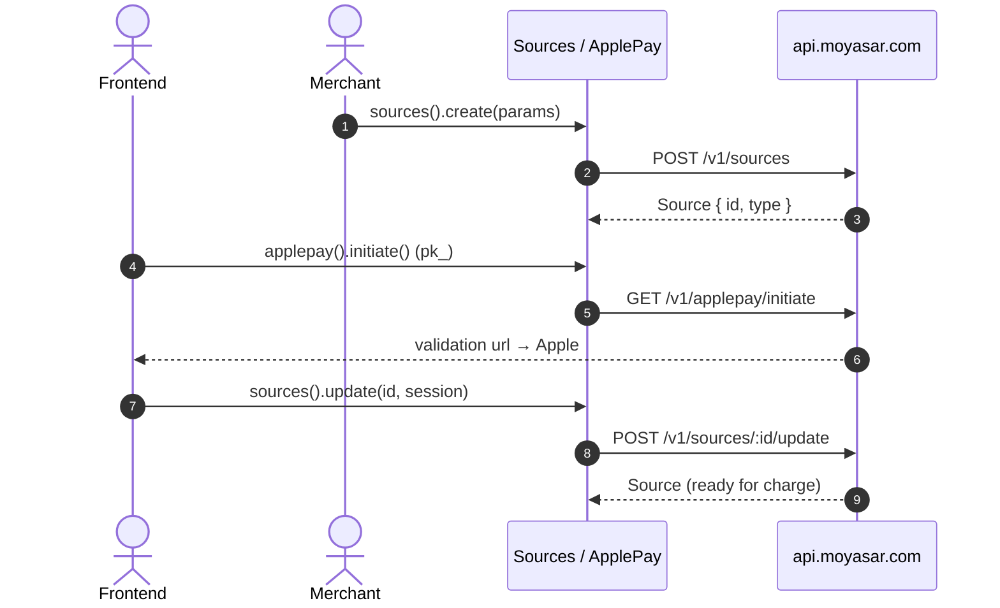

# US-7.1.0: Generic Sources & Apple Pay Initiation

> **Spec Kit Specification**: [Specification Lifecycle Active](../../../docs/architecture/DECOMPOSITION_ROADMAP.md)  
> **Behavior Blueprint**: `features/core/modules/sources/behaviours/generic-sources-applepay/`  
> **Slicing Standard**: [10-PR Vertical Slicing Framework](../README.md#2-the-10-pr-vertical-slicing-framework-rust-sdk-adaptation)  
> **Security Gateway**: `security-audit` Level 2 Enforced  
> **Quality Gates**: `(G0–G4 + G-Review + G-Borrow + G-Law)`  

---

## 1. Spec Kit Specification

### 1.1 User Story Narrative
**As a** checkout engineer adding new payment rails,  
**I want to** create and fetch generic `Source` objects (`POST /v1/sources`, `GET /v1/sources/:id`), complete Apple Pay sessions via `POST /v1/sources/:id/update`, and initiate Apple Pay merchant validation through `GET /v1/applepay/initiate`,  
**So that** I can onboard rails beyond the typed `SourceRequest` enum without an SDK release, and Apple Pay domain validation works from a publishable key on the frontend.

#### 1.1.1 Preconditions
- `features = ["sources"]`.
- `SecretKey` for source creation; `PublishableKey` is permitted for `GET /v1/applepay/initiate` only.

#### 1.1.2 Postconditions
- `create()` returns a `Source` with `id`, `type`, `status`, `amount`, `given_id`.
- `retrieve(id)` returns the same `Source`.
- `update(id, params)` accepts Apple Pay payment-session data and returns the updated `Source`.
- `applepay_initiate()` returns a validation URL, and rejects `sk_` when a `pk_` is required by policy.

### 1.2 Acceptance Criteria (Gherkin Scenarios)

```gherkin
Feature: Generic Sources and Apple Pay

  Scenario: [AC-US-7.1.0-01] Create a generic source
    Given a CreateSourceParams with type, amount and currency
    When client.sources().create(params) is called
    Then the API returns a Source with a UUID id
    And the Source.type echoes the requested type.

  Scenario: [AC-US-7.1.0-02] Retrieve a source by id
    Given an existing source id
    When client.sources().retrieve(id) is called
    Then the returned Source.id equals the requested id
    And a 404 maps to RecordNotFound.

  Scenario: [AC-US-7.1.0-03] Update a source with Apple Pay session data
    Given an Apple Pay source awaiting merchant validation
    When client.sources().update(id, params) is called with the session payload
    Then the request is POST /v1/sources/:id/update
    And the returned Source reflects the updated state.

  Scenario: [AC-US-7.1.0-04] Initiate Apple Pay merchant validation with a publishable key
    Given a client configured with a publishable key
    When client.applepay().initiate() is called
    Then the request is GET /v1/applepay/initiate
    And the response contains a validation url.

  Scenario: [AC-US-7.1.0-05] Secret key is rejected on Apple Pay initiate
    Given a client configured with a secret key
    When client.applepay().initiate() is called
    Then a typed KeyTypeMismatch error is returned before any network call.

  Scenario: [AC-US-7.1.0-LAW] PCI-DSS scoping for Apple Pay token handling
    Given any Apple Pay flow
    When the encrypted payment token is transmitted
    Then the raw DPAN is never persisted or logged and only the opaque token is forwarded,
         satisfying PCI-DSS SAQ A-EP scoping for tokenized wallets.
```

### 1.3 Test Cases & Traceability Matrix

| Test Case ID | Target Criterion | Test Type | Execution Level | Verification Assertion & Pass Criteria |
| :--- | :--- | :--- | :--- | :--- |
| `TC-7.1.0-01` | `AC-US-7.1.0-01` | Functional | Integration | Source with UUID id; type echoed. |
| `TC-7.1.0-02` | `AC-US-7.1.0-02` | Functional | Integration | Matching id; 404 → `RecordNotFound`. |
| `TC-7.1.0-03` | `AC-US-7.1.0-03` | Functional | Unit | Path/verb verified; payload forwarded. |
| `TC-7.1.0-04` | `AC-US-7.1.0-04` | Functional | Integration | pk_ accepted; validation url returned. |
| `TC-7.1.0-05` | `AC-US-7.1.0-05` | Security | Unit | `KeyTypeMismatch` with zero network calls. |
| `TC-7.1.0-LAW` | `AC-US-7.1.0-LAW` | Compliance | Static / Audit | No DPAN retained; token forwarded opaquely. |

---

## 2. Behavior-Centric Architecture & Folder Blueprint

### 2.1 Colocated Behaviour Directory Tree

```
features/core/modules/sources/behaviours/generic-sources-applepay/
├── services/        # SourcesService create/retrieve/update, ApplePayService initiate
├── logic/           # Key-type guard for applepay initiate
├── types/           # Source, SourceId, CreateSourceParams, UpdateSourceParams, ApplePaySession
└── constants/       # SOURCES_PATH, UPDATE_SUFFIX, APPLEPAY_INITIATE_PATH
```

### 2.2 Scoping & Promotion Blueprint
- **Tier 1 (Behaviour-Local)**: Apple Pay session payload passthrough.
- **Tier 2 (Module-Shared)**: `SourceId` referenced by `SourceRequest`.
- **Tier 3 (Feature-Shared)**: services under `sources`.
- **Tier 4 (Global-Shared)**: `client.sources()` / `client.applepay()` facades.

---

## 3. Technical Implementation Plan

### 3.1 Domain Invariants & Storage Schema
- **Key Law**: `GET /v1/applepay/initiate` is a publishable-key route; `sk_` must be rejected client-side.
- **Opaque Token Law**: Apple Pay tokens are forwarded verbatim and never inspected or logged.
- **Type Law**: `Source.type` is an open string, not a closed enum — new rails need no SDK change.
- **Id Law**: `SourceId` is a UUID.

```rust
#[derive(Debug, Clone, Deserialize)]
pub struct Source {
    pub id: Uuid,
    pub r#type: String,               // open string by design
    pub status: String,
    pub amount: u64,
    pub currency: Currency,
    pub given_id: Option<String>,
    pub created_at: DateTime<Utc>,
}

impl SourcesService<'_> {
    /// PUT-free: Apple Pay completes via POST /v1/sources/:id/update.
    pub async fn update(&self, id: Uuid, p: &UpdateSourceParams)
        -> Result<Source, MoyasarError>
    {
        self.client.post(&format!("{SOURCES_PATH}/{id}{UPDATE_SUFFIX}"), p).await
    }
}

impl ApplePayService<'_> {
    pub async fn initiate(&self) -> Result<ApplePaySession, MoyasarError> {
        self.client.require_publishable_key()?;   // fails fast, no network call
        self.client.get(APPLEPAY_INITIATE_PATH).await
    }
}
```

### 3.2 Activity & Interaction Diagram



---

## 4. Granular Implementation Tasks

### 4.1 The 10-PR Vertical Slicing Implementation Plan

| PR # | Pillar | Architectural Layer | Primary Scope & Files | Deliverables & Acceptance | Accountable Role / Agent | Assigned Skills |
| :--- | :--- | :--- | :--- | :--- | :--- | :--- |
| **PR 1** | **Pillar 1** | **Domain Logic & Core Traits** | `src/resources/sources/models.rs` | `Source` with open-string type. | `engineering-software-architect` | `security-audit` |
| **PR 2** | **Pillar 2** | **Request Modeling** | `src/resources/sources/params.rs` | Create/Update params. | `engineering-backend-architect` | `security-audit` |
| **PR 3** | **Pillar 3** | **Transport Wire Adapter** | `src/resources/sources/sources.rs` | create/retrieve/update endpoints. | `engineering-backend-architect` | `security-audit` |
| **PR 4** | **Pillar 4** | **Service Accessor** | `src/resources/sources/service.rs` | `client.sources()` and `client.applepay()`. | `engineering-software-architect` | `security-audit` |
| **PR 5** | **Pillar 5** | **Error Taxonomy** | `src/kernel/error.rs` | `KeyTypeMismatch`, 404 mapping. | `security-application-security-engineer` | `security-audit` |
| **PR 6** | **Pillar 6** | **Resource Facade Mounting** | `src/resources/sources/mod.rs` | Feature-gated export under `sources`. | `engineering-software-architect` | `security-audit` |
| **PR 7** | **Pillar 7** | **Zero-Copy Hardening** | `src/resources/sources/models.rs` | Borrowed session payload; no cloning. | `agency-rust-refactoring-specialist` | `security-audit` |
| **PR 8** | **Pillar 8** | **Edge Cases & Guards** | `src/resources/sources/applepay.rs` | pk_-only guard for initiate. | `agency-api-tester` | `security-audit` |
| **PR 9** | **Pillar 9** | **Integration Wire Verification** | `tests/sources_test.rs` | Full Apple Pay handshake simulation. | `agency-api-tester` | `security-audit` |
| **PR 10** | **Pillar 10** | **Documentation & Packaging** | `README.md` | Doc-tests for both key types. | `engineering-technical-writer` | `security-audit` |

### 4.2 Implementation Phase Breakdown

#### Phase 1: Models & Params (PR 1–2)
- [ ] **Task 1.1 (Source Type)**: open-string `type`.  
  *Agent*: `engineering-software-architect` | *Skill*: `security-audit`
- [ ] **Task 1.2 (Params)**: create/update param structs.  
  *Agent*: `engineering-backend-architect` | *Skill*: `security-audit`

#### Phase 2: Endpoints (PR 3–6)
- [ ] **Task 2.1 (Sources CRUD)**: create/retrieve/update.  
  *Agent*: `engineering-backend-architect` | *Skill*: `security-audit`
- [ ] **Task 2.2 (Apple Pay)**: `GET /v1/applepay/initiate`.  
  *Agent*: `engineering-backend-architect` | *Skill*: `security-audit`

#### Phase 3: Guards (PR 7–8)
- [ ] **Task 3.1 (Key Guard)**: reject `sk_` on initiate before transport.  
  *Agent*: `agency-api-tester` | *Skill*: `security-audit`

#### Phase 4: Verification & Sign-Off (PR 9–10)
- [ ] **Task 4.1 (Wire Tests)**: create → initiate → update handshake.  
  *Agent*: `agency-api-tester` | *Skill*: `security-audit`
- [ ] **Task 4.2 (G-Review)**: peer review on key-type guard.  
  *Agent*: `agency-code-reviewer` | *Skill*: `security-audit`
- [ ] **Task 4.3 (Documentation)**: frontend/backend split documented.  
  *Agent*: `engineering-technical-writer` | *Skill*: `security-audit`

---

## 5. Security Gateway (Powered by security-audit)

### 5.1 Trust Boundaries & Security Actors
- **Trust Boundaries**:
  - `Wallet Boundary`: Apple Pay token originates in a customer device.
  - `Public Key Boundary`: `pk_` is exposed to browsers.
- **Authorized Principals**: `sk_` (backend), `pk_` (browser, initiate only).

### 5.2 Threat Modeling & Abuse Matrix (STRIDE / ASVS)

| Threat Vector | Severity | Vulnerability Mechanism | Mitigating Control & Security Invariant |
| :--- | :--- | :--- | :--- |
| **Secret Key in Browser** | Critical | `sk_` shipped to frontend for initiate | `require_publishable_key()` guard fails fast. |
| **Token Tampering** | High | Modifying the Apple Pay token | Token forwarded opaquely; server validates cryptographically. |
| **DPAN Exposure** | Critical | Device PAN stored or logged | Never deserialized into a typed field; opaque JSON only. |
| **Source Spoofing** | Medium | Guessing source ids | UUID ids + server-side authorization. |
| **Session Replay** | High | Reusing an Apple Pay session | Session validated once; server rejects replays. |

### 5.3 Cryptographic & Data Protection Controls
- **Key-Type Guard**: publishable-only enforcement.
- **Opaque Token**: no inspection of wallet payloads.
- **UUID Ids**: non-sequential.

### 5.4 Automated Security Verification Checklist
- [ ] **Key Guard Test**: `sk_` rejected with zero network calls.
- [ ] **Token Test**: wallet payload never `Debug`-printed.
- [ ] **Tenant Test**: foreign source id yields typed error.
- [ ] **Replay Test**: reused session rejected by server.

### 5.5 Security Gateway (G2) Sign-Off Checklist
- [ ] Wallet flow verified against OWASP ASVS Level 2.
- [ ] Zero secret-key exposure to frontend.
- [ ] Zero DPAN retention.
- [ ] Independent reviewer sign-off; zero open findings.

---

## 6. Validation Gates & Acceptance Sign-Off

**Status: Ready for Implementation.**

### G0 — Build, lint & format
- [ ] **US-7.1.0-G0:** `cargo build && cargo clippy -- -D warnings && cargo fmt --check` clean.

### G1 — Test coverage
- [ ] **US-7.1.0-G1:** ≥90% line / ≥85% branch on the sources module.

### G2 — Security audit
- [ ] **US-7.1.0-G2:** Wallet/key audit passes with zero critical/high findings.

### G3 — Architecture and maintainability
- [ ] **US-7.1.0-G3:** Sources module has no dependency on payouts or settlements.

### G-Review — Code review
- [ ] **US-7.1.0-G-Review:** Peer review on the key-type guard and token opacity.

### G-Borrow — Rust zero-clone validation
- [ ] **US-7.1.0-G-Borrow:** Session payload passed by reference.

### G-Complexity — Cyclomatic complexity
- [ ] **US-7.1.0-G-Complexity:** $CC \le 6$; nesting $\le 2$.

### G-Docs — Public docs & examples
- [ ] **US-7.1.0-G-Docs:** 100% public symbols documented; both key types demonstrated.

### G-Law — Law validation
- [ ] **US-7.1.0-G-Law:** PCI-DSS SAQ A-EP wallet scoping certified.

### G4 — Integrated acceptance
- [ ] **US-7.1.0-G4:** Create → initiate → update verified against the mock server.
