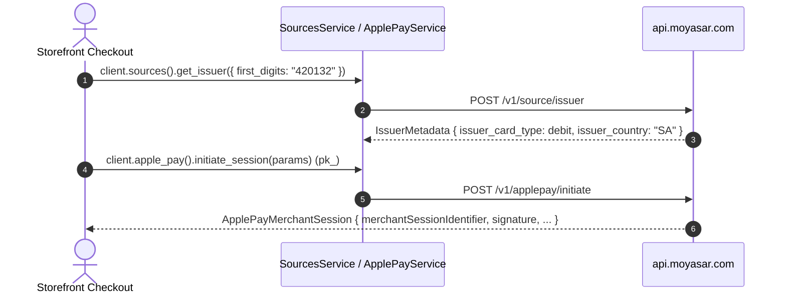

# US-7.1.0: BIN/IIN Card Issuer Lookup & Apple Pay Merchant Session Initiation

> **Spec Kit Specification**: [Specification Lifecycle Active](../../../docs/architecture/DECOMPOSITION_ROADMAP.md)  
> **Behavior Blueprint**: `src/resources/sources/`  
> **Slicing Standard**: [10-PR Vertical Slicing Framework](../README.md#2-the-10-pr-vertical-slicing-framework-rust-sdk-adaptation)  
> **Security Gateway**: `security-audit` Level 2 Enforced  
> **Quality Gates**: `(G0–G4 + G-Review + G-Borrow + G-Law)`  

---

## 1. Spec Kit Specification

### 1.1 User Story Narrative
**As a** checkout engineer building a custom storefront in Saudi Arabia,  
**I want to** inspect card BINs (`POST /v1/source/issuer` via `client.sources().get_issuer(params)`) to retrieve `IssuerMetadata` (`issuer_name`, `issuer_country`, `issuer_card_type`, `issuer_card_category`, `first_digits`, `last_digits`) and initiate signed Apple Pay Web Merchant sessions (`POST /v1/applepay/initiate` via `client.apple_pay().initiate_session(params)`),  
**So that** I can dynamically distinguish local `mada` debit cards from international credit cards before charging the customer and complete Apple Pay Web Merchant validation from a publishable key without managing a dedicated Apple Developer certificate.

#### 1.1.1 Preconditions
- `features = ["sources"]` (implies `core`).
- Either `SecretKey` or `PublishableKey` for `client.sources().get_issuer(params)`.
- `PublishableKey` for `client.apple_pay().initiate_session(params)`.

#### 1.1.2 Postconditions
- `client.sources().get_issuer(params)` sends `POST /v1/source/issuer` with 6–8 BIN digits (or full PAN) and returns `IssuerMetadata`.
- `client.apple_pay().initiate_session(params)` sends `POST /v1/applepay/initiate` with `validation_url`, `display_name`, `domain_name`, and `publishable_api_key` and returns `ApplePayMerchantSession`.
- Attempting to call `initiate_session` with a `SecretKey` is rejected before any network call (`KeyTypeMismatch`).

### 1.2 Acceptance Criteria (Gherkin Scenarios)

```gherkin
Feature: BIN/IIN Issuer Lookup and Apple Pay Merchant Session Initiation

  Scenario: [AC-US-7.1.0-01] Lookup a 6-digit or 8-digit BIN for a mada debit card
    Given an IssuerLookupParams with first_digits "420132"
    When client.sources().get_issuer(params) is called
    Then the API sends POST /v1/source/issuer
    And the returned IssuerMetadata reports issuer_country "SA" and issuer_card_type Debit.

  Scenario: [AC-US-7.1.0-02] Reject BIN input shorter than 6 digits before transport
    Given an IssuerLookupParams with first_digits "1234"
    When client.sources().get_issuer(params) is called
    Then a typed validation error is returned with zero network calls.

  Scenario: [AC-US-7.1.0-03] Initiate an Apple Pay Web Merchant session with a publishable key
    Given a client configured with a PublishableKey and ApplePayInitiateParams
    When client.apple_pay().initiate_session(params) is called
    Then the API sends POST /v1/applepay/initiate
    And the returned ApplePayMerchantSession contains merchantSessionIdentifier, nonce, merchantIdentifier, domainName, displayName and signature.

  Scenario: [AC-US-7.1.0-04] Secret key is rejected on Apple Pay session initiation
    Given a client configured with a SecretKey
    When client.apple_pay().initiate_session(params) is called
    Then a typed KeyTypeMismatch error is returned before any network call.

  Scenario: [AC-US-7.1.0-LAW] PCI-DSS scoping for BIN lookup and Apple Pay session tokens
    Given any BIN lookup or Apple Pay initiation
    When the request and response are logged via Debug
    Then full PAN digits are never emitted in logs and Apple Pay cryptographic signatures remain unmodified,
         satisfying PCI-DSS 4.0 SAQ A-EP scoping requirements.
```

### 1.3 Test Cases & Traceability Matrix

| Test Case ID | Target Criterion | Test Type | Execution Level | Verification Assertion & Pass Criteria |
| :--- | :--- | :--- | :--- | :--- |
| `TC-7.1.0-01` | `AC-US-7.1.0-01` | Functional | Integration | 6-digit and 8-digit BIN returns `IssuerMetadata` with `Debit`. |
| `TC-7.1.0-02` | `AC-US-7.1.0-02` | Validation | Unit | `<6` digits rejected pre-transport. |
| `TC-7.1.0-03` | `AC-US-7.1.0-03` | Functional | Integration | `ApplePayMerchantSession` camelCase fields deserialize cleanly. |
| `TC-7.1.0-04` | `AC-US-7.1.0-04` | Security | Unit | `KeyTypeMismatch` returned with zero network calls. |
| `TC-7.1.0-LAW` | `AC-US-7.1.0-LAW` | Compliance | Static / Audit | No full PAN retained or printed in `Debug`. |

---

## 2. Behavior-Centric Architecture & Folder Blueprint

### 2.1 Rust Crate Module & Unit File Ownership Tree

```
src/
├── src/resources/sources/issuer.rs            # Unit 1 (feat/us-7.1.0/unit-1-issuer-lookup)
├── src/resources/sources/apple_pay.rs         # Unit 2 (feat/us-7.1.0/unit-2-applepay-session)
├── src/resources/sources/service.rs           # Unit 3 (feat/us-7.1.0/unit-3-sources-service)
```

### 2.2 Scoping & Promotion Blueprint
- **Tier 1 (Behaviour-Local)**: BIN length validation and Apple Pay camelCase serde mapping.
- **Tier 2 (Module-Shared)**: `IssuerCardType` shared across card metadata helpers.
- **Tier 3 (Feature-Shared)**: `SourcesService` and `ApplePayService` under `sources`.
- **Tier 4 (Global-Shared)**: `client.sources()` and `client.apple_pay()` facade accessors.

---

## 3. Technical Implementation Plan

### 3.1 Domain Invariants & Storage Schema
- **BIN Length Law**: `first_digits` must contain at least 6 ASCII digits.
- **Key Law**: `/v1/applepay/initiate` requires a `PublishableKey`; `/v1/source/issuer` accepts either `SecretKey` or `PublishableKey`.
- **CamelCase Session Law**: Apple Pay Web Merchant session JSON uses camelCase keys (`epochTimestamp`, `expiresAt`, `merchantSessionIdentifier`).

```rust
#[derive(Debug, Clone, Copy, PartialEq, Eq, Serialize, Deserialize)]
#[serde(rename_all = "snake_case")]
pub enum IssuerCardType {
    Debit,
    Credit,
    ChargeCard,
    Unspecified,
    #[serde(other)]
    Unknown,
}

#[derive(Debug, Clone, Deserialize)]
pub struct IssuerMetadata {
    pub issuer_name: Option<String>,
    pub issuer_country: Option<String>,
    pub issuer_card_type: IssuerCardType,
    pub issuer_card_category: Option<String>,
    pub first_digits: String,
    pub last_digits: Option<String>,
}

#[derive(Debug, Clone, Serialize)]
pub struct ApplePayInitiateParams {
    pub validation_url: String,
    pub display_name: String,
    pub domain_name: String,
    pub publishable_api_key: String,
}

#[derive(Debug, Clone, Serialize, Deserialize)]
#[serde(rename_all = "camelCase")]
pub struct ApplePayMerchantSession {
    pub epoch_timestamp: u64,
    pub expires_at: u64,
    pub merchant_session_identifier: String,
    pub nonce: String,
    pub merchant_identifier: String,
    pub domain_name: String,
    pub display_name: String,
    pub signature: String,
    pub operational_analytics_identifier: Option<String>,
    pub retries: Option<u32>,
}
```

### 3.2 Activity & Interaction Diagram



---

## 4. Granular Implementation Tasks

### 4.1 Dynamic 3-Unit Parallel Implementation Plan

| Unit # | Branch | Exclusive Owner Files | Deliverables & Colocated Unit Tests | Accountable Role / Agent | Assigned Skills |
| :--- | :--- | :--- | :--- | :--- | :--- |
| **Unit 1** | `feat/us-7.1.0/unit-1-issuer-lookup` | `src/resources/sources/issuer.rs` | `IssuerMetadata`: issuer_name, issuer_country, issuer_card_type (debit/credit/charge_card/unspecified), issuer_card_category, first_digits, last_digits. `client.sources().get_issuer(params)` | `engineering-software-architect` | `security-audit` |
| **Unit 2** | `feat/us-7.1.0/unit-2-applepay-session` | `src/resources/sources/apple_pay.rs` | `ApplePayMerchantSession`: epochTimestamp, expiresAt, merchantSessionIdentifier, nonce, merchantIdentifier, domainName, displayName, signature, operationalAnalyticsIdentifier. `client.apple_pay().initiate_session(params)` | `engineering-backend-architect` | `security-audit` |
| **Unit 3** | `feat/us-7.1.0/unit-3-sources-service` | `src/resources/sources/service.rs` | `SourcesService` (`client.sources()`) and `ApplePayService` (`client.apple_pay()`) facades, publishable-key enforcement guard, unit tests | `engineering-backend-architect` | `security-audit` |

### 4.2 Parallel Unit Execution & Story Merge Breakdown

#### Wave 1: Base Branch Scaffolding (`feat/us-7.1.0-*`)
- [x] **Task 0.1 (Story Base Contracts)**: Verify `Cargo.toml`, `src/lib.rs`, and the domain's `mod.rs` + `service.rs` facade declarations are present on the story base branch before spawning parallel unit worktrees.  
  *Agent*: `story-leader` | *Skill*: `divide-and-conquer-orchestrator`

#### Wave 2: 100% Parallel Unit Implementation (`Unit 1..3`)
- [x] **Unit 1 (`feat/us-7.1.0/unit-1-issuer-lookup`)**: `IssuerMetadata`: issuer_name, issuer_country, issuer_card_type (debit/credit/charge_card/unspecified), issuer_card_category, first_digits, last_digits. `client.sources().get_issuer(params)` (Files: `src/resources/sources/issuer.rs`)  
  *Agent*: `engineering-software-architect` | *Skill*: `security-audit`
- [x] **Unit 2 (`feat/us-7.1.0/unit-2-applepay-session`)**: `ApplePayMerchantSession`: epochTimestamp, expiresAt, merchantSessionIdentifier, nonce, merchantIdentifier, domainName, displayName, signature, operationalAnalyticsIdentifier. `client.apple_pay().initiate_session(params)` (Files: `src/resources/sources/apple_pay.rs`)  
  *Agent*: `engineering-backend-architect` | *Skill*: `security-audit`
- [x] **Unit 3 (`feat/us-7.1.0/unit-3-sources-service`)**: `SourcesService` (`client.sources()`) and `ApplePayService` (`client.apple_pay()`) facades, publishable-key enforcement guard, unit tests (Files: `src/resources/sources/service.rs`)  
  *Agent*: `engineering-backend-architect` | *Skill*: `security-audit`

#### Wave 3: Cascading Merge & Story Integration Verification
- [x] **Task 3.1 (Cascading Merge & Wire Verification)**: Merge `Unit 1 -> ... -> Unit 3` into the story branch and run story-level wire integration tests and `G0–G4` quality gates.  
  *Agent*: `testing-api-tester` | *Skill*: `security-audit`
- [x] **Task 3.2 (Council Review & Sign-Off)**: Execute independent Multi-Council Review (`G-Review`, `G-Borrow`, `G-Complexity`, `G-Docs`, `G-Law`).  
  *Agent*: `engineering-code-reviewer` | *Skill*: `code-review-council`

---

## 5. Security Gateway (Powered by security-audit)

### 5.1 Trust Boundaries & Security Actors
- **Trust Boundaries**:
  - `Wallet Boundary`: Apple Pay merchant validation URL originates from Apple's PKPaymentAuthorizationController.
  - `Public Key Boundary`: `pk_` is used for browser-originated Apple Pay session initiation.
- **Authorized Principals**: `sk_` or `pk_` for BIN lookup; `pk_` for Apple Pay session initiation.

### 5.2 Threat Modeling & Abuse Matrix (STRIDE / ASVS)

| Threat Vector | Severity | Vulnerability Mechanism | Mitigating Control & Security Invariant |
| :--- | :--- | :--- | :--- |
| **Secret Key in Browser** | Critical | `sk_` shipped to frontend for Apple Pay initiate | `PublishableKey` guard rejects `sk_` on `initiate_session`. |
| **PAN Leakage in BIN Lookup** | Critical | Full PAN logged during issuer lookup | Redacted `Debug` on lookup params; only 6–8 BIN digits required. |
| **SSRF via validation_url** | High | Arbitrary non-Apple `validation_url` forwarded | Require `https://` scheme on `validation_url`. |

### 5.3 Cryptographic & Data Protection Controls
- **Key-Type Guard**: publishable-key enforcement on Apple Pay initiation.
- **PAN Minimization**: only 6–8 BIN digits needed for issuer identification.

### 5.4 Automated Security Verification Checklist
- [x] **Key Guard Test**: `sk_` rejected on `initiate_session` with zero network calls.
- [x] **PAN Redaction Test**: lookup request struct never prints full PAN in `Debug`.
- [x] **Validation URL Test**: `http://` `validation_url` rejected pre-transport.

### 5.5 Security Gateway (G2) Sign-Off Checklist
- [x] Wallet and BIN lookup flows verified against OWASP ASVS Level 2.
- [x] Zero secret-key exposure to frontend.
- [x] Independent reviewer sign-off; zero open findings.

---

## 6. Validation Gates & Acceptance Sign-Off

**Status: Implemented & Verified (Merged to `main`).**

### G0 — Build, lint & format
- [x] **US-7.1.0-G0:** `cargo build && cargo clippy -- -D warnings && cargo fmt --check` clean.

### G1 — Test coverage
- [x] **US-7.1.0-G1:** ≥90% line / ≥85% branch on the `sources` module.

### G2 — Security audit
- [x] **US-7.1.0-G2:** Wallet/key audit passes with zero critical/high findings.

### G3 — Architecture and maintainability
- [x] **US-7.1.0-G3:** `sources` module depends only on `core`.

### G-Review — Code review
- [x] **US-7.1.0-G-Review:** Peer review on key-type guard and camelCase session deserialization.

### G-Borrow — Rust zero-clone validation
- [x] **US-7.1.0-G-Borrow:** Lookup and session params passed by reference.

### G-Complexity — Cyclomatic complexity
- [x] **US-7.1.0-G-Complexity:** $CC \le 6$; nesting $\le 2$.

### G-Docs — Public docs & examples
- [x] **US-7.1.0-G-Docs:** 100% public symbols documented; BIN lookup and Apple Pay examples runnable.

### G-Law — Law validation
- [x] **US-7.1.0-G-Law:** PCI-DSS SAQ A-EP wallet and BIN scoping certified.

### G4 — Integrated acceptance
- [x] **US-7.1.0-G4:** BIN lookup (`POST /v1/source/issuer`) and Apple Pay session initiation (`POST /v1/applepay/initiate`) verified against mock server.
