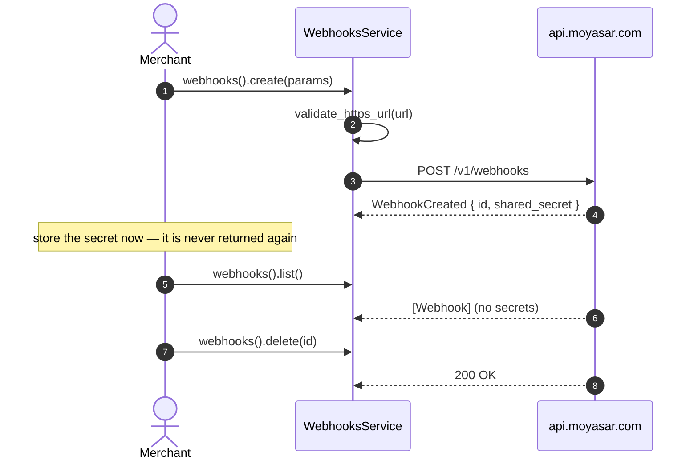

# US-7.2.0: Webhooks API — CRUD for Merchant Webhook Endpoints

> **Spec Kit Specification**: [Specification Lifecycle Active](../../../docs/architecture/DECOMPOSITION_ROADMAP.md)  
> **Behavior Blueprint**: `features/core/modules/webhooks/behaviours/webhook-endpoints-api/`  
> **Slicing Standard**: [10-PR Vertical Slicing Framework](../README.md#2-the-10-pr-vertical-slicing-framework-rust-sdk-adaptation)  
> **Security Gateway**: `security-audit` Level 2 Enforced  
> **Quality Gates**: `(G0–G4 + G-Review + G-Borrow + G-Law)`  

---

## 1. Spec Kit Specification

### 1.1 User Story Narrative
**As a** merchant operating webhook-driven order fulfilment,  
**I want to** register, list, update and delete webhook endpoints through `client.webhooks()` — including the `shared_secret` shown only at creation,  
**So that** each environment (staging/production) has its own endpoint, secrets rotate safely, and I never store a secret the API will not return again.

#### 1.1.1 Preconditions
- `features = ["webhooks"]`; valid `SecretKey`.
- An HTTPS endpoint that can accept POST callbacks.

#### 1.1.2 Postconditions
- `create()` returns a `Webhook` including `shared_secret` (returned **only** on creation, per Moyasar docs).
- `list()` returns all registered endpoints with `id`, `url`, `http_method`, `username`, `created_at`.
- `update(id, params)` modifies url/username/password.
- `delete(id)` returns success; subsequent `retrieve` yields 404.

### 1.2 Acceptance Criteria (Gherkin Scenarios)

```gherkin
Feature: Webhook Endpoint Management

  Scenario: [AC-US-7.2.0-01] Create a webhook endpoint
    Given a CreateWebhookParams with an https url and http_method POST
    When client.webhooks().create(params) is called
    Then the response Webhook contains an id
    And the response contains a shared_secret that is never returned by later calls.

  Scenario: [AC-US-7.2.0-02] List all endpoints
    Given two registered endpoints
    When client.webhooks().list() is called
    Then the response contains both endpoints
    And no shared_secret appears in any list entry.

  Scenario: [AC-US-7.2.0-03] Update an endpoint url
    Given a registered webhook
    When client.webhooks().update(id, params) is called with a new url
    Then the returned Webhook.url reflects the change
    And the shared_secret is unchanged and still not returned.

  Scenario: [AC-US-7.2.0-04] Delete an endpoint
    Given a registered webhook
    When client.webhooks().delete(id) is called
    Then the API returns success
    And a follow-up retrieve of the same id fails with 404.

  Scenario: [AC-US-7.2.0-05] Non-HTTPS endpoints are rejected
    Given a CreateWebhookParams whose url uses http://
    When create is attempted
    Then a typed InvalidWebhookUrl error is returned
    And no request is sent.

  Scenario: [AC-US-7.2.0-LAW] SAMA confidentiality of webhook shared secrets
    Given a webhook shared_secret
    When it is handled by the SDK
    Then it is never logged, never included in Debug output, and never persisted by the SDK,
         satisfying SAMA confidentiality requirements for shared authentication material.
```

### 1.3 Test Cases & Traceability Matrix

| Test Case ID | Target Criterion | Test Type | Execution Level | Verification Assertion & Pass Criteria |
| :--- | :--- | :--- | :--- | :--- |
| `TC-7.2.0-01` | `AC-US-7.2.0-01` | Functional | Integration | id present; `shared_secret` present on create only. |
| `TC-7.2.0-02` | `AC-US-7.2.0-02` | Functional | Unit | List fixture has no `shared_secret`. |
| `TC-7.2.0-03` | `AC-US-7.2.0-03` | Functional | Integration | url updated; secret absent. |
| `TC-7.2.0-04` | `AC-US-7.2.0-04` | Functional | Integration | delete succeeds; retrieve 404s. |
| `TC-7.2.0-05` | `AC-US-7.2.0-05` | Security | Unit | `http://` rejected with zero network calls. |
| `TC-7.2.0-LAW` | `AC-US-7.2.0-LAW` | Security | Unit / SAST | Secret absent from `Debug` and logs. |

---

## 2. Behavior-Centric Architecture & Folder Blueprint

### 2.1 Colocated Behaviour Directory Tree

```
features/core/modules/webhooks/behaviours/webhook-endpoints-api/
├── services/        # WebhooksService create/list/update/delete
├── logic/           # HTTPS enforcement, secret redaction
├── types/           # Webhook, WebhookId, WebhookSecret, Create/UpdateWebhookParams
└── constants/       # WEBHOOKS_PATH
```

### 2.2 Scoping & Promotion Blueprint
- **Tier 1 (Behaviour-Local)**: HTTPS validator.
- **Tier 2 (Module-Shared)**: `WebhookSecret` referenced by the verification engine (US-7.3.0).
- **Tier 3 (Feature-Shared)**: `WebhooksService` under `webhooks`.
- **Tier 4 (Global-Shared)**: `client.webhooks()` facade.

---

## 3. Technical Implementation Plan

### 3.1 Domain Invariants & Storage Schema
- **One-Time Secret Law**: `shared_secret` appears only in the create response.
- **HTTPS Law**: endpoint URLs must use `https://`.
- **Redaction Law**: `WebhookSecret` has a manual `Debug` that emits `[REDACTED]`.
- **Deletion Law**: delete is terminal; retrieve afterwards returns 404.

```rust
pub struct WebhookSecret(String);

impl WebhookSecret {
    pub fn expose(&self) -> &str { &self.0 }
}

impl fmt::Debug for WebhookSecret {
    fn fmt(&self, f: &mut fmt::Formatter<'_>) -> fmt::Result {
        f.write_str("[REDACTED]")
    }
}

/// Creation response: the only shape that carries the secret.
#[derive(Debug, Clone, Deserialize)]
pub struct WebhookCreated {
    pub id: WebhookId,
    pub url: String,
    pub shared_secret: WebhookSecret,
}

/// All later responses omit the secret entirely.
#[derive(Debug, Clone, Deserialize)]
pub struct Webhook {
    pub id: WebhookId,
    pub url: String,
    pub http_method: HttpMethod,
    pub username: Option<String>,
    pub created_at: DateTime<Utc>,
}

pub fn validate_https_url(url: &str) -> Result<(), MoyasarError> {
    if url.starts_with("https://") { Ok(()) } else { Err(MoyasarError::InvalidWebhookUrl) }
}
```

### 3.2 Activity & Interaction Diagram



---

## 4. Granular Implementation Tasks

### 4.1 The 10-PR Vertical Slicing Implementation Plan

| PR # | Pillar | Architectural Layer | Primary Scope & Files | Deliverables & Acceptance | Accountable Role / Agent | Assigned Skills |
| :--- | :--- | :--- | :--- | :--- | :--- | :--- |
| **PR 1** | **Pillar 1** | **Domain Logic & Core Traits** | `src/resources/webhooks/models.rs` | `Webhook`, `WebhookCreated`, `WebhookSecret`. | `engineering-software-architect` | `security-audit` |
| **PR 2** | **Pillar 2** | **Request Modeling** | `src/resources/webhooks/params.rs` | Create/Update params. | `engineering-backend-architect` | `security-audit` |
| **PR 3** | **Pillar 3** | **Transport Wire Adapter** | `src/resources/webhooks/crud.rs` | create/list/update/delete. | `engineering-backend-architect` | `security-audit` |
| **PR 4** | **Pillar 4** | **Service Accessor** | `src/resources/webhooks/service.rs` | `client.webhooks()` accessor. | `engineering-software-architect` | `security-audit` |
| **PR 5** | **Pillar 5** | **Error Taxonomy** | `src/kernel/error.rs` | `InvalidWebhookUrl`, 404 mapping. | `security-application-security-engineer` | `security-audit` |
| **PR 6** | **Pillar 6** | **Resource Facade Mounting** | `src/resources/webhooks/mod.rs` | Feature-gated export under `webhooks`. | `engineering-software-architect` | `security-audit` |
| **PR 7** | **Pillar 7** | **Zero-Copy Hardening** | `src/resources/webhooks/models.rs` | `WebhookSecret` newtype with manual `Debug`. | `agency-rust-refactoring-specialist` | `security-audit` |
| **PR 8** | **Pillar 8** | **Edge Cases & Guards** | `src/resources/webhooks/validate.rs` | HTTPS guard; post-delete 404. | `agency-api-tester` | `security-audit` |
| **PR 9** | **Pillar 9** | **Integration Wire Verification** | `tests/webhooks_test.rs` | Full CRUD lifecycle. | `agency-api-tester` | `security-audit` |
| **PR 10** | **Pillar 10** | **Documentation & Packaging** | `README.md` | Doc-tests incl. one-time secret warning. | `engineering-technical-writer` | `security-audit` |

### 4.2 Implementation Phase Breakdown

#### Phase 1: Models & Params (PR 1–2)
- [ ] **Task 1.1 (Types)**: `Webhook` vs `WebhookCreated` split.  
  *Agent*: `engineering-software-architect` | *Skill*: `security-audit`
- [ ] **Task 1.2 (Secret)**: `WebhookSecret` with redacting `Debug`.  
  *Agent*: `security-application-security-engineer` | *Skill*: `security-audit`

#### Phase 2: Endpoints (PR 3–6)
- [ ] **Task 2.1 (CRUD)**: create/list/update/delete.  
  *Agent*: `engineering-backend-architect` | *Skill*: `security-audit`
- [ ] **Task 2.2 (Errors)**: `InvalidWebhookUrl`, 404.  
  *Agent*: `security-application-security-engineer` | *Skill*: `security-audit`

#### Phase 3: Guards (PR 7–8)
- [ ] **Task 3.1 (HTTPS)**: reject `http://` pre-transport.  
  *Agent*: `agency-api-tester` | *Skill*: `security-audit`
- [ ] **Task 3.2 (One-Time Secret)**: type split prevents accidental secret reliance.  
  *Agent*: `agency-rust-refactoring-specialist` | *Skill*: `security-audit`

#### Phase 4: Verification & Sign-Off (PR 9–10)
- [ ] **Task 4.1 (Wire Tests)**: full lifecycle.  
  *Agent*: `agency-api-tester` | *Skill*: `security-audit`
- [ ] **Task 4.2 (G-Review)**: peer review on secret handling.  
  *Agent*: `agency-code-reviewer` | *Skill*: `security-audit`
- [ ] **Task 4.3 (Documentation)**: one-time secret warning in docs.  
  *Agent*: `engineering-technical-writer` | *Skill*: `security-audit`

---

## 5. Security Gateway (Powered by security-audit)

### 5.1 Trust Boundaries & Security Actors
- **Trust Boundaries**:
  - `Callback Boundary`: merchant endpoints receive signed payloads.
  - `Secret Boundary`: `shared_secret` authenticates callbacks.
- **Authorized Principals**: merchant backend (`sk_`).

### 5.2 Threat Modeling & Abuse Matrix (STRIDE / ASVS)

| Threat Vector | Severity | Vulnerability Mechanism | Mitigating Control & Security Invariant |
| :--- | :--- | :--- | :--- |
| **Secret Leakage** | Critical | Secret logged or re-fetched | One-time-only response type; redacting `Debug`. |
| **Plaintext Callbacks** | Critical | `http://` endpoint receiving financial events | HTTPS-only validation before transport. |
| **Endpoint Hijack** | High | Attacker repointing the webhook url | Update requires `sk_`; server-side ownership. |
| **Secret Rotation Gap** | High | No rotation path | Recreate the endpoint to rotate; documented. |
| **Deleted Endpoint Still Receiving** | Medium | Stale registration after delete | Delete is terminal; server stops delivery. |

### 5.3 Cryptographic & Data Protection Controls
- **One-Time Secret**: typed separation between create and read responses.
- **HTTPS Enforcement**: pre-transport validation.
- **Redacted Debug**: no accidental log exposure.

### 5.4 Automated Security Verification Checklist
- [ ] **Secret Test**: absent from `Debug` and list responses.
- [ ] **HTTPS Test**: `http://` rejected with zero calls.
- [ ] **Delete Test**: retrieve after delete returns 404.
- [ ] **Rotation Test**: recreate yields a new secret.

### 5.5 Security Gateway (G2) Sign-Off Checklist
- [ ] Webhook secret handling verified against OWASP ASVS Level 2.
- [ ] HTTPS-only enforced.
- [ ] Zero secret leakage.
- [ ] Independent reviewer sign-off; zero open findings.

---

## 6. Validation Gates & Acceptance Sign-Off

**Status: Ready for Implementation.**

### G0 — Build, lint & format
- [ ] **US-7.2.0-G0:** `cargo build && cargo clippy -- -D warnings && cargo fmt --check` clean.

### G1 — Test coverage
- [ ] **US-7.2.0-G1:** ≥90% line / ≥85% branch on the webhooks API module.

### G2 — Security audit
- [ ] **US-7.2.0-G2:** Secret-handling audit passes with zero critical/high findings.

### G3 — Architecture and maintainability
- [ ] **US-7.2.0-G3:** API module independent of the verification engine.

### G-Review — Code review
- [ ] **US-7.2.0-G-Review:** Peer review on the create/read type split.

### G-Borrow — Rust zero-clone validation
- [ ] **US-7.2.0-G-Borrow:** `WebhookSecret::expose()` returns `&str` without allocation.

### G-Complexity — Cyclomatic complexity
- [ ] **US-7.2.0-G-Complexity:** $CC \le 6$; nesting $\le 2$.

### G-Docs — Public docs & examples
- [ ] **US-7.2.0-G-Docs:** 100% public symbols documented; one-time secret emphasized.

### G-Law — Law validation
- [ ] **US-7.2.0-G-Law:** SAMA confidentiality of shared authentication material certified.

### G4 — Integrated acceptance
- [ ] **US-7.2.0-G4:** Full CRUD lifecycle verified against the mock server.
