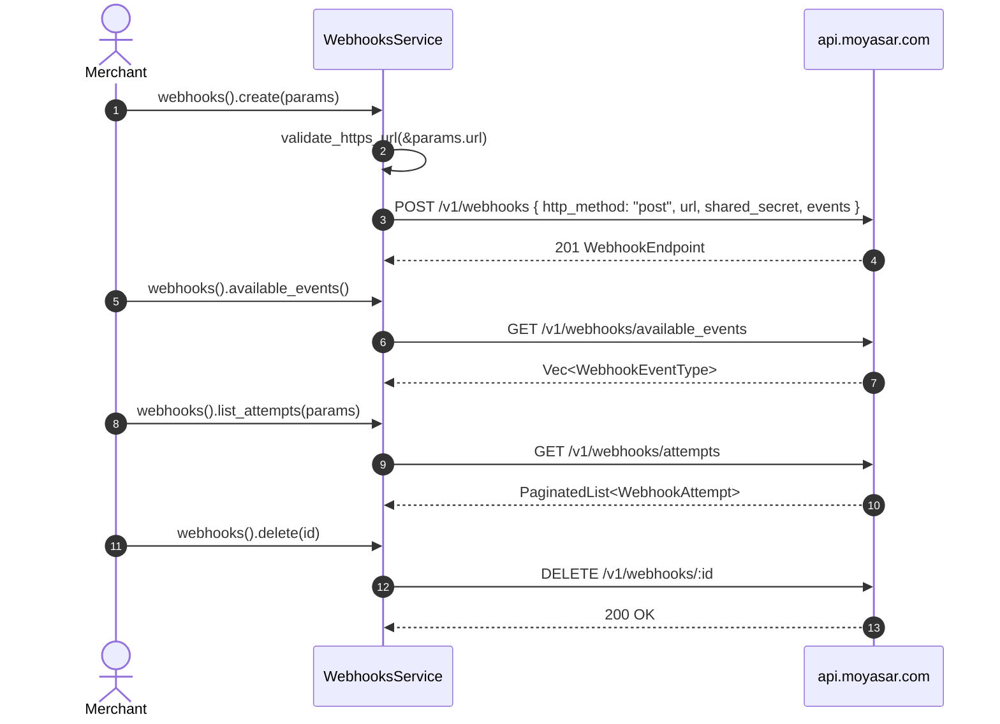

# US-7.2.0: Webhooks Management API — Endpoint CRUD, Available Events & Delivery Attempts

> **Spec Kit Specification**: [Specification Lifecycle Active](../../../docs/architecture/DECOMPOSITION_ROADMAP.md)  
> **Behavior Blueprint**: `src/resources/webhooks_api/`  
> **Slicing Standard**: [10-PR Vertical Slicing Framework](../README.md#2-the-10-pr-vertical-slicing-framework-rust-sdk-adaptation)  
> **Security Gateway**: `security-audit` Level 2 Enforced  
> **Quality Gates**: `(G0–G4 + G-Review + G-Borrow + G-Law)`  

---

## 1. Spec Kit Specification

### 1.1 User Story Narrative
**As a** merchant operating webhook-driven order fulfillment,  
**I want to** register, list, retrieve, and delete webhook endpoints (`POST /v1/webhooks`, `GET /v1/webhooks`, `GET /v1/webhooks/:id`, `DELETE /v1/webhooks/:id`), query canonical `available_events` (`GET /v1/webhooks/available_events`), and inspect delivery attempts (`GET /v1/webhooks/attempts`, `GET /v1/webhooks/attempts/:id`) through `client.webhooks()`,  
**So that** I can programmatically configure HTTPS webhook listeners with a caller-supplied `shared_secret` and optional `events` filter, and diagnose failed callback deliveries.

#### 1.1.1 Preconditions
- `features = ["webhooks-api"]` (implies `core`, `webhook-engine`).
- A valid `SecretKey`.
- An HTTPS callback URL and a high-entropy `shared_secret`.

#### 1.1.2 Postconditions
- `create(params)` sends `POST /v1/webhooks` with `http_method: "post"`, `url` (`https://`), `shared_secret`, and `events: Option<Vec<WebhookEventType>>` (omitting `events` creates a global listener) and returns `WebhookEndpoint`.
- `list()` and `retrieve(id)` return registered `WebhookEndpoint` configurations.
- `delete(id)` deletes the endpoint (`DELETE /v1/webhooks/:id`).
- `available_events()` calls `GET /v1/webhooks/available_events` returning `Vec<WebhookEventType>`.
- `list_attempts(params)` and `retrieve_attempt(id)` return `PaginatedList<WebhookAttempt>` and `WebhookAttempt`.

### 1.2 Acceptance Criteria (Gherkin Scenarios)

```gherkin
Feature: Webhooks Management API

  Scenario: [AC-US-7.2.0-01] Register a webhook endpoint with events filter and shared_secret
    Given a CreateWebhookParams with an https url, shared_secret and events [PaymentPaid, PaymentFailed]
    When client.webhooks().create(params) is called
    Then the API receives POST /v1/webhooks with http_method "post", url, shared_secret and events
    And returns a WebhookEndpoint with a UUID id.

  Scenario: [AC-US-7.2.0-02] Register a global listener by omitting events
    Given a CreateWebhookParams with events None
    When client.webhooks().create(params) is called
    Then no "events" field is emitted in the JSON body
    And the endpoint subscribes to all current and future webhook events.

  Scenario: [AC-US-7.2.0-03] List, retrieve, and delete webhook endpoints
    Given a registered webhook id
    When client.webhooks().list(), .retrieve(id), and .delete(id) are called
    Then list and retrieve return the matching WebhookEndpoint
    And delete removes the endpoint so a subsequent retrieve returns 404 RecordNotFound.

  Scenario: [AC-US-7.2.0-04] Query available webhook events and delivery attempts
    Given webhook activity on the merchant account
    When client.webhooks().available_events(), .list_attempts(params), and .retrieve_attempt(id) are called
    Then available_events deserializes the 11 canonical event types (including payment_failed / payment_faild)
    And list_attempts and retrieve_attempt return WebhookAttempt diagnostic records.

  Scenario: [AC-US-7.2.0-05] Non-HTTPS webhook URLs are rejected client-side
    Given a CreateWebhookParams whose url uses http://
    When client.webhooks().create(params) is called
    Then Err(MoyasarError::InvalidWebhookUrl) is returned with zero network calls.

  Scenario: [AC-US-7.2.0-LAW] SAMA confidentiality of webhook shared secrets
    Given a WebhookSecret inside CreateWebhookParams or WebhookEndpoint
    When formatted via Debug
    Then the secret is printed as "[REDACTED]" and never exposed in logs,
         satisfying SAMA confidentiality requirements for authentication material.
```

### 1.3 Test Cases & Traceability Matrix

| Test Case ID | Target Criterion | Test Type | Execution Level | Verification Assertion & Pass Criteria |
| :--- | :--- | :--- | :--- | :--- |
| `TC-7.2.0-01` | `AC-US-7.2.0-01` | Functional | Integration | `POST /v1/webhooks` body includes `shared_secret` and `events`. |
| `TC-7.2.0-02` | `AC-US-7.2.0-02` | Functional | Unit | Omitting `events` omits `"events"` key from serialized JSON. |
| `TC-7.2.0-03` | `AC-US-7.2.0-03` | Functional | Integration | `list`, `retrieve`, and `delete` round-trip cleanly. |
| `TC-7.2.0-04` | `AC-US-7.2.0-04` | Functional | Integration | `available_events`, `list_attempts`, and `retrieve_attempt` deserialize. |
| `TC-7.2.0-05` | `AC-US-7.2.0-05` | Security | Unit | `http://` URL rejected with `InvalidWebhookUrl` and zero network calls. |
| `TC-7.2.0-LAW` | `AC-US-7.2.0-LAW` | Security | Unit / SAST | `WebhookSecret` redacts value in `Debug`. |

---

## 2. Behavior-Centric Architecture & Folder Blueprint

### 2.1 Rust Crate Module & Unit File Ownership Tree

```
src/
├── src/resources/webhooks_api/models.rs       # Unit 1 (feat/us-7.2.0/unit-1-webhook-model)
├── src/resources/webhooks_api/crud.rs         # Unit 2 (feat/us-7.2.0/unit-2-webhook-create-list)
├── src/resources/webhooks_api/events.rs       # Unit 3 (feat/us-7.2.0/unit-3-available-events)
├── src/resources/webhooks_api/attempts.rs     # Unit 4 (feat/us-7.2.0/unit-4-delivery-attempts)
├── src/resources/webhooks_api/retrieve_delete.rs # Unit 5 (feat/us-7.2.0/unit-5-webhook-retrieve-delete)
```

### 2.2 Scoping & Promotion Blueprint
- **Tier 1 (Behaviour-Local)**: `validate_https_url` pre-transport check.
- **Tier 2 (Module-Shared)**: Re-exports `WebhookEventType` from `webhook_engine` (US-7.3.0).
- **Tier 3 (Feature-Shared)**: `WebhooksService` under `webhooks-api`.
- **Tier 4 (Global-Shared)**: `client.webhooks()` facade accessor.

---

## 3. Technical Implementation Plan

### 3.1 Domain Invariants & Storage Schema
- **HTTPS Law**: webhook callback URLs must start with `https://`.
- **Global Listener Law**: `events: None` must be omitted via `#[serde(skip_serializing_if = "Option::is_none")]`.
- **Redaction Law**: `WebhookSecret` implements a manual `fmt::Debug` that emits `"[REDACTED]"`.

```rust
#[derive(Clone, PartialEq, Eq, Serialize, Deserialize)]
#[serde(transparent)]
pub struct WebhookSecret(String);

impl WebhookSecret {
    pub fn new(raw: impl Into<String>) -> Self { Self(raw.into()) }
    pub fn expose(&self) -> &str { &self.0 }
}

impl std::fmt::Debug for WebhookSecret {
    fn fmt(&self, f: &mut std::fmt::Formatter<'_>) -> std::fmt::Result {
        f.write_str("[REDACTED]")
    }
}

#[derive(Debug, Clone, Serialize)]
pub struct CreateWebhookParams {
    pub http_method: String,
    pub url: String,
    pub shared_secret: WebhookSecret,
    #[serde(skip_serializing_if = "Option::is_none")]
    pub events: Option<Vec<WebhookEventType>>,
}

#[derive(Debug, Clone, Deserialize)]
pub struct WebhookEndpoint {
    pub id: Uuid,
    pub http_method: String,
    pub url: String,
    pub shared_secret: Option<WebhookSecret>,
    pub events: Option<Vec<WebhookEventType>>,
    pub created_at: DateTime<Utc>,
}

#[derive(Debug, Clone, Deserialize)]
pub struct WebhookAttempt {
    pub id: Uuid,
    pub webhook_id: Option<Uuid>,
    pub event_id: Uuid,
    pub event_type: Option<WebhookEventType>,
    pub response_code: Option<u16>,
    pub response_headers: Option<serde_json::Value>,
    pub response_body: Option<String>,
    pub succeeded: Option<bool>,
    pub message: Option<String>,
    pub created_at: DateTime<Utc>,
}

pub fn validate_https_url(url: &str) -> Result<(), MoyasarError> {
    if url.starts_with("https://") { Ok(()) } else { Err(MoyasarError::InvalidWebhookUrl) }
}
```

### 3.2 Activity & Interaction Diagram



---

## 4. Granular Implementation Tasks

### 4.1 Dynamic 5-Unit Parallel Implementation Plan

| Unit # | Branch | Exclusive Owner Files | Deliverables & Colocated Unit Tests | Accountable Role / Agent | Assigned Skills |
| :--- | :--- | :--- | :--- | :--- | :--- |
| **Unit 1** | `feat/us-7.2.0/unit-1-webhook-model` | `src/resources/webhooks_api/models.rs` | `WebhookEndpoint` struct (id, http_method, url, shared_secret, events), `WebhookAttempt` struct (id, event_id, status_code, response_body, created_at) | `engineering-software-architect` | `security-audit` |
| **Unit 2** | `feat/us-7.2.0/unit-2-webhook-create-list` | `src/resources/webhooks_api/crud.rs` | `CreateWebhookParams` (with `validate_https_url`), `client.webhooks().create()` (`POST /v1/webhooks` with `http_method`, `url`, `shared_secret`, `events`), `.list()`, unit tests | `engineering-backend-architect` | `security-audit` |
| **Unit 3** | `feat/us-7.2.0/unit-3-available-events` | `src/resources/webhooks_api/events.rs` | `client.webhooks().available_events()` (`GET /v1/webhooks/available_events`), re-exporting `WebhookEventType` (all 11 variants) from `webhook_engine` | `engineering-backend-architect` | `security-audit` |
| **Unit 4** | `feat/us-7.2.0/unit-4-delivery-attempts` | `src/resources/webhooks_api/attempts.rs` | `ListWebhookAttemptsParams`, `client.webhooks().list_attempts(params)`, `client.webhooks().retrieve_attempt(id)`, delivery attempt diagnostics | `security-appsec-engineer` | `security-audit` |
| **Unit 5** | `feat/us-7.2.0/unit-5-webhook-retrieve-delete` | `src/resources/webhooks_api/retrieve_delete.rs` | `client.webhooks().retrieve(id)` (`GET /v1/webhooks/:id`) and `client.webhooks().delete(id)` (`DELETE /v1/webhooks/:id`), unit tests | `engineering-rust-refactoring-specialist` | `security-audit` |

### 4.2 Parallel Unit Execution & Story Merge Breakdown

#### Wave 1: Base Branch Scaffolding (`feat/us-7.2.0-*`)
- [x] **Task 0.1 (Story Base Contracts)**: Verify `Cargo.toml`, `src/lib.rs`, and the domain's `mod.rs` + `service.rs` facade declarations are present on the story base branch before spawning parallel unit worktrees.  
  *Agent*: `story-leader` | *Skill*: `divide-and-conquer-orchestrator`

#### Wave 2: 100% Parallel Unit Implementation (`Unit 1..5`)
- [x] **Unit 1 (`feat/us-7.2.0/unit-1-webhook-model`)**: `WebhookEndpoint` struct (id, http_method, url, shared_secret, events), `WebhookAttempt` struct (id, event_id, status_code, response_body, created_at) (Files: `src/resources/webhooks_api/models.rs`)  
  *Agent*: `engineering-software-architect` | *Skill*: `security-audit`
- [x] **Unit 2 (`feat/us-7.2.0/unit-2-webhook-create-list`)**: `CreateWebhookParams` (with `validate_https_url`), `client.webhooks().create()` (`POST /v1/webhooks` with `http_method`, `url`, `shared_secret`, `events`), `.list()`, unit tests (Files: `src/resources/webhooks_api/crud.rs`)  
  *Agent*: `engineering-backend-architect` | *Skill*: `security-audit`
- [x] **Unit 3 (`feat/us-7.2.0/unit-3-available-events`)**: `client.webhooks().available_events()` (`GET /v1/webhooks/available_events`), re-exporting `WebhookEventType` (all 11 variants) from `webhook_engine` (Files: `src/resources/webhooks_api/events.rs`)  
  *Agent*: `engineering-backend-architect` | *Skill*: `security-audit`
- [x] **Unit 4 (`feat/us-7.2.0/unit-4-delivery-attempts`)**: `ListWebhookAttemptsParams`, `client.webhooks().list_attempts(params)`, `client.webhooks().retrieve_attempt(id)`, delivery attempt diagnostics (Files: `src/resources/webhooks_api/attempts.rs`)  
  *Agent*: `security-appsec-engineer` | *Skill*: `security-audit`
- [x] **Unit 5 (`feat/us-7.2.0/unit-5-webhook-retrieve-delete`)**: `client.webhooks().retrieve(id)` (`GET /v1/webhooks/:id`) and `client.webhooks().delete(id)` (`DELETE /v1/webhooks/:id`), unit tests (Files: `src/resources/webhooks_api/retrieve_delete.rs`)  
  *Agent*: `engineering-rust-refactoring-specialist` | *Skill*: `security-audit`

#### Wave 3: Cascading Merge & Story Integration Verification
- [x] **Task 3.1 (Cascading Merge & Wire Verification)**: Merge `Unit 1 -> ... -> Unit 5` into the story branch and run story-level wire integration tests and `G0–G4` quality gates.  
  *Agent*: `testing-api-tester` | *Skill*: `security-audit`
- [x] **Task 3.2 (Council Review & Sign-Off)**: Execute independent Multi-Council Review (`G-Review`, `G-Borrow`, `G-Complexity`, `G-Docs`, `G-Law`).  
  *Agent*: `engineering-code-reviewer` | *Skill*: `code-review-council`

---

## 5. Security Gateway (Powered by security-audit)

### 5.1 Trust Boundaries & Security Actors
- **Trust Boundaries**:
  - `Callback Boundary`: merchant endpoints receive asynchronous payment notifications.
  - `Secret Boundary`: `shared_secret` authenticates webhook payloads.
- **Authorized Principals**: merchant backend (`sk_` only).

### 5.2 Threat Modeling & Abuse Matrix (STRIDE / ASVS)

| Threat Vector | Severity | Vulnerability Mechanism | Mitigating Control & Security Invariant |
| :--- | :--- | :--- | :--- |
| **Secret Leakage** | Critical | `shared_secret` printed in `Debug` logs | `WebhookSecret` implements custom `Debug` printing `"[REDACTED]"`. |
| **Plaintext Callbacks** | Critical | `http://` endpoint receiving financial events | `validate_https_url` rejects non-HTTPS URLs before transport. |
| **Endpoint Hijack** | High | Unauthorized webhook registration | All `/v1/webhooks` routes require `SecretKey` (`sk_`). |

### 5.3 Cryptographic & Data Protection Controls
- **HTTPS Enforcement**: pre-transport validation on callback URLs.
- **Redacted Debug**: `WebhookSecret` never prints secret material.

### 5.4 Automated Security Verification Checklist
- [x] **Secret Test**: `format!("{:?}", secret)` prints `"[REDACTED]"`.
- [x] **HTTPS Test**: `http://` rejected with zero network calls.
- [x] **Delete Test**: `retrieve(id)` after `delete(id)` returns 404.

### 5.5 Security Gateway (G2) Sign-Off Checklist
- [x] Webhook management verified against OWASP ASVS Level 2.
- [x] HTTPS-only enforced.
- [x] Zero secret leakage in `Debug` output.
- [x] Independent reviewer sign-off; zero open findings.

---

## 6. Validation Gates & Acceptance Sign-Off

**Status: Implemented & Verified (Merged to `main`).**

### G0 — Build, lint & format
- [x] **US-7.2.0-G0:** `cargo build && cargo clippy -- -D warnings && cargo fmt --check` clean.

### G1 — Test coverage
- [x] **US-7.2.0-G1:** ≥90% line / ≥85% branch on `webhooks_api`.

### G2 — Security audit
- [x] **US-7.2.0-G2:** Secret-handling audit passes with zero critical/high findings.

### G3 — Architecture and maintainability
- [x] **US-7.2.0-G3:** `webhooks-api` re-uses `WebhookEventType` from `webhook-engine` without duplicate definitions.

### G-Review — Code review
- [x] **US-7.2.0-G-Review:** Peer review on all 7 endpoints and `WebhookSecret` redaction.

### G-Borrow — Rust zero-clone validation
- [x] **US-7.2.0-G-Borrow:** `WebhookSecret::expose()` returns `&str` with zero allocation.

### G-Complexity — Cyclomatic complexity
- [x] **US-7.2.0-G-Complexity:** $CC \le 6$; nesting $\le 2$.

### G-Docs — Public docs & examples
- [x] **US-7.2.0-G-Docs:** 100% public symbols documented; CRUD and attempts examples runnable.

### G-Law — Law validation
- [x] **US-7.2.0-G-Law:** SAMA confidentiality of shared authentication material certified.

### G4 — Integrated acceptance
- [x] **US-7.2.0-G4:** All 7 `/v1/webhooks` endpoints verified against the mock server.
