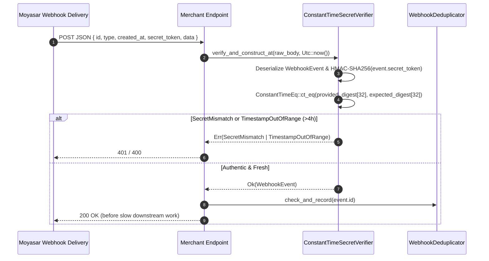

# US-7.3.0: Constant-Time Webhook Verification Engine — Double-HMAC, Replay Window & Deduplication

> **Spec Kit Specification**: [Specification Lifecycle Active](../../../docs/architecture/DECOMPOSITION_ROADMAP.md)  
> **Behavior Blueprint**: `src/webhook_engine/`  
> **Slicing Standard**: [10-PR Vertical Slicing Framework](../README.md#2-the-10-pr-vertical-slicing-framework-rust-sdk-adaptation)  
> **Security Gateway**: `security-audit` Level 2 Enforced  
> **Quality Gates**: `(G0–G4 + G-Review + G-Borrow + G-Law)`  

---

## 1. Spec Kit Specification

### 1.1 User Story Narrative
**As a** merchant running a webhook receiver in Rust,  
**I want to** verify inbound Moyasar webhook JSON payloads using `ConstantTimeSecretVerifier` (domain-separated double-HMAC-SHA256 + `subtle::ConstantTimeEq` over `event.secret_token` and `shared_secret` with zero length leakage), enforce a 4-hour timestamp tolerance accommodating Moyasar's 6-attempt retry ladder (`+1m`, `+10m`, `+30m`, `+1h`, `+2h` = `3h41m`), and deduplicate deliveries via `WebhookDeduplicator`,  
**So that** timing attacks can neither reconstruct `secret_token` byte-by-byte nor infer the secret's byte length, late retries within 3h41m are accepted idempotently, and the `payment_faild` spelling quirk is normalized automatically.

#### 1.1.1 Preconditions
- `features = ["webhook-engine"]` (enabled in `default`; zero HTTP client dependency).
- The merchant's `shared_secret` configured on the webhook endpoint.
- Raw JSON request body bytes (`&[u8]`) containing `id`, `type`, `created_at`, `secret_token`, `account_name`, `live`, and `data`.

#### 1.1.2 Postconditions
- `ConstantTimeSecretVerifier::new(shared_secret, tolerance)` pre-computes the 32-byte HMAC-SHA256 digest of `shared_secret` using domain-separation key `b"some-moyasar-webhook-domain-v1"`.
- `verify_and_construct(raw_body)` (and `verify_and_construct_at(raw_body, now)`) deserializes `WebhookEvent`, computes the 32-byte HMAC-SHA256 digest of `event.secret_token`, compares both 32-byte arrays via `subtle::ConstantTimeEq`, and validates `created_at` against `tolerance` (default 4 hours).
- `WebhookEventType` deserializes all 11 canonical Moyasar event variants (normalizing `"payment_faild"` to `PaymentFailed`) plus `Unknown(String)` for forward compatibility.
- `WebhookEvent` redacts `secret_token` in its `fmt::Debug` implementation.
- `WebhookDeduplicator` provides an async idempotency trait keyed by `event.id` (`Uuid`).

### 1.2 Acceptance Criteria (Gherkin Scenarios)

```gherkin
Feature: Constant-Time Double-HMAC Webhook Verification Engine

  Scenario: [AC-US-7.3.0-01] Valid secret_token inside JSON payload is accepted
    Given a ConstantTimeSecretVerifier initialized with shared_secret "whsec_live_123" and 4h tolerance
    When verify_and_construct_at is called on a JSON body with matching secret_token and fresh created_at
    Then it returns Ok(WebhookEvent)
    And event.event_type matches one of the 11 canonical WebhookEventType variants.

  Scenario: [AC-US-7.3.0-02] Wrong secret_token of any length is rejected in constant time with zero length leakage
    Given a ConstantTimeSecretVerifier initialized with a 32-byte shared_secret
    When verify_and_construct_at is called with a 1-byte or 64-byte wrong secret_token
    Then both values are hashed through HMAC-SHA256 ("some-moyasar-webhook-domain-v1") to 32-byte digests
    And compared via subtle::ConstantTimeEq, returning Err(WebhookError::SecretMismatch).

  Scenario: [AC-US-7.3.0-03] Replay outside the 4-hour tolerance or excessive future skew is rejected
    Given a validly authenticated WebhookEvent whose created_at is older than 4 hours
    When verify_and_construct_at is called with the current time
    Then it returns Err(WebhookError::TimestampOutOfRange).

  Scenario: [AC-US-7.3.0-04] All 6 attempts across Moyasar's 3h41m retry ladder are accepted
    Given Moyasar retries at +0m, +1m, +11m, +41m, +1h41m and +3h41m from created_at
    When each retry is verified with the default 4-hour tolerance
    Then all six attempts pass timestamp verification
    And WebhookDeduplicator records event.id to prevent duplicate downstream side effects.

  Scenario: [AC-US-7.3.0-05] The documented "payment_faild" alias normalizes to PaymentFailed
    Given a webhook JSON payload with "type": "payment_faild"
    When deserialized into WebhookEvent
    Then event.event_type equals WebhookEventType::PaymentFailed.

  Scenario: [AC-US-7.3.0-06] Unknown future event types deserialize without failing
    Given a webhook JSON payload with "type": "settlement_completed_v2"
    When deserialized into WebhookEvent
    Then event.event_type equals WebhookEventType::Unknown("settlement_completed_v2".to_string()).

  Scenario: [AC-US-7.3.0-LAW] SAMA secret redaction and non-repudiable notification integrity
    Given any WebhookEvent
    When formatted with Debug ("{:?}")
    Then secret_token is printed as "[REDACTED]" and never leaked to logs,
         satisfying SAMA cryptographic key protection and audit requirements.
```

### 1.3 Test Cases & Traceability Matrix

| Test Case ID | Target Criterion | Test Type | Execution Level | Verification Assertion & Pass Criteria |
| :--- | :--- | :--- | :--- | :--- |
| `TC-7.3.0-01` | `AC-US-7.3.0-01` | Functional | Unit | Valid `secret_token` → `Ok(WebhookEvent)`. |
| `TC-7.3.0-02` | `AC-US-7.3.0-02` | Security | Unit / SAST | Double-HMAC 32-byte `ct_eq` used; different-length secrets return `Err(SecretMismatch)`. |
| `TC-7.3.0-03` | `AC-US-7.3.0-03` | Security | Unit | `4h + 1s` old and `>5m` future timestamps return `Err(TimestampOutOfRange)`. |
| `TC-7.3.0-04` | `AC-US-7.3.0-04` | Functional | Unit | All 6 retry offsets (`0m..221m`) accepted; deduplicator flags duplicates. |
| `TC-7.3.0-05` | `AC-US-7.3.0-05` | Functional | Unit | `"payment_faild"` and `"payment_failed"` both map to `PaymentFailed`. |
| `TC-7.3.0-06` | `AC-US-7.3.0-06` | Functional | Unit | Unrecognized event string preserved in `Unknown(String)`. |
| `TC-7.3.0-LAW` | `AC-US-7.3.0-LAW` | Security | Unit | `format!("{:?}", event)` does not contain raw `secret_token`. |

---

## 2. Behavior-Centric Architecture & Folder Blueprint

### 2.1 Rust Crate Module & Unit File Ownership Tree

```
src/
├── src/webhook_engine/event_types.rs          # Unit 1 (feat/us-7.3.0/unit-1-webhook-event-types)
├── src/webhook_engine/verifier.rs             # Unit 2 (feat/us-7.3.0/unit-2-constant-time-verifier)
├── src/webhook_engine/timestamp.rs            # Unit 3 (feat/us-7.3.0/unit-3-timestamp-validation)
├── src/webhook_engine/deduplication.rs        # Unit 4 (feat/us-7.3.0/unit-4-deduplication)
├── src/webhook_engine/payload.rs              # Unit 5 (feat/us-7.3.0/unit-5-webhook-payload-extractors)
```

### 2.2 Scoping & Promotion Blueprint
- **Tier 1 (Behaviour-Local)**: domain-separated HMAC-SHA256 digest computation and timestamp tolerance check.
- **Tier 2 (Module-Shared)**: `WebhookEventType` re-exported by `webhooks-api` (US-7.2.0).
- **Tier 3 (Feature-Shared)**: `ConstantTimeSecretVerifier`, `WebhookEvent`, and `WebhookDeduplicator` under `webhook-engine`.
- **Tier 4 (Global-Shared)**: Re-exported in `prelude::*` when `webhook-engine` is active.

---

## 3. Technical Implementation Plan

### 3.1 Domain Invariants & Storage Schema
- **Double-HMAC Zero-Length-Leakage Law**: Never compare raw `secret_token` slices directly (`ct_eq` on slices of different lengths returns `false` immediately, leaking the secret's byte length). Always hash both inputs with `Hmac::<Sha256>::new_from_slice(b"some-moyasar-webhook-domain-v1")` and compare fixed `[u8; 32]` digests via `subtle::ConstantTimeEq`.
- **Tolerance Law**: Default `REPLAY_TOLERANCE = Duration::from_secs(4 * 3600)` (covers the 3h41m 6-attempt retry schedule), with `MAX_FUTURE_SKEW = Duration::from_secs(300)`.
- **Alias Law**: `#[serde(rename = "payment_failed", alias = "payment_faild")]` normalizes Moyasar's spelling discrepancy.
- **Redaction Law**: `WebhookEvent` implements `fmt::Debug` manually and redacts `secret_token`.

```rust
pub const DOMAIN_SEPARATION_KEY: &[u8] = b"some-moyasar-webhook-domain-v1";
pub const REPLAY_TOLERANCE: Duration = Duration::from_secs(4 * 60 * 60);
pub const MAX_FUTURE_SKEW: Duration = Duration::from_secs(5 * 60);

#[derive(Debug, thiserror::Error)]
pub enum WebhookError {
    #[error("invalid webhook JSON: {0}")]
    InvalidJson(#[from] serde_json::Error),
    #[error("webhook secret_token mismatch")]
    SecretMismatch,
    #[error("webhook timestamp out of tolerance range")]
    TimestampOutOfRange,
    #[error("duplicate webhook event id: {0}")]
    DuplicateEvent(Uuid),
}

#[derive(Debug, Clone, PartialEq, Eq, Serialize, Deserialize)]
pub enum WebhookEventType {
    #[serde(rename = "payment_paid")]
    PaymentPaid,
    #[serde(rename = "payment_failed", alias = "payment_faild")]
    PaymentFailed,
    #[serde(rename = "payment_refunded")]
    PaymentRefunded,
    #[serde(rename = "payment_voided")]
    PaymentVoided,
    #[serde(rename = "payment_authorized")]
    PaymentAuthorized,
    #[serde(rename = "payment_captured")]
    PaymentCaptured,
    #[serde(rename = "payment_verified")]
    PaymentVerified,
    #[serde(rename = "payment_abandoned")]
    PaymentAbandoned,
    #[serde(rename = "payment_expired")]
    PaymentExpired,
    #[serde(rename = "card_auth_authenticated")]
    CardAuthAuthenticated,
    #[serde(rename = "card_auth_failed")]
    CardAuthFailed,
    #[serde(untagged)]
    Unknown(String),
}

#[derive(Clone, Serialize, Deserialize)]
pub struct WebhookEvent {
    pub id: Uuid,
    #[serde(rename = "type")]
    pub event_type: WebhookEventType,
    pub created_at: DateTime<Utc>,
    pub secret_token: String,
    pub account_name: Option<String>,
    pub live: bool,
    pub data: serde_json::Value,
}

impl std::fmt::Debug for WebhookEvent {
    fn fmt(&self, f: &mut std::fmt::Formatter<'_>) -> std::fmt::Result {
        f.debug_struct("WebhookEvent")
            .field("id", &self.id)
            .field("event_type", &self.event_type)
            .field("created_at", &self.created_at)
            .field("secret_token", &"[REDACTED]")
            .field("account_name", &self.account_name)
            .field("live", &self.live)
            .finish()
    }
}

pub struct ConstantTimeSecretVerifier {
    expected_secret_digest: [u8; 32],
    tolerance: Duration,
}

impl ConstantTimeSecretVerifier {
    pub fn new(shared_secret: &str, tolerance: Duration) -> Self {
        Self {
            expected_secret_digest: Self::compute_digest(shared_secret.as_bytes()),
            tolerance,
        }
    }

    #[inline]
    fn compute_digest(input: &[u8]) -> [u8; 32] {
        let mut mac = Hmac::<Sha256>::new_from_slice(DOMAIN_SEPARATION_KEY)
            .expect("HMAC accepts keys of any size");
        mac.update(input);
        mac.finalize().into_bytes().into()
    }

    pub fn verify_and_construct_at(
        &self,
        raw_body: &[u8],
        now: DateTime<Utc>,
    ) -> Result<WebhookEvent, WebhookError> {
        let event: WebhookEvent = serde_json::from_slice(raw_body)?;
        let provided_digest = Self::compute_digest(event.secret_token.as_bytes());
        if provided_digest.ct_eq(&self.expected_secret_digest).unwrap_u8() != 1 {
            return Err(WebhookError::SecretMismatch);
        }
        event.validate_timestamp_at(now, self.tolerance)?;
        Ok(event)
    }
}
```

### 3.2 Activity & Interaction Diagram



---

## 4. Granular Implementation Tasks

### 4.1 Dynamic 5-Unit Parallel Implementation Plan

| Unit # | Branch | Exclusive Owner Files | Deliverables & Colocated Unit Tests | Accountable Role / Agent | Assigned Skills |
| :--- | :--- | :--- | :--- | :--- | :--- |
| **Unit 1** | `feat/us-7.3.0/unit-1-webhook-event-types` | `src/webhook_engine/event_types.rs` | `WebhookEventType` enum with `#[serde(rename = "payment_failed", alias = "payment_faild")]`, all 11 event variants, `WebhookEvent` struct (id, event_type, created_at, secret_token [Debug-redacted], account_name, live, data as Value) | `engineering-software-architect` | `security-audit` |
| **Unit 2** | `feat/us-7.3.0/unit-2-constant-time-verifier` | `src/webhook_engine/verifier.rs` | `ConstantTimeSecretVerifier::new(shared_secret, tolerance)` — HMAC-SHA256 with domain-separation key "some-moyasar-webhook-domain-v1", 32-byte digest comparison via `subtle::ConstantTimeEq` | `engineering-backend-architect` | `security-audit` |
| **Unit 3** | `feat/us-7.3.0/unit-3-timestamp-validation` | `src/webhook_engine/timestamp.rs` | `REPLAY_TOLERANCE` (4h default for 3h41m retry ladder), `validate_timestamp_at(now, tolerance)` guarding against stale and future-skewed events | `engineering-backend-architect` | `security-audit` |
| **Unit 4** | `feat/us-7.3.0/unit-4-deduplication` | `src/webhook_engine/deduplication.rs` | `WebhookDeduplicator` trait (async, keyed by `event.id` UUID), `NoopDeduplicator` and `InMemoryDeduplicator`, integration point for Redis/PostgreSQL | `security-appsec-engineer` | `security-audit` |
| **Unit 5** | `feat/us-7.3.0/unit-5-webhook-payload-extractors` | `src/webhook_engine/payload.rs` | Typed `WebhookEvent` payload extractors (`into_payment()`, `into_card_auth()`) and cryptographic/replay-ladder unit tests | `engineering-rust-refactoring-specialist` | `security-audit` |

### 4.2 Parallel Unit Execution & Story Merge Breakdown

#### Wave 1: Base Branch Scaffolding (`feat/us-7.3.0-*`)
- [ ] **Task 0.1 (Story Base Contracts)**: Verify `Cargo.toml`, `src/lib.rs`, and the domain's `mod.rs` + `service.rs` facade declarations are present on the story base branch before spawning parallel unit worktrees.  
  *Agent*: `story-leader` | *Skill*: `divide-and-conquer-orchestrator`

#### Wave 2: 100% Parallel Unit Implementation (`Unit 1..5`)
- [ ] **Unit 1 (`feat/us-7.3.0/unit-1-webhook-event-types`)**: `WebhookEventType` enum with `#[serde(rename = "payment_failed", alias = "payment_faild")]`, all 11 event variants, `WebhookEvent` struct (id, event_type, created_at, secret_token [Debug-redacted], account_name, live, data as Value) (Files: `src/webhook_engine/event_types.rs`)  
  *Agent*: `engineering-software-architect` | *Skill*: `security-audit`
- [ ] **Unit 2 (`feat/us-7.3.0/unit-2-constant-time-verifier`)**: `ConstantTimeSecretVerifier::new(shared_secret, tolerance)` — HMAC-SHA256 with domain-separation key "some-moyasar-webhook-domain-v1", 32-byte digest comparison via `subtle::ConstantTimeEq` (Files: `src/webhook_engine/verifier.rs`)  
  *Agent*: `engineering-backend-architect` | *Skill*: `security-audit`
- [ ] **Unit 3 (`feat/us-7.3.0/unit-3-timestamp-validation`)**: `REPLAY_TOLERANCE` (4h default for 3h41m retry ladder), `validate_timestamp_at(now, tolerance)` guarding against stale and future-skewed events (Files: `src/webhook_engine/timestamp.rs`)  
  *Agent*: `engineering-backend-architect` | *Skill*: `security-audit`
- [ ] **Unit 4 (`feat/us-7.3.0/unit-4-deduplication`)**: `WebhookDeduplicator` trait (async, keyed by `event.id` UUID), `NoopDeduplicator` and `InMemoryDeduplicator`, integration point for Redis/PostgreSQL (Files: `src/webhook_engine/deduplication.rs`)  
  *Agent*: `security-appsec-engineer` | *Skill*: `security-audit`
- [ ] **Unit 5 (`feat/us-7.3.0/unit-5-webhook-payload-extractors`)**: Typed `WebhookEvent` payload extractors (`into_payment()`, `into_card_auth()`) and cryptographic/replay-ladder unit tests (Files: `src/webhook_engine/payload.rs`)  
  *Agent*: `engineering-rust-refactoring-specialist` | *Skill*: `security-audit`

#### Wave 3: Cascading Merge & Story Integration Verification
- [ ] **Task 3.1 (Cascading Merge & Wire Verification)**: Merge `Unit 1 -> ... -> Unit 5` into the story branch and run story-level wire integration tests and `G0–G4` quality gates.  
  *Agent*: `testing-api-tester` | *Skill*: `security-audit`
- [ ] **Task 3.2 (Council Review & Sign-Off)**: Execute independent Multi-Council Review (`G-Review`, `G-Borrow`, `G-Complexity`, `G-Docs`, `G-Law`).  
  *Agent*: `engineering-code-reviewer` | *Skill*: `code-review-council`

---

## 5. Security Gateway (Powered by security-audit)

### 5.1 Trust Boundaries & Security Actors
- **Trust Boundaries**:
  - `Inbound Callback Boundary`: unauthenticated public HTTP endpoint receiving Moyasar POST callbacks.
  - `Cryptographic Boundary`: constant-time comparison without leaking secret length or byte positions.
- **Authorized Principals**: Moyasar webhook delivery workers holding the merchant's `shared_secret`.

### 5.2 Threat Modeling & Abuse Matrix (STRIDE / ASVS)

| Threat Vector | Severity | Vulnerability Mechanism | Mitigating Control & Security Invariant |
| :--- | :--- | :--- | :--- |
| **Timing Side-Channel & Length Leakage** | Critical | `==` or raw slice `ct_eq` leaks secret prefix or byte length | Double-HMAC-SHA256 maps both strings to 32-byte arrays before `ConstantTimeEq::ct_eq`. |
| **Replay Attack** | High | Re-sending a captured valid webhook hours/days later | 4-hour freshness window + `WebhookDeduplicator` keyed by `event.id`. |
| **Secret Token in Logs** | Critical | `WebhookEvent` logged via `{:?}` exposing `secret_token` | Custom `fmt::Debug` on `WebhookEvent` prints `"[REDACTED]"`. |
| **Deserialization Failure on `payment_faild`** | High | Moyasar's documented typo drops failed payment alerts | `#[serde(rename = "payment_failed", alias = "payment_faild")]` on `PaymentFailed`. |

### 5.3 Cryptographic & Data Protection Controls
- **Double-HMAC-SHA256**: domain-separated (`"some-moyasar-webhook-domain-v1"`) 32-byte digest comparison.
- **Constant-Time Equality**: `subtle::ConstantTimeEq` over `[u8; 32]`.
- **Freshness & Deduplication**: 4h tolerance window + `WebhookDeduplicator` trait.

### 5.4 Automated Security Verification Checklist
- [ ] **Forgery & Length Test**: wrong secret (1-byte, 32-byte, 64-byte) returns `Err(SecretMismatch)`.
- [ ] **Replay Test**: event older than 4h or `>5m` in the future returns `Err(TimestampOutOfRange)`.
- [ ] **Retry Ladder Test**: `+1m`, `+10m`, `+30m`, `+1h`, `+2h` (`3h41m` total) all pass verification.
- [ ] **Redaction Test**: `format!("{:?}", event)` prints `"[REDACTED]"` for `secret_token`.

### 5.5 Security Gateway (G2) Sign-Off Checklist
- [ ] Crypto usage verified against OWASP ASVS Level 2 (V6 Cryptography, V11 Business Logic).
- [ ] Double-HMAC constant-time comparison certified.
- [ ] Independent reviewer sign-off; zero open findings.

---

## 6. Validation Gates & Acceptance Sign-Off

**Status: Ready for Implementation.**

### G0 — Build, lint & format
- [ ] **US-7.3.0-G0:** `cargo build && cargo clippy -- -D warnings && cargo fmt --check` clean.

### G1 — Test coverage
- [ ] **US-7.3.0-G1:** ≥95% line / ≥90% branch on `webhook_engine`.

### G2 — Security audit
- [ ] **US-7.3.0-G2:** Crypto audit passes with zero critical/high findings.

### G3 — Architecture and maintainability
- [ ] **US-7.3.0-G3:** `webhook_engine` has zero `reqwest` / HTTP client dependency so edge workers can compile with `default-features = false, features = ["webhook-engine"]`.

### G-Review — Code review
- [ ] **US-7.3.0-G-Review:** Security peer review on double-HMAC and `ConstantTimeEq`.

### G-Borrow — Rust zero-clone validation
- [ ] **US-7.3.0-G-Borrow:** Verification operates directly on `raw_body: &[u8]`.

### G-Complexity — Cyclomatic complexity
- [ ] **US-7.3.0-G-Complexity:** $CC \le 6$; nesting $\le 2$.

### G-Docs — Public docs & examples
- [ ] **US-7.3.0-G-Docs:** 100% public symbols documented; transactional outbox receiver example included.

### G-Law — Law validation
- [ ] **US-7.3.0-G-Law:** SAMA integrity and non-repudiation requirements certified.

### G4 — Integrated acceptance
- [ ] **US-7.3.0-G4:** All 11 event variants (including `payment_faild`), retry ladder, and constant-time verifier pass.
