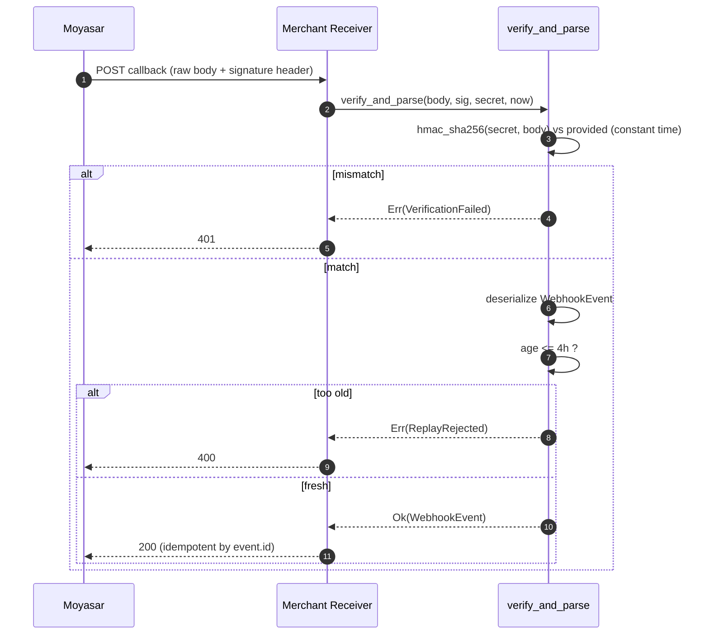

# US-7.3.0: Webhook Verification Engine — Signature, Replay Window & Event Parsing

> **Spec Kit Specification**: [Specification Lifecycle Active](../../../docs/architecture/DECOMPOSITION_ROADMAP.md)  
> **Behavior Blueprint**: `features/core/modules/webhooks/behaviours/verification-engine/`  
> **Slicing Standard**: [10-PR Vertical Slicing Framework](../README.md#2-the-10-pr-vertical-slicing-framework-rust-sdk-adaptation)  
> **Security Gateway**: `security-audit` Level 2 Enforced  
> **Quality Gates**: `(G0–G4 + G-Review + G-Borrow + G-Law)`  

---

## 1. Spec Kit Specification

### 1.1 User Story Narrative
**As a** merchant running a webhook receiver,  
**I want to** verify an inbound callback's authenticity using the shared secret, enforce a replay window, and deserialize the payload into a typed `WebhookEvent`,  
**So that** forged or replayed callbacks can never mark an order paid, and retries (Moyasar retries at +1m, +10m, +30m, +1h, +2h — 3h41m total) are handled idempotently within a 4-hour tolerance.

#### 1.1.1 Preconditions
- `features = ["webhooks"]`.
- The `shared_secret` captured at endpoint creation (US-7.2.0).
- Raw request body bytes **and** the signature header, unmodified.

#### 1.1.2 Postconditions
- `verify_and_parse(raw_body, signature, secret, now)` returns `WebhookEvent`.
- A mismatch returns `WebhookVerificationFailed`; a stale timestamp returns `WebhookReplayRejected`.
- Comparison is constant-time (`subtle::ConstantTimeEq`).
- `WebhookEvent` exposes `id`, `type`, `account_name`, `secret_token`, `live`, `created_at`, and a typed `data` variant per event type.

### 1.2 Acceptance Criteria (Gherkin Scenarios)

```gherkin
Feature: Webhook Signature Verification

  Scenario: [AC-US-7.3.0-01] Valid signature is accepted
    Given a raw body and a signature computed with the correct shared secret
    When verify_and_parse is called
    Then it returns Ok with a typed WebhookEvent
    And event.type is one of the documented event names.

  Scenario: [AC-US-7.3.0-02] Tampered body is rejected
    Given a raw body modified after signing
    When verify_and_parse is called
    Then it returns Err(WebhookVerificationFailed)
    And no partial event is produced.

  Scenario: [AC-US-7.3.0-03] Wrong secret is rejected
    Given a signature computed with a different secret
    When verify_and_parse is called
    Then it returns Err(WebhookVerificationFailed).

  Scenario: [AC-US-7.3.0-04] Comparison is constant-time
    Given any two candidate signatures of equal length
    When they are compared
    Then the comparison consumes the same work regardless of the first differing byte
    And no early return on prefix mismatch occurs.

  Scenario: [AC-US-7.3.0-05] Replay outside the 4-hour tolerance is rejected
    Given a validly signed event whose timestamp is older than 4 hours
    When verify_and_parse is called with the current time
    Then it returns Err(WebhookReplayRejected).

  Scenario: [AC-US-7.3.0-06] Retry ladder events within tolerance are accepted
    Given Moyasar retries at +1m, +10m, +30m, +1h and +2h
    When each retry is verified
    Then all five verify successfully
    And the total ladder (3h41m) fits inside the 4-hour tolerance window.

  Scenario: [AC-US-7.3.0-07] Unknown event types are preserved, not dropped
    Given a payload with an event type newer than this SDK version
    When parsed
    Then the event is returned with an Unknown variant carrying the raw JSON
    And the receiver can still acknowledge it.

  Scenario: [AC-US-7.3.0-08] The payment_faild alias is normalized
    Given a payload whose type is the documented misspelled alias "payment_faild"
    When parsed
    Then it normalizes to the PaymentFailed variant
    And downstream handlers match a single canonical variant.

  Scenario: [AC-US-7.3.0-LAW] SAMA integrity and non-repudiation of payment events
    Given any accepted webhook event
    When it triggers a financial state change
    Then its signature was verified with the merchant's shared secret and its timestamp fell inside the tolerance window,
         satisfying SAMA requirements for authenticated, non-repudiable payment notifications.
```

### 1.3 Test Cases & Traceability Matrix

| Test Case ID | Target Criterion | Test Type | Execution Level | Verification Assertion & Pass Criteria |
| :--- | :--- | :--- | :--- | :--- |
| `TC-7.3.0-01` | `AC-US-7.3.0-01` | Functional | Unit | Valid signature → `Ok(WebhookEvent)`. |
| `TC-7.3.0-02` | `AC-US-7.3.0-02` | Security | Unit | Tampered body → `WebhookVerificationFailed`. |
| `TC-7.3.0-03` | `AC-US-7.3.0-03` | Security | Unit | Wrong secret → `WebhookVerificationFailed`. |
| `TC-7.3.0-04` | `AC-US-7.3.0-04` | Security | Static / SAST | `ConstantTimeEq` used; no `==` on secrets. |
| `TC-7.3.0-05` | `AC-US-7.3.0-05` | Security | Unit | 4h+1s → `WebhookReplayRejected`. |
| `TC-7.3.0-06` | `AC-US-7.3.0-06` | Functional | Unit | All five retry offsets verify. |
| `TC-7.3.0-07` | `AC-US-7.3.0-07` | Functional | Unit | Unknown type preserved with raw JSON. |
| `TC-7.3.0-08` | `AC-US-7.3.0-08` | Functional | Unit | `payment_faild` → `PaymentFailed`. |
| `TC-7.3.0-LAW` | `AC-US-7.3.0-LAW` | Compliance | Static / Audit | Signature + freshness enforced on every transition. |

---

## 2. Behavior-Centric Architecture & Folder Blueprint

### 2.1 Colocated Behaviour Directory Tree

```
features/core/modules/webhooks/behaviours/verification-engine/
├── services/        # verify_and_parse entry point
├── logic/           # HMAC computation, constant-time compare, tolerance check
├── types/           # WebhookEvent, WebhookEventType, WebhookVerificationError
└── constants/       # REPLAY_TOLERANCE (4h), RETRY_LADDER
```

### 2.2 Scoping & Promotion Blueprint
- **Tier 1 (Behaviour-Local)**: HMAC + tolerance logic.
- **Tier 2 (Module-Shared)**: `WebhookEvent` referenced by merchant handlers.
- **Tier 3 (Feature-Shared)**: `WebhooksService::verify_and_parse`.
- **Tier 4 (Global-Shared)**: `moyasar::webhooks::verify_and_parse` free function.

---

## 3. Technical Implementation Plan

### 3.1 Domain Invariants & Storage Schema
- **Constant-Time Law**: signature comparison must never short-circuit.
- **Raw Body Law**: verification uses the exact bytes received — never a re-serialized struct.
- **Tolerance Law**: reject events older than 4 hours (covers the 3h41m retry ladder).
- **Alias Law**: `payment_faild` normalizes to `PaymentFailed`.
- **Forward-Compat Law**: unknown event types are preserved as `Unknown(Value)`.

```rust
pub const REPLAY_TOLERANCE: Duration = Duration::from_secs(4 * 60 * 60);

#[derive(Debug, Clone, PartialEq, Eq)]
pub enum WebhookVerificationError {
    MissingSignature,
    MalformedSignature,
    VerificationFailed,
    ReplayRejected { age: Duration },
    PayloadInvalid(serde_json::Error),
}

#[derive(Debug, Clone, Deserialize)]
pub struct WebhookEvent {
    pub id: Uuid,
    #[serde(rename = "type")]
    pub event_type: WebhookEventType,
    pub account_name: Option<String>,
    pub secret_token: Option<String>,
    pub live: bool,
    pub created_at: DateTime<Utc>,
    pub data: serde_json::Value,
}

#[derive(Debug, Clone, PartialEq, Eq)]
pub enum WebhookEventType {
    PaymentPaid, PaymentFailed, PaymentRefunded, PaymentAuthorized,
    PaymentCaptured, PaymentVoided, PayoutPaid, PayoutFailed,
    InvoicePaid, InvoiceCanceled, Unknown(String),
}

impl<'de> Deserialize<'de> for WebhookEventType {
    fn deserialize<D: serde::Deserializer<'de>>(d: D) -> Result<Self, D::Error> {
        let raw = String::deserialize(d)?;
        let raw = if raw == "payment_faild" { "payment_failed".to_owned() } else { raw };
        Ok(match raw.as_str() {
            "payment_paid" => Self::PaymentPaid,
            "payment_failed" => Self::PaymentFailed,
            "payment_refunded" => Self::PaymentRefunded,
            "payment_authorized" => Self::PaymentAuthorized,
            "payment_captured" => Self::PaymentCaptured,
            "payment_voided" => Self::PaymentVoided,
            "payout_paid" => Self::PayoutPaid,
            "payout_failed" => Self::PayoutFailed,
            "invoice_paid" => Self::InvoicePaid,
            "invoice_canceled" => Self::InvoiceCanceled,
            other => Self::Unknown(other.to_owned()),
        })
    }
}

pub fn verify_and_parse(
    raw_body: &[u8],
    signature: &str,
    secret: &WebhookSecret,
    now: DateTime<Utc>,
) -> Result<WebhookEvent, WebhookVerificationError> {
    let expected = hmac_sha256(secret.expose().as_bytes(), raw_body);
    let provided = hex_decode(signature).ok_or(WebhookVerificationError::MalformedSignature)?;
    if expected.ct_eq(&provided).unwrap_u8() != 1 {
        return Err(WebhookVerificationError::VerificationFailed);
    }
    let event: WebhookEvent = serde_json::from_slice(raw_body)
        .map_err(WebhookVerificationError::PayloadInvalid)?;
    let age = now.signed_duration_since(event.created_at);
    if age.num_seconds() > REPLAY_TOLERANCE.as_secs() as i64 {
        return Err(WebhookVerificationError::ReplayRejected {
            age: age.to_std().unwrap_or_default(),
        });
    }
    Ok(event)
}
```

### 3.2 Activity & Interaction Diagram



---

## 4. Granular Implementation Tasks

### 4.1 The 10-PR Vertical Slicing Implementation Plan

| PR # | Pillar | Architectural Layer | Primary Scope & Files | Deliverables & Acceptance | Accountable Role / Agent | Assigned Skills |
| :--- | :--- | :--- | :--- | :--- | :--- | :--- |
| **PR 1** | **Pillar 1** | **Domain Logic & Core Traits** | `src/resources/webhooks/event.rs` | `WebhookEvent`, `WebhookEventType` with alias normalization. | `engineering-software-architect` | `security-audit` |
| **PR 2** | **Pillar 2** | **Request Modeling** | `src/resources/webhooks/verify_params.rs` | `VerifyParams` (body, signature, now). | `engineering-backend-architect` | `security-audit` |
| **PR 3** | **Pillar 3** | **Transport Wire Adapter** | `src/resources/webhooks/verify.rs` | HMAC-SHA256 computation over raw bytes. | `engineering-backend-architect` | `security-audit` |
| **PR 4** | **Pillar 4** | **Service Accessor** | `src/resources/webhooks/mod.rs` | Public `verify_and_parse` free function. | `engineering-software-architect` | `security-audit` |
| **PR 5** | **Pillar 5** | **Error Taxonomy** | `src/resources/webhooks/verify.rs` | `WebhookVerificationError` variants. | `security-application-security-engineer` | `security-audit` |
| **PR 6** | **Pillar 6** | **Resource Facade Mounting** | `src/lib.rs` | Feature-gated re-export under `webhooks`. | `engineering-software-architect` | `security-audit` |
| **PR 7** | **Pillar 7** | **Zero-Copy Hardening** | `src/resources/webhooks/verify.rs` | Verify over `&[u8]`; no body copy. | `agency-rust-refactoring-specialist` | `security-audit` |
| **PR 8** | **Pillar 8** | **Edge Cases & Guards** | `src/resources/webhooks/tolerance.rs` | 4h tolerance; empty/malformed signature. | `agency-api-tester` | `security-audit` |
| **PR 9** | **Pillar 9** | **Integration Wire Verification** | `tests/webhook_verify_test.rs` | 9 scenarios incl. retry ladder. | `agency-api-tester` | `security-audit` |
| **PR 10** | **Pillar 10** | **Documentation & Packaging** | `README.md` | Receiver example with constant-time notes. | `engineering-technical-writer` | `security-audit` |

### 4.2 Implementation Phase Breakdown

#### Phase 1: Event Types (PR 1–2)
- [ ] **Task 1.1 (Event Enum)**: all documented types + `Unknown(String)`.  
  *Agent*: `engineering-software-architect` | *Skill*: `security-audit`
- [ ] **Task 1.2 (Alias)**: `payment_faild` → `PaymentFailed`.  
  *Agent*: `engineering-backend-architect` | *Skill*: `security-audit`
- [ ] **Task 1.3 (Unit Tests)**: type mapping table.  
  *Agent*: `agency-api-tester` | *Skill*: `security-audit`

#### Phase 2: Verification Core (PR 3–6)
- [ ] **Task 2.1 (HMAC)**: HMAC-SHA256 with `hmac` crate.  
  *Agent*: `security-application-security-engineer` | *Skill*: `security-audit`
- [ ] **Task 2.2 (Constant-Time)**: `subtle::ConstantTimeEq`.  
  *Agent*: `security-application-security-engineer` | *Skill*: `security-audit`
- [ ] **Task 2.3 (Errors)**: typed verification error variants.  
  *Agent*: `security-application-security-engineer` | *Skill*: `security-audit`

#### Phase 3: Tolerance & Guards (PR 7–8)
- [ ] **Task 3.1 (Replay Window)**: 4h tolerance constant + check.  
  *Agent*: `agency-api-tester` | *Skill*: `security-audit`
- [ ] **Task 3.2 (Malformed Input)**: empty and non-hex signature handling.  
  *Agent*: `agency-api-tester` | *Skill*: `security-audit`

#### Phase 4: Verification & Sign-Off (PR 9–10)
- [ ] **Task 4.1 (Tests)**: all 9 scenarios incl. the 5-step retry ladder.  
  *Agent*: `agency-api-tester` | *Skill*: `security-audit`
- [ ] **Task 4.2 (G-Review)**: peer review on crypto usage.  
  *Agent*: `agency-code-reviewer` | *Skill*: `security-audit`
- [ ] **Task 4.3 (Documentation)**: receiver integration guide.  
  *Agent*: `engineering-technical-writer` | *Skill*: `security-audit`

---

## 5. Security Gateway (Powered by security-audit)

### 5.1 Trust Boundaries & Security Actors
- **Trust Boundaries**:
  - `Inbound Callback Boundary`: an unauthenticated public HTTP endpoint.
  - `Crypto Boundary`: HMAC key material.
- **Authorized Principals**: Moyasar's webhook delivery service (holder of the shared secret).

### 5.2 Threat Modeling & Abuse Matrix (STRIDE / ASVS)

| Threat Vector | Severity | Vulnerability Mechanism | Mitigating Control & Security Invariant |
| :--- | :--- | :--- | :--- |
| **Forged Callback** | Critical | Unsigned POST marks an order paid | HMAC-SHA256 verification before any state change. |
| **Timing Oracle** | High | Byte-wise `==` leaks the correct prefix | `ConstantTimeEq` comparison only. |
| **Replay Attack** | High | Re-sending a captured valid callback | 4-hour freshness tolerance; idempotency by `event.id`. |
| **Body Re-serialization** | High | Verifying a parsed struct instead of raw bytes | Raw `&[u8]` is the only verification input. |
| **Secret in Logs** | Critical | Shared secret leaked in error messages | `WebhookSecret` redacting `Debug`; errors carry no key material. |
| **Downgrade to Unknown** | Medium | Unknown events dropped, causing missed state changes | `Unknown(String)` preserved and acknowledged. |

### 5.3 Cryptographic & Data Protection Controls
- **HMAC-SHA256**: standard keyed MAC via the `hmac` crate.
- **Constant-Time Compare**: `subtle` crate, no early exit.
- **Freshness Window**: 4h, exceeding the 3h41m retry ladder.
- **Key Redaction**: secrets never printed.

### 5.4 Automated Security Verification Checklist
- [ ] **Forgery Test**: tampered body and wrong secret both rejected.
- [ ] **Timing Test**: no data-dependent early return in comparison.
- [ ] **Replay Test**: event older than 4h rejected.
- [ ] **Retry Ladder Test**: +1m/+10m/+30m/+1h/+2h all accepted.
- [ ] **Redaction Test**: no secret material in `Debug` or errors.

### 5.5 Security Gateway (G2) Sign-Off Checklist
- [ ] Crypto usage verified against OWASP ASVS Level 2 (V6 Stored Cryptography, V11 Business Logic).
- [ ] Constant-time comparison certified.
- [ ] Replay window documented and tested.
- [ ] Independent reviewer sign-off; zero open findings.

---

## 6. Validation Gates & Acceptance Sign-Off

**Status: Ready for Implementation.**

### G0 — Build, lint & format
- [ ] **US-7.3.0-G0:** `cargo build && cargo clippy -- -D warnings && cargo fmt --check` clean.

### G1 — Test coverage
- [ ] **US-7.3.0-G1:** ≥95% line / ≥90% branch on the verification engine (crypto-adjacent code).

### G2 — Security audit
- [ ] **US-7.3.0-G2:** Crypto audit passes with zero critical/high findings.

### G3 — Architecture and maintainability
- [ ] **US-7.3.0-G3:** Verification engine has no HTTP client dependency.

### G-Review — Code review
- [ ] **US-7.3.0-G-Review:** Peer review by a security reviewer on HMAC and comparison.

### G-Borrow — Rust zero-clone validation
- [ ] **US-7.3.0-G-Borrow:** Verification operates on `&[u8]` with no body copy.

### G-Complexity — Cyclomatic complexity
- [ ] **US-7.3.0-G-Complexity:** $CC \le 6$; nesting $\le 2$.

### G-Docs — Public docs & examples
- [ ] **US-7.3.0-G-Docs:** 100% public symbols documented; a complete receiver example ships.

### G-Law — Law validation
- [ ] **US-7.3.0-G-Law:** SAMA integrity and non-repudiation requirements certified.

### G4 — Integrated acceptance
- [ ] **US-7.3.0-G4:** All 9 verification scenarios pass, including the retry ladder.
