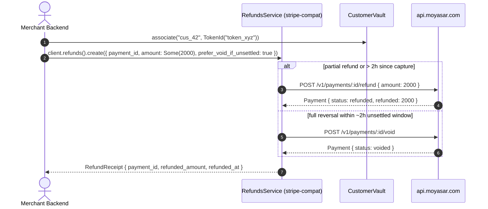

# US-8.1.0: Stripe Compatibility Layer — Virtual Refunds Service & Pluggable Customer Vault

> **Spec Kit Specification**: [Specification Lifecycle Active](../../../docs/architecture/DECOMPOSITION_ROADMAP.md)  
> **Behavior Blueprint**: `src/stripe_compat/`  
> **Slicing Standard**: [10-PR Vertical Slicing Framework](../README.md#2-the-10-pr-vertical-slicing-framework-rust-sdk-adaptation)  
> **Security Gateway**: `security-audit` Level 2 Enforced  
> **Quality Gates**: `(G0–G4 + G-Review + G-Borrow + G-Law)`  

---

## 1. Spec Kit Specification

### 1.1 User Story Narrative
**As a** merchant migrating from `stripe-node` or building cross-gateway workflows,  
**I want to** invoke a virtual `client.refunds().create(RefundCreateParams)` service (which wraps Moyasar's `POST /v1/payments/:id/refund` and `/void` primitives and synthesizes a `RefundReceipt`) and manage customer-to-token bindings through `client.customers()` backed by a pluggable `CustomerVault` trait (`PostgreSQL` / `Redis` / `Moka` / `InMemoryCustomerVault`),  
**So that** my application gets Stripe-ergonomic top-level refund receipts and customer token management even though Moyasar exposes only payment-scoped refund routes and standalone card tokens.

#### 1.1.1 Preconditions
- `features = ["stripe-compat"]` (implies `core`, `payments`, `tokens`, `invoices`).
- A valid `SecretKey`.

#### 1.1.2 Postconditions
- `client.refunds().create(RefundCreateParams)` routes to `POST /v1/payments/:id/void` when `prefer_void_if_unsettled` is `true` and the full payment is within the ~2-hour unsettled void window, or `POST /v1/payments/:id/refund` otherwise, returning a synthesized `RefundReceipt`.
- `CustomerVault` defines async methods `associate(customer_id, token_id)`, `resolve_tokens(customer_id) -> Vec<TokenId>`, and `deactivate(token_id)`.
- `CustomersService` injects `metadata["customer_id"]` into payment charges and provides `InMemoryCustomerVault` for local/test usage.

### 1.2 Acceptance Criteria (Gherkin Scenarios)

```gherkin
Feature: Stripe-Compatible Virtual Refunds Service and Customer Vault

  Scenario: [AC-US-8.1.0-01] Create a full or partial refund receipt via client.refunds()
    Given a paid payment of 15000 halalas and RefundCreateParams with amount Some(5000)
    When client.refunds().create(params) is called
    Then the SDK calls POST /v1/payments/:id/refund with {"amount": 5000}
    And returns a RefundReceipt with payment_id, refunded_amount 5000, refunded_format, and refunded_at.

  Scenario: [AC-US-8.1.0-02] Smart void routing for unsettled full refunds
    Given a payment created 30 minutes ago and RefundCreateParams with amount None and prefer_void_if_unsettled true
    When client.refunds().create(params) is called
    Then the SDK calls POST /v1/payments/:id/void first (falling back to /refund if settled)
    And returns a RefundReceipt reflecting the reversal.

  Scenario: [AC-US-8.1.0-03] Associate and resolve saved tokens in CustomerVault
    Given a CustomerVault implementation and a customer_id "cus_101"
    When associate("cus_101", TokenId::new("token_abc")?) is called
    Then resolve_tokens("cus_101") returns [TokenId("token_abc")]
    And deactivate(TokenId("token_abc")) removes it from active resolution.

  Scenario: [AC-US-8.1.0-04] Inject customer_id into payment metadata automatically
    Given a customer charge initiated through CustomersService
    When the CreatePaymentParams payload is built
    Then metadata["customer_id"] is populated with the merchant's customer_id.

  Scenario: [AC-US-8.1.0-LAW] SAMA refund traceability and PCI-DSS customer data minimization
    Given any RefundReceipt or CustomerVault record
    When stored or logged
    Then RefundReceipt links directly to payment_id and CustomerVault stores only TokenId ("token_...") references, never raw PAN or CVC,
         satisfying SAMA auditability and PCI-DSS 4.0 tokenization rules.
```

### 1.3 Test Cases & Traceability Matrix

| Test Case ID | Target Criterion | Test Type | Execution Level | Verification Assertion & Pass Criteria |
| :--- | :--- | :--- | :--- | :--- |
| `TC-8.1.0-01` | `AC-US-8.1.0-01` | Functional | Integration | Calls `POST /v1/payments/:id/refund` and populates `RefundReceipt`. |
| `TC-8.1.0-02` | `AC-US-8.1.0-02` | Functional | Integration | Within 2h + full amount calls `/void`; partial amount always calls `/refund`. |
| `TC-8.1.0-03` | `AC-US-8.1.0-03` | Functional | Unit | `InMemoryCustomerVault` `associate` / `resolve_tokens` / `deactivate` round-trip. |
| `TC-8.1.0-04` | `AC-US-8.1.0-04` | Functional | Unit | `metadata["customer_id"]` injected into payment parameters. |
| `TC-8.1.0-LAW` | `AC-US-8.1.0-LAW` | Compliance | Static / Audit | Only `TokenId` stored in vault; zero PAN/CVC fields. |

---

## 2. Behavior-Centric Architecture & Folder Blueprint

### 2.1 Rust Crate Module & Unit File Ownership Tree

```
src/
├── src/stripe_compat/refunds.rs               # Unit 1 (feat/us-8.1.0/unit-1-refunds-service)
├── src/stripe_compat/refund_strategy.rs       # Unit 2 (feat/us-8.1.0/unit-2-refund-strategy)
├── src/stripe_compat/customers.rs             # Unit 3 (feat/us-8.1.0/unit-3-customer-vault)
├── src/stripe_compat/in_memory_vault.rs       # Unit 4 (feat/us-8.1.0/unit-4-in-memory-customer-vault)
```

### 2.2 Scoping & Promotion Blueprint
- **Tier 1 (Behaviour-Local)**: `RefundReceipt` synthesis from Moyasar `Payment`.
- **Tier 2 (Module-Shared)**: `RefundCreateParams` and `CustomerVault` shared with `US-8.2.0` subscriptions.
- **Tier 3 (Feature-Shared)**: `RefundsService`, `CustomersService`, and `InMemoryCustomerVault` under `stripe-compat`.
- **Tier 4 (Global-Shared)**: `client.refunds()` and `client.customers()` facade accessors.

---

## 3. Technical Implementation Plan

### 3.1 Domain Invariants & Storage Schema
- **Primitive Mapping Law**: Moyasar has no `/v1/refunds` or `/v1/customers` endpoints; `RefundsService` always dispatches to `/v1/payments/:id/refund` or `/v1/payments/:id/void`, and `CustomerVault` maps merchant customer IDs to Moyasar `TokenId`s.
- **Partial Refund Law**: Partial refunds (`amount: Some(n)` where `n < payment.amount`) always route to `POST /v1/payments/:id/refund` (Moyasar does not support partial voids).
- **No-PAN Vault Law**: `CustomerVault` stores only `TokenId` (`token_...`) and customer metadata—never card numbers.

```rust
#[derive(Debug, Clone, Serialize, Deserialize)]
pub struct RefundCreateParams {
    pub payment_id: Uuid,
    pub amount: Option<u64>,
    pub prefer_void_if_unsettled: bool,
}

#[derive(Debug, Clone, Serialize, Deserialize)]
pub struct RefundReceipt {
    pub payment_id: Uuid,
    pub status: PaymentStatus,
    pub refunded_amount: u64,
    pub refunded_format: String,
    pub refunded_at: Option<DateTime<Utc>>,
    pub voided_at: Option<DateTime<Utc>>,
    pub split_reversal_flags: Vec<bool>,
}

#[async_trait::async_trait]
pub trait CustomerVault: Send + Sync {
    async fn associate(&self, customer_id: &str, token_id: TokenId) -> Result<(), MoyasarError>;
    async fn resolve_tokens(&self, customer_id: &str) -> Result<Vec<TokenId>, MoyasarError>;
    async fn deactivate(&self, token_id: &TokenId) -> Result<(), MoyasarError>;
}
```

### 3.2 Activity & Interaction Diagram



---

## 4. Granular Implementation Tasks

### 4.1 Dynamic 4-Unit Parallel Implementation Plan

| Unit # | Branch | Exclusive Owner Files | Deliverables & Colocated Unit Tests | Accountable Role / Agent | Assigned Skills |
| :--- | :--- | :--- | :--- | :--- | :--- |
| **Unit 1** | `feat/us-8.1.0/unit-1-refunds-service` | `src/stripe_compat/refunds.rs` | `RefundsService`, `RefundCreateParams` (payment_id, amount optional, prefer_void_if_unsettled), `RefundReceipt` (payment_id, refunded_amount, refunded_format, refunded_at, split_reversal_flags) | `engineering-software-architect` | `security-audit` |
| **Unit 2** | `feat/us-8.1.0/unit-2-refund-strategy` | `src/stripe_compat/refund_strategy.rs` | Smart routing: void within 2h → POST /void, else → POST /refund, partial amounts always → refund. Unit tests per strategy branch | `engineering-backend-architect` | `security-audit` |
| **Unit 3** | `feat/us-8.1.0/unit-3-customer-vault` | `src/stripe_compat/customers.rs` | `CustomerVault` trait: `associate(customer_id, token_id)`, `resolve_tokens(customer_id) -> Vec<TokenId>`, `deactivate(token_id)`. `customer_id` injected into payment metadata | `engineering-backend-architect` | `security-audit` |
| **Unit 4** | `feat/us-8.1.0/unit-4-in-memory-customer-vault` | `src/stripe_compat/in_memory_vault.rs` | Thread-safe `InMemoryCustomerVault` reference implementation of `CustomerVault`, customer metadata injector, and refund/customer unit tests | `security-appsec-engineer` | `security-audit` |

### 4.2 Parallel Unit Execution & Story Merge Breakdown

#### Wave 1: Base Branch Scaffolding (`feat/us-8.1.0-*`)
- [ ] **Task 0.1 (Story Base Contracts)**: Verify `Cargo.toml`, `src/lib.rs`, and the domain's `mod.rs` + `service.rs` facade declarations are present on the story base branch before spawning parallel unit worktrees.  
  *Agent*: `story-leader` | *Skill*: `divide-and-conquer-orchestrator`

#### Wave 2: 100% Parallel Unit Implementation (`Unit 1..4`)
- [ ] **Unit 1 (`feat/us-8.1.0/unit-1-refunds-service`)**: `RefundsService`, `RefundCreateParams` (payment_id, amount optional, prefer_void_if_unsettled), `RefundReceipt` (payment_id, refunded_amount, refunded_format, refunded_at, split_reversal_flags) (Files: `src/stripe_compat/refunds.rs`)  
  *Agent*: `engineering-software-architect` | *Skill*: `security-audit`
- [ ] **Unit 2 (`feat/us-8.1.0/unit-2-refund-strategy`)**: Smart routing: void within 2h → POST /void, else → POST /refund, partial amounts always → refund. Unit tests per strategy branch (Files: `src/stripe_compat/refund_strategy.rs`)  
  *Agent*: `engineering-backend-architect` | *Skill*: `security-audit`
- [ ] **Unit 3 (`feat/us-8.1.0/unit-3-customer-vault`)**: `CustomerVault` trait: `associate(customer_id, token_id)`, `resolve_tokens(customer_id) -> Vec<TokenId>`, `deactivate(token_id)`. `customer_id` injected into payment metadata (Files: `src/stripe_compat/customers.rs`)  
  *Agent*: `engineering-backend-architect` | *Skill*: `security-audit`
- [ ] **Unit 4 (`feat/us-8.1.0/unit-4-in-memory-customer-vault`)**: Thread-safe `InMemoryCustomerVault` reference implementation of `CustomerVault`, customer metadata injector, and refund/customer unit tests (Files: `src/stripe_compat/in_memory_vault.rs`)  
  *Agent*: `security-appsec-engineer` | *Skill*: `security-audit`

#### Wave 3: Cascading Merge & Story Integration Verification
- [ ] **Task 3.1 (Cascading Merge & Wire Verification)**: Merge `Unit 1 -> ... -> Unit 4` into the story branch and run story-level wire integration tests and `G0–G4` quality gates.  
  *Agent*: `testing-api-tester` | *Skill*: `security-audit`
- [ ] **Task 3.2 (Council Review & Sign-Off)**: Execute independent Multi-Council Review (`G-Review`, `G-Borrow`, `G-Complexity`, `G-Docs`, `G-Law`).  
  *Agent*: `engineering-code-reviewer` | *Skill*: `code-review-council`

---

## 5. Security Gateway (Powered by security-audit)

### 5.1 Trust Boundaries & Security Actors
- **Trust Boundaries**:
  - `Orchestration Boundary`: translates Stripe-style refund/customer calls into Moyasar `/v1/payments` and `/v1/tokens` primitives.
  - `Vault Boundary`: external persistence (`PostgreSQL` / `Redis` / `Moka`) storing `customer_id -> TokenId` mappings.
- **Authorized Principals**: merchant backend (`sk_` only).

### 5.2 Threat Modeling & Abuse Matrix (STRIDE / ASVS)

| Threat Vector | Severity | Vulnerability Mechanism | Mitigating Control & Security Invariant |
| :--- | :--- | :--- | :--- |
| **Over-Refund** | Critical | Refunding more than the captured payment amount | Client-side and server-side bounds check against `payment.captured`. |
| **PAN Storage in Vault** | Critical | Storing card numbers in `CustomerVault` | `CustomerVault` accepts only validated `TokenId` (`token_...`) newtypes. |
| **Cross-Customer Token Use** | High | Charging a token belonging to another customer | Vault resolves tokens strictly scoped by `customer_id` and injects `metadata["customer_id"]`. |

### 5.3 Cryptographic & Data Protection Controls
- **Token-Only Vaulting**: `TokenId` prefix guard prevents raw PAN storage.
- **Audit Linkage**: `RefundReceipt` preserves `payment_id` and `metadata["customer_id"]`.

### 5.4 Automated Security Verification Checklist
- [ ] **Routing Test**: partial refund never calls `/void`; unsettled full refund with `prefer_void_if_unsettled` calls `/void` then falls back to `/refund`.
- [ ] **Vault Test**: `InMemoryCustomerVault` isolates tokens by `customer_id` and removes deactivated tokens.
- [ ] **Metadata Test**: `metadata["customer_id"]` injected cleanly without exceeding 30-key limit.

### 5.5 Security Gateway (G2) Sign-Off Checklist
- [ ] Stripe-compat layer verified against OWASP ASVS Level 2.
- [ ] Zero PAN retention in `CustomerVault`.
- [ ] Independent reviewer sign-off; zero open findings.

---

## 6. Validation Gates & Acceptance Sign-Off

**Status: Ready for Implementation.**

### G0 — Build, lint & format
- [ ] **US-8.1.0-G0:** `cargo build && cargo clippy -- -D warnings && cargo fmt --check` clean.

### G1 — Test coverage
- [ ] **US-8.1.0-G1:** ≥90% line / ≥85% branch on `stripe_compat` refunds and customers.

### G2 — Security audit
- [ ] **US-8.1.0-G2:** Vault and refund routing audit passes with zero critical/high findings.

### G3 — Architecture and maintainability
- [ ] **US-8.1.0-G3:** `stripe_compat` builds cleanly on top of `core`, `payments`, and `tokens`.

### G-Review — Code review
- [ ] **US-8.1.0-G-Review:** Peer review on `RefundReceipt` synthesis and `CustomerVault` trait ergonomics.

### G-Borrow — Rust zero-clone validation
- [ ] **US-8.1.0-G-Borrow:** `CustomerVault` methods borrow `customer_id: &str` and `&TokenId`.

### G-Complexity — Cyclomatic complexity
- [ ] **US-8.1.0-G-Complexity:** $CC \le 6$; nesting $\le 2$.

### G-Docs — Public docs & examples
- [ ] **US-8.1.0-G-Docs:** 100% public symbols documented; `RefundsService` and `CustomerVault` examples runnable.

### G-Law — Law validation
- [ ] **US-8.1.0-G-Law:** SAMA refund traceability and PCI-DSS data minimization certified.

### G4 — Integrated acceptance
- [ ] **US-8.1.0-G4:** Full/partial refund, unsettled void fallback, and `CustomerVault` lifecycle verified against mock server.
