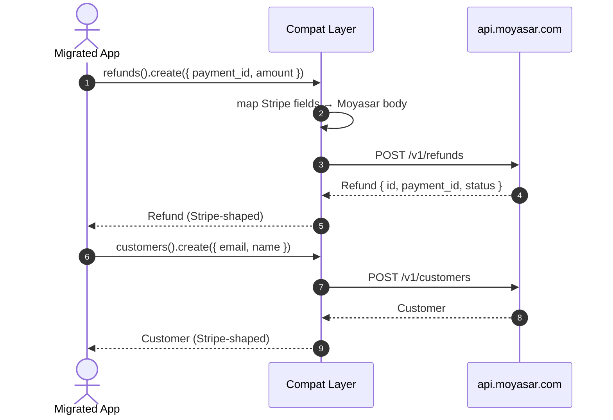

# US-8.1.0: Stripe Compatibility Layer — Refunds & Customers

> **Spec Kit Specification**: [Specification Lifecycle Active](../../../docs/architecture/DECOMPOSITION_ROADMAP.md)  
> **Behavior Blueprint**: `features/core/modules/compat/behaviours/stripe-refunds-customers/`  
> **Slicing Standard**: [10-PR Vertical Slicing Framework](../README.md#2-the-10-pr-vertical-slicing-framework-rust-sdk-adaptation)  
> **Security Gateway**: `security-audit` Level 2 Enforced  
> **Quality Gates**: `(G0–G4 + G-Review + G-Borrow + G-Law)`  

---

## 1. Spec Kit Specification

### 1.1 User Story Narrative
**As a** merchant migrating an existing Stripe integration to Moyasar,  
**I want to** call `client.refunds()` and `client.customers()` with Stripe-shaped params and get back Stripe-shaped objects,  
**So that** my existing business logic keeps working while I move to Moyasar's `some-payment` abstraction, and the mapping quirks (e.g. refunds keyed by payment id, `customer` as an id string) are absorbed by the SDK rather than my code.

#### 1.1.1 Preconditions
- `features = ["compat-stripe"]` (implies `core`, `payments`).
- A valid `SecretKey`.

#### 1.1.2 Postconditions
- `refunds().create()` accepts `payment_id` as the Stripe `charge` equivalent and returns a Stripe-shaped `Refund`.
- `refunds().retrieve()`, `.update()` (metadata only), `.list()` with `payment_id`/date filters all work.
- `customers().create/retrieve/update/delete/list` operate on Moyasar customers with Stripe field names.
- Every translatable field has a documented name mapping; everything untranslatable is rejected explicitly rather than silently dropped.

### 1.2 Acceptance Criteria (Gherkin Scenarios)

```gherkin
Feature: Stripe-Compatible Refunds and Customers

  Scenario: [AC-US-8.1.0-01] Create a refund with a Stripe-shaped payload
    Given a CreateRefundParams with payment_id, amount and metadata
    When client.refunds().create(params) is called
    Then the body sent to Moyasar maps payment_id to the refund's payment reference
    And the returned Refund exposes id, amount, currency, status and created_at.

  Scenario: [AC-US-8.1.0-02] Partial refund leaves the payment refundable
    Given a paid payment of 10000 with a 3000 refund
    When the refund succeeds
    Then Refund.amount equals 3000
    And the remaining refundable amount is 7000.

  Scenario: [AC-US-8.1.0-03] Refund update is metadata-only
    Given an existing refund
    When client.refunds().update(id, params) is called with metadata
    Then the request contains only metadata
    And attempting to change amount returns a typed ImmutableField error before transport.

  Scenario: [AC-US-8.1.0-04] List refunds with payment filter
    Given refunds across multiple payments
    When client.refunds().list({ payment_id }) is called
    Then only refunds for that payment are returned
    And the response is a paginated list.

  Scenario: [AC-US-8.1.0-05] Customer lifecycle with Stripe field names
    Given a CreateCustomerParams with email and name
    When customers().create(params) is called
    Then the returned Customer exposes id, email, name and created_at
    And customers().retrieve/update/delete/list behave as in Stripe.

  Scenario: [AC-US-8.1.0-06] Unsupported Stripe fields are rejected, not dropped
    Given a param set containing a Stripe-only field with no Moyasar equivalent
    When the request is built
    Then a typed UnsupportedCompatField error names the offending field
    And no request is sent with silently missing data.

  Scenario: [AC-US-8.1.0-LAW] SAMA refund traceability and customer data minimality
    Given any refund or customer operation
    When it completes
    Then the refund retains a link to its originating payment and customer records hold no card data,
         satisfying SAMA refund traceability and data-minimization requirements.
```

### 1.3 Test Cases & Traceability Matrix

| Test Case ID | Target Criterion | Test Type | Execution Level | Verification Assertion & Pass Criteria |
| :--- | :--- | :--- | :--- | :--- |
| `TC-8.1.0-01` | `AC-US-8.1.0-01` | Functional | Unit | Field mapping verified on the wire body. |
| `TC-8.1.0-02` | `AC-US-8.1.0-02` | Functional | Integration | Refund amount and remaining balance correct. |
| `TC-8.1.0-03` | `AC-US-8.1.0-03` | Functional | Unit | Metadata-only body; immutable-field error. |
| `TC-8.1.0-04` | `AC-US-8.1.0-04` | Functional | Unit | Filter encoded; paginated shape. |
| `TC-8.1.0-05` | `AC-US-8.1.0-05` | Functional | Integration | Full customer CRUD. |
| `TC-8.1.0-06` | `AC-US-8.1.0-06` | Validation | Unit | Typed error names the field; zero calls. |
| `TC-8.1.0-LAW` | `AC-US-8.1.0-LAW` | Compliance | Static / Audit | Payment linkage present; no card data. |

---

## 2. Behavior-Centric Architecture & Folder Blueprint

### 2.1 Colocated Behaviour Directory Tree

```
features/core/modules/compat/behaviours/stripe-refunds-customers/
├── services/        # RefundsService, CustomersService
├── logic/           # Stripe→Moyasar field mapping, unsupported-field detection
├── types/           # Refund, Customer, StripeRefundParams, StripeCustomerParams
└── constants/       # REFUNDS_PATH, CUSTOMERS_PATH, FIELD_MAP
```

### 2.2 Scoping & Promotion Blueprint
- **Tier 1 (Behaviour-Local)**: field-name mapping tables.
- **Tier 2 (Module-Shared)**: `Refund`, `Customer` shared with subscriptions (US-8.2.0).
- **Tier 3 (Feature-Shared)**: services under `compat-stripe`.
- **Tier 4 (Global-Shared)**: `client.refunds()` / `client.customers()` facades.

---

## 3. Technical Implementation Plan

### 3.1 Domain Invariants & Storage Schema
- **Explicit Mapping Law**: every Stripe field name maps to a documented Moyasar field, or the request is rejected.
- **Refund Immutability Law**: only `metadata` is updatable on a refund.
- **Linkage Law**: a refund always carries its originating payment.
- **No Card Data Law**: `Customer` never carries PAN or CVC fields.

```rust
/// Stripe-compatible refund shape, backed by Moyasar's refund resource.
#[derive(Debug, Clone, Deserialize)]
pub struct Refund {
    pub id: Uuid,
    pub payment_id: Uuid,      // Stripe's "charge" equivalent
    pub amount: u64,
    pub currency: Currency,
    pub status: RefundStatus,
    pub metadata: BTreeMap<String, String>,
    pub created_at: DateTime<Utc>,
}

#[derive(Debug, Clone, Copy, PartialEq, Eq, Deserialize)]
#[serde(rename_all = "lowercase")]
pub enum RefundStatus { Pending, Succeeded, Failed, #[serde(other)] Unknown }

#[derive(Debug, Clone, Deserialize)]
pub struct Customer {
    pub id: Uuid,
    pub email: Option<String>,
    pub name: Option<String>,
    pub metadata: BTreeMap<String, String>,
    pub created_at: DateTime<Utc>,
}

/// Rejects Stripe-only fields with no Moyasar equivalent.
pub fn reject_unsupported(field: &str) -> Result<(), MoyasarError> {
    Err(MoyasarError::UnsupportedCompatField { field: field.to_owned() })
}
```

### 3.2 Activity & Interaction Diagram



---

## 4. Granular Implementation Tasks

### 4.1 The 10-PR Vertical Slicing Implementation Plan

| PR # | Pillar | Architectural Layer | Primary Scope & Files | Deliverables & Acceptance | Accountable Role / Agent | Assigned Skills |
| :--- | :--- | :--- | :--- | :--- | :--- | :--- |
| **PR 1** | **Pillar 1** | **Domain Logic & Core Traits** | `src/compat/refund.rs` | Stripe-shaped `Refund` + `RefundStatus`. | `engineering-software-architect` | `security-audit` |
| **PR 2** | **Pillar 2** | **Request Modeling** | `src/compat/field_map.rs` | Explicit Stripe→Moyasar mapping table. | `engineering-backend-architect` | `security-audit` |
| **PR 3** | **Pillar 3** | **Transport Wire Adapter** | `src/compat/refunds.rs` | create/retrieve/update/list. | `engineering-backend-architect` | `security-audit` |
| **PR 4** | **Pillar 4** | **Service Accessor** | `src/compat/mod.rs` | `client.refunds()`, `client.customers()`. | `engineering-software-architect` | `security-audit` |
| **PR 5** | **Pillar 5** | **Error Taxonomy** | `src/kernel/error.rs` | `UnsupportedCompatField`, `ImmutableField`. | `security-application-security-engineer` | `security-audit` |
| **PR 6** | **Pillar 6** | **Resource Facade Mounting** | `src/lib.rs` | Feature-gated `compat-stripe` export. | `engineering-software-architect` | `security-audit` |
| **PR 7** | **Pillar 7** | **Zero-Copy Hardening** | `src/compat/customers.rs` | Borrow param strings for mapping. | `agency-rust-refactoring-specialist` | `security-audit` |
| **PR 8** | **Pillar 8** | **Edge Cases & Guards** | `src/compat/refunds.rs` | Immutability guard; partial-refund balance. | `agency-api-tester` | `security-audit` |
| **PR 9** | **Pillar 9** | **Integration Wire Verification** | `tests/compat_refunds_customers_test.rs` | Full refund + customer lifecycle. | `agency-api-tester` | `security-audit` |
| **PR 10** | **Pillar 10** | **Documentation & Packaging** | `README.md` | Migration table Stripe ⇄ Moyasar. | `engineering-technical-writer` | `security-audit` |

### 4.2 Implementation Phase Breakdown

#### Phase 1: Types & Mapping (PR 1–2)
- [ ] **Task 1.1 (Refund/Customer Types)**: Stripe-shaped structs.  
  *Agent*: `engineering-software-architect` | *Skill*: `security-audit`
- [ ] **Task 1.2 (Field Map)**: explicit mapping + unsupported list.  
  *Agent*: `engineering-backend-architect` | *Skill*: `security-audit`

#### Phase 2: Endpoints (PR 3–6)
- [ ] **Task 2.1 (Refunds)**: create/retrieve/update/list.  
  *Agent*: `engineering-backend-architect` | *Skill*: `security-audit`
- [ ] **Task 2.2 (Customers)**: full CRUD.  
  *Agent*: `engineering-backend-architect` | *Skill*: `security-audit`

#### Phase 3: Guards (PR 7–8)
- [ ] **Task 3.1 (Immutability)**: metadata-only update.  
  *Agent*: `agency-api-tester` | *Skill*: `security-audit`
- [ ] **Task 3.2 (Unsupported Fields)**: typed rejection before transport.  
  *Agent*: `agency-api-tester` | *Skill*: `security-audit`

#### Phase 4: Verification & Sign-Off (PR 9–10)
- [ ] **Task 4.1 (Wire Tests)**: refund + customer flows.  
  *Agent*: `agency-api-tester` | *Skill*: `security-audit`
- [ ] **Task 4.2 (G-Review)**: peer review on the mapping table exactness.  
  *Agent*: `agency-code-reviewer` | *Skill*: `security-audit`
- [ ] **Task 4.3 (Documentation)**: migration mapping table.  
  *Agent*: `engineering-technical-writer` | *Skill*: `security-audit`

---

## 5. Security Gateway (Powered by security-audit)

### 5.1 Trust Boundaries & Security Actors
- **Trust Boundaries**:
  - `Migration Boundary`: developers assume Stripe semantics that do not exist in Moyasar.
  - `Refund Boundary`: money leaves the merchant balance.
- **Authorized Principals**: merchant backend (`sk_`).

### 5.2 Threat Modeling & Abuse Matrix (STRIDE / ASVS)

| Threat Vector | Severity | Vulnerability Mechanism | Mitigating Control & Security Invariant |
| :--- | :--- | :--- | :--- |
| **Silent Field Drop** | High | Stripe field ignored, refund issued with wrong amount | Explicit mapping; unsupported fields raise a typed error. |
| **Over-Refund** | Critical | Refunding beyond the captured amount | Server-side cap; client exposes remaining refundable amount. |
| **Refund Amount Mutation** | High | Editing amount after creation | Immutable-field guard; metadata-only update. |
| **Card Data in Customer** | Critical | Storing PAN/CVC on a customer object | `Customer` has no card fields by construction. |
| **Orphaned Refund** | Medium | Refund without payment linkage | `payment_id` is a required field. |

### 5.3 Cryptographic & Data Protection Controls
- **Explicit Mapping**: no silent divergence from Stripe semantics.
- **Immutability**: refund amount fixed at creation.
- **Data Minimization**: customer objects carry no card data.

### 5.4 Automated Security Verification Checklist
- [ ] **Mapping Test**: every supported field asserted on the wire body.
- [ ] **Unsupported Test**: typed error, zero network calls.
- [ ] **Over-Refund Test**: exceeding the remainder rejected.
- [ ] **Data Test**: no PAN/CVC fields exist on `Customer`.

### 5.5 Security Gateway (G2) Sign-Off Checklist
- [ ] Migration layer verified against OWASP ASVS Level 2.
- [ ] Zero silent field drops.
- [ ] Refund immutability certified.
- [ ] Independent reviewer sign-off; zero open findings.

---

## 6. Validation Gates & Acceptance Sign-Off

**Status: Ready for Implementation.**

### G0 — Build, lint & format
- [ ] **US-8.1.0-G0:** `cargo build && cargo clippy -- -D warnings && cargo fmt --check` clean.

### G1 — Test coverage
- [ ] **US-8.1.0-G1:** ≥90% line / ≥85% branch on the compat refunds/customers module.

### G2 — Security audit
- [ ] **US-8.1.0-G2:** Mapping-audit passes with zero critical/high findings.

### G3 — Architecture and maintainability
- [ ] **US-8.1.0-G3:** Compat layer depends on kernel + payments only; no leakage into core types.

### G-Review — Code review
- [ ] **US-8.1.0-G-Review:** Peer review on the field-mapping table.

### G-Borrow — Rust zero-clone validation
- [ ] **US-8.1.0-G-Borrow:** Mapping borrows param strings.

### G-Complexity — Cyclomatic complexity
- [ ] **US-8.1.0-G-Complexity:** $CC \le 6$; nesting $\le 2$.

### G-Docs — Public docs & examples
- [ ] **US-8.1.0-G-Docs:** 100% public symbols documented; migration table published.

### G-Law — Law validation
- [ ] **US-8.1.0-G-Law:** SAMA refund traceability and data-minimization certified.

### G4 — Integrated acceptance
- [ ] **US-8.1.0-G4:** Refund and customer lifecycles verified against the mock server.
