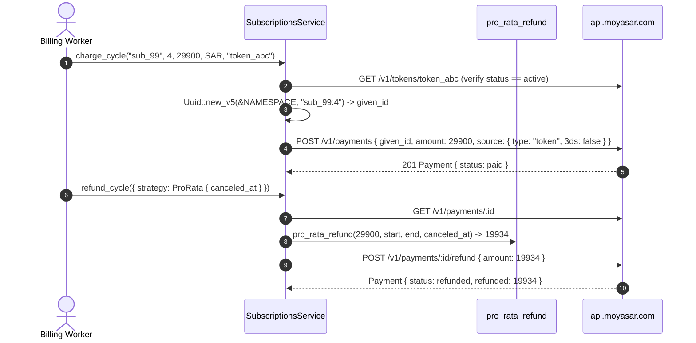

# US-8.2.0: Stripe Compatibility Layer — Subscriptions, Deterministic UUIDv5 Billing & Pro-Rata Refunds

> **Spec Kit Specification**: [Specification Lifecycle Active](../../../docs/architecture/DECOMPOSITION_ROADMAP.md)  
> **Behavior Blueprint**: `src/stripe_compat/`  
> **Slicing Standard**: [10-PR Vertical Slicing Framework](../README.md#2-the-10-pr-vertical-slicing-framework-rust-sdk-adaptation)  
> **Security Gateway**: `security-audit` Level 2 Enforced  
> **Quality Gates**: `(G0–G4 + G-Review + G-Borrow + G-Law)`  

---

## 1. Spec Kit Specification

### 1.1 User Story Narrative
**As a** SaaS or subscription merchant billing customers in Saudi Arabia,  
**I want to** execute recurring off-session token charges via `client.subscriptions().charge_cycle(...)` using deterministic UUIDv5 `given_id` idempotency (`Uuid::new_v5(&NAMESPACE, "{sub_id}:{cycle_index}")`) and issue full, partial, or exact pro-rata unused-time refunds via `client.subscriptions().refund_cycle(...)` with automatic ~2-hour void fallback,  
**So that** distributed billing workers never double-charge a subscriber for the same cycle on retry, and mid-cycle cancellations refund the exact unused halalas (`ceil(amount * remaining / total)`) without floating-point rounding errors.

#### 1.1.1 Preconditions
- `features = ["stripe-compat"]` (implies `core`, `payments`, `tokens`, `invoices`).
- A valid `SecretKey`.
- An active saved card `TokenId` (`TokenStatus::Active` from `US-4.1.0`).

#### 1.1.2 Postconditions
- `charge_cycle(...)` verifies that the saved token is `TokenStatus::Active`, derives `given_id = Uuid::new_v5(&MOYASAR_SUBSCRIPTION_NAMESPACE, "{sub_id}:{cycle_index}")`, and submits an off-session `POST /v1/payments` charge with `PaymentSourceRequest::Token` (`three_ds: Some(false)`).
- `pro_rata_refund(amount, period_start, period_end, canceled_at)` calculates `ceil(amount * remaining_secs / total_secs)` using exact 128-bit integer arithmetic (`u128`).
- `refund_cycle(SubscriptionCycleRefundParams)` resolves the refund amount according to `RefundStrategy` (`Full`, `Partial { amount_halalas }`, or `ProRata { canceled_at }`), executes smart void-or-refund routing (`POST /v1/payments/:id/void` if full reversal within ~2h, else `POST /v1/payments/:id/refund`), and returns `SubscriptionCycleRefundResult`.

### 1.2 Acceptance Criteria (Gherkin Scenarios)

```gherkin
Feature: Deterministic Subscription Billing and Pro-Rata Cycle Refunds

  Scenario: [AC-US-8.2.0-01] Off-session cycle charge uses deterministic UUIDv5 given_id
    Given subscription "sub_pro_9921" at cycle_index 4 and an active token "token_abc"
    When client.subscriptions().charge_cycle(...) is called twice across worker retries
    Then both requests emit the exact same deterministic UUIDv5 given_id in POST /v1/payments
    And Moyasar deduplicates the retry so the subscriber is charged at most once.

  Scenario: [AC-US-8.2.0-02] Inactive or unverified token is rejected before charging
    Given a token whose status is Initiated or Inactive
    When client.subscriptions().charge_cycle(...) is called
    Then the SDK rejects the charge before calling POST /v1/payments.

  Scenario: [AC-US-8.2.0-03] Exact integer ceiling pro-rata refund calculation
    Given a 30-day billing cycle (2,592,000 seconds) paid at 29,900 halalas (299.00 SAR)
    When canceled exactly 10 days into the cycle (20 days remaining)
    Then pro_rata_refund computes ceil(29900 * 1728000 / 2592000) == 19934 halalas
    And uses integer u128 arithmetic with zero f64 conversion.

  Scenario: [AC-US-8.2.0-04] Full cycle cancellation within 2 hours routes to void
    Given a subscription cycle paid 20 minutes ago
    When client.subscriptions().refund_cycle(params) is called with RefundStrategy::Full
    Then the SDK executes POST /v1/payments/:id/void
    And returns SubscriptionCycleRefundResult with action Voided.

  Scenario: [AC-US-8.2.0-05] SubscriptionPlan computes accurate billing period boundaries
    Given a SubscriptionPlan with PlanInterval::Month
    When next_period_bounds(period_start) is computed across standard and leap-year months
    Then current_period_start and current_period_end reflect exact UTC timestamps.

  Scenario: [AC-US-8.2.0-LAW] SAMA recurring-charge idempotency and pro-rata refund fairness
    Given any recurring subscription charge or mid-cycle cancellation
    When executed by the SDK
    Then cycle idempotency prevents duplicate debits and ceiling rounding favors the consumer on fractional halalas,
         satisfying SAMA recurring-payment consumer protection requirements.
```

### 1.3 Test Cases & Traceability Matrix

| Test Case ID | Target Criterion | Test Type | Execution Level | Verification Assertion & Pass Criteria |
| :--- | :--- | :--- | :--- | :--- |
| `TC-8.2.0-01` | `AC-US-8.2.0-01` | Functional | Integration | Identical UUIDv5 `given_id` sent on retry for `sub_id:cycle_index`. |
| `TC-8.2.0-02` | `AC-US-8.2.0-02` | Security | Unit | Inactive token rejected pre-charge. |
| `TC-8.2.0-03` | `AC-US-8.2.0-03` | Functional | Unit | 30-day, 365-day, and leap-year pro-rata ceiling math exact to 1 halala. |
| `TC-8.2.0-04` | `AC-US-8.2.0-04` | Functional | Integration | Unsettled full refund routes to `/void`; pro-rata partial routes to `/refund`. |
| `TC-8.2.0-05` | `AC-US-8.2.0-05` | Functional | Unit | `SubscriptionPlan` period calculation across `Day`, `Week`, `Month`, `Year`. |
| `TC-8.2.0-LAW` | `AC-US-8.2.0-LAW` | Compliance | Static / Audit | Zero `f64` in pro-rata math; deterministic UUIDv5 enforced. |

---

## 2. Behavior-Centric Architecture & Folder Blueprint

### 2.1 Rust Crate Module & Unit File Ownership Tree

```
src/
├── src/stripe_compat/subscriptions_model.rs   # Unit 1 (feat/us-8.2.0/unit-1-subscription-model)
├── src/stripe_compat/subscriptions_billing.rs # Unit 2 (feat/us-8.2.0/unit-2-subscription-billing)
├── src/stripe_compat/pro_rata.rs              # Unit 3 (feat/us-8.2.0/unit-3-pro-rata-calculator)
├── src/stripe_compat/subscriptions_refund.rs  # Unit 4 (feat/us-8.2.0/unit-4-cycle-refund)
├── src/stripe_compat/subscription_plan.rs     # Unit 5 (feat/us-8.2.0/unit-5-subscription-plan)
```

### 2.2 Scoping & Promotion Blueprint
- **Tier 1 (Behaviour-Local)**: 128-bit integer ceiling pro-rata calculator (`pro_rata_refund`).
- **Tier 2 (Module-Shared)**: Reuses `RefundsService` smart void/refund routing from `US-8.1.0`.
- **Tier 3 (Feature-Shared)**: `SubscriptionsService`, `RefundStrategy`, `SubscriptionPlan` under `stripe-compat`.
- **Tier 4 (Global-Shared)**: `client.subscriptions()` facade accessor.

---

## 3. Technical Implementation Plan

### 3.1 Domain Invariants & Storage Schema
- **Deterministic Cycle Law**: `given_id = Uuid::new_v5(&MOYASAR_SUBSCRIPTION_NAMESPACE, format!("{sub_id}:{cycle_index}").as_bytes())`.
- **Integer Ceiling Pro-Rata Law**: $\text{Refund}_{\text{pro-rata}} = \lceil \text{Amount}_{\text{paid}} \times \frac{T_{\text{end}} - T_{\text{cancel}}}{T_{\text{end}} - T_{\text{start}}} \rceil$ computed via `(amount as u128 * remaining as u128 + total as u128 - 1) / total as u128`.
- **Active Token Law**: `charge_cycle` verifies `TokenStatus::Active` before submitting an off-session charge.

```rust
#[derive(Debug, Clone, Copy, PartialEq, Eq, Serialize, Deserialize)]
pub enum RefundStrategy {
    Full,
    Partial { amount_halalas: u64 },
    ProRata { canceled_at: DateTime<Utc> },
}

#[derive(Debug, Clone, Serialize, Deserialize)]
pub struct SubscriptionCycleRefundParams {
    pub subscription_id: String,
    pub cycle_payment_id: Uuid,
    pub period_start: DateTime<Utc>,
    pub period_end: DateTime<Utc>,
    pub strategy: RefundStrategy,
}

#[derive(Debug, Clone, Copy, PartialEq, Eq, Serialize, Deserialize)]
pub enum ReversalAction {
    Voided,
    Refunded,
}

#[derive(Debug, Clone, Serialize, Deserialize)]
pub struct SubscriptionCycleRefundResult {
    pub payment_id: Uuid,
    pub action: ReversalAction,
    pub amount_reversed: u64,
}

pub fn pro_rata_refund(
    amount: u64,
    period_start: DateTime<Utc>,
    period_end: DateTime<Utc>,
    canceled_at: DateTime<Utc>,
) -> Result<u64, MoyasarError> {
    let total = (period_end - period_start).num_seconds();
    if total <= 0 {
        return Err(MoyasarError::InvalidPayoutAmount);
    }
    let remaining = (period_end - canceled_at).num_seconds().clamp(0, total);
    if remaining == 0 {
        return Ok(0);
    }
    let num = (amount as u128) * (remaining as u128) + (total as u128) - 1;
    Ok((num / (total as u128)) as u64)
}
```

### 3.2 Activity & Interaction Diagram



---

## 4. Granular Implementation Tasks

### 4.1 Dynamic 5-Unit Parallel Implementation Plan

| Unit # | Branch | Exclusive Owner Files | Deliverables & Colocated Unit Tests | Accountable Role / Agent | Assigned Skills |
| :--- | :--- | :--- | :--- | :--- | :--- |
| **Unit 1** | `feat/us-8.2.0/unit-1-subscription-model` | `src/stripe_compat/subscriptions_model.rs` | `SubscriptionCycle`, `SubscriptionCycleId`, `Subscription`, `RefundStrategy` enum (Full, Partial, ProRata { canceled_at }) | `engineering-software-architect` | `security-audit` |
| **Unit 2** | `feat/us-8.2.0/unit-2-subscription-billing` | `src/stripe_compat/subscriptions_billing.rs` | `client.subscriptions().charge_cycle(sub_id, cycle_index, amount, token_id)`, deterministic UUIDv5: `Uuid::new_v5(&NAMESPACE, "{sub_id}:{cycle_index}")`, token status check before charge | `engineering-backend-architect` | `security-audit` |
| **Unit 3** | `feat/us-8.2.0/unit-3-pro-rata-calculator` | `src/stripe_compat/pro_rata.rs` | `pro_rata_refund(amount, period_start, period_end, canceled_at) -> u64` — exact halala calculation: `ceil(amount * remaining / total)`, unit tests for 30-day, 365-day, leap-year periods | `engineering-backend-architect` | `security-audit` |
| **Unit 4** | `feat/us-8.2.0/unit-4-cycle-refund` | `src/stripe_compat/subscriptions_refund.rs` | `client.subscriptions().refund_cycle(params)`: locate cycle Payment, compute pro-rata, execute refund/void with smart routing, `SubscriptionCycleRefundResult` (action, amount, payment_id) | `security-appsec-engineer` | `security-audit` |
| **Unit 5** | `feat/us-8.2.0/unit-5-subscription-plan` | `src/stripe_compat/subscription_plan.rs` | `SubscriptionPlan`, `PlanInterval` (`Day`, `Week`, `Month`, `Year`), billing period boundary calculator (`next_period_bounds`), and subscription cycle unit tests | `engineering-rust-refactoring-specialist` | `security-audit` |

### 4.2 Parallel Unit Execution & Story Merge Breakdown

#### Wave 1: Base Branch Scaffolding (`feat/us-8.2.0-*`)
- [ ] **Task 0.1 (Story Base Contracts)**: Verify `Cargo.toml`, `src/lib.rs`, and the domain's `mod.rs` + `service.rs` facade declarations are present on the story base branch before spawning parallel unit worktrees.  
  *Agent*: `story-leader` | *Skill*: `divide-and-conquer-orchestrator`

#### Wave 2: 100% Parallel Unit Implementation (`Unit 1..5`)
- [ ] **Unit 1 (`feat/us-8.2.0/unit-1-subscription-model`)**: `SubscriptionCycle`, `SubscriptionCycleId`, `Subscription`, `RefundStrategy` enum (Full, Partial, ProRata { canceled_at }) (Files: `src/stripe_compat/subscriptions_model.rs`)  
  *Agent*: `engineering-software-architect` | *Skill*: `security-audit`
- [ ] **Unit 2 (`feat/us-8.2.0/unit-2-subscription-billing`)**: `client.subscriptions().charge_cycle(sub_id, cycle_index, amount, token_id)`, deterministic UUIDv5: `Uuid::new_v5(&NAMESPACE, "{sub_id}:{cycle_index}")`, token status check before charge (Files: `src/stripe_compat/subscriptions_billing.rs`)  
  *Agent*: `engineering-backend-architect` | *Skill*: `security-audit`
- [ ] **Unit 3 (`feat/us-8.2.0/unit-3-pro-rata-calculator`)**: `pro_rata_refund(amount, period_start, period_end, canceled_at) -> u64` — exact halala calculation: `ceil(amount * remaining / total)`, unit tests for 30-day, 365-day, leap-year periods (Files: `src/stripe_compat/pro_rata.rs`)  
  *Agent*: `engineering-backend-architect` | *Skill*: `security-audit`
- [ ] **Unit 4 (`feat/us-8.2.0/unit-4-cycle-refund`)**: `client.subscriptions().refund_cycle(params)`: locate cycle Payment, compute pro-rata, execute refund/void with smart routing, `SubscriptionCycleRefundResult` (action, amount, payment_id) (Files: `src/stripe_compat/subscriptions_refund.rs`)  
  *Agent*: `security-appsec-engineer` | *Skill*: `security-audit`
- [ ] **Unit 5 (`feat/us-8.2.0/unit-5-subscription-plan`)**: `SubscriptionPlan`, `PlanInterval` (`Day`, `Week`, `Month`, `Year`), billing period boundary calculator (`next_period_bounds`), and subscription cycle unit tests (Files: `src/stripe_compat/subscription_plan.rs`)  
  *Agent*: `engineering-rust-refactoring-specialist` | *Skill*: `security-audit`

#### Wave 3: Cascading Merge & Story Integration Verification
- [ ] **Task 3.1 (Cascading Merge & Wire Verification)**: Merge `Unit 1 -> ... -> Unit 5` into the story branch and run story-level wire integration tests and `G0–G4` quality gates.  
  *Agent*: `testing-api-tester` | *Skill*: `security-audit`
- [ ] **Task 3.2 (Council Review & Sign-Off)**: Execute independent Multi-Council Review (`G-Review`, `G-Borrow`, `G-Complexity`, `G-Docs`, `G-Law`).  
  *Agent*: `engineering-code-reviewer` | *Skill*: `code-review-council`

---

## 5. Security Gateway (Powered by security-audit)

### 5.1 Trust Boundaries & Security Actors
- **Trust Boundaries**:
  - `Off-Session Charge Boundary`: recurring debits execute without cardholder interaction.
  - `Refund Calculation Boundary`: pro-rata arithmetic determines consumer refund value.
- **Authorized Principals**: merchant billing backend (`sk_` only).

### 5.2 Threat Modeling & Abuse Matrix (STRIDE / ASVS)

| Threat Vector | Severity | Vulnerability Mechanism | Mitigating Control & Security Invariant |
| :--- | :--- | :--- | :--- |
| **Double Billing on Retry** | Critical | Worker timeout triggers duplicate cycle charge | Deterministic UUIDv5 `given_id` (`{sub_id}:{cycle_index}`) enforces server-side idempotency. |
| **Integer Overflow / Float Drift** | High | `u64` overflow or `f64` rounding error in pro-rata math | Exact `u128` ceiling division with clamped `[0, total]` bounds. |
| **Charging Revoked Token** | High | Off-session charge attempted on inactive/deleted token | Pre-charge `TokenStatus::Active` verification gate. |

### 5.3 Cryptographic & Data Protection Controls
- **UUIDv5 Determinism**: RFC 4122 SHA-1 namespace hashing for cycle idempotency.
- **128-Bit Integer Math**: overflow-proof ceiling division.

### 5.4 Automated Security Verification Checklist
- [ ] **Idempotency Test**: retrying `charge_cycle` with identical `(sub_id, cycle_index)` produces identical `given_id`.
- [ ] **Pro-Rata Overflow Test**: large amounts (`u64::MAX / 2`) do not overflow `u128` intermediate math.
- [ ] **Active Token Test**: `TokenStatus::Inactive` aborts `charge_cycle` before `POST /v1/payments`.

### 5.5 Security Gateway (G2) Sign-Off Checklist
- [ ] Subscription billing and pro-rata refunds verified against OWASP ASVS Level 2.
- [ ] Zero floating-point arithmetic in money calculations.
- [ ] Independent reviewer sign-off; zero open findings.

---

## 6. Validation Gates & Acceptance Sign-Off

**Status: Ready for Implementation.**

### G0 — Build, lint & format
- [ ] **US-8.2.0-G0:** `cargo build && cargo clippy -- -D warnings && cargo fmt --check` clean.

### G1 — Test coverage
- [ ] **US-8.2.0-G1:** ≥90% line / ≥85% branch on `stripe_compat` subscriptions.

### G2 — Security audit
- [ ] **US-8.2.0-G2:** Recurring-billing audit passes with zero critical/high findings.

### G3 — Architecture and maintainability
- [ ] **US-8.2.0-G3:** `stripe_compat` subscriptions compose cleanly over `core` (`idempotency`), `payments`, and `tokens`.

### G-Review — Code review
- [ ] **US-8.2.0-G-Review:** Peer review on `u128` pro-rata ceiling math and UUIDv5 derivation.

### G-Borrow — Rust zero-clone validation
- [ ] **US-8.2.0-G-Borrow:** Subscription IDs and token IDs borrowed during request construction.

### G-Complexity — Cyclomatic complexity
- [ ] **US-8.2.0-G-Complexity:** $CC \le 6$; nesting $\le 2$.

### G-Docs — Public docs & examples
- [ ] **US-8.2.0-G-Docs:** 100% public symbols documented; subscription cycle charge and pro-rata refund examples runnable.

### G-Law — Law validation
- [ ] **US-8.2.0-G-Law:** SAMA recurring-payment idempotency and pro-rata consumer protection certified.

### G4 — Integrated acceptance
- [ ] **US-8.2.0-G4:** Cycle billing, retry deduplication, pro-rata refund, and 2h void fallback verified against mock server.
