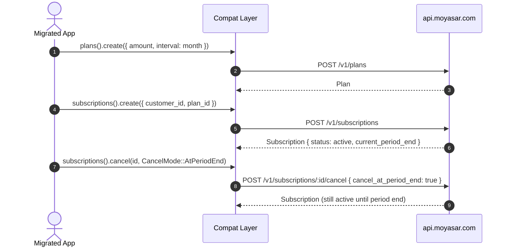

# US-8.2.0: Stripe Compatibility Layer — Plans, Subscriptions & Invoices

> **Spec Kit Specification**: [Specification Lifecycle Active](../../../docs/architecture/DECOMPOSITION_ROADMAP.md)  
> **Behavior Blueprint**: `features/core/modules/compat/behaviours/stripe-subscriptions/`  
> **Slicing Standard**: [10-PR Vertical Slicing Framework](../README.md#2-the-10-pr-vertical-slicing-framework-rust-sdk-adaptation)  
> **Security Gateway**: `security-audit` Level 2 Enforced  
> **Quality Gates**: `(G0–G4 + G-Review + G-Borrow + G-Law)`  

---

## 1. Spec Kit Specification

### 1.1 User Story Narrative
**As a** merchant with recurring billing already modelled in Stripe terms,  
**I want to** manage plans, subscriptions and subscription invoices through `client.plans()`, `client.subscriptions()` and `client.subscription_invoices()` using Stripe-shaped params,  
**So that** my recurring-revenue code migrates without a rewrite, while the SDK absorbs Moyasar's differences (plan `interval` naming, subscription status set, invoice linkage) and rejects anything it cannot faithfully translate.

#### 1.1.1 Preconditions
- `features = ["compat-stripe"]` (implies `core`, `payments`, `invoices`).
- A valid `SecretKey` with subscriptions entitlement.
- A customer id (US-8.1.0) for subscription creation.

#### 1.1.2 Postconditions
- `plans().create/retrieve/update/delete/list` operate on Moyasar plans with Stripe field names.
- `subscriptions().create/retrieve/update/cancel/list` return a Stripe-shaped `Subscription` with `status`, `current_period_start/end`, `plan_id`, `customer_id`.
- `subscription_invoices().list()` filters by subscription and returns Stripe-shaped invoices.
- Cancel is explicit (`cancel_at_period_end` vs immediate) and never silently immediate.

### 1.2 Acceptance Criteria (Gherkin Scenarios)

```gherkin
Feature: Stripe-Compatible Subscriptions

  Scenario: [AC-US-8.2.0-01] Create a plan with a billing interval
    Given a CreatePlanParams with amount, currency and interval month
    When client.plans().create(params) is called
    Then the returned Plan exposes id, amount, currency and interval
    And interval serializes to the documented wire value.

  Scenario: [AC-US-8.2.0-02] Create a subscription for a customer
    Given a customer id and a plan id
    When client.subscriptions().create(params) is called
    Then the returned Subscription.status is one of the documented statuses
    And current_period_start and current_period_end are populated.

  Scenario: [AC-US-8.2.0-03] Cancel at period end is distinct from immediate cancel
    Given an active subscription
    When cancel is requested with cancel_at_period_end true
    Then the request body carries that flag
    And the subscription remains active until current_period_end.

  Scenario: [AC-US-8.2.0-04] Immediate cancel is explicit
    Given an active subscription
    When cancel is requested with cancel_at_period_end false
    Then the subscription transitions to canceled immediately
    And the response status reflects the terminal state.

  Scenario: [AC-US-8.2.0-05] List subscription invoices
    Given a subscription with generated invoices
    When client.subscription_invoices().list({ subscription_id }) is called
    Then only invoices for that subscription are returned
    And each invoice exposes amount, status and period bounds.

  Scenario: [AC-US-8.2.0-06] Unsupported Stripe subscription fields are rejected
    Given a param set containing a Stripe-only subscription field
    When the request is built
    Then a typed UnsupportedCompatField error names the field
    And no request is sent.

  Scenario: [AC-US-8.2.0-LAW] SAMA recurring-charge consent and disclosure
    Given any subscription
    When it is created or cancelled
    Then the plan amount, currency and interval are recorded and cancellation takes effect at a disclosed date,
         satisfying SAMA recurring-payment consent and disclosure requirements.
```

### 1.3 Test Cases & Traceability Matrix

| Test Case ID | Target Criterion | Test Type | Execution Level | Verification Assertion & Pass Criteria |
| :--- | :--- | :--- | :--- | :--- |
| `TC-8.2.0-01` | `AC-US-8.2.0-01` | Functional | Unit | Interval wire value correct. |
| `TC-8.2.0-02` | `AC-US-8.2.0-02` | Functional | Integration | Status in set; period bounds present. |
| `TC-8.2.0-03` | `AC-US-8.2.0-03` | Functional | Unit | `cancel_at_period_end: true` on the wire. |
| `TC-8.2.0-04` | `AC-US-8.2.0-04` | Functional | Integration | Immediate cancel → terminal status. |
| `TC-8.2.0-05` | `AC-US-8.2.0-05` | Functional | Unit | Filter encoded; invoice fields present. |
| `TC-8.2.0-06` | `AC-US-8.2.0-06` | Validation | Unit | Typed error; zero calls. |
| `TC-8.2.0-LAW` | `AC-US-8.2.0-LAW` | Compliance | Static / Audit | Amount/interval recorded; cancel date disclosed. |

---

## 2. Behavior-Centric Architecture & Folder Blueprint

### 2.1 Colocated Behaviour Directory Tree

```
features/core/modules/compat/behaviours/stripe-subscriptions/
├── services/        # PlansService, SubscriptionsService, SubscriptionInvoicesService
├── logic/           # Interval mapping, cancel-mode resolution
├── types/           # Plan, Subscription, SubscriptionInvoice, SubscriptionStatus
└── constants/       # PLANS_PATH, SUBSCRIPTIONS_PATH, SUBSCRIPTION_INVOICES_PATH
```

### 2.2 Scoping & Promotion Blueprint
- **Tier 1 (Behaviour-Local)**: interval mapping.
- **Tier 2 (Module-Shared)**: `Subscription` shared with the compat invoice layer.
- **Tier 3 (Feature-Shared)**: three services under `compat-stripe`.
- **Tier 4 (Global-Shared)**: `client.plans()`, `client.subscriptions()`, `client.subscription_invoices()`.

---

## 3. Technical Implementation Plan

### 3.1 Domain Invariants & Storage Schema
- **Cancel Explicitness Law**: `cancel_at_period_end` must be explicit; no default that silently cancels immediately.
- **Interval Law**: intervals map to documented wire values (`day` | `week` | `month` | `year`).
- **Status Law**: `SubscriptionStatus` is a closed set with an `Unknown` fallback for forward compatibility.
- **Linkage Law**: every subscription invoice references its subscription.

```rust
#[derive(Debug, Clone, Deserialize)]
pub struct Plan {
    pub id: Uuid,
    pub amount: u64,
    pub currency: Currency,
    pub interval: PlanInterval,
    pub description: Option<String>,
    pub created_at: DateTime<Utc>,
}

#[derive(Debug, Clone, Copy, PartialEq, Eq, Serialize, Deserialize)]
#[serde(rename_all = "lowercase")]
pub enum PlanInterval { Day, Week, Month, Year }

#[derive(Debug, Clone, Deserialize)]
pub struct Subscription {
    pub id: Uuid,
    pub customer_id: Uuid,
    pub plan_id: Uuid,
    pub status: SubscriptionStatus,
    pub current_period_start: DateTime<Utc>,
    pub current_period_end: DateTime<Utc>,
    pub cancel_at_period_end: bool,
}

#[derive(Debug, Clone, Copy, PartialEq, Eq, Deserialize)]
#[serde(rename_all = "snake_case")]
pub enum SubscriptionStatus {
    Active, Trialing, PastDue, Canceled, Incomplete, #[serde(other)] Unknown,
}

#[derive(Debug, Clone, Copy, PartialEq, Eq)]
pub enum CancelMode { AtPeriodEnd, Immediate }

impl CancelMode {
    /// Explicit by construction: no silent default.
    pub fn cancel_at_period_end(self) -> bool {
        matches!(self, Self::AtPeriodEnd)
    }
}
```

### 3.2 Activity & Interaction Diagram



---

## 4. Granular Implementation Tasks

### 4.1 The 10-PR Vertical Slicing Implementation Plan

| PR # | Pillar | Architectural Layer | Primary Scope & Files | Deliverables & Acceptance | Accountable Role / Agent | Assigned Skills |
| :--- | :--- | :--- | :--- | :--- | :--- | :--- |
| **PR 1** | **Pillar 1** | **Domain Logic & Core Traits** | `src/compat/plan.rs` | `Plan`, `PlanInterval`. | `engineering-software-architect` | `security-audit` |
| **PR 2** | **Pillar 2** | **Request Modeling** | `src/compat/subscription_params.rs` | Create/update/cancel params. | `engineering-backend-architect` | `security-audit` |
| **PR 3** | **Pillar 3** | **Transport Wire Adapter** | `src/compat/plans.rs` | Plan CRUD endpoints. | `engineering-backend-architect` | `security-audit` |
| **PR 4** | **Pillar 4** | **Service Accessor** | `src/compat/mod.rs` | Three service accessors. | `engineering-software-architect` | `security-audit` |
| **PR 5** | **Pillar 5** | **Error Taxonomy** | `src/kernel/error.rs` | `UnsupportedCompatField`, invalid-interval. | `security-application-security-engineer` | `security-audit` |
| **PR 6** | **Pillar 6** | **Resource Facade Mounting** | `src/lib.rs` | Feature-gated exports. | `engineering-software-architect` | `security-audit` |
| **PR 7** | **Pillar 7** | **Zero-Copy Hardening** | `src/compat/subscriptions.rs` | Borrow params; no cloning of ids. | `agency-rust-refactoring-specialist` | `security-audit` |
| **PR 8** | **Pillar 8** | **Edge Cases & Guards** | `src/compat/subscription_cancel.rs` | Explicit `CancelMode`; no silent default. | `agency-api-tester` | `security-audit` |
| **PR 9** | **Pillar 9** | **Integration Wire Verification** | `tests/compat_subscriptions_test.rs` | Plan → subscription → cancel → invoices. | `agency-api-tester` | `security-audit` |
| **PR 10** | **Pillar 10** | **Documentation & Packaging** | `README.md` | Recurring-billing migration guide. | `engineering-technical-writer` | `security-audit` |

### 4.2 Implementation Phase Breakdown

#### Phase 1: Types & Params (PR 1–2)
- [ ] **Task 1.1 (Plan/Subscription Types)**: structs + status enum.  
  *Agent*: `engineering-software-architect` | *Skill*: `security-audit`
- [ ] **Task 1.2 (Params)**: create/update/cancel params.  
  *Agent*: `engineering-backend-architect` | *Skill*: `security-audit`

#### Phase 2: Endpoints (PR 3–6)
- [ ] **Task 2.1 (Plans)**: full CRUD.  
  *Agent*: `engineering-backend-architect` | *Skill*: `security-audit`
- [ ] **Task 2.2 (Subscriptions)**: create/retrieve/update/list.  
  *Agent*: `engineering-backend-architect` | *Skill*: `security-audit`
- [ ] **Task 2.3 (Subscription Invoices)**: filtered list.  
  *Agent*: `engineering-backend-architect` | *Skill*: `security-audit`

#### Phase 3: Guards (PR 7–8)
- [ ] **Task 3.1 (Cancel Mode)**: explicit enum, no default.  
  *Agent*: `agency-api-tester` | *Skill*: `security-audit`
- [ ] **Task 3.2 (Unsupported Fields)**: typed rejection.  
  *Agent*: `agency-api-tester` | *Skill*: `security-audit`

#### Phase 4: Verification & Sign-Off (PR 9–10)
- [ ] **Task 4.1 (Wire Tests)**: full recurring lifecycle.  
  *Agent*: `agency-api-tester` | *Skill*: `security-audit`
- [ ] **Task 4.2 (G-Review)**: peer review on cancel semantics.  
  *Agent*: `agency-code-reviewer` | *Skill*: `security-audit`
- [ ] **Task 4.3 (Documentation)**: recurring-billing migration guide.  
  *Agent*: `engineering-technical-writer` | *Skill*: `security-audit`

---

## 5. Security Gateway (Powered by security-audit)

### 5.1 Trust Boundaries & Security Actors
- **Trust Boundaries**:
  - `Recurring Charge Boundary`: future charges occur without the cardholder present.
  - `Cancellation Boundary`: a wrong cancel mode changes billing behaviour.
- **Authorized Principals**: merchant backend (`sk_`).

### 5.2 Threat Modeling & Abuse Matrix (STRIDE / ASVS)

| Threat Vector | Severity | Vulnerability Mechanism | Mitigating Control & Security Invariant |
| :--- | :--- | :--- | :--- |
| **Silent Immediate Cancel** | High | Default cancel mode terminates service unexpectedly | `CancelMode` is a required explicit enum. |
| **Interval Misinterpretation** | High | `month` mapped to `day`, over-charging | Closed `PlanInterval` enum with wire-value tests. |
| **Unsupported Field Drop** | High | Stripe field ignored, wrong billing terms | Typed `UnsupportedCompatField` rejection. |
| **Orphaned Invoice** | Medium | Invoice not linked to a subscription | `subscription_id` required on list filters. |
| **Status Misread** | Medium | Unknown status treated as active | `Unknown` variant forces explicit handling. |

### 5.3 Cryptographic & Data Protection Controls
- **Explicit Cancel Semantics**: no implicit defaults.
- **Closed Enums**: intervals and statuses are exhaustive.
- **Linkage Enforcement**: invoices always reference a subscription.

### 5.4 Automated Security Verification Checklist
- [ ] **Cancel Test**: both modes produce distinct wire bodies.
- [ ] **Interval Test**: all four intervals map correctly.
- [ ] **Unsupported Test**: typed error, zero calls.
- [ ] **Status Test**: `Unknown` never treated as active.

### 5.5 Security Gateway (G2) Sign-Off Checklist
- [ ] Recurring-billing controls verified against OWASP ASVS Level 2.
- [ ] Cancel semantics certified.
- [ ] Zero silent field drops.
- [ ] Independent reviewer sign-off; zero open findings.

---

## 6. Validation Gates & Acceptance Sign-Off

**Status: Ready for Implementation.**

### G0 — Build, lint & format
- [ ] **US-8.2.0-G0:** `cargo build && cargo clippy -- -D warnings && cargo fmt --check` clean.

### G1 — Test coverage
- [ ] **US-8.2.0-G1:** ≥90% line / ≥85% branch on the compat subscriptions module.

### G2 — Security audit
- [ ] **US-8.2.0-G2:** Recurring-billing audit passes with zero critical/high findings.

### G3 — Architecture and maintainability
- [ ] **US-8.2.0-G3:** Compat subscriptions depend on kernel + invoices only.

### G-Review — Code review
- [ ] **US-8.2.0-G-Review:** Peer review on cancel semantics and interval mapping.

### G-Borrow — Rust zero-clone validation
- [ ] **US-8.2.0-G-Borrow:** Params borrowed during mapping.

### G-Complexity — Cyclomatic complexity
- [ ] **US-8.2.0-G-Complexity:** $CC \le 6$; nesting $\le 2$.

### G-Docs — Public docs & examples
- [ ] **US-8.2.0-G-Docs:** 100% public symbols documented; migration guide published.

### G-Law — Law validation
- [ ] **US-8.2.0-G-Law:** SAMA recurring-charge consent and disclosure certified.

### G4 — Integrated acceptance
- [ ] **US-8.2.0-G4:** Plan → subscription → cancel → invoices verified against the mock server.
