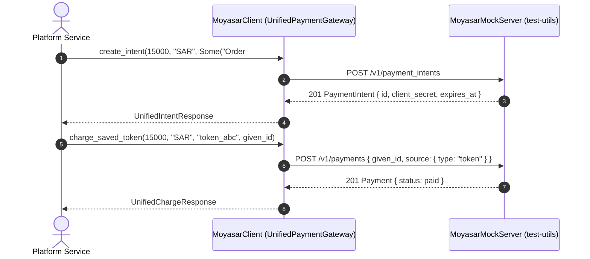

# US-8.3.0: `some-payments` Unified Gateway Trait Adapter & Deterministic `test-utils` Mock Suite

> **Spec Kit Specification**: [Specification Lifecycle Active](../../../docs/architecture/DECOMPOSITION_ROADMAP.md)  
> **Behavior Blueprint**: `src/`  
> **Slicing Standard**: [10-PR Vertical Slicing Framework](../README.md#2-the-10-pr-vertical-slicing-framework-rust-sdk-adaptation)  
> **Security Gateway**: `security-audit` Level 2 Enforced  
> **Quality Gates**: `(G0–G4 + G-Review + G-Borrow + G-Law)`  

---

## 1. Spec Kit Specification

### 1.1 User Story Narrative
**As a** multi-gateway platform engineer integrating `some-moyasar` alongside `some-stripe` and `some-paymob` inside the `some-payments` ecosystem,  
**I want to** program against the `UnifiedPaymentGateway` trait (`create_intent`, `charge_saved_token`, `refund_or_void`, `verify_webhook`) implemented for `MoyasarClient` in `src/unified.rs`, and run offline CI tests against `MoyasarMockServer` and deterministic JSON fixtures in `src/test_utils/` (`test-utils` feature flag),  
**So that** cross-gateway checkout, off-session token charging, smart reversals, and constant-time webhook verification work uniformly across providers, and every Moyasar edge case (all 11 webhook events including `payment_faild`, STC Pay sandbox numbers `0515555555`/`0515555558`/`0515555559`, SADAD biller `007`, and ISO 8583 response codes) is deterministically testable offline.

#### 1.1.1 Preconditions
- `features = ["some-payments-trait"]` (alias `some-payment-trait`; implies `core`, `payments`, `payment-intents`, `tokens`, `webhook-engine`) for `src/unified.rs`.
- `features = ["test-utils"]` for `src/test_utils/fixtures.rs` and `src/test_utils/mock.rs`.

#### 1.1.2 Postconditions
- `impl UnifiedPaymentGateway for MoyasarClient` normalizes `create_intent` (`POST /v1/payment_intents`), `charge_saved_token` (`POST /v1/payments` with `TokenSource` and `given_id`), `refund_or_void` (smart ~2h void-else-refund routing), and `verify_webhook` (`ConstantTimeSecretVerifier`).
- `src/test_utils/fixtures.rs` provides deterministic JSON fixture generators for all 11 webhook event types (including `"payment_faild"`), STC Pay sandbox numbers (`0515555555`, `0515555558`, `0515555559`), SADAD sandbox biller `007`, and ISO 8583 response codes.
- `src/test_utils/mock.rs` provides `MoyasarMockServer` for hermetic local/CI integration testing.

### 1.2 Acceptance Criteria (Gherkin Scenarios)

```gherkin
Feature: UnifiedPaymentGateway Adapter and Deterministic test-utils Mock Server

  Scenario: [AC-US-8.3.0-01] MoyasarClient implements UnifiedPaymentGateway
    Given a configured MoyasarClient and a shared webhook verifier secret
    When create_intent, charge_saved_token, refund_or_void, and verify_webhook are invoked through UnifiedPaymentGateway
    Then each operation dispatches to its canonical Moyasar primitive and returns unified response types.

  Scenario: [AC-US-8.3.0-02] Deterministic JSON fixtures cover all 11 webhook events and sandbox edge cases
    Given the test-utils fixtures module
    When fixture payloads are generated for all 11 webhook event types (plus "payment_faild"), STC Pay (0515555555, 0515555558, 0515555559), SADAD (007), and ISO 8583 codes
    Then every fixture deserializes cleanly into its strongly typed SDK model without errors.

  Scenario: [AC-US-8.3.0-03] MoyasarMockServer serves hermetic local HTTP responses for CI
    Given a running MoyasarMockServer instance bound to 127.0.0.1
    When MoyasarClient executes end-to-end payment, intent, token, and webhook flows against the mock server
    Then all assertions pass with zero outbound internet requests.

  Scenario: [AC-US-8.3.0-LAW] SAMA cross-provider auditability and integer minor-unit fidelity
    Given any operation executed through UnifiedPaymentGateway
    When amounts, currencies, and idempotency keys are normalized
    Then amounts remain exact u64 minor units (halalas/cents/fils) with zero f64 conversion andgiven_id is preserved,
         satisfying SAMA audit-trail and monetary precision requirements.
```

### 1.3 Test Cases & Traceability Matrix

| Test Case ID | Target Criterion | Test Type | Execution Level | Verification Assertion & Pass Criteria |
| :--- | :--- | :--- | :--- | :--- |
| `TC-8.3.0-01` | `AC-US-8.3.0-01` | Functional | Integration | All 4 `UnifiedPaymentGateway` methods succeed against mock responders. |
| `TC-8.3.0-02` | `AC-US-8.3.0-02` | Functional | Unit | All 11+1 webhook fixtures, 3 STC Pay sandbox numbers, SADAD `007`, and ISO 8583 fixtures parse cleanly. |
| `TC-8.3.0-03` | `AC-US-8.3.0-03` | Functional | Integration | `MoyasarMockServer` handles full conformance suite offline. |
| `TC-8.3.0-LAW` | `AC-US-8.3.0-LAW` | Compliance | Static / Audit | Zero `f64` in unified adapter; `given_id` idempotency preserved. |

---

## 2. Behavior-Centric Architecture & Folder Blueprint

### 2.1 Rust Crate Module & Unit File Ownership Tree

```
src/
├── src/unified.rs                             # Unit 1 (feat/us-8.3.0/unit-1-unified-trait)
├── src/test_utils/fixtures.rs                 # Unit 2 (feat/us-8.3.0/unit-2-test-fixtures)
├── src/test_utils/mock.rs                     # Unit 3 (feat/us-8.3.0/unit-3-mock-responder)
```

### 2.2 Scoping & Promotion Blueprint
- **Tier 1 (Behaviour-Local)**: Unified response mapping and mock HTTP route table.
- **Tier 2 (Module-Shared)**: Deterministic JSON fixtures in `src/test_utils/fixtures.rs`.
- **Tier 3 (Feature-Shared)**: `UnifiedPaymentGateway` under `some-payments-trait` and `MoyasarMockServer` under `test-utils`.
- **Tier 4 (Global-Shared)**: Re-exported from crate root when respective features are enabled.

---

## 3. Technical Implementation Plan

### 3.1 Domain Invariants & Storage Schema
- **Integer Minor-Unit Law**: `amount_minor: u64` is passed directly in minor units (halalas for SAR) with zero floating-point math.
- **Idempotency Normalization Law**: `charge_saved_token` forwards `idempotency_key: Uuid` directly into `CreatePaymentParams.given_id`.
- **Hermetic Mock Law**: `MoyasarMockServer` binds to `127.0.0.1:0` and requires zero external network access.

```rust
#[async_trait::async_trait]
pub trait UnifiedPaymentGateway: Send + Sync {
    type Error: std::error::Error + Send + Sync + 'static;

    async fn create_intent(
        &self,
        amount_minor: u64,
        currency: &str,
        description: Option<&str>,
        callback_url: &str,
    ) -> Result<UnifiedIntentResponse, Self::Error>;

    async fn charge_saved_token(
        &self,
        amount_minor: u64,
        currency: &str,
        token_id: &str,
        idempotency_key: Uuid,
    ) -> Result<UnifiedChargeResponse, Self::Error>;

    async fn refund_or_void(
        &self,
        transaction_id: &str,
        amount_minor: Option<u64>,
    ) -> Result<UnifiedReversalResponse, Self::Error>;

    fn verify_webhook(
        &self,
        headers: &http::HeaderMap,
        raw_body: &[u8],
    ) -> Result<UnifiedWebhookEvent, Self::Error>;
}
```

### 3.2 Activity & Interaction Diagram



---

## 4. Granular Implementation Tasks

### 4.1 Dynamic 3-Unit Parallel Implementation Plan

| Unit # | Branch | Exclusive Owner Files | Deliverables & Colocated Unit Tests | Accountable Role / Agent | Assigned Skills |
| :--- | :--- | :--- | :--- | :--- | :--- |
| **Unit 1** | `feat/us-8.3.0/unit-1-unified-trait` | `src/unified.rs` | `impl UnifiedPaymentGateway for MoyasarClient`: create_intent, charge_saved_token, refund_or_void, verify_webhook. Normalization: idempotency_key → given_id, webhook verification via ConstantTimeSecretVerifier | `engineering-software-architect` | `security-audit` |
| **Unit 2** | `feat/us-8.3.0/unit-2-test-fixtures` | `src/test_utils/fixtures.rs` | Deterministic JSON fixtures: all 11 webhook event types (including payment_faild), STC Pay mock responses (0515555555, 0515555558, 0515555559), SADAD sandbox biller 007, ISO 8583 response codes | `engineering-backend-architect` | `security-audit` |
| **Unit 3** | `feat/us-8.3.0/unit-3-mock-responder` | `src/test_utils/mock.rs` | `MoyasarMockServer` local HTTP mock responder and route handlers under `test-utils` feature flag, conformance unit tests | `engineering-backend-architect` | `security-audit` |

### 4.2 Parallel Unit Execution & Story Merge Breakdown

#### Wave 1: Base Branch Scaffolding (`feat/us-8.3.0-*`)
- [ ] **Task 0.1 (Story Base Contracts)**: Verify `Cargo.toml`, `src/lib.rs`, and the domain's `mod.rs` + `service.rs` facade declarations are present on the story base branch before spawning parallel unit worktrees.  
  *Agent*: `story-leader` | *Skill*: `divide-and-conquer-orchestrator`

#### Wave 2: 100% Parallel Unit Implementation (`Unit 1..3`)
- [ ] **Unit 1 (`feat/us-8.3.0/unit-1-unified-trait`)**: `impl UnifiedPaymentGateway for MoyasarClient`: create_intent, charge_saved_token, refund_or_void, verify_webhook. Normalization: idempotency_key → given_id, webhook verification via ConstantTimeSecretVerifier (Files: `src/unified.rs`)  
  *Agent*: `engineering-software-architect` | *Skill*: `security-audit`
- [ ] **Unit 2 (`feat/us-8.3.0/unit-2-test-fixtures`)**: Deterministic JSON fixtures: all 11 webhook event types (including payment_faild), STC Pay mock responses (0515555555, 0515555558, 0515555559), SADAD sandbox biller 007, ISO 8583 response codes (Files: `src/test_utils/fixtures.rs`)  
  *Agent*: `engineering-backend-architect` | *Skill*: `security-audit`
- [ ] **Unit 3 (`feat/us-8.3.0/unit-3-mock-responder`)**: `MoyasarMockServer` local HTTP mock responder and route handlers under `test-utils` feature flag, conformance unit tests (Files: `src/test_utils/mock.rs`)  
  *Agent*: `engineering-backend-architect` | *Skill*: `security-audit`

#### Wave 3: Cascading Merge & Story Integration Verification
- [ ] **Task 3.1 (Cascading Merge & Wire Verification)**: Merge `Unit 1 -> ... -> Unit 3` into the story branch and run story-level wire integration tests and `G0–G4` quality gates.  
  *Agent*: `testing-api-tester` | *Skill*: `security-audit`
- [ ] **Task 3.2 (Council Review & Sign-Off)**: Execute independent Multi-Council Review (`G-Review`, `G-Borrow`, `G-Complexity`, `G-Docs`, `G-Law`).  
  *Agent*: `engineering-code-reviewer` | *Skill*: `code-review-council`

---

## 5. Security Gateway (Powered by security-audit)

### 5.1 Trust Boundaries & Security Actors
- **Trust Boundaries**:
  - `Unified Gateway Boundary`: normalizes provider-specific primitives without leaking secrets or losing idempotency keys.
  - `Test Fixture Boundary`: synthetic sandbox credentials (`sk_test_...`, `pk_test_...`) clearly isolated under `test-utils`.
- **Authorized Principals**: platform backend (`sk_`).

### 5.2 Threat Modeling & Abuse Matrix (STRIDE / ASVS)

| Threat Vector | Severity | Vulnerability Mechanism | Mitigating Control & Security Invariant |
| :--- | :--- | :--- | :--- |
| **Idempotency Loss Across Adapter** | High | Adapter drops `idempotency_key` when calling `POST /v1/payments` | `idempotency_key` mapped directly to `CreatePaymentParams.given_id`. |
| **Webhook Verification Bypass** | Critical | Unified `verify_webhook` skips constant-time check | Delegates directly to `ConstantTimeSecretVerifier`. |
| **Live Key in Test Fixtures** | High | Accidental `sk_live_` token committed in fixtures | Fixtures strictly use `sk_test_` / `pk_test_` synthetic values. |

### 5.3 Cryptographic & Data Protection Controls
- **Constant-Time Delegation**: `verify_webhook` uses `ConstantTimeSecretVerifier`.
- **Integer Money**: `u64` minor units across all trait methods.

### 5.4 Automated Security Verification Checklist
- [ ] **Idempotency Test**: `charge_saved_token` forwards `idempotency_key` into `given_id`.
- [ ] **Webhook Test**: `verify_webhook` rejects tampered `secret_token` in constant time.
- [ ] **Fixture Scan**: zero `sk_live_` or real PANs in `src/test_utils/fixtures.rs`.

### 5.5 Security Gateway (G2) Sign-Off Checklist
- [ ] Unified adapter and test utilities verified against OWASP ASVS Level 2.
- [ ] Idempotency and constant-time webhook verification enforced.
- [ ] Independent reviewer sign-off; zero open findings.

---

## 6. Validation Gates & Acceptance Sign-Off

**Status: Ready for Implementation.**

### G0 — Build, lint & format
- [ ] **US-8.3.0-G0:** `cargo build --all-features && cargo clippy --all-features -- -D warnings && cargo fmt --check` clean.

### G1 — Test coverage
- [ ] **US-8.3.0-G1:** ≥90% line / ≥85% branch on `unified` and `test_utils`.

### G2 — Security audit
- [ ] **US-8.3.0-G2:** Unified adapter audit passes with zero critical/high findings.

### G3 — Architecture and maintainability
- [ ] **US-8.3.0-G3:** `test-utils` is opt-in and never compiled into default production builds.

### G-Review — Code review
- [ ] **US-8.3.0-G-Review:** Peer review on trait normalization and fixture completeness.

### G-Borrow — Rust zero-clone validation
- [ ] **US-8.3.0-G-Borrow:** Trait methods accept `&str` and `&[u8]` slices without unnecessary allocations.

### G-Complexity — Cyclomatic complexity
- [ ] **US-8.3.0-G-Complexity:** $CC \le 6$; nesting $\le 2$.

### G-Docs — Public docs & examples
- [ ] **US-8.3.0-G-Docs:** 100% public symbols documented; `MoyasarMockServer` and `UnifiedPaymentGateway` examples runnable.

### G-Law — Law validation
- [ ] **US-8.3.0-G-Law:** SAMA cross-provider auditability and minor-unit precision certified.

### G4 — Integrated acceptance
- [ ] **US-8.3.0-G4:** Full cross-provider conformance suite passes against `MoyasarClient` and `MoyasarMockServer`.
