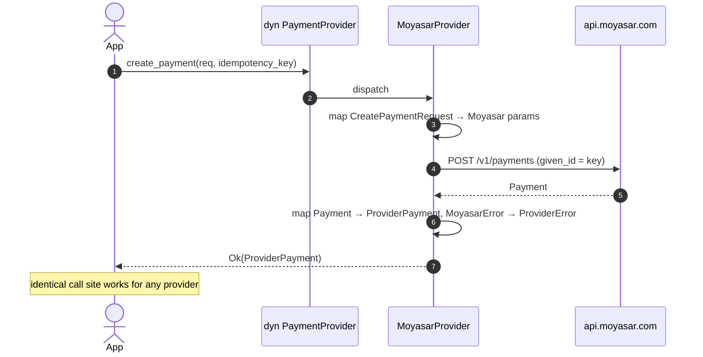

# US-8.3.0: `some-payment` Provider Trait & Cross-Provider Conformance Suite

> **Spec Kit Specification**: [Specification Lifecycle Active](../../../docs/architecture/DECOMPOSITION_ROADMAP.md)  
> **Behavior Blueprint**: `features/core/modules/compat/behaviours/some-payment-trait/`  
> **Slicing Standard**: [10-PR Vertical Slicing Framework](../README.md#2-the-10-pr-vertical-slicing-framework-rust-sdk-adaptation)  
> **Security Gateway**: `security-audit` Level 2 Enforced  
> **Quality Gates**: `(G0–G4 + G-Review + G-Borrow + G-Law)`  

---

## 1. Spec Kit Specification

### 1.1 User Story Narrative
**As a** platform engineer who must support more than one payment provider,  
**I want to** program against a single `PaymentProvider` trait from the `some-payment` crate, with Moyasar as one implementation, and run one shared conformance suite against every implementation,  
**So that** swapping or adding a provider is a dependency change rather than a rewrite, and every provider is proven to honour the same money, idempotency and error semantics.

#### 1.1.1 Preconditions
- `features = ["some-payment"]` (implies `core`, `payments`).
- The `some-payment` crate providing the `PaymentProvider` trait.
- A `MoyasarProvider` adapter wrapping `MoyasarClient`.

#### 1.1.2 Postconditions
- `PaymentProvider` defines `create_payment`, `retrieve_payment`, `refund`, `capture`, `void` as `async` trait methods returning provider-agnostic types.
- `MoyasarProvider` implements every method, mapping `MoyasarError` into the trait's `ProviderError`.
- A shared conformance suite (`tests/conformance/`) runs against any `PaymentProvider` via a generic harness.
- Money is expressed in minor units with an explicit currency; no provider-specific types leak through the trait.

### 1.2 Acceptance Criteria (Gherkin Scenarios)

```gherkin
Feature: Provider-Agnostic Payment Abstraction

  Scenario: [AC-US-8.3.0-01] Moyasar implements the full provider trait
    Given a MoyasarProvider wrapping a configured client
    When it is used as a dyn PaymentProvider
    Then all trait methods are callable
    And the code compiles without provider-specific types at the call site.

  Scenario: [AC-US-8.3.0-02] Provider-agnostic money representation
    Given a payment of 10050 SAR
    When created through the trait
    Then the amount is expressed as 10050 minor units with currency SAR
    And no float is used anywhere in the money path.

  Scenario: [AC-US-8.3.0-03] Errors are normalized across providers
    Given a provider error (e.g. card declined)
    When surfaced through the trait
    Then it is a ProviderError variant, not a MoyasarError
    And the original provider error is retained as a source for diagnostics.

  Scenario: [AC-US-8.3.0-04] Idempotency is part of the contract
    Given the same idempotency key used twice through the trait
    When both calls execute
    Then the provider returns the same logical payment
    And the conformance suite asserts this for every implementation.

  Scenario: [AC-US-8.3.0-05] The conformance suite is provider-generic
    Given a generic harness parameterized over PaymentProvider
    When run against MoyasarProvider
    Then all conformance cases execute
    And adding a second provider requires no changes to the suite.

  Scenario: [AC-US-8.3.0-06] Refund and void semantics are uniform
    Given a captured payment
    When refund and void are invoked through the trait
    Then both return provider-agnostic results
    And a void on a settled payment yields a normalized UnsupportedOperation error.

  Scenario: [AC-US-8.3.0-LAW] SAMA auditability across provider abstraction
    Given any operation through the trait
    When it is logged for audit
    Then the provider name, operation, amount, currency and idempotency key are recorded without card data,
         satisfying SAMA audit-trail requirements independent of the underlying provider.
```

### 1.3 Test Cases & Traceability Matrix

| Test Case ID | Target Criterion | Test Type | Execution Level | Verification Assertion & Pass Criteria |
| :--- | :--- | :--- | :--- | :--- |
| `TC-8.3.0-01` | `AC-US-8.3.0-01` | Compile | Static | `dyn PaymentProvider` usage compiles. |
| `TC-8.3.0-02` | `AC-US-8.3.0-02` | Functional | Unit | Integer minor units; no `f64` in money path. |
| `TC-8.3.0-03` | `AC-US-8.3.0-03` | Functional | Unit | `ProviderError` with `source()` preserved. |
| `TC-8.3.0-04` | `AC-US-8.3.0-04` | Functional | Integration | Duplicate key → same logical payment. |
| `TC-8.3.0-05` | `AC-US-8.3.0-05` | Architecture | Static | Harness generic over `PaymentProvider`. |
| `TC-8.3.0-06` | `AC-US-8.3.0-06` | Functional | Integration | Uniform refund/void; normalized unsupported error. |
| `TC-8.3.0-LAW` | `AC-US-8.3.0-LAW` | Compliance | Static / Audit | Audit fields present; no card data. |

---

## 2. Behavior-Centric Architecture & Folder Blueprint

### 2.1 Colocated Behaviour Directory Tree

```
features/core/modules/compat/behaviours/some-payment-trait/
├── services/        # MoyasarProvider adapter
├── logic/           # Error normalization, money conversion
├── types/           # PaymentProvider trait, ProviderError, ProviderPayment
└── constants/       # PROVIDER_NAME ("moyasar")
```

### 2.2 Scoping & Promotion Blueprint
- **Tier 1 (Behaviour-Local)**: error normalization.
- **Tier 2 (Module-Shared)**: `ProviderPayment` used by the conformance suite.
- **Tier 3 (Feature-Shared)**: `MoyasarProvider` under `some-payment`.
- **Tier 4 (Global-Shared)**: re-exported trait from the `some-payment` crate.

---

## 3. Technical Implementation Plan

### 3.1 Domain Invariants & Storage Schema
- **No Leak Law**: no `MoyasarError` or Moyasar-specific type may appear in the trait signature.
- **Integer Money Law**: amounts are `u64` minor units plus an explicit `Currency`.
- **Idempotency Law**: every mutating trait method takes an idempotency key.
- **Source Law**: `ProviderError` retains the original error via `std::error::Error::source`.

```rust
#[async_trait::async_trait]
pub trait PaymentProvider: Send + Sync {
    fn name(&self) -> &'static str;

    async fn create_payment(
        &self,
        req: CreatePaymentRequest,
        idempotency_key: &str,
    ) -> Result<ProviderPayment, ProviderError>;

    async fn retrieve_payment(&self, id: &str) -> Result<ProviderPayment, ProviderError>;

    async fn refund(
        &self,
        id: &str,
        amount: Option<u64>,
        idempotency_key: &str,
    ) -> Result<ProviderRefund, ProviderError>;

    async fn capture(&self, id: &str, amount: Option<u64>) -> Result<ProviderPayment, ProviderError>;

    async fn void(&self, id: &str) -> Result<ProviderPayment, ProviderError>;
}

#[derive(Debug, Clone)]
pub struct CreatePaymentRequest {
    pub amount: u64,          // minor units
    pub currency: Currency,
    pub description: Option<String>,
    pub metadata: BTreeMap<String, String>,
}

#[derive(Debug, thiserror::Error)]
pub enum ProviderError {
    #[error("card declined: {0}")]
    Declined(String),
    #[error("insufficient funds")]
    InsufficientFunds,
    #[error("operation not supported by provider")]
    UnsupportedOperation,
    #[error("provider transport error")]
    Transport(#[source] Box<dyn std::error::Error + Send + Sync>),
    #[error("provider error: {0}")]
    Other(#[source] Box<dyn std::error::Error + Send + Sync>),
}

pub struct MoyasarProvider { client: MoyasarClient }

#[async_trait::async_trait]
impl PaymentProvider for MoyasarProvider {
    fn name(&self) -> &'static str { "moyasar" }

    async fn create_payment(&self, req: CreatePaymentRequest, key: &str)
        -> Result<ProviderPayment, ProviderError>
    {
        self.client
            .payments()
            .create_with_idempotency(req.into(), key)
            .await
            .map(ProviderPayment::from)
            .map_err(ProviderError::from)
    }
    // ...remaining methods
}
```

### 3.2 Activity & Interaction Diagram



---

## 4. Granular Implementation Tasks

### 4.1 The 10-PR Vertical Slicing Implementation Plan

| PR # | Pillar | Architectural Layer | Primary Scope & Files | Deliverables & Acceptance | Accountable Role / Agent | Assigned Skills |
| :--- | :--- | :--- | :--- | :--- | :--- | :--- |
| **PR 1** | **Pillar 1** | **Domain Logic & Core Traits** | `src/compat/provider/trait.rs` | `PaymentProvider` trait + provider-agnostic types. | `engineering-software-architect` | `security-audit` |
| **PR 2** | **Pillar 2** | **Request Modeling** | `src/compat/provider/request.rs` | `CreatePaymentRequest` in minor units. | `engineering-backend-architect` | `security-audit` |
| **PR 3** | **Pillar 3** | **Transport Wire Adapter** | `src/compat/provider/moyasar.rs` | `MoyasarProvider` implementing all methods. | `engineering-backend-architect` | `security-audit` |
| **PR 4** | **Pillar 4** | **Service Accessor** | `src/compat/provider/mod.rs` | `MoyasarClient::as_provider()`. | `engineering-software-architect` | `security-audit` |
| **PR 5** | **Pillar 5** | **Error Taxonomy** | `src/compat/provider/error.rs` | `ProviderError` + `From<MoyasarError>`. | `security-application-security-engineer` | `security-audit` |
| **PR 6** | **Pillar 6** | **Resource Facade Mounting** | `src/lib.rs` | Feature-gated `some-payment` export. | `engineering-software-architect` | `security-audit` |
| **PR 7** | **Pillar 7** | **Zero-Copy Hardening** | `src/compat/provider/moyasar.rs` | Borrow request fields; no intermediate clones. | `agency-rust-refactoring-specialist` | `security-audit` |
| **PR 8** | **Pillar 8** | **Edge Cases & Guards** | `src/compat/provider/error.rs` | Void-on-settled → `UnsupportedOperation`. | `agency-api-tester` | `security-audit` |
| **PR 9** | **Pillar 9** | **Integration Wire Verification** | `tests/conformance/mod.rs` | Generic harness + Moyasar conformance run. | `agency-api-tester` | `security-audit` |
| **PR 10** | **Pillar 10** | **Documentation & Packaging** | `README.md` | "Add a provider" guide + trait docs. | `engineering-technical-writer` | `security-audit` |

### 4.2 Implementation Phase Breakdown

#### Phase 1: Trait & Types (PR 1–2)
- [ ] **Task 1.1 (Trait)**: `PaymentProvider` with 5 async methods.  
  *Agent*: `engineering-software-architect` | *Skill*: `security-audit`
- [ ] **Task 1.2 (Request Types)**: minor-unit money + currency.  
  *Agent*: `engineering-backend-architect` | *Skill*: `security-audit`

#### Phase 2: Adapter (PR 3–6)
- [ ] **Task 2.1 (MoyasarProvider)**: implement all trait methods.  
  *Agent*: `engineering-backend-architect` | *Skill*: `security-audit`
- [ ] **Task 2.2 (Error Mapping)**: `From<MoyasarError> for ProviderError`.  
  *Agent*: `security-application-security-engineer` | *Skill*: `security-audit`

#### Phase 3: Guards (PR 7–8)
- [ ] **Task 3.1 (Unsupported Ops)**: normalize void-on-settled.  
  *Agent*: `agency-api-tester` | *Skill*: `security-audit`
- [ ] **Task 3.2 (Idempotency)**: key threaded through every mutating method.  
  *Agent*: `agency-rust-refactoring-specialist` | *Skill*: `security-audit`

#### Phase 4: Conformance & Sign-Off (PR 9–10)
- [ ] **Task 4.1 (Harness)**: generic `run_conformance<P: PaymentProvider>(p: P)`.  
  *Agent*: `agency-api-tester` | *Skill*: `security-audit`
- [ ] **Task 4.2 (G-Review)**: peer review on trait purity (no provider leakage).  
  *Agent*: `agency-code-reviewer` | *Skill*: `security-audit`
- [ ] **Task 4.3 (Documentation)**: provider-addition guide.  
  *Agent*: `engineering-technical-writer` | *Skill*: `security-audit`

---

## 5. Security Gateway (Powered by security-audit)

### 5.1 Trust Boundaries & Security Actors
- **Trust Boundaries**:
  - `Abstraction Boundary`: the trait is the only surface platform code sees.
  - `Provider Boundary`: each implementation holds its own credentials.
- **Authorized Principals**: platform backend (`sk_` per provider).

### 5.2 Threat Modeling & Abuse Matrix (STRIDE / ASVS)

| Threat Vector | Severity | Vulnerability Mechanism | Mitigating Control & Security Invariant |
| :--- | :--- | :--- | :--- |
| **Error Information Leak** | Medium | Raw provider error exposing internals | `ProviderError` normalizes; source retained but not displayed by default. |
| **Idempotency Bypass** | High | Provider adapter drops the key | Key is a required parameter on every mutating method. |
| **Money Precision Loss** | Critical | Float conversion in the adapter | `u64` minor units only; no `f64` in the money path. |
| **Provider Type Leakage** | Medium | `MoyasarError` in the trait signature | Compile-time enforced purity; no provider types in the trait. |
| **Credential Cross-Use** | Critical | One provider's key used for another | Each adapter owns its client and credentials. |

### 5.3 Cryptographic & Data Protection Controls
- **Trait Purity**: no provider-specific types in signatures.
- **Integer Money**: exact minor-unit arithmetic.
- **Idempotency Contract**: mandatory key parameter.

### 5.4 Automated Security Verification Checklist
- [ ] **Purity Test**: `dyn PaymentProvider` compiles with no provider imports.
- [ ] **Money Test**: no `f64` in the money path (grep + clippy).
- [ ] **Idempotency Test**: duplicate key returns the same logical payment.
- [ ] **Error Test**: `source()` chain preserved; no secrets in `Display`.

### 5.5 Security Gateway (G2) Sign-Off Checklist
- [ ] Abstraction verified against OWASP ASVS Level 2.
- [ ] Trait purity certified.
- [ ] Idempotency contract enforced.
- [ ] Independent reviewer sign-off; zero open findings.

---

## 6. Validation Gates & Acceptance Sign-Off

**Status: Ready for Implementation.**

### G0 — Build, lint & format
- [ ] **US-8.3.0-G0:** `cargo build && cargo clippy -- -D warnings && cargo fmt --check` clean.

### G1 — Test coverage
- [ ] **US-8.3.0-G1:** ≥90% line / ≥85% branch on the provider adapter; 100% of trait methods covered by conformance.

### G2 — Security audit
- [ ] **US-8.3.0-G2:** Abstraction audit passes with zero critical/high findings.

### G3 — Architecture and maintainability
- [ ] **US-8.3.0-G3:** Trait has zero provider-specific types; adding a provider touches no shared code.

### G-Review — Code review
- [ ] **US-8.3.0-G-Review:** Peer review on trait purity and error normalization.

### G-Borrow — Rust zero-clone validation
- [ ] **US-8.3.0-G-Borrow:** Adapter borrows request fields; no intermediate clones.

### G-Complexity — Cyclomatic complexity
- [ ] **US-8.3.0-G-Complexity:** $CC \le 6$; nesting $\le 2$.

### G-Docs — Public docs & examples
- [ ] **US-8.3.0-G-Docs:** 100% public symbols documented; "add a provider" guide ships.

### G-Law — Law validation
- [ ] **US-8.3.0-G-Law:** SAMA audit-trail requirements certified provider-independently.

### G4 — Integrated acceptance
- [ ] **US-8.3.0-G4:** Full conformance suite passes against `MoyasarProvider`.
