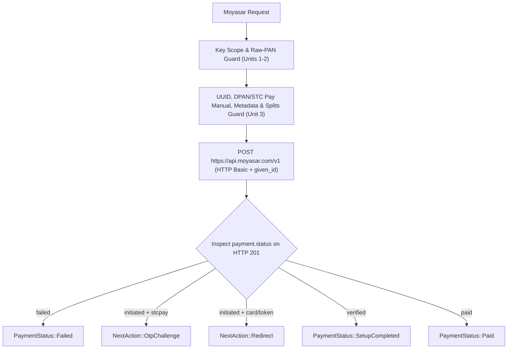

# User Story `US-9.1.0`: Moyasar Pre-Integration Hardening (Key-Prefix Mode & Scope Guards, Raw-PAN Default-Deny, HTTP 201 Status/NextAction, Pre-Flight Rules & `given_id`)

- **Module**: `module-9-some-payment-alignment` (`some-payment` Orchestrator Alignment & Optional Adapter)
- **Story Branch**: `feat/us-9.1.0-moyasar-core-hardening-and-preflight-rules`
- **Field Profile**: `software`
- **Story Decomposition Score ($S_{\text{story}}$)**: `2.65` $\to$ **`5` Parallel Implementation Units (`unit-1..5`)**

---

## 1. Spec Kit Specifications

### 1.1 User Story Narrative
> **As a** `some-payment` integrator routing SAR/mada/STC Pay/SADAD payments through `some-moyasar`,  
> **I want** `some-moyasar` to detect mode strictly from key prefixes (`sk_test_`/`sk_live_`), fail closed on `pk_` misuse and raw server-side PANs, inspect `payment.status` on HTTP 201, enforce DPAN/STC Pay/UUID/metadata/splits pre-flight checks, forward `given_id`, and map `3ds_auth_error` to `ThreeDsFailed`,  
> **So that** Moyasar's HTTP 201 and non-idempotent mutation quirks never trigger false `Paid` states, PCI violations, or misclassified merchant auth alerts.

Implements every P0 and P1 core alignment item for `some-moyasar` from `some-payment/docs/sdk-implementation.md`.

#### 1.1.1 Preconditions
- `some-moyasar` Modules 1–8 are merged on `main`.

#### 1.1.2 Postconditions
- Boolean `sandbox` flag is deprecated/removed; mode derives strictly from `sk_test_`/`pk_test_` vs `sk_live_`/`pk_live_`.
- `pk_` keys fail closed locally on secret-key-only operations.
- HTTP 201 `failed` maps to `Failed` (never `Paid`); `initiated` + `stcpay` maps to `OtpChallenge` (never browser redirect); `verified` maps to `SetupCompleted`.
- `3ds_auth_error` maps to `ThreeDsFailed` (never `AuthenticationError`).

### 1.2 Acceptance Criteria (Gherkin Scenarios)
```gherkin
Feature: some-moyasar Pre-Integration Core Hardening

  Scenario: AC-1 — Key-prefix mode detection and pk_/sk_ scope guards
    Given a pk_test_ publishable key passed to capture, void, refund, create_invoice, or create_payment_intent
    When the operation is invoked
    Then it fails closed locally with AuthenticationError / ValidationError and 0 HTTP calls

  Scenario: AC-2 — Inspect payment.status on HTTP 201 and discriminate NextAction
    Given HTTP 201 responses with status "failed", "initiated" (stcpay), "initiated" (creditcard), "sadadbill", and "verified"
    When parsed
    Then failed -> Failed, stcpay -> OtpChallenge, card -> Redirect, sadadbill -> OfflineBill, verified -> SetupCompleted

  Scenario: AC-3 — Pre-flight validation for raw PANs, DPAN/STC Pay manual capture, UUIDs, metadata & splits
    Given raw source.type == "creditcard" (without allow_raw_cards) or manual: true on STC Pay/DPAN or >30 metadata entries
    When validated pre-flight
    Then each fails closed locally with ValidationError and 0 HTTP calls

  Scenario: AC-4 — Forward UUID v4 given_id and classify 3ds_auth_error
    Given a CreatePaymentRequest with UUID v4 idempotency_key and a 3ds_auth_error response
    When executed
    Then given_id is forwarded on create/fulfill and 3ds_auth_error maps to ThreeDsFailed
```

### 1.3 Test Cases & Traceability Matrix

| Test Case ID | Mapped AC | Owning Unit | Test Level | Description & Input Vector | Expected Result & Pass Threshold |
| :--- | :---: | :---: | :---: | :--- | :--- |
| `TC-9.1.1` | `AC-1` | `unit-1` | Security | `sk_test_`/`sk_live_`/`pk_test_` prefix detection + `pk_` blocked on secret-only ops | 0 HTTP calls when `pk_` used on secret-only ops |
| `TC-9.1.2` | `AC-2` | `unit-2` | Unit | HTTP 201 status/source mapping + default-deny raw PAN (`allow_raw_cards: false`) | Exact `PaymentStatus` & `NextAction`; raw PAN rejected by default |
| `TC-9.1.3` | `AC-3` | `unit-3` | Boundary | UUID check, `manual: true` on DPAN/STC Pay, empty body full capture/refund/void, metadata (<=30/40/500) & splits sum | All invalid combos fail closed pre-flight |
| `TC-9.1.4` | `AC-4` | `unit-4` | Unit | `given_id` UUID v4 forwarding + `3ds_auth_error` -> `ThreeDsFailed` | Never mapped to `AuthenticationError` |
| `TC-9.1.5` | `AC-2` | `unit-5` | Unit | Payment Intents (`^pi_secret_`, `intent_not_fulfillable`) & Invoices `invoice.url` checkout alignment | Hosted `invoice.url` and single-use `pi_secret_` handled cleanly |

---

## 2. Technical Implementation Plan

### 2.1 Domain Invariants & Storage Schema
- **Single Base URL**: Always `https://api.moyasar.com/v1`; mode comes strictly from key prefix.
- **Empty Body Full Ops**: Send empty body for full capture, full refund, and void; ignore canonical `refund.reason` cleanly.

### 2.2 Activity Diagram


---

## 3. Expected Folder Architecture at the Project

```text
src/alignment/
├── mod.rs                  # Seeded on Module 9 base branch
├── key_scope.rs            # Owned exclusively by unit-1
├── pan_and_status.rs       # Owned exclusively by unit-2
├── preflight_rules.rs      # Owned exclusively by unit-3
├── idempotency_errors.rs   # Owned exclusively by unit-4
└── checkout_intents.rs     # Owned exclusively by unit-5
```

---

## 4. Implementation Units in Detail & Specialist Agent Assignment

### 4.1 Story Decomposition Score ($S_{\text{story}}$) & Dynamic Unit Count ($K$)
- **$D_1$ (35% Surface)**: `3` — 5 P0/P1 alignment areas (key-prefix/scope guards, raw-PAN deny & 201 status/NextAction, capture/void/refund/metadata/splits pre-flight, `given_id` & `3ds_auth_error`, Payment Intents/Invoices alignment)
- **$D_2$ (25% Volume)**: `3` — ~650–850 production LOC + unit tests
- **$D_3$ (20% Complexity)**: `2` — STC Pay OTP vs 3DS redirect discrimination, DPAN/STC Pay `manual: true` guard, `pk_`/`sk_` fail-closed checks
- **$D_4$ (20% Boundaries)**: `2` — 5 disjoint files under `src/alignment/`
- **Calculated Score**: $S_{\text{story}} = 0.35(3) + 0.25(3) + 0.20(2) + 0.20(2) = \mathbf{2.65}$ $\to$ **`5` Parallel Units**

### 4.2 Detailed Unit Specifications (`unit-1..5`)
- **`unit-1` (`feat/us-9.1.0/unit-1-key-scope`)**:
  - **Deliverable Scope**: Key-prefix mode detection (`sk_test_`/`sk_live_`/`pk_*`), `pk_` local scope guard, injectable `reqwest::Client`
  - **Owned Files**: `src/alignment/key_scope.rs`
  - **Public Contract / Exports**: `KeyMode`, `require_secret_key`
  - **Unit Verification & Target Complexity**: Unit tests + doc-tests for `src/alignment/key_scope.rs`, Max Cyclomatic Complexity $CC \le 6$ (cap $\le 10$, nesting $\le 2$)
- **`unit-2` (`feat/us-9.1.0/unit-2-pan-and-status`)**:
  - **Deliverable Scope**: Default-deny raw card PANs (`allow_raw_cards` opt-in) & HTTP 201 `payment.status` / `NextAction` mapper
  - **Owned Files**: `src/alignment/pan_and_status.rs`
  - **Public Contract / Exports**: `guard_raw_pan`, `map_moyasar_status`
  - **Unit Verification & Target Complexity**: Unit tests + doc-tests for `src/alignment/pan_and_status.rs`, Max Cyclomatic Complexity $CC \le 6$ (cap $\le 10$, nesting $\le 2$)
- **`unit-3` (`feat/us-9.1.0/unit-3-preflight-rules`)**:
  - **Deliverable Scope**: UUID check, reject `manual: true` on DPAN/STC Pay, empty-body full capture/refund/void, metadata (`<=30`/`<=40`/`<=500`) & splits sum check
  - **Owned Files**: `src/alignment/preflight_rules.rs`
  - **Public Contract / Exports**: `validate_moyasar_preflight`
  - **Unit Verification & Target Complexity**: Unit tests + doc-tests for `src/alignment/preflight_rules.rs`, Max Cyclomatic Complexity $CC \le 6$ (cap $\le 10$, nesting $\le 2$)
- **`unit-4` (`feat/us-9.1.0/unit-4-idempotency-errors`)**:
  - **Deliverable Scope**: `given_id` UUID v4 mapping & `3ds_auth_error` -> `ThreeDsFailed` error classification
  - **Owned Files**: `src/alignment/idempotency_errors.rs`
  - **Public Contract / Exports**: `map_moyasar_error`, `validate_given_id`
  - **Unit Verification & Target Complexity**: Unit tests + doc-tests for `src/alignment/idempotency_errors.rs`, Max Cyclomatic Complexity $CC \le 6$ (cap $\le 10$, nesting $\le 2$)
- **`unit-5` (`feat/us-9.1.0/unit-5-checkout-intents`)**:
  - **Deliverable Scope**: Payment Intents (`^pi_secret_`, `intent_not_fulfillable`) & Invoices API `invoice.url` checkout alignment
  - **Owned Files**: `src/alignment/checkout_intents.rs`
  - **Public Contract / Exports**: `map_invoice_checkout`, `map_intent_result`
  - **Unit Verification & Target Complexity**: Unit tests + doc-tests for `src/alignment/checkout_intents.rs`, Max Cyclomatic Complexity $CC \le 6$ (cap $\le 10$, nesting $\le 2$)

### 4.3 Best-Fit Specialist Agents per Unit (`msitarzewski/agency-agents` + Core Roster)

| Unit ID | Branch Name | Primary Implementer Agent(s) (`agency-catalog`) | Reviewing Council Agent(s) | Mandatory Skills Enforced |
| :--- | :--- | :--- | :--- | :--- |
| `unit-1` | `feat/us-9.1.0/unit-1-key-scope` | `security-engineer` | `code-reviewer`, `penetration-tester`, `test-automation-engineer` | `code-review-council`, `security-audit`, `cyclomatic-complexity` |
| `unit-2` | `feat/us-9.1.0/unit-2-pan-and-status` | `backend-architect` | `code-reviewer`, `application-security-engineer`, `test-automation-engineer` | `code-review-council`, `security-audit`, `cyclomatic-complexity` |
| `unit-3` | `feat/us-9.1.0/unit-3-preflight-rules` | `backend-architect` | `code-reviewer`, `security-architect`, `test-automation-engineer` | `code-review-council`, `security-audit`, `cyclomatic-complexity` |
| `unit-4` | `feat/us-9.1.0/unit-4-idempotency-errors` | `api-platform-engineer` | `code-reviewer`, `application-security-engineer`, `test-automation-engineer` | `code-review-council`, `security-audit`, `cyclomatic-complexity` |
| `unit-5` | `feat/us-9.1.0/unit-5-checkout-intents` | `api-platform-engineer` | `code-reviewer`, `security-architect`, `test-automation-engineer` | `code-review-council`, `security-audit`, `cyclomatic-complexity` |
| **Story Remediation** | `patch/us-9.1.0-fixes` | `patch-implementer` | `code-reviewer-council-president` | Full 6-Gate Re-Verification |

### 4.4 Parallel Execution & Zero-Blocking Contract Seeding Plan
1. **Base Contract Seeding**: Seed `src/alignment/mod.rs` on `feat/module-9-some-payment-alignment` before branching.
2. **Simultaneous Worktree Spawning**: All 5 units are provisioned in `.worktrees/feat-us-9.1.0-moyasar-core-hardening-and-preflight-rules-unit-1..5` and spawned simultaneously in Wave 2.
3. **Ordered Cascading Merge Sequence**: `unit-1` $\to$ `unit-2` $\to$ `unit-3` $\to$ `unit-4` $\to$ `unit-5` into `feat/us-9.1.0-moyasar-core-hardening-and-preflight-rules` via `gh pr merge <PR> --merge`.

---

## 5. Security Gateway (Powered by `security-audit` Skill)

### 5.1 Trust Boundaries & Security Actors
- **Security Actors**: Merchants processing SAR/mada/STC Pay/Apple Pay/SADAD via `some-moyasar` or `some-payment`.
- **Trust Boundaries**: API key scope boundary; server-side raw PAN PCI boundary; HTTP 201 response status boundary.

### 5.2 Threat Modeling & Abuse Matrix (STRIDE / OWASP ASVS)

| Threat ID | STRIDE Category | ASVS / CWE Ref | Attack Vector / Abuse Scenario | Impact | Required Mitigation & Code Control |
| :--- | :---: | :---: | :--- | :---: | :--- |
| `TM-1` | **S**poofing | ASVS V2 / CWE-287 | Using `pk_` publishable key on secret-only endpoints | Medium | Fail closed locally before network via `require_secret_key` |
| `TM-2` | **T**ampering | ASVS V5 / CWE-20 | Treating HTTP 201 `status: failed` as `Paid` | Critical | Always inspect `payment.status` on every HTTP 201 |
| `TM-3` | **R**epudiation | ASVS V7 / CWE-778 | Misclassifying customer `3ds_auth_error` as merchant auth failure | Medium | Map `3ds_auth_error` strictly to `ThreeDsFailed` |
| `TM-4` | **I**nformation Disclosure | ASVS V8 / CWE-200 | Raw PANs sent through non-PCI backend servers | Critical | Default-deny `source.type == "creditcard"` unless `allow_raw_cards: true` |
| `TM-5` | **D**enial of Service | ASVS V11 / CWE-400 | Reusing declined `given_id` causing HTTP 400 loop | Medium | Validate UUID v4 and document new-attempt key rotation |
| `TM-6` | **E**levation of Privilege | ASVS V4 / CWE-285 | Assuming native mutation idempotency on capture/void/refund | Critical | Declare `NATIVE_MUTATION_IDEMPOTENCY = false` in capabilities |

### 5.3 Cryptography & Global Data Protection Controls (Worldwide Legal & Regulatory Compliance)
1. **Cryptographic Standards**: TLS 1.2/1.3+ in transit; constant-time comparison (`subtle::ConstantTimeEq`) for all HMAC digests and secret tokens; `SHA-256`/`SHA-512` only; zero hardcoded secrets or weak hashes (`MD5`/`SHA-1`).
2. **Global Multi-Jurisdictional Privacy & Legal Compliance**: Supports PCI-DSS v4.0 (zero raw PANs in logs/errors/server-side defaults), GDPR / UK GDPR, CCPA/CPRA, and regional MENA payment sovereignty (SA/EG/AE/OM/PK) via automatic `[REDACTED]` PII/secret scrubbing across UTF-8 logs and telemetry.

### 5.4 Automated Security Verification Checklist (`cloudflare/security-audit-skill`)
- [ ] Applicable `skills/security-audit/playbooks/` reviewed (`WEB-PROTOCOL-AND-AUTH.md`, `MEMORY-SAFETY-AND-BINARY.md`, `SUPPLY-CHAIN-AND-RELEASE.md`).
- [ ] All untrusted inputs validated for type, length, range, and encoding prior to domain processing.
- [ ] Zero secrets, API keys, private keys, or raw PII emitted in `Debug` formatting, logs, or error messages.
- [ ] Zero `unsafe` blocks and zero `f32`/`f64` floats for monetary calculations.

### 5.5 Security Gateway (Gate G2) Sign-Off Checklist
- [ ] **0 Critical / High / Medium** vulnerabilities in `security-audit` scan.
- [ ] All STRIDE / ASVS threat mitigations (`TM-1..TM-6`) implemented and covered by negative/security test cases in Section 1.3.
- [ ] Independent Security Reviewer agent sign-off posted to the GitHub PR conversation.

---

## 6. Validation Gates & Acceptance Sign-Off

| Gate | Gate Name | Pass Criteria for `US-9.1.0` | Verification Command / Evidence | Status |
| :--- | :--- | :--- | :--- | :---: |
| **Gate G0** | **Build, Lint & Format** | 0 errors, 0 warnings, 100% `rustfmt` compliance | `CARGO_BUILD_JOBS=1 cargo fmt --check && cargo clippy --all-targets -- -D warnings` | `[ ]` |
| **Gate G1** | **Tests, Coverage & Traceability** | 100% of `AC-*` and `TC-*` passing ($\ge 90\%$ line, $\ge 85\%$ branch coverage) | `CARGO_BUILD_JOBS=1 cargo test` | `[ ]` |
| **Gate G2** | **Security Gateway (`security-audit`)** | All Section 5 STRIDE, crypto, and global compliance checks pass (0 findings) | `security-audit` report on PR | `[ ]` |
| **Gate G-Complexity** | **Cyclomatic Complexity** | Every function $CC \le 6$ target ($CC \le 10$ ceiling, $CC > 15$ blocker, nesting $\le 2$) | `cyclomatic-complexity` table on PR | `[ ]` |
| **Gate G-Docs** | **Documentation & Doc-Tests** | 100% public symbols documented + runnable doc-tests pass | `CARGO_BUILD_JOBS=1 cargo test --doc` | `[ ]` |
| **Gate G-Review** | **Council President Sign-Off** | Independent Reviewing Council posts `GATE G-REVIEW APPROVED` on GitHub PR | `gh pr comment <PR>` | `[ ]` |

### Final Acceptance Sign-Off Block
- **Story Leader Verification**: All 5 units merged via cascading `gh pr merge`, story integration suite green, and zero unaddressed findings.
- **Reviewing Council Verdict**: `PENDING` $\to$ `GATE G-REVIEW APPROVED`
