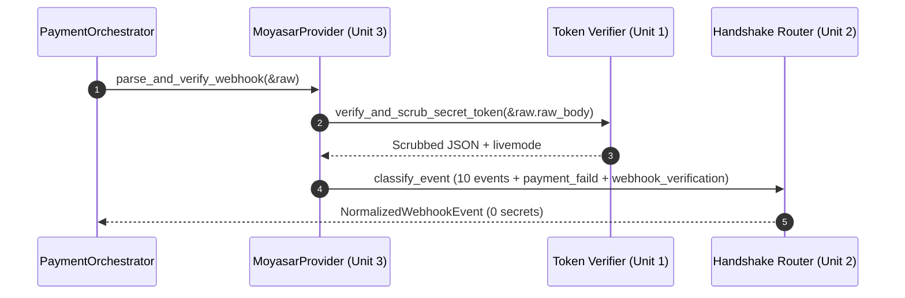

# User Story `US-9.2.0`: Constant-Time `secret_token` Webhook Verification/Scrubbing, Handshake & Optional `some-payment-adapter`

- **Module**: `module-9-some-payment-alignment` (`some-payment` Orchestrator Alignment & Optional Adapter)
- **Story Branch**: `feat/us-9.2.0-moyasar-webhook-scrubbing-and-adapter`
- **Field Profile**: `software`
- **Story Decomposition Score ($S_{\text{story}}$)**: `2.45` $\to$ **`4` Parallel Implementation Units (`unit-1..4`)**

---

## 1. Spec Kit Specifications

### 1.1 User Story Narrative
> **As a** `some-payment` orchestrator consumer using Moyasar,  
> **I want** constant-time `payload.secret_token` webhook verification with mandatory scrubbing, `webhook_verification` handshake helpers, `payment_faild` typo tolerance, and an optional `#[cfg(feature = "some-payment-adapter")]` `MoyasarProvider`,  
> **So that** Moyasar webhooks never leak `secret_token` into logs/storage and `some-moyasar` plugs into `some-payment` with accurate capability flags.

Aligns Moyasar webhook handling strictly with Moyasar's official November 2026 Webhook Reference (JSON body `secret_token`, no HTTP signature header) and implements `some_payment_core::PaymentProvider` behind `some-payment-adapter`.

#### 1.1.1 Preconditions
- `some-payment` Module 1 (`some-payment-core`) is available.
- `US-9.1.0` alignment is seeded/merged on `feat/module-9-some-payment-alignment`.

#### 1.1.2 Postconditions
- `payload.secret_token` is compared in constant time and scrubbed from `raw_redacted` before returning.
- `webhook_verification` populates `VerificationChallenge` (6-digit code, 30m TTL) with `verify_webhook` and `resend_verification` helpers.
- All 10 live `/v1/webhooks/available_events` plus `payment_faild` normalize cleanly.
- `MoyasarProvider` declares `NATIVE_CREATE_IDEMPOTENCY` true and `NATIVE_MUTATION_IDEMPOTENCY` false.

### 1.2 Acceptance Criteria (Gherkin Scenarios)
```gherkin
Feature: Moyasar secret_token Webhook Scrubbing & some-payment-adapter

  Scenario: AC-1 — Verify payload.secret_token in constant time and scrub raw_redacted
    Given a Moyasar JSON webhook body containing secret_token "wh_secret_123" and live: true
    When parse_and_verify_webhook runs
    Then it verifies in constant time, sets livemode = true, and removes "wh_secret_123" from raw_redacted

  Scenario: AC-2 — Handle webhook_verification handshake and payment_faild typo
    Given a webhook_verification event with 6-digit verification_code or a payment_faild event
    When parsed by MoyasarProvider
    Then webhook_verification populates VerificationChallenge and payment_faild normalizes to PaymentStatus::Failed

  Scenario: AC-3 — Optional some-payment-adapter implements PaymentProvider accurately
    Given feature "some-payment-adapter" enabled
    When MoyasarProvider::capabilities() is inspected
    Then NATIVE_CREATE_IDEMPOTENCY is true and NATIVE_MUTATION_IDEMPOTENCY is false
```

### 1.3 Test Cases & Traceability Matrix

| Test Case ID | Mapped AC | Owning Unit | Test Level | Description & Input Vector | Expected Result & Pass Threshold |
| :--- | :---: | :---: | :---: | :--- | :--- |
| `TC-9.2.1` | `AC-1` | `unit-1` | Security | Constant-time `secret_token` check (valid vs wrong) + `raw_redacted` canary scan | Wrong token rejected; canary secret absent from `raw_redacted` |
| `TC-9.2.2` | `AC-2` | `unit-2` | Unit | All 10 live events + `payment_faild` + `webhook_verification` handshake helpers | Static lookup table `CC <= 3`; challenge extracted |
| `TC-9.2.3` | `AC-3` | `unit-3` | Integration | `MoyasarProvider` implementing `PaymentProvider` behind `some-payment-adapter` | Compiles with and without `some-payment-adapter` |
| `TC-9.2.4` | `AC-3` | `unit-4` | Integration | Offline `wiremock` conformance tests for `MoyasarProvider` | Passes money, 201-failed, STC Pay OTP, webhook scrubbing, and capability tests |

---

## 2. Technical Implementation Plan

### 2.1 Domain Invariants & Storage Schema
- **Mandatory Secret Scrubbing**: `secret_token` MUST be removed from `raw_redacted` before returning `NormalizedWebhookEvent`.
- **Optional Feature Isolation**: `some-payment-core` is `optional = true` behind `some-payment-adapter`.

### 2.2 Sequence Diagram


---

## 3. Expected Folder Architecture at the Project

```text
src/
├── alignment/
│   ├── webhook_token_verifier.rs   # Owned exclusively by unit-1
│   └── webhook_handshake.rs        # Owned exclusively by unit-2
└── adapter/
    ├── moyasar_provider.rs         # Owned exclusively by unit-3
    └── conformance_tests.rs        # Owned exclusively by unit-4
```

---

## 4. Implementation Units in Detail & Specialist Agent Assignment

### 4.1 Story Decomposition Score ($S_{\text{story}}$) & Dynamic Unit Count ($K$)
- **$D_1$ (35% Surface)**: `3` — `secret_token` constant-time verifier + scrubbing, `webhook_verification` handshake + `payment_faild`, `MoyasarProvider` adapter, conformance tests
- **$D_2$ (25% Volume)**: `2` — ~500–650 production LOC
- **$D_3$ (20% Complexity)**: `3` — Constant-time JSON body token check (zero HTTP sig headers), mandatory secret scrubbing, 10 live events + typo tolerance
- **$D_4$ (20% Boundaries)**: `2` — 4 disjoint files under `src/alignment/` and `src/adapter/`
- **Calculated Score**: $S_{\text{story}} = 0.35(3) + 0.25(2) + 0.20(3) + 0.20(2) = \mathbf{2.45}$ $\to$ **`4` Parallel Units**

### 4.2 Detailed Unit Specifications (`unit-1..4`)
- **`unit-1` (`feat/us-9.2.0/unit-1-webhook-token-verifier`)**:
  - **Deliverable Scope**: Constant-time `payload.secret_token` verification, mandatory scrubbing from `raw_redacted`, and `payload.live` -> `livemode`
  - **Owned Files**: `src/alignment/webhook_token_verifier.rs`
  - **Public Contract / Exports**: `verify_and_scrub_moyasar_webhook`
  - **Unit Verification & Target Complexity**: Unit tests + doc-tests for `src/alignment/webhook_token_verifier.rs`, Max Cyclomatic Complexity $CC \le 6$ (cap $\le 10$, nesting $\le 2$)
- **`unit-2` (`feat/us-9.2.0/unit-2-webhook-handshake`)**:
  - **Deliverable Scope**: All 10 live events + `payment_faild` static lookup table + `webhook_verification` handshake (`verify_webhook`, `resend_verification`)
  - **Owned Files**: `src/alignment/webhook_handshake.rs`
  - **Public Contract / Exports**: `normalize_moyasar_event`, `verify_webhook`, `resend_verification`
  - **Unit Verification & Target Complexity**: Unit tests + doc-tests for `src/alignment/webhook_handshake.rs`, Max Cyclomatic Complexity $CC \le 6$ (cap $\le 10$, nesting $\le 2$)
- **`unit-3` (`feat/us-9.2.0/unit-3-moyasar-provider`)**:
  - **Deliverable Scope**: `#[cfg(feature = "some-payment-adapter")] pub struct MoyasarProvider` implementing `PaymentProvider`
  - **Owned Files**: `src/adapter/moyasar_provider.rs`
  - **Public Contract / Exports**: `MoyasarProvider`
  - **Unit Verification & Target Complexity**: Unit tests + doc-tests for `src/adapter/moyasar_provider.rs`, Max Cyclomatic Complexity $CC \le 6$ (cap $\le 10$, nesting $\le 2$)
- **`unit-4` (`feat/us-9.2.0/unit-4-moyasar-conformance`)**:
  - **Deliverable Scope**: Offline `wiremock` conformance suite for `MoyasarProvider`
  - **Owned Files**: `src/adapter/conformance_tests.rs`
  - **Public Contract / Exports**: Integration test suite
  - **Unit Verification & Target Complexity**: Unit tests + doc-tests for `src/adapter/conformance_tests.rs`, Max Cyclomatic Complexity $CC \le 6$ (cap $\le 10$, nesting $\le 2$)

### 4.3 Best-Fit Specialist Agents per Unit (`msitarzewski/agency-agents` + Core Roster)

| Unit ID | Branch Name | Primary Implementer Agent(s) (`agency-catalog`) | Reviewing Council Agent(s) | Mandatory Skills Enforced |
| :--- | :--- | :--- | :--- | :--- |
| `unit-1` | `feat/us-9.2.0/unit-1-webhook-token-verifier` | `security-engineer` | `code-reviewer`, `penetration-tester`, `test-automation-engineer` | `code-review-council`, `security-audit`, `cyclomatic-complexity` |
| `unit-2` | `feat/us-9.2.0/unit-2-webhook-handshake` | `api-platform-engineer` | `code-reviewer`, `security-architect`, `test-automation-engineer` | `code-review-council`, `security-audit`, `cyclomatic-complexity` |
| `unit-3` | `feat/us-9.2.0/unit-3-moyasar-provider` | `backend-architect` | `code-reviewer`, `application-security-engineer`, `test-automation-engineer` | `code-review-council`, `security-audit`, `cyclomatic-complexity` |
| `unit-4` | `feat/us-9.2.0/unit-4-moyasar-conformance` | `test-automation-engineer` | `code-reviewer`, `application-security-engineer`, `test-automation-engineer` | `code-review-council`, `security-audit`, `cyclomatic-complexity` |
| **Story Remediation** | `patch/us-9.2.0-fixes` | `patch-implementer` | `code-reviewer-council-president` | Full 6-Gate Re-Verification |

### 4.4 Parallel Execution & Zero-Blocking Contract Seeding Plan
1. **Base Contract Seeding**: Add optional `some-payment-core` dependency & `some-payment-adapter` feature in `Cargo.toml` on `feat/module-9-some-payment-alignment`.
2. **Simultaneous Worktree Spawning**: All 4 units are provisioned in `.worktrees/feat-us-9.2.0-moyasar-webhook-scrubbing-and-adapter-unit-1..4` and spawned simultaneously in Wave 2.
3. **Ordered Cascading Merge Sequence**: `unit-1` $\to$ `unit-2` $\to$ `unit-3` $\to$ `unit-4` into `feat/us-9.2.0-moyasar-webhook-scrubbing-and-adapter` via `gh pr merge <PR> --merge`.

---

## 5. Security Gateway (Powered by `security-audit` Skill)

### 5.1 Trust Boundaries & Security Actors
- **Security Actors**: Moyasar webhook servers and `some-payment` orchestrator.
- **Trust Boundaries**: JSON body `secret_token` verification and scrubbing boundary.

### 5.2 Threat Modeling & Abuse Matrix (STRIDE / OWASP ASVS)

| Threat ID | STRIDE Category | ASVS / CWE Ref | Attack Vector / Abuse Scenario | Impact | Required Mitigation & Code Control |
| :--- | :---: | :---: | :--- | :---: | :--- |
| `TM-1` | **S**poofing | ASVS V2 / CWE-345 | Forged webhook body with missing or wrong `secret_token` | Critical | Constant-time `subtle::ConstantTimeEq` check rejecting missing/mismatched token |
| `TM-2` | **T**ampering | ASVS V5 / CWE-20 | `payment_faild` typo event dropped or mishandled | High | Explicitly map both `payment_failed` and `payment_faild` to `Failed` |
| `TM-3` | **R**epudiation | ASVS V7 / CWE-778 | Test-mode webhook processed as live order fulfillment | Critical | Always propagate `payload.live` to `event.livemode` |
| `TM-4` | **I**nformation Disclosure | ASVS V8 / CWE-200 | Persisting or logging `payload.secret_token` in `raw_redacted` | Critical | Strip `secret_token` key from JSON before constructing `raw_redacted` |
| `TM-5` | **D**enial of Service | ASVS V11 / CWE-400 | Exhausting 5 wrong attempts on `webhook_verification` handshake | Medium | Validate 6-digit code format before calling `verify_webhook` |
| `TM-6` | **E**levation of Privilege | ASVS V4 / CWE-285 | Timing attack against `secret_token` string equality | High | Hash/pad or length-checked constant-time digest comparison |

### 5.3 Cryptography & Global Data Protection Controls (Worldwide Legal & Regulatory Compliance)
1. **Cryptographic Standards**: TLS 1.2/1.3+ in transit; constant-time comparison (`subtle::ConstantTimeEq`) for all HMAC digests and secret tokens; `SHA-256`/`SHA-512` only; zero hardcoded secrets or weak hashes (`MD5`/`SHA-1`).
2. **Global Multi-Jurisdictional Privacy & Legal Compliance**: Supports PCI-DSS v4.0 (zero raw PANs in logs/errors/server-side defaults), GDPR / UK GDPR, CCPA/CPRA, and regional MENA payment sovereignty (SA/EG/AE/OM/PK) via automatic `[REDACTED]` PII/secret scrubbing across UTF-8 logs and telemetry.

### 5.4 Automated Security Verification Checklist (`cloudflare/security-audit-skill`)
- [ ] Applicable `skills/security-audit/playbooks/` reviewed (`WEB-PROTOCOL-AND-AUTH.md`, `MEMORY-SAFETY-AND-BINARY.md`, `SUPPLY-CHAIN-AND-RELEASE.md`).
- [ ] All untrusted inputs validated for type, length, range, and encoding prior to domain processing.
- [ ] Zero secrets, API keys, private keys, or raw PII emitted in `Debug` formatting, logs, or error messages.
- [ ] Zero `unsafe` blocks and zero `f32`/`f64` floats for monetary calculations.

### 5.5 Security Gateway (Gate G2) Sign-Off Checklist
- [ ] **0 Critical / High / Medium** vulnerabilities in `security-audit` scan.
- [ ] All STRIDE / ASVS threat mitigations (`TM-1..TM-6`) implemented and covered by negative/security test cases in Section 1.3.
- [ ] Independent Security Reviewer agent sign-off posted to the GitHub PR conversation.

---

## 6. Validation Gates & Acceptance Sign-Off

| Gate | Gate Name | Pass Criteria for `US-9.2.0` | Verification Command / Evidence | Status |
| :--- | :--- | :--- | :--- | :---: |
| **Gate G0** | **Build, Lint & Format** | 0 errors, 0 warnings, 100% `rustfmt` compliance | `CARGO_BUILD_JOBS=1 cargo fmt --check && cargo clippy --all-features --all-targets -- -D warnings` | `[ ]` |
| **Gate G1** | **Tests, Coverage & Traceability** | 100% of `AC-*` and `TC-*` passing ($\ge 90\%$ line, $\ge 85\%$ branch coverage) | `CARGO_BUILD_JOBS=1 cargo test --no-default-features --features core && cargo test --features some-payment-adapter` | `[ ]` |
| **Gate G2** | **Security Gateway (`security-audit`)** | All Section 5 STRIDE, crypto, and global compliance checks pass (0 findings) | `security-audit` report on PR | `[ ]` |
| **Gate G-Complexity** | **Cyclomatic Complexity** | Every function $CC \le 6$ target ($CC \le 10$ ceiling, $CC > 15$ blocker, nesting $\le 2$) | `cyclomatic-complexity` table on PR | `[ ]` |
| **Gate G-Docs** | **Documentation & Doc-Tests** | 100% public symbols documented + runnable doc-tests pass | `CARGO_BUILD_JOBS=1 cargo test --doc --features some-payment-adapter` | `[ ]` |
| **Gate G-Review** | **Council President Sign-Off** | Independent Reviewing Council posts `GATE G-REVIEW APPROVED` on GitHub PR | `gh pr comment <PR>` | `[ ]` |

### Final Acceptance Sign-Off Block
- **Story Leader Verification**: All 4 units merged via cascading `gh pr merge`, story integration suite green, and zero unaddressed findings.
- **Reviewing Council Verdict**: `PENDING` $\to$ `GATE G-REVIEW APPROVED`
